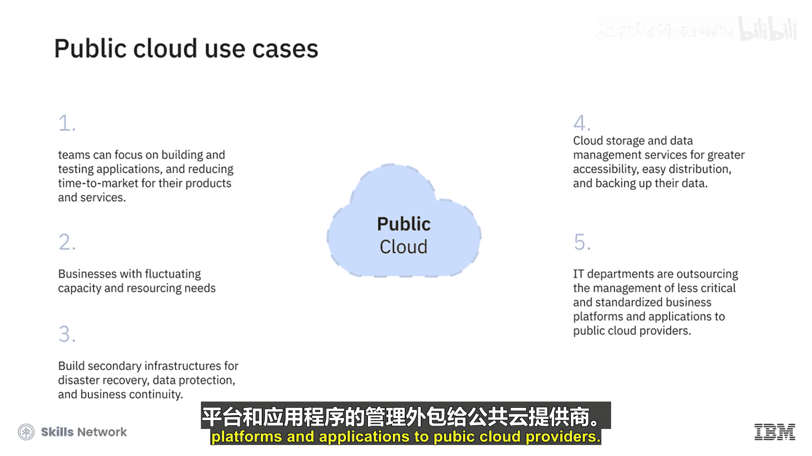
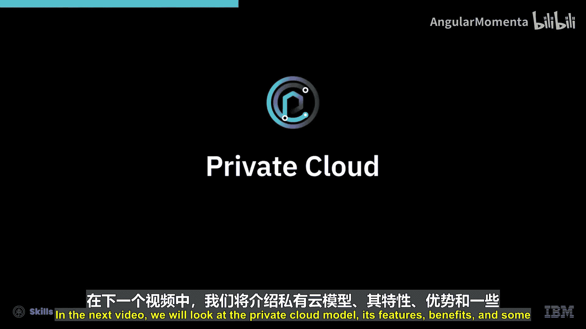

# 【IBM】云计算导论-｜-Introduction-to-Cloud-Computing-p17-02_02_01_公有云--BV1X66rBqE8G_p17-

In our introductory cloud video， we briefly mentioned the four deployment models for cloud in this video we will discuss the public cloud deployment model in more detail。

Deployment models indicate where the infrastructure resides， who owns and manages it。

 and how cloud resources and services are made available to users。

The four cloud deployment models include public cloud， private cloud。

 Community Cloud and hybrid cloud in a public cloud model， users get access to servers， storage。

 network， security， and applications as services delivered by cloud service providers over the internet。

Using web consoles and APIs， users can provision the resources and services they need。

The cloud provider owns， manages， provisions， and maintains the infrastructure。

 renting it out to customers either for a subscription charge or user based fee。

Users don't own the servers their applications run on or storage their data consumes。

 or manage the operations of the servers， or even determine how the platforms are maintained。

In very much the same way that we consume and pay for utilities such as water。

 electricity or gas in our everyday lives。We don't own any of these cloud resources。

 We make an agreement with the service provider， use the resources and pay for what we use within a certain period。

 public clouds offer significant cost savings in terms of total cost for ownership TCO as the provider bears all the capital operational and maintenance expenses for the infrastructure and the facilities they are hosted in it makes scalability as easy as requesting more capacity however。

 with the public cloud， the user does not have any control over the computing environment and is subject to the performance and security of the cloud provider' infrastructure。

There are several public cloud providers in the market today， such as Amazon Web Services。

 Microsoft Azure， IBM Cloud， Google Cloud Platform， and Alibaba Cloud。

While all providers include a common set of core services， such as servers， storage， network。

 security， and databases， they also offer a wide spectrum of niche services with varied payment options。

Let's talk about some of the characteristics of a public cloud。

 a public cloud is a virtualized multitenant architecture enabling tenants or users to share computing resources。

 residing outside their firewalls。The cloud providers's pool of resources， including infrastructure。

 platforms， and software， are not dedicated for use by a single tenant or organization。

Resources are distributed on an as needed basis offered through a variety of subscription and pay as you go models。

 public clouds have significant benefits we'll go over some of these benefits here。

Vast on demand resources are available， allowing applications to respond seamlessly to fluctuations in demand。

Considering the large number of users that share the centralized cloud resources on demand。

 the public cloud offers the most significant economies of scale。

 the sheer number of server and network resources available on the public cloud means that a public cloud is highly available if one physical component fails。

 the service still runs unaffected on the remaining available components。

It's also important to note some concerns users have regarding public clouds key among them being security and data sovereignty compliance。

 security issues such as data breaches， data loss， account hijacking。

 insufficient due diligence and system and application vulnerability seem to be some of the fears users continue to have concerning security in the public cloud with data being stored in different locations。

 and access across national borders， it has also become increasingly critical for companies to be compliant with data sovereignty regulations governing the storage。

 transfer， and security of data。A service provider's ability to not just keep up with the regulations。

 but also the interpretation of these regulations is a concern shared by many businesses。

Let's look at some common use cases for public cloud organizations are increasingly opting to access cloud-based applications and platforms so their teams can focus on building and testing applications and reducing time to market for their products and services。

 businesses with fluctuating capacity and resourcing needs are opting for the public cloud organizations are using public cloud computing resources to build secondary infrastructures for disaster recovery。

 data protection and business continuity。More and more organizations are using cloud storage and data management services for greater accessibility。

 easy distribution， and backing up their data。IT departments are outsourcing the management of less critical and standardized business platforms and applications to public cloud providers。

In the next video， we will look at the private cloud model， its features， benefits。

 and some use cases。

