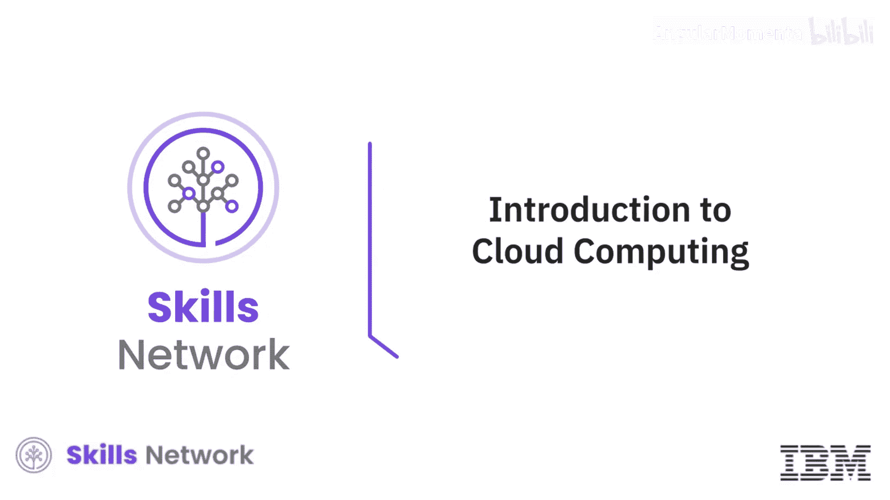
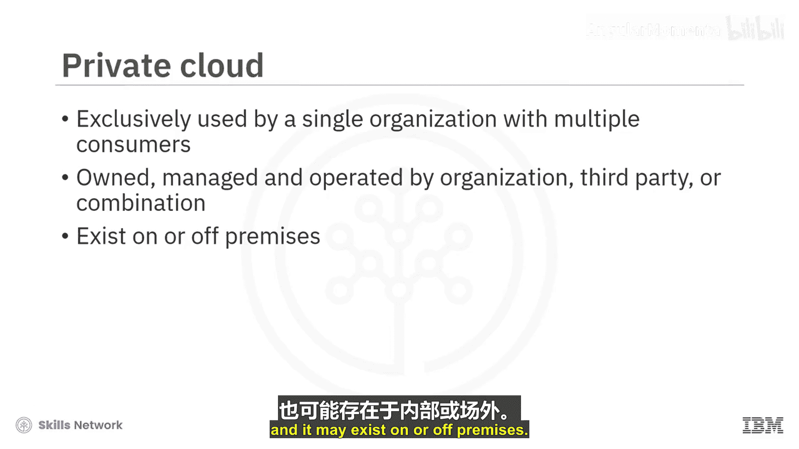
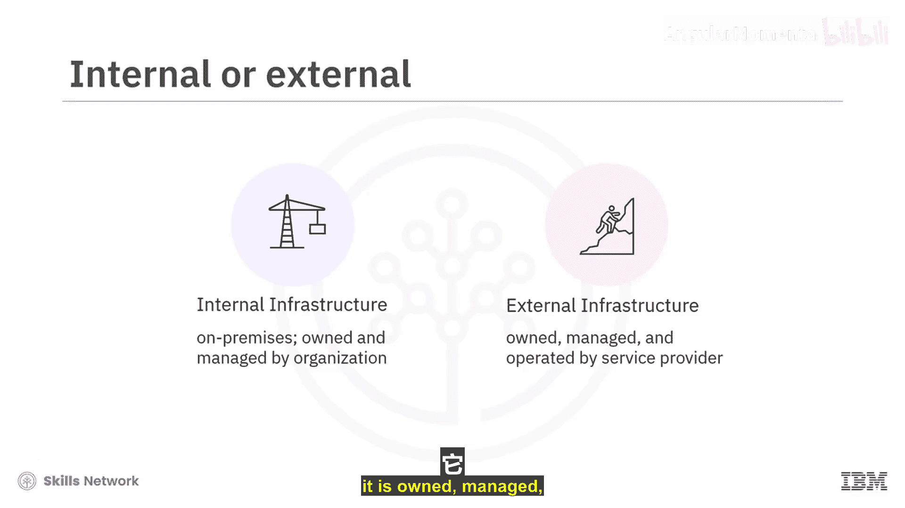
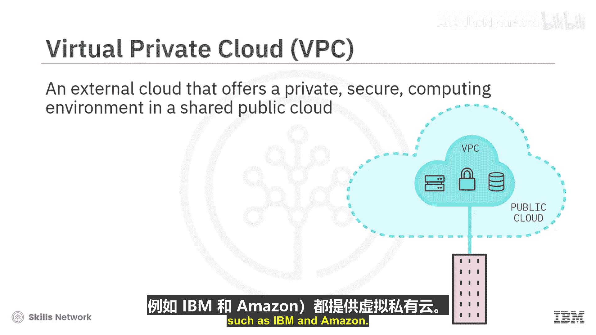
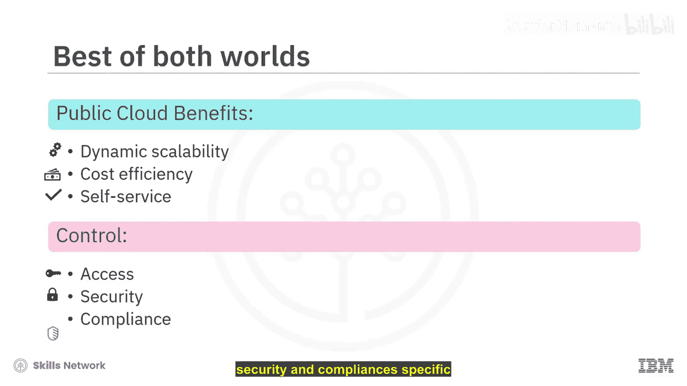
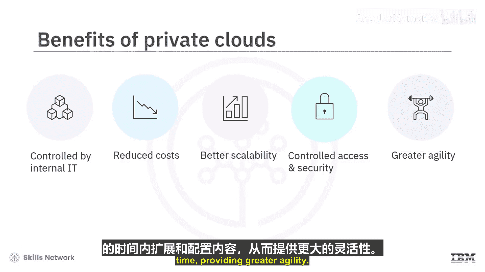
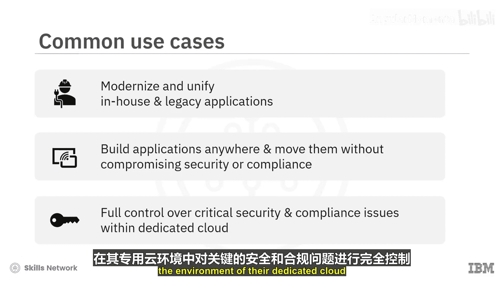

# 【IBM】云计算导论-｜-Introduction-to-Cloud-Computing-p18-02_02_02_私有云--BV1X66rBqE8G_p18-

嗯。

The National Institute of Standards and Technology defines private Cloud as cloud infrastructure provisioned for exclusive use by a single organization comprising multiple consumers such as the business units within the organization it may be owned。

 managed and operated by the organization a thirdpart or some combination of them。

 and it may exist on or offpres private cloud platforms can be implemented internally or externally when the platform is provisioned over an organization's internal infrastructure it runs on premises and is owned。

 managed and operated by the organization when it is provisioned over a cloud provider' infrastructure。

 it is owned managed and operated by the service provider this external private cloud offering that resides on a cloud service provider infrastructure is called a virtual private cloud or VPC a VPC is a public cloud offering that lets an organization established。

Its own private and secure cloudlike computing environment in a logically isolated part of a shared public cloud using a VPC organizations can leverage the dynamic scalability。

 high availability and lower cost of ownership of a public cloud while having the infrastructure and security tailored to the organization unique needs Vi private clouds are offered by most public cloud providers such as IBM and Amazon a private cloud is a virtualized environment model to bring in the benefits of a public cloud platform without the perceived disadvantages of an open and shared public platform Use of a private cloud such as developers and business units in an organization still get to leverage benefits such as economies of scale granular scale。

 operational efficiencies and user self-serv while exercising full control over access security and compliances specific to their organization。

And business private clouds provide you with one the ability to leverage the value of cloud computing using systems that are directly managed or under perceived control of the organizations internal IT2 the ability to better utilize internal computing resources such as the organization's existing investments in hardware and software。

 thereby reducing costs3 better scalability through virtualization and cloud bursting that is leveraging public cloud instances for a period of time but returning to the private cloud when the surge is met4 controlled access and greater security measures customized to specific organizational needs5 the ability to expand and provision things in a relatively short amount of time providing greater agility organizations may choose to opt for private cloud because of various reasons because their applications provide a unique competitive advantage。

 there are security and regulatory concerns。

because their data is highly sensitive and subject to strict industry or governmental regulations Let's look at some common use cases for a private cloud One。

 a private cloud is an opportunity for organizations to modernize and unify their in-house and legacy applications moving these applications from their dedicated hardware to the cloud also allows them to leverage the power of the compute resources and multiple services available on the cloud2 using the private cloud organizations are integrating data and application services from their existing applications with public cloud services This allows them to leverage their private cloud compute capability for the larger jobs while pulling data into an application on a private cloud to leverage public cloud servicesEssential opening their data centers to work with cloud services3 application portability is a key feature of cloud platforms using the private。

Cloud gives organizations the ability to build applications anywhere and move them anywhere without having to compromise security and compliance in the process4。

 some of the key reasons that may prevent an organization from moving to a public cloud includes security and regulatory concerns and data sensitivity a private cloud offers these organizations。

 the benefits of on-ded enterprise resources while exercising full control over critical security and compliance issues from within the environment of their dedicated cloud。

