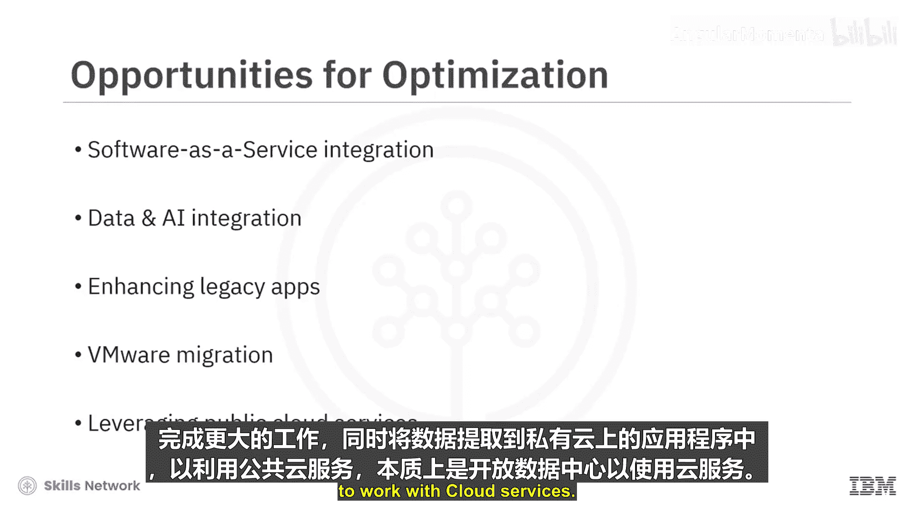
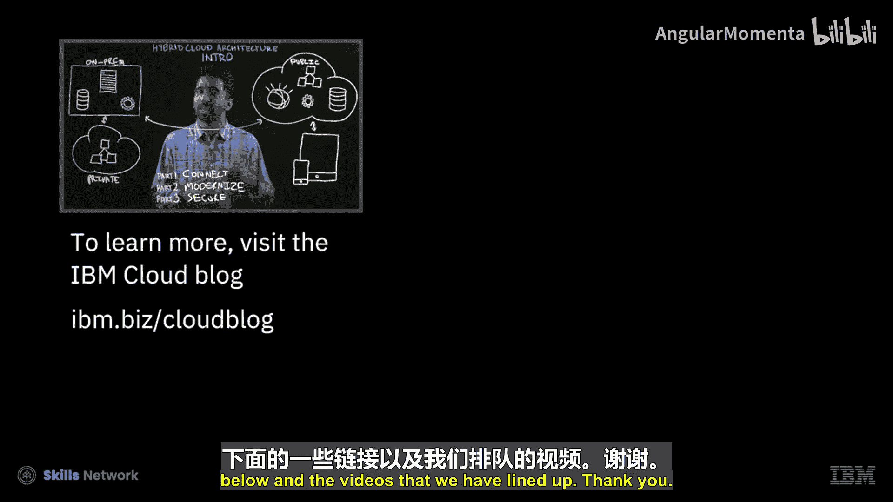
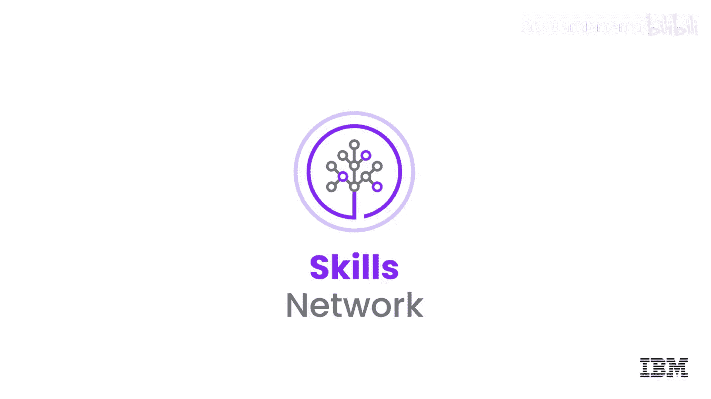

# 【IBM】云计算导论-｜-Introduction-to-Cloud-Computing-p19-02_02_03_混合云--BV1X66rBqE8G_p19-

Hybrid Cloud is a computing environment that connects an organization's on premise private cloud and third party public cloud into a single flexible infrastructure for running the organization's applications and workloads。

The mix of public and private cloud resources gives organizations the flexibility to choose the optimal cloud for each application or workload。

Workloads move freely between the two clouds as needs change organizations can choose to run the sensitive。

 highly regulated and mission critical applications or workloads with reasonably constant performance and capacity requirements on private cloud infrastructure while deploying the less sensitive and more dynamic workloads on the public cloud。

With proper integration and orchestration between the public and private clouds。

 you can leverage both clouds for the same workload， for example。

 you can leverage public cloud instances for a period of time。

 but return to the private cloud when the search is met， also known as cloud bursting。

The key tenets of a hybrid cloud are interoperability， scalability， and portability。

 hybrid cloud is interoperable， which means that the public and private cloud services can understand each other's API's configuration。

 data formats， and forms of authentication and authorization。When there's a spike in demand。

 a workload running on the private cloud can leverage the additional public cloud capacity。

 making it scalable。A hybrid cloud is also portable。

 since you're no longer locked in with a specific vendor。

 you can move applications and data not just between on premise and cloud systems。

 but also between cloud service providers。Hybrid is about taking the best of both worlds。

There are two common types of hybrid clouds， hybrid monocloud and hybrid multicloud。

 a hybrid monocloud is a hybrid cloud with one cloud provider。

 while a hybrid multicloud is an open standards based stack that can be deployed on any public cloud infrastructure。

The difference lies in the flexibility that the hybrid multicloud offers organizations to move workloads and environments from one vendor to another。

There is also a variant of hybrid multicloud called the composite MultiCud。

 which makes this flexibility even more granular as it distributes single applications across multiple providers。

 allowing you to move application components across cloud services and vendors as needed。

Hybrid Cloud offers significant benefits in areas of security and compliance。

 scalability and resilience， resource optimization， and cost saving。

A hybrid cloud lets organizations deploy highly regulated or sensitive workloads in a private cloud while running the less sensitive workloads on a public cloud。

Using a hybrid cloud， you can scale up quickly， inexpensively。

 and even automatically using the public cloud infrastructure。

 all without impacting the other workloads running on your private cloud。

Because you are not locked in with a specific vendor and also don't have to make either or decisions between the different cloud models。

 you can make the most cost efficient use of your infrastructure budget。

 you can maintain workloads where they are most efficient。

 spin up environments using pay as you go in the public cloud。

 and rapidly adopt new tools as you need them。However。

 hybrid clouds are complex and challenging to deploy and maintain since they involve synchronization。

 redirection， latency， security， portability， interoperability， and compatibility of policies。

 applications and data， and so on。A typical organization will have a range of applications and workloads spread across private。

 public， and traditional IT environments。This represents a range of opportunities for optimization via a hybrid cloud approach。

Let's look at some increasingly common hybrid cloud use cases。Software as a service integration。

Through hybrid integration， organizations are connecting software as a service applications available in the public cloud to their existing public cloud。

 private cloud， and traditional IT applications to deliver new solutions。Data and AI integration。

Organizations today are creating richer and more personal experiences by combining new data sources on the public cloud。

 such as weather， social， the Internet of Things， CRM and ERRP， with existing data and analytics。

 machine learning and AI capabilities。Enhancing legacy apps。

An increasing number of organizations are using public cloud services to upgrade the user experience of their on premises applications and deploy them globally to new devices while incrementally modernizing their core business systems。

VM where migration。More and more organizations are lifting and shifting their on premises virtualized workloads to a public cloud without conversion or modification to reduce their on premisems data center footprint and position themselves to scale without added capital expense。

Leveraging public cloud services using the private cloud。

 organizations are integrating data and application services from their existing applications with public cloud services。

 this allows them to leverage their private cloud's compute capability for the larger jobs while pulling data into an application on a private cloud to leverage public cloud services。

 essentially opening their data centers to work with cloud services。

Hi everyone， my name is S Venham and I'm a developer advocate with IBN Today I'm excited to introduce a three- part video series on hybrid cloud architectures。

 Hyclo is a concept that's been around for quite some time。

 but we're finding that it's becoming increasingly used to architect and modernize existing or legacy applications。

According to research， we found that 75% of non cloud applications will be moving to the cloud in the next three years。

This goes to say that if you're not already thinking about your hybrid cloud strategy。

 you may be falling behind。If you want to learn more about the basics of hybrid Cloud。

 check out my hybrid Cloud Explain video where I cover the basic concepts of all hybrid cloud architectures。

In this three part series， I want to dive deeper and hit on key concepts that make up a hybrid cloud architecture。

And to do that， we're going to start with part one of this video series which is going to be connect。

Connectivity and interoperability are。Core concepts of hybrid cloud architectures。

 You can imagine that you have existing applications that may be running on prem。

Working with maybe a private cloud。And you can also imagine you'd be taking advantage of public cloud as well。

And you have services that are running across all of these environments。

 we need a way to securely connect them to one another。So taking advantage of solutions。

 open source solutions that we have， things like Linux based containers， Kubernetes， Istio。

 as well as multicluster management tools， message cos， brokers， you know the list is endless。

 but there's a lot of solutions out there when used properly help you hit that connectivity that you need with hybrid cloud architectures。

In part two， we want to talk about modernization， so we'll be switching gears a little bit here。

Can imagine that with existing applications that you may have。

 you might have a monolithic application that you want to break apart and move to a public cloud and that might allow you to take better advantage of scaling that public environments offer that's a very simple use case and one of many when it comes to modernizing your applications in part two I'm going to hit on strategies to modernize those legacy applications which is a core part of hybrid cloud architectures。

In part three， we want to talk about security。We're finding that every year you're hearing about a different data breach and we're hearing about privacy regulations that are becoming increasingly more strict being imposed on companies。

The fact is moving to Hycloud might scare some folks。

 but we have the right solutions to ensure that you can take advantage of your existing on-prem assets。

 the security and the ease of use that you have there while securely moving some of your assets to a public or even a private cloud。

 this allows you to kind of have the comfort of taking advantage of all the resources you have on public cloud while still maintaining the security that's required of your architectures。

I believe that this three-part series is going to help tackle the three major issues that you may have when architecting your hybridcloud applications As always。

 we're always checking for your comments and your feedback and if you have any other topics that you'd like us to cover in lightboarding videos please let us know below be sure to subscribe and stay tuned for future videos in this series and if you want to get started on your hybridclo architecture journey right now。

 go ahead and check out some of the links that we have below and the videos that we have lined up Thank you。

