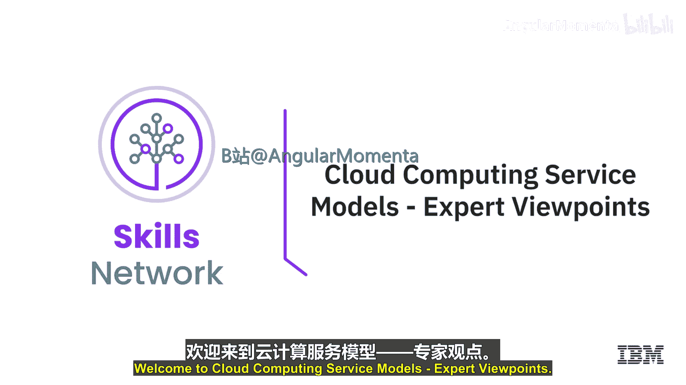
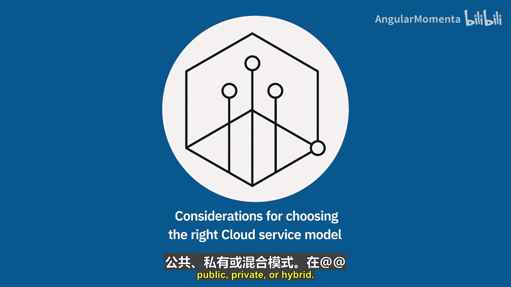
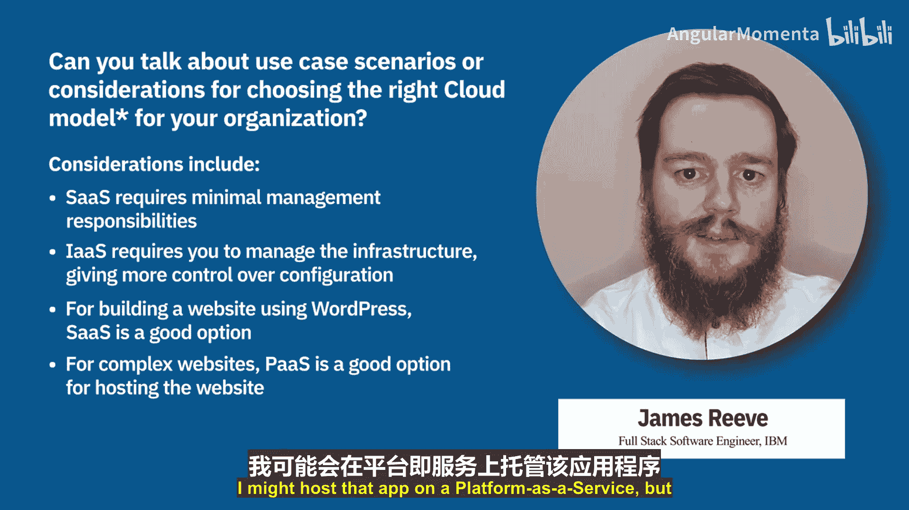

# 【IBM】云计算导论-｜-Introduction-to-Cloud-Computing-p20-02_02_04_专家观点：云计算服务与部署模式--BV1X66rBqE8G_p20-

Welcome to Cloud computinguting service Models， expertert viewpoints。😊。

In this video， we will listen to several cloud experts discuss the choice and adoption of different cloud models。

Can you talk about use case scenarios or considerations for choosing the right cloud model for your organization？

Model， as in las， Saas or pass or public， private or hybrid。

ButWhen choosing a cloud model for your organization。You want to consider。

Where is your organization at in the cloud journey。

 So if they have a lease that's about to expire at the data center， then。

They might not have time to rewrite the application to be cloud native。

 they might just have time to take the application exactly as it is on the virtual machines in the data center and move them on to virtual machines in the cloud and that's called infrastructure as a service if you have more time you could consider replatforming and that means putting it on a platform as a service such as。

Containers or a service that。Operates the。Operating system for you patches the operating system for you。

 and all you have to do is install extra dependencies yourself。

 or if you want to move really fast and you have a brand new product that you're just starting to write。

Why not start with the latest approach， which is functions as a service。

 use serverless functions and you can move really fast because you don't have to manage any underlying infrastructure the security of the operating system is。

Handled for you by the cloud provider。Generally my answer is to stay as high on the stack as you can to meet your business requirements。

You know SAS applications provide the business value with little or no technology resource investment beyond the subscriptions。

 so if that works that's great platform is a service as I mentioned allows developers to focus on building and deploying new applications without having to grapple with the details of cloud infrastructure and if in a lot of cases that will save money and investment and allow you to focus on building your products more quickly in time to market。

Infrastructure as a service though is the right answer when you need control。

 specific control of all the compute and network resources to achieve your business goals。

 so in many cases that'll make sense too。While choosing the right cloud model organizations should consider what are their business needs。

 the level of control that they would like to have and the cost if your business needs an out of the box software like email CRM event management tool etc。

 then choose software as a service， it will offer access from anywhere and any device。

 automatic software updates， lower cost and easy adoptions。

 you will need a vendor to manage the software。If you require a platform for building products。

 then choose Pla as a service it is perfect choice for software development companies as it provides developers with reduced development time。

 different programming language support， easy collaboration with teams and reduces the cost。

If your business simply needs a virtual machine， then enough for infrastructure as a service。

 scenarios for using infrastructure as a service can be hosting a website。

 virtual data centers or performing data analysis。Infrastructure as a service is more expensive than SAS or PAS and all issues related to virtual machine management is business' responsibility。

 however it is more reliable and secure as data is kept at designated data centers。

As you move down the layers of abstraction from software as a service all the way to infrastructure as a service。

 the tradeoff is that you take on more management responsibilities yourself with the advantage of having more control over how your resources are configured。

I'll typically only take that trade off when I have to， so let's say I'm building a website。

 I'll typically default to a software as a service option， let's say WordPress。

But then maybe it turns out the website I'm building is somewhat complicated and I want it to be a react app。

 I might host that app on a platform as a service。

But then let's suppose I have a requirement that my app needs to run in an operating system that is not supported by the platform as a service at that point I'll have to just provision some VMs myself and figure out how to run it myself。

