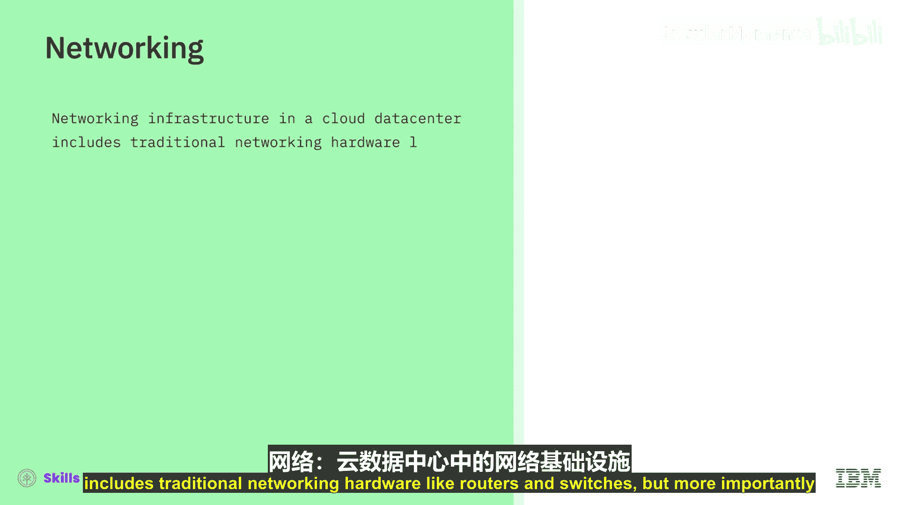
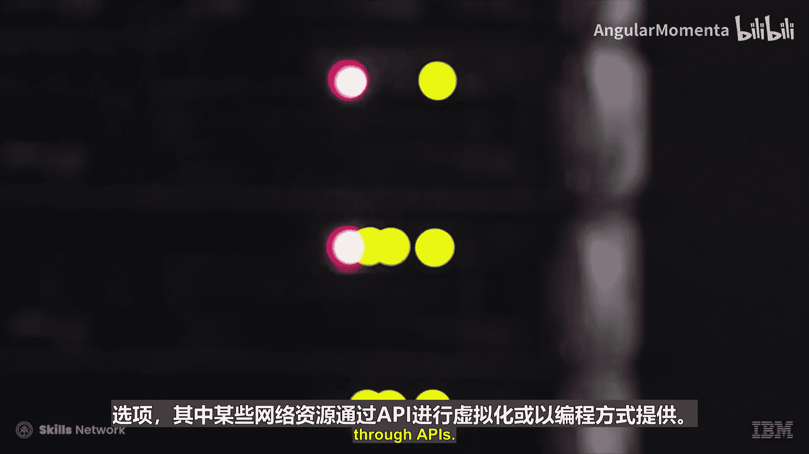
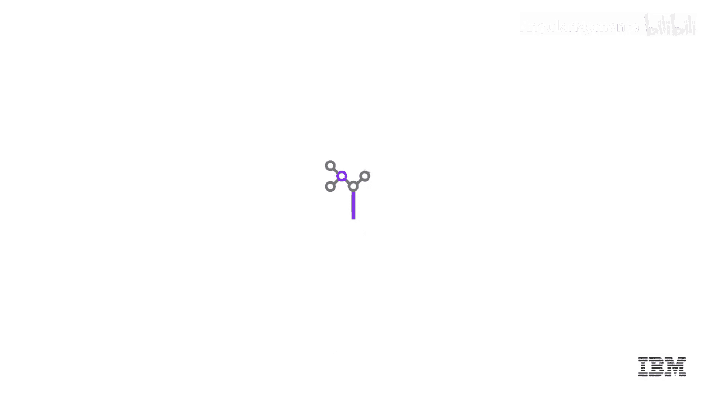

# 【IBM】云计算导论-｜-Introduction-to-Cloud-Computing-p21-03_01_01_云基础设施概述--BV1X66rBqE8G_p21-

After choosing the cloud service model and the cloud type offered by vendors。

 customers need to plan the infrastructure architecture。

 the infrastructure layer is the foundation of the cloud。

This layer consists of physical resources that are housed in regions， zones， and data centers。

A cloud provider's IT environment is typically distributed across many regions around the world。

A cloud region is a geographic area or location where a cloud provider's infrastructure is clustered and may have names like in a south or US East。

 the cloud regions are isolated from each other so that if one region was impacted by a natural disaster like an earthquake。

 the cloud operations in other regions would keep running。

 each cloud region can have multiple zones or availability zones or AZ for short。

 which are typically distinct data centers with their own power， cooling and networking resources。

 these zones can have names like DAL09 or US East1。

The isolation of zones improves the cloud's overall fault tolerance， decreases latency。

 and avoids creating a single shared point of failure。

 the availability zones and data centers within them are connected to other AZs and regions。

 private data centers， and the internet， using very high bandwidth network connectivity。

A cloud data center is a huge room or a warehouse containing cloud infrastructure。

These data centers contain pods and racks， or standardized containers of computing resources such as servers。

 as well as storage and networking equipment， virtually everything that a physical IT environment has。

 computing resources。Cloud providers offer several compute options， virtual servers。

 bare metalal servers， and serverless computing resources。

 most of the servers in a cloud data center run hypervisions to create virtual servers or virtual machines。

 also called VMs for short， that are software based computers based on virtualization technologies。

Other servers in the racks are bare metal servers that are physical servers that aren't virtualized。

Customers can provision VMs and bare metal servers as and when they need them and run their workloads on them。

Cloud users can also run their workloads on serverless computing resources。

 which are an abstraction layer on top of virtual machines。

We will talk about all three compute options in greater detail in subsequent videos Stage information and data can consist of files。

 code， documents， images， videos， backups， snapshots， and databases。

 and can be stored in many different types of storage options on the cloud。

 bare metal servers and virtual servers are provisioned with default storage and local drives。

Networking networkworking infrastructure in a cloud data center includes traditional networking hardware like routers and switches。

 but more importantly for users of the cloud and cloud providers have software defined networking or SDN options。

 where certain networking resources are virtualized or made available programmatically through APIs。

This allows for easier network provisioning， configuration， and management in the cloud。

When servers in the cloud are provisioned， you need to set up their public and private network interfaces。

The public network interfaces， as the name suggests， connect the servers to the public internet。

 whereas the private ones provide connectivity to your other cloud resources and help keep them secure。

As in the physical IT world， network interfaces in the cloud need to have IP addresses and subnets either assigned automatically or configured。

In a cloud environment， it is even more important to configure which network traffic and users can access your resources。

 which can be done by setting up security groups and access control lists or ACLs。

For further security and isolation of your resources in the cloud。

 most cloud providers provide virtual local area networks， VLs， virtual private clouds， VPCs。

 and virtual private networks， VPNs。Some of the traditional hardware appliances such as buywalls。

 load balancers， gateways， and traffic analyzers can also be virtualized and made available as services in the cloud another network capability provided by the cloud providers is content delivery networks or CDNs that distribute content to multiple points throughout the world so users accessing the content can access it more quickly by getting it from a point nearest to them。

We will learn more about some of these cloud networking options and terminology in subsequent videos Cloud infrastructure is constantly advancing and improving in the next video we explain virtualization and virtual machines。

😊。

