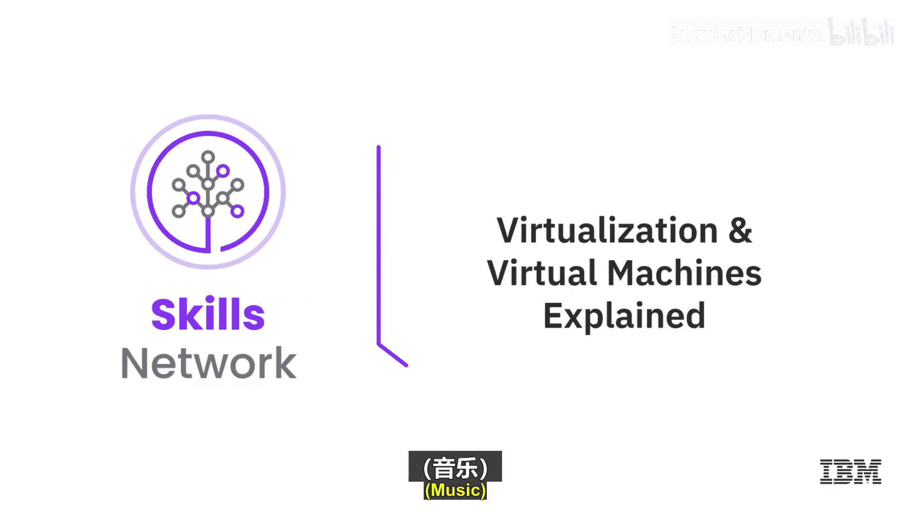
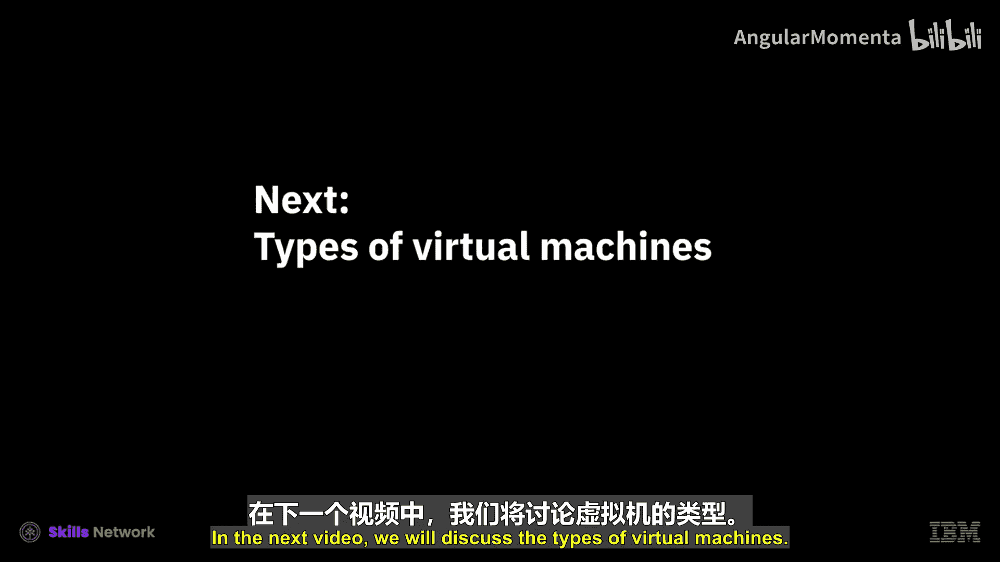

# 【IBM】云计算导论-｜-Introduction-to-Cloud-Computing-p22-03_01_02_虚拟化与虚拟机详解--BV1X66rBqE8G_p22-

Hi， my name is Kae Bvie with the IBM Cloud team and today we're going to be talking about virtualization As you know。

 virtualization is a fairly old technology， but it's still super relevant to building our cloud computing strategy today。

So first off， what is virtualization simply put virtualization is the process of creating a softwareer based or virtual version of something。

 whether that be compute， storage， networking， servers or applications。

And what makes virtualization feasible is something called the hypervisor。

So we're going to write that here。And what a hypervisor is。

 is it simply a piece of software that runs above the physical server or host。

There are a couple different types of hypervisors out there and what they do is essentially pull the resources from the physical server and allocate them to your virtual environments There are two main types of hypervisors out there one being type1。

Very simple to remember。And two， you guessed it， type two。So let's start with type1。

A typey1 hypervisor。Is a hypervisor that is installed directly on top of the physical server。

They're also called bare metal hypervisors， so we'll write that up here just so you can remember。

These are the most frequently type of used hypervisors and they're most secure。

 they lower the latency and these are the ones that you'll see in the market the most。

 some examples would be VMware ESXI or Microsoft hyperperV or even open source KVM。

The other type of hypervisor is a typey2 hypervisor over here。

And what makes these different is that there is a layer of host OS that sits between the physical server and the hypervisor。

So， by that nature， they are also killed， hosted。These are a lot less frequent。

 they're mostly used for end user virtualization and you might see some in the market that are called like Oracle Viual box or VMware workstation again they're a lot less frequent they're a bit more they have a higher latency than a typey1 hypervisor。

So once you have your hypervisor installed， you can build virtual environments or virtual machines。

 or simply put VMs。So let's spin up some environments。So what makes a VM a VM， a VM is simply。

A software based computer， they run like a physical computer。

 they have an operating system and applications， and they're completely independent of one another。

 but you can run multiple of them on a hypervisor and the hypervisor manages the resources that are allocated to these virtual environments from the physical server。

So。Because they're independent， you can run different operating systems on different virtual machines。

 so you could run Windows here or Linux here。Are you next here？For example。

And because they're independent， they're also extremely portable。

 you can move a virtual machine from one hypervisor to another hypervisor on a completely different machine。

 almost instantaneously， which gives you a lot of flexibility and a lot of portability within your environment。

So looking at all of this。This is the core of virtualization as a process。

So let's talk about a couple key benefits that you want to take away from this。1。Cost savings。

When you think about this and the fact that you can run multiple virtual environments from one piece of infrastructure means that you can drastically reduce your physical infrastructure footprint。

 this is consolidation at its core and the fact that you don't have to maintain nearly as many servers。

 run as much electricity， save on maintenance costs means that you save on your bottom line at the end of the day。

Number two would be agility and speed。So like I said。

 spinning up a virtual machine is relatively easy and quick。

 a lot more simple than provisioning an entire new environment for your developers if they say they want to spin up a new environment so that they can run a depth test scenario。

 whatever it might be， virtualization makes that process a lot simpler and quicker。And three。

Lowers your downtime。So let's say that this host goes out unexpectedly。

The fact that you can move virtual machines from one hypervisor to another on a different physical server means that you have a great backup plan in place right。

 so if this host goes down， you can simply move your VMs very quickly to another hypervisor on a machine that was working。

Virtualization and VMs are at the center of cloud computing and provide many benefits in the next video we will discuss the types of virtual machines。

