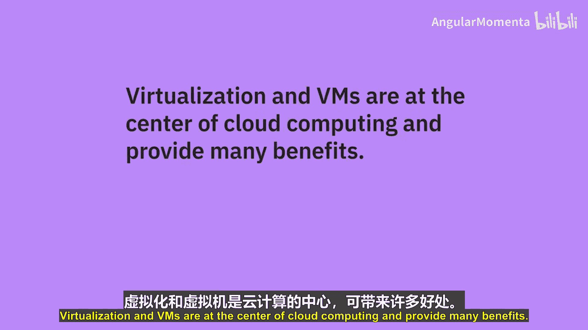
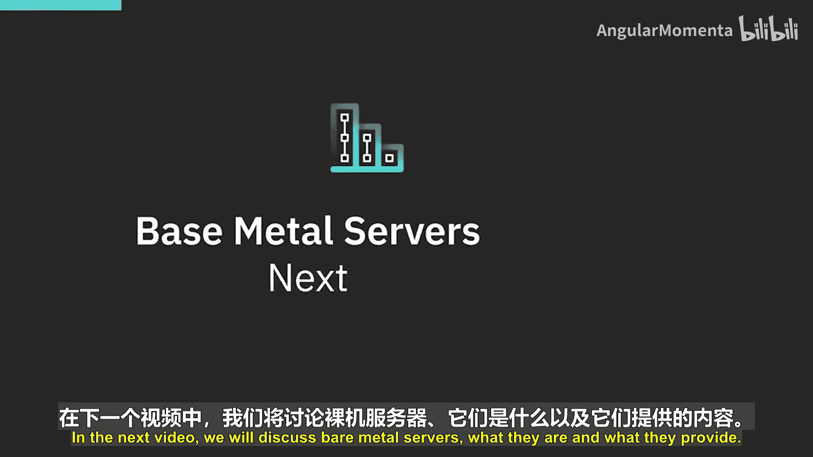

# 【IBM】云计算导论-｜-Introduction-to-Cloud-Computing-p23-03_01_03_虚拟机类型--BV1X66rBqE8G_p23-

Virtual machines or VMs are also known as virtual servers or virtual instances。

 or simply instances depending on the cloud provider。

The various cloud providers make VMs available in a variety of configurations and deployment options to serve different use cases。

When you create a virtual server in the cloud， you specify the region and Z or data center you want the server to be provisioned in and the operating system you want on it。

You can choose between shared that is a multiten VMs or dedicated that is a single tenant VMs you can also choose between hourly or monthly billing and select storage and networking options for the virtual server。

Now let's look at a few different types of VMs that can be provisioned in the cloud。

Shared or public cloud VMs are provider managed multi tenantant deployments that can be provisioned on demand with predefined sizes。

Being multiten means that the underlying physical server is virtualized and is shared across other tenants or users to satisfy different workloads。

 cloud providers offer predefined sizes and configurations。

 ranging from a single virtual core and a small amount of RAM to multiple virtual cores and much larger amounts of RAM。

For example， there can be configurations for compute intensive workloads， memory intensive workloads。

 or high performance IO。Rather than pick from only predefined sizes。

 some providers also offer custom configurations that allow users to define the number of cores and RA and local storage characteristics。

Public VMs are usually priced by the hour， or in some cases。

 even seconds and configurations start as low as pennies per hour。

 some providers also let you get monthly VMs， which can result in some cost savings if you know you will run the VM for at least a month。

 but if you decide to decommission the VM in the middle of the month。

 you will still be charged for the full month。Transient or S VMs take advantage of unused capacity in a cloud data center Cloud providers make this unused capacity available to users at a much lower cost than regular VMs of similar sizes。

 although the transient VMs are available at a huge discount。

 the cloud provider can choose to deprivision them at any time and reclaim the resources for provisioning regular higher pricericd VMs。

Because you run the risk of losing these VMs when capacity in the data center decreases。

 these VMs are great for non-production workloads such as testing and developing applications。

 they are also useful for running stateless workloads， testing scalability。

 or running big data and high performance computing workloads at a low cost。

Reserved virtual server instances allow you to reserve capacity and guarantee resources for future deployments。

You reserve desired amount of virtual server capacity。

 provision instances from that capacity when you need them and choose a term such as one year or three years for your reserved capacity you're guaranteed this capacity within the data center of your choice for the life of the contract term。

By committing to a longer term， you can also lower your costs compared to hourly or monthly instances。

This can be useful when you know you require at least a certain level of cloud capacity for a specific duration If you exceed your reserved capacity。

 you can always choose to supplement your unplanned usage and capacity requirements with hourly or monthly VMs Note however。

 that not all predefined VM families or configurations may be available as reserved。

Dedicated hosts offer single tenant isolation This means that only your VMs run on a given host so they can make exclusive use of full capacity and resources of the underlying hardware。

When provisioning a dedicated host， you need to specify the data center and pod in which you want your host placed。

 you then assign instances or virtual machines to a specific host。

This allows for maximum control over workload placement。

Dedicated hosts are typically used for meeting compliance and regulatory requirements or meet specific licensing terms。

Virtualization and VMs are at the center of cloud computing and provide many benefits in the next video we will discuss bare metal servers what they are and what they provide。

