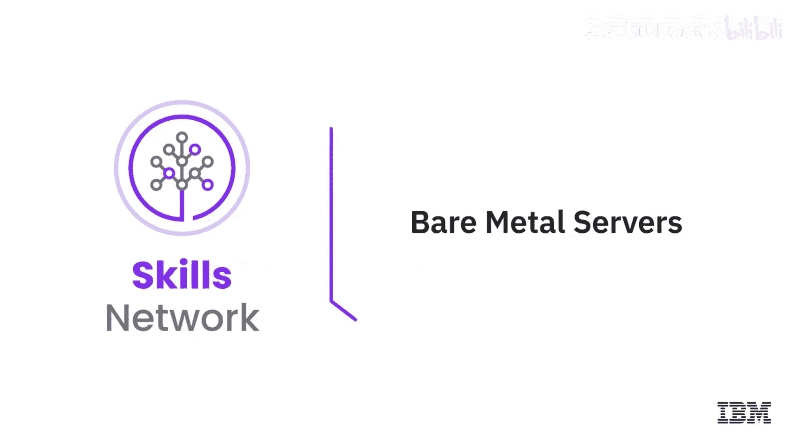
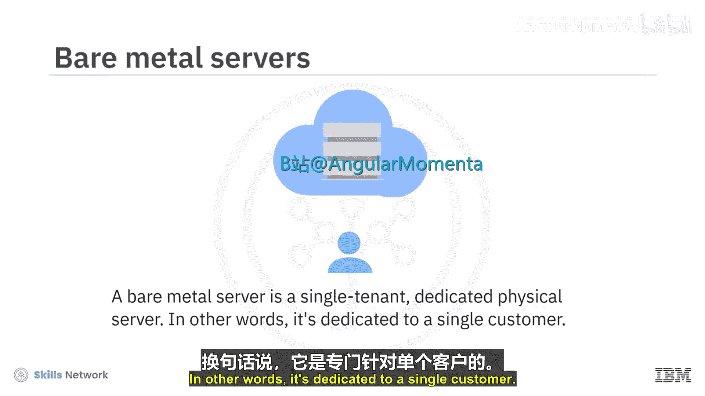
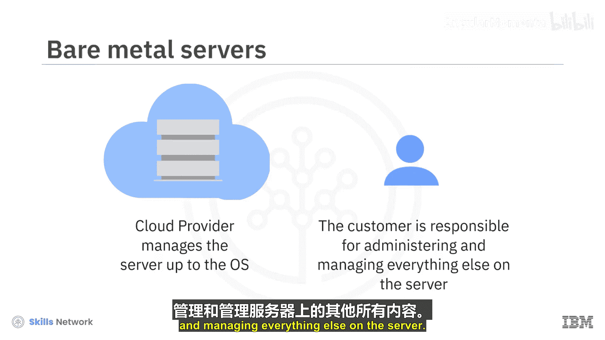
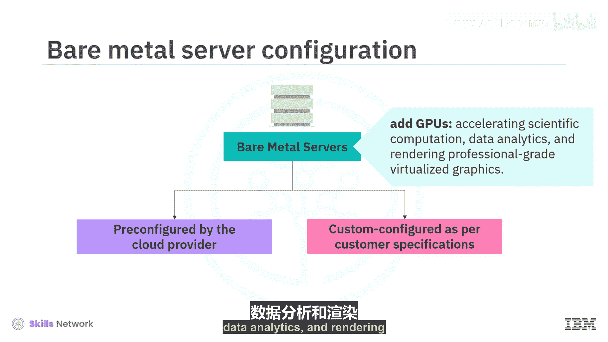
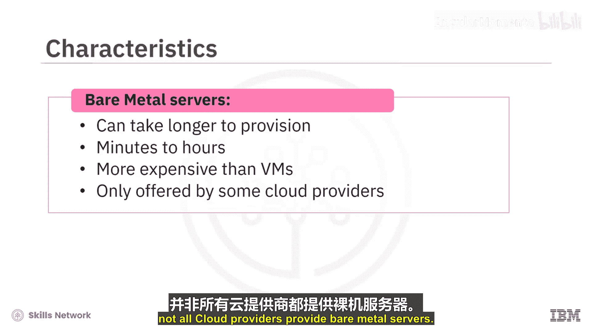
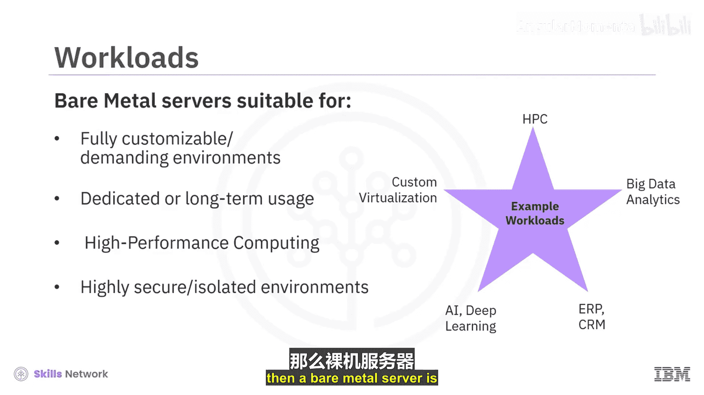
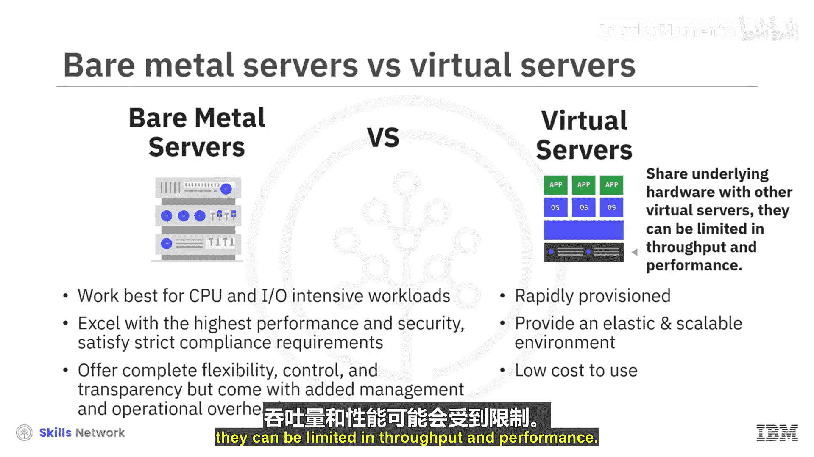

# 【IBM】云计算导论-｜-Introduction-to-Cloud-Computing-p24-03_01_04_裸机服务器--BV1X66rBqE8G_p24-

A bare metal server is a single tenant dedicated physical server。 In other words。

 it's dedicated to a single customer。 The cloud provider actually takes the physical server and plugs it into a rack in a data center for customers。

 the cloud provider manages the server up to the operating system or OS。

 which means if anything goes wrong with the hardware or rack connection。

 They will fix or replace it and then reboot the server。

 The customer is responsible for administering and managing everything else on the server。😊。

Baear metal servers are either preconfigured by the cloud provider to meet workload packages or they can be custom configurered as per customer specifications。

 This includes the processors RA hard drives specialized components and the OS Custom can also install their own OS and can install certain hypervisors that aren't available from the cloud provider and thus create their own virtual machines and farms with bare metal servers。

 you can also add GPUs which are designed for accelerating scientific computation data analytics and rendering professional grade virtualized graphics because bare metal servers are physical machines。

 they take longer to provision than virtual servers。

 Preconfigured builds of bare metal can take 20 to 40 minutes to provision and custom builds can take around three or four hours。

 but these provisioning times can vary by cloud provider。😊。

As bare metal servers are dedicated for use by a single client at any given time。

 they tend to be more expensive than similarly sized virtual machines。

Also note that unlike virtual servers， not all cloud providers provide bare metal servers。

 Since bare metal servers are fully customizable， they can do what a customer wants in the most demanding environments。

 bare metal servers are dedicated and intended for long term highper use in highly secure and isolated environments。

 clients have full access and control of bare metal servers because theres no hypervisor required as there is no sharing underlying server hardware with other customers。

 bare metal servers fulfill the demanding needs of high performance computing or HPC and data intense applications that require minimal latency related delays。

 these servers also excel in big data analytics applications and GPU intensive solutions Some workload examples that bare metal servers satisfy are ERRP CRM。

 AI， deep learning and virtual。

。If you use any applications that require high degrees of security control or apps that you' typically run in an on-prems environment。

 then a bare metalal server is a good alternative in the cloud。

 when comparing bare metal servers to virtual servers。

 some of the most important considerations are found in customer need。

 bare metal servers work best for CPU and IO intensive workloads。

 Excelel with highest performance and security， satisfies strict compliance requirements。

 and offer complete flexibility， control and transparency。

 but come with added management and operational overhead。

 whereas virtual servers are rapidly provisioned， provide in elastic and scalable environment and are low costs to use。

 however， since they share underlying hardware with other virtual servers。

 they can be limited in throughput and performance。

