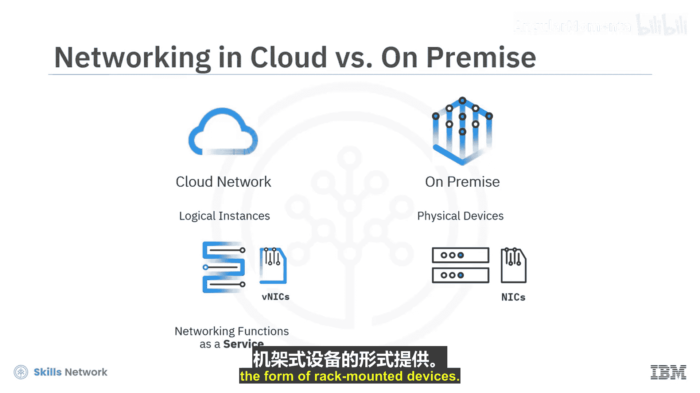
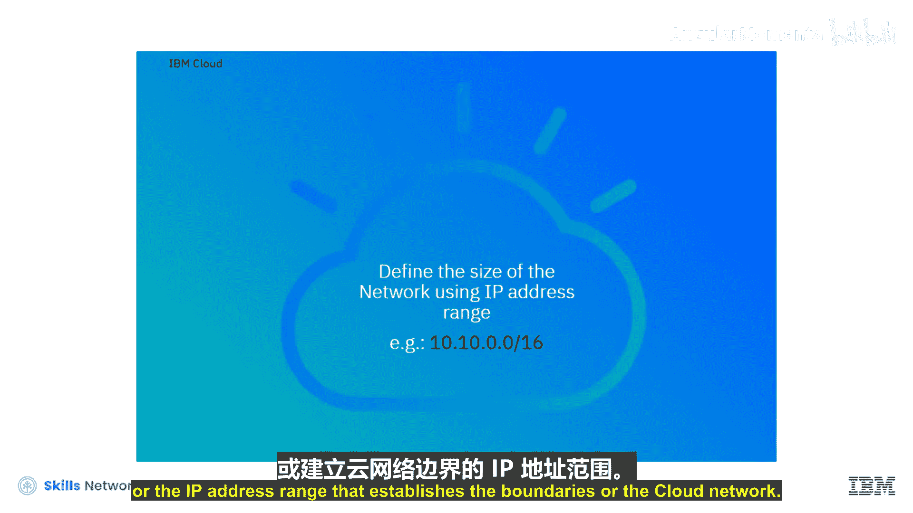
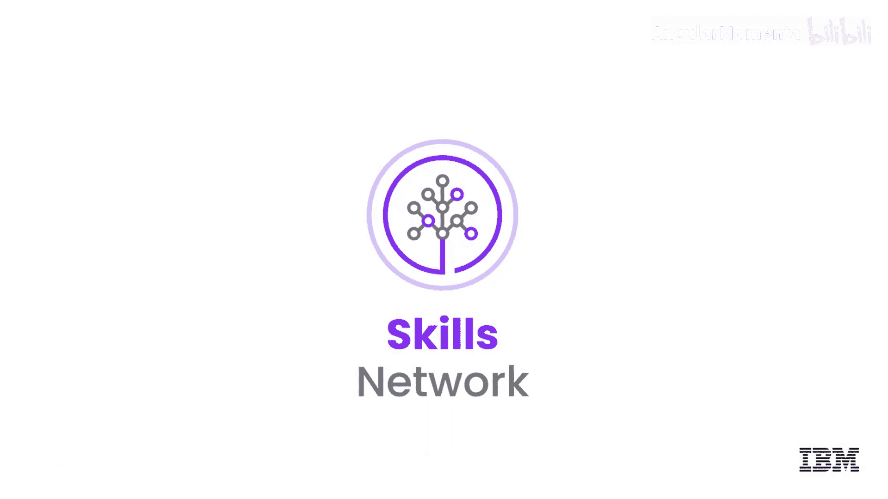

# 【IBM】云计算导论-｜-Introduction-to-Cloud-Computing-p25-03_01_05_云端安全网络--BV1X66rBqE8G_p25-

As cloud environments gain greater adoption and digital data invites rapidly increasing cyber securitycurity threats。

 building secure networks on the cloud is crucial let's look at how we can build a secure cloud networking presence As one might expect the notion of building a cloud network is not much different from deploying a network in an on-preesis data center the main different stems from the fact that in the cloud we use logical instances of networking elements as opposed to physical devices For example。

 network interface controllers or NIX would be represented by V in cloud environments In the cloud networking functions are delivered as a service rather than in the form of rackmounted devices to create a network in the cloud one starts by defining the size of the network or the IP address range that establishes the boundaries or the cloud network Cloud networks are deployed in networking spaces that are logically separate。

Segments of the networks using options， including virtual private cloud or VPC that in turn can be divided into smaller segments called subnets Loly segmented cloud networks are private carve out of the cloud that offer customers the security of private clouds and the scalability of public clouds Cloud resources such as VMs or virtual server instances。

 VSIs， storage network connectivity and load balancers are deployed into subnets using subnets allows users to deploy enterprise applications using the same multi-ter concepts used in on-pres environments Subnets are also the main area where security is implemented in the cloud Every subnet is protected by access control lists or ACLs that serve as a subnet levelve firewall Within the subnet one could create security groups that provide security at the instance level。

Such as VSIs。Once you build a subnet， then it is time to add some VSIs and storage to it so that you could run your applications。

 let's say you have a three tier application that requires web access VSIs。

 application tier VSIs and backend database VSIs In this case。

 we would place the webfacing VSIs into one security group。

 the application VSIs in a second security group， while the database VSIs in a third security group。

It goes without saying that the web facing VSIs need internet access。

 a public gateway instance is added to the network to enable users access to the application in the internet tier。

While public gateways are great for internet access to the cloud。

 enterprises are interested in extending their own on- premisems resources to the cloud by securely connecting them using virtual private networks or VPNs when building many subnets and deploying several workloads it becomes necessary to ensure that applications continue to be responsive that is achieved with load balancers that ensure availability of bandwidth for the different applications Enterprises with hybrid cloud environment find using dedicated high-spe connections between clouds and on-premise resources is a more secured and more efficient way than public connectivity solutions Some cloud service providers offer such connectivity such as IBM Cloud and its directlink solutions that enables extending on- premisems resources to the cloud as needed building a cloud network entails creating a set of logical constructs that deliver networking functionality that is。

K to the data center networks that all IT professionals have come to rely on for securing their environments and ensuring high performing business applications。

