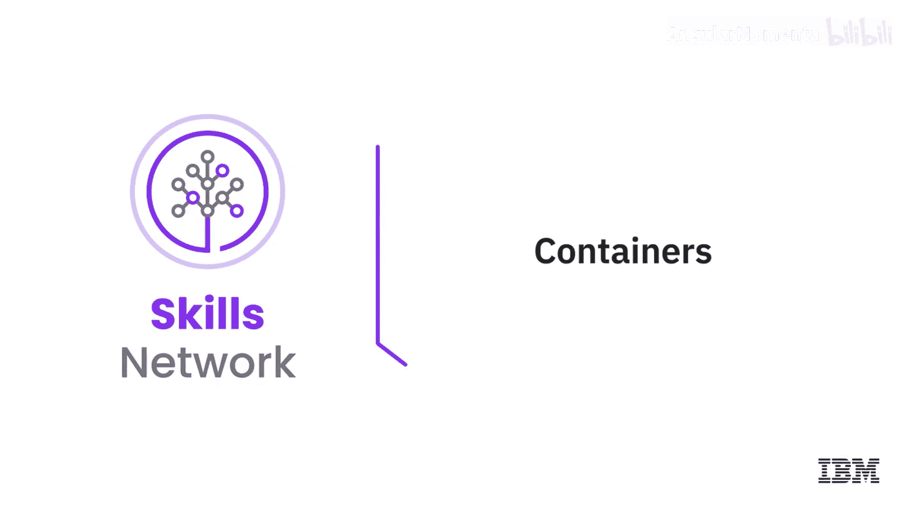
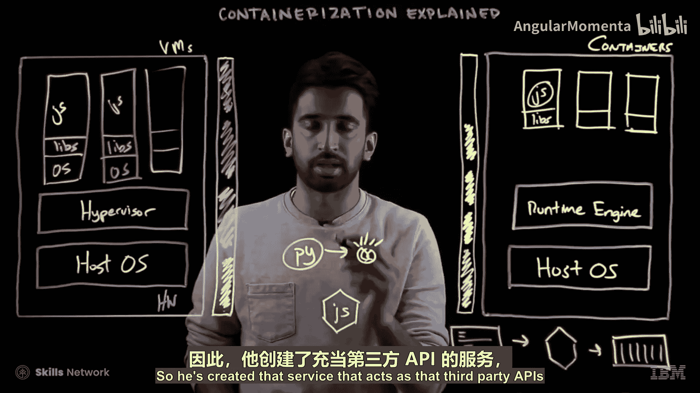
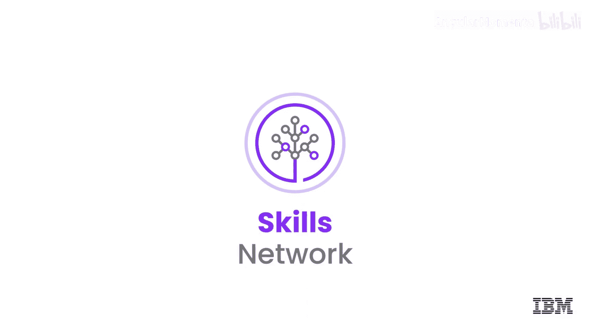

# 【IBM】云计算导论-｜-Introduction-to-Cloud-Computing-p26-03_01_06_容器--BV1X66rBqE8G_p26-

Containers are an executable unit of software in which application code is packaged。

 along with its libraries and dependencies in common ways so that it can be run anywhere。

 whether it be on desktop， traditional IT， or the cloud。Containers are small， fast， and portable。

 and unlike virtual machines， they do not need to include a guest OS in every instance and can instead simply leverage the features and resources of the host OS。

In the rest of this video， we will see how container based technology really works。Hi everyone。

 my name is Sa venham and I'm a developer advocate with IBM Today。

 I want to talk about containerization Whenever I mention containers。

 most people tend to default to something like Docker or even Kubernetes these days。

 but container technology has actually been around for quite some time It's actually back in 2008 that D Linux kernelnel introduced C groups or control groups that basically paved the way for all of the different container technologies we see today。

 so that includes Docker but also things like Cloud Foundry as well as rocket and other container runtimes out there。

😊，Let's get started with an example and we'll say that I'm a developer and I've created a node JS application。

And I want to push it into production。 We'll take two different form factors to kind of explain the advantages of containerization。

 So let's say that first we'll talk about VMs and then we'll talk about containers。

So first things first， let's introduce some of the things that we've got here。

 so we've got the hardware itself， just the big box。

We've got the guest or rather the host operating system。As well as a hypervisor。

 the hypervisor is actually what allows us to spin up VMs。

Already we let's take a look at this shared pool of resources with the host OS and hypervisor。

 we can assume。That some of these resources have already been consumed。Next。

 let's go ahead and take this JS application and push it in， and to do that I need a Linux VM。

So let's go ahead and sketch out that Linux game。And in this VM， there's a few things to note here。

 so we've got another operating system in addition to the host OSs is going to be the guest OS。

As well as some binaries and libraries so that's one of the things about Linux VMs that even though we're working with a really lightweight application to create that Linux VM。

 we have to put that guest OSOS in there in a set of binaries and libraries and so that really blos it out in fact you know I think the smallest node GSVM that I've seen out there is 400 plus megabytes whereas the nodeGS runtime and app itself would be under 15 so we've got that and we go ahead and let's push that JS application into it and just by doing that alone we're going to consume a set of resources。

Next， let's think about scaling this out， right， so we'll create two additional copies of it。

And you'll notice that even though it's the exact same application。

 we have to use and deploy that separate guest Os and libraries every time。

 and so we'll do that three times。And by doing that。

 essentially we can assume that for this particular hardware。We've consumed all of the resources。

And there's another thing that I haven't mentioned here， but this JS application。

 I developed it on my MacBook， so when I pushed it into production to get it going on the VM。

 I noticed that there were some issues and incompatibilities this is the kind of foundation of this big heset sheet issue where things might be working on your local machine and work great but when you try to push it into production things start to break and this really gets in the way of doing agile DevOs and continuous integration and delivery。

That's solved when you use something like containers there's a three step process when kind of doing anything container related and pushing or creating containers。

 and it almost always starts with first some sort of a manifest。😊。

So something that describes the container itself。So in the Docker world。

 this would be something like a Docker file and Cloud foundry this would be a manifest jamm。

Next what you'll do is create the actual image itself。So for the image， you know， again。

 if you're working with something like Docker， that could be something， no be a Docker image。

 if you're working with a rocket， it would be an ACI or application container image。

 you know so regardless of the different containerization technologies。

 this process stays the same and the last thing you end up with is an actual container itself you know that contains all of the run times and libraries and binaries needed to run an application。

That application runs on a very similar setup to the VMs， but what we've got on this side is， again。

 a host operating system。The difference here， instead of a hypervisor。

 we're going to have something like a runtime engine。 So if you're using。Docker。

 this would be the Docker engine。And， you know， different different containerization technologies would have a different engine regardless。

 it's something that runs those containers again， we've got the shared pool of resources so we can assume that that alone consumes some set of resources。

Next， let's think about actually containerizing this technology so we talked about the three step process。

 we create some， you know a Docker file， we build out the image。

 we push it to a registry and we have our container and we can start pushing this out as containers。

 The great thing is these are going to be much more lightweight。😊，So。

Deploying out multiple containers。Since you don't have to worry about a guest OS this time。

reallyally just have the libraries， as well as the。The application itself。

 So weve scaled that out three times。 And because we don't have to duplicate all of those operating system dependencies and create bloated Vms。

 we actually will use less resources。 So chooses a different color here。And。

Scaling that out three times。We still have a good amount of resources left。Next。

 let's say that my coworker decides， hey， for this JS application。

 let's take advantage of a third party， you know， let's say a cognitive API to do something like image recognition。

 So， you know， let's say that we've got our。Third party service。

 and we want to access that using maybe a Python application。

So he's created that service that accesses that third party APIs， and with our node JS application。

 we want to access that Python app to then access that service。

If we wanted to do this in VMs， I'm really tempted to basically create a VM out of both the JS application and the Python application because essentially that would allow me to continue to use the VMs that I have but that's not truly cloud native right because if I wanted to scale out the JS but not the Python app。

 I wouldn't be able to if they were running in the same VM。

 so to do it in a truly cloud nativeative way essentially I would have to free up some of these resources basically get rid of one of these VMs and then deploy the Python application in it instead。

 and that's not ideal。But with a container based approach， what we can do is simply say。

 since we're modulars， we can say， okay， just deploy。One copy。Of the Python application。

So we'll go ahead and do that， here's a different color here。

And that consumes a little bit more resources and then you know with those those remaining resources。

 the great thing about container technology， that actually becomes shared between all the processes running In fact。

 another advantage if if these container processes aren't actually utilizing the CPU or memory。

All of those shared resources become accessible for the other containers running within that hardware。

So with containerbased technology， we can truly take advantage of cloud native based architectures。

 so we talked about things like portability of the containers。

 we talked about how it's easier to scale them out。

 and then overall with this kind of three step process and the way we push containers。

 it allows for more agile DevOs and continuous integration and delivery。

Containers streamline development and deployment of cloud native applications。In the next lesson。

 we will cover cloud storage。

