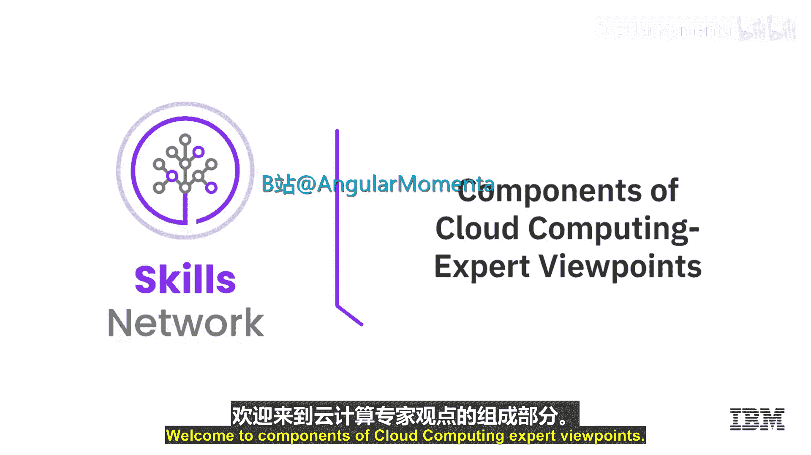
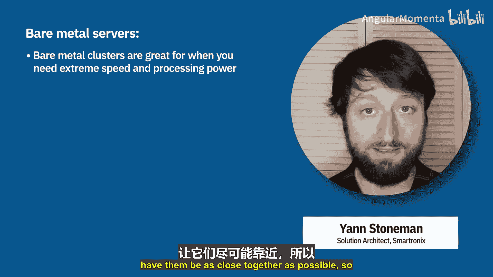
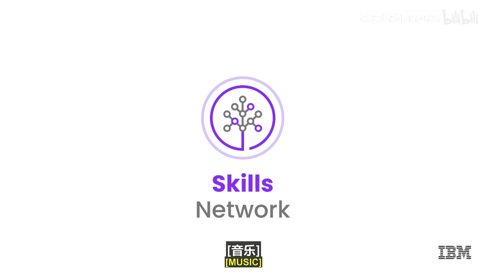

# 【IBM】云计算导论-｜-Introduction-to-Cloud-Computing-p27-03_01_07_专家观点-云计算组件--BV1X66rBqE8G_p27-

Welcome to components of cloud computing expert viewpoints。 In this video。

 we will listen to several cloud application professionals discuss some of the factors considered in deciding between computing resources in the cloud。

😊。

For example， a bare metal server versus a virtual server versus containers。

Virtual servers are basically running a different OS inside of another operating system。

 like an example would be running Windows on top of Linux。And as such。

 they contain their own complete OS， so VMs look and act very much like physical servers and because they contain the whole OS。

 they're typically gigabytes in size quite large VMs are far less portable because of their dependence on the operating system。

 the application and library versions。So that's a consideration with virtual machines。

When it comes to deciding between containers， virtual servers， and bare metal servers。

 I'm almost always drawn to containers to start because of their scalability and their cost efficiency。

However， that doesn't mean they're always the best option。For example。

 you might not be able to tolerate your containers running on the same VM as another customers for security reasons and in that case you might decide to provision your own virtual server。

Or perhaps you just consistently need the best performance possible and you don't want to deal with the hypervisor tax or noisy neighbor effects。

 and in that case you'll go with bare metal。Containers are based on a Linux based shared image that can be shared across environments。

 dev QA in production， and this is one very big advantage of containers it's also possible to spin up containers very fast milliseconds instead of seconds for virtual machines they're lightweight。

 typically megabytes in size， and the key technologies here are Docker Kubernetes and openshift for container orchestration and some of the compelling use cases here are where workloads can be broken into you know the smallest serviceable units here you could think about microservices for example。

 and this is you perhaps a foundational technology for what's referred to as cloud native architecture。

If you want to have something that doesn't cost as much and only runs when needed。

 that's a perfect use case for serverless functions because。On some cloud providers。

 they only charge you as little as by the millisecond of usage。Serveless functions。

Help you not use any time on work like patching the operating system。

And if you want to be cloud agnostic， meaning you want to have a hybrid cloud setup， meaning。

Be on different cloud providers at the same time， then containers can be a really good choice because Docker runs the same anywhere。

So in the past few years I've actually seen containers come quite a long way。

 especially in the enterprise space， with Kubernetes and Openshift and other things。

 quite frankly containers can run almost any workload you might want to throw at it。

 there are some exceptions， sometimes you need a special video card in a bare metal machine or need to access you know kernel level settings and the like which you can't in a container。

 but for the most part， I would say you're going to use containers or serverless。

 unless you have a specific need not to。Baear metal servers are。

Basically a single tenant dedicated hardware server。

You could this is our legacy hardware approach advantages you can optimize the server according to the specific needs for performance security and reliability。

 the disadvantages， however， are limits on on demand scalability that the hardware has a fixed capacity。

And flat monthly pricing for bare metal servers， use cases。

 there are use cases where bare metal servers make sense。

 some of these might be things requiring very high performance。

 think about gaming or real time analytics。Or situations where regulatory or compliance requirements dictate a dedicated compute environment。

Or applications that use steady and continuous compute resources。

If you need extreme speed and a lot of processing power。

 let's say you're iterating over a design for a supersonic jet and you need to model how it would act in a wind tunnel and you need to do that 500 times that's a whole lot of data to a process and you want to use the most powerful machines in a cluster。

And have them be as close together as possible， so that's bare metal machines。

。

