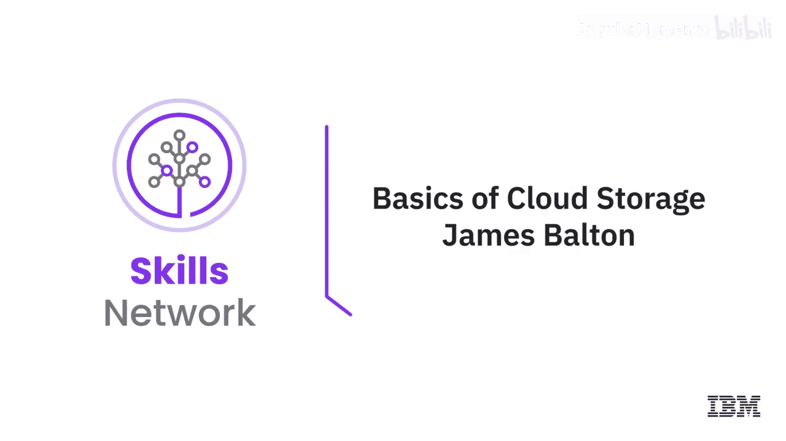
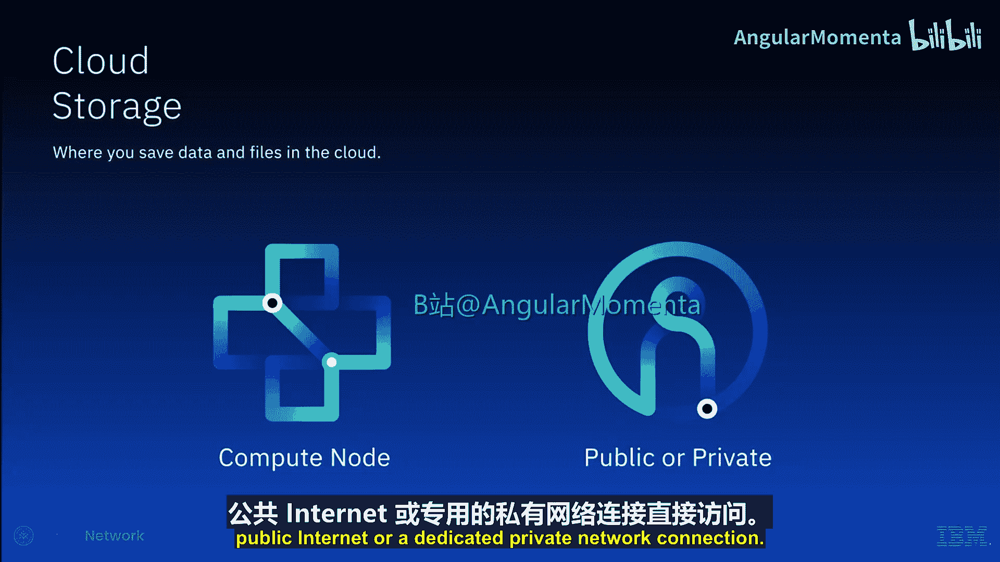
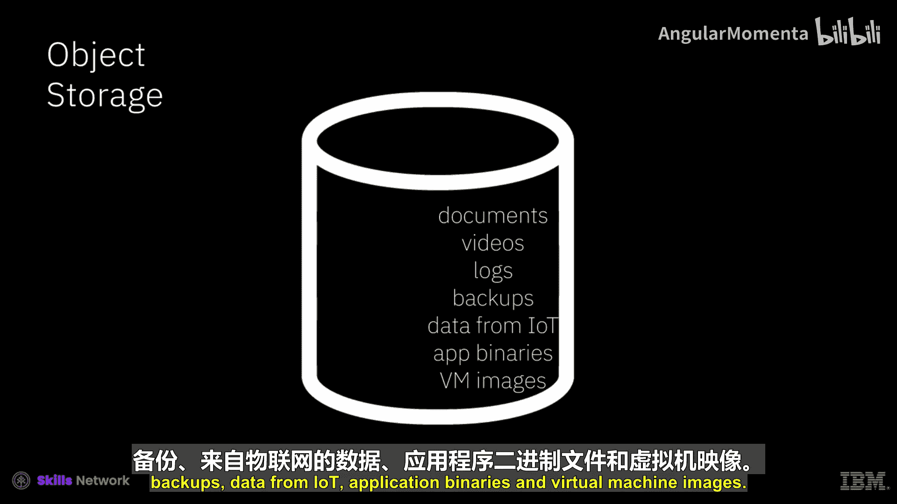

# 【IBM】云计算导论-｜-Introduction-to-Cloud-Computing-p28-03_02_01_云端存储基础--BV1X66rBqE8G_p28-

Cloud storage is where you save data files in the cloud。

 certain storage must be attached to a compute node before the storage can be accessed。

 whereas other storage types can be directly accessed either through the public internet or a dedicated private network connection Cloud providers host。

 secure， manage and maintain the cloud storage and associated infrastructure to ensure you have access to your data when you need it。

Clloud storage services allow you to scale your capacity as you need。

 so you only pay for what you provision， usually on a per gigabyte basis。

 the cost of storage will vary by type， but in general。

 the faster the read write speed of the storage， the higher the per gigabyte cost。

Cloud St is available in four main types， direct attached， file storage， blocklock storage。

 and objectject storage。Direct attached storage sometimes referred to as local storage is storage which is presented directly to a cloud based server and is effectively either within the host server chassis or within the same rack。

This storage is fast and normally only used to store a server's operating system。

 although it can have several other use cases。The main two reasons why direct attached storage is not so great for other uses besides to store the operating system。

 is that it's typically ephemeral， meaning that it only lasts as long at the compute resource it's attached to。

 it cannot be shared with other nodes， and while you use raid techniques。

 it's not as resilient to failure as other types of storage。

File St is typically presented to compute nodes as NFS storage。

InFS stands for Network Biile System and means that the storage is connected to compute nodes over a standard ethernet network。

NFS mounted storage is commonplace， but it tends to be slower than either direct attached storage or block storage because the data travels over an ethernet network。

It also tends to be lower costs than either direct attached or block storage。

One advantage of file storage is that it can be mounted or used on multiple servers at once。

File based storage is a simple， straightforward approach to data storage and works well for organizing data in a hierarchical folder structure that desktop users are familiar with。

Block storageage is presented to compute nodes using highpe fiber connections。

 which means that read and write speeds are typically much faster and reliable than with file storage。

 making block storage suitable for use with databases and other applications where disk speed is important。

You typically provision block storage in volumes， which can then be mounted onto a compute node。

 which it then effectively sees as another hard drive。

Volumes can normally only be mounted onto one compute node at a time。

With both file and block storage， you may also hear the term IOPS IOPS stands for input output operations per second and relates to the speed of the storage or to put it another way。

 how quickly data can be read from or written to the storage。

 We'll cover this in a little more detail in a later video。

Perssistence is a term that is used when provisioning file or block storage and relates to what happens to the storage once the compute noted is attached to is terminated。

If the storage is set to persist， then it will not be deleted along with the compute node。

 meaning that it and its data are preserved and available to mount onto another compute node。

 though you will continue to pay for the storage。You can also。

 in some cases set the storage so that it is automatically deleted with the compute note that it is mounted onto in this case。

 as we know， it becomes ephemeral storage here， you will also stop paying for the storage。

 but you will lose any data unless it is backed up somewhere。

There are several ways to back up data in the cloud。

 but one way to back up both file and block storage is to take a snapshot that is the image of the storage at a particular instant。

Snapshots are usually fast to create， they don't actually write any data。

 or rather they create metadata， don't require downtime and subsequent snapshots record only changes to the data。

They are great for returning storage to the way it was at a particular snapshot， though note。

 they cannot be used to recover individual files。The fourth kind of storage is object storage This is a different type of storage insom much as it's not attached to a compute node。

 rather it is accessed via an API。Of all the storage types。

 object storage is by far the cheapest and also the slowest in terms of Read&Wr speeds。

 but it is infinite in size to the end user。Unlike file and block storage。

 where you provision a certain storage capacity and it fills up over time with object storage。

 you can keep adding files to it and it never fills up， you just pay for what you use。

This makes objectject storage a fantastic repository for all sorts of unstructured data types。

 large and small， including documents， video， logs， backups， data from IoT。

 application binaries and virtual machine images in the following videos there will be more detailed information on the different types of storage。

