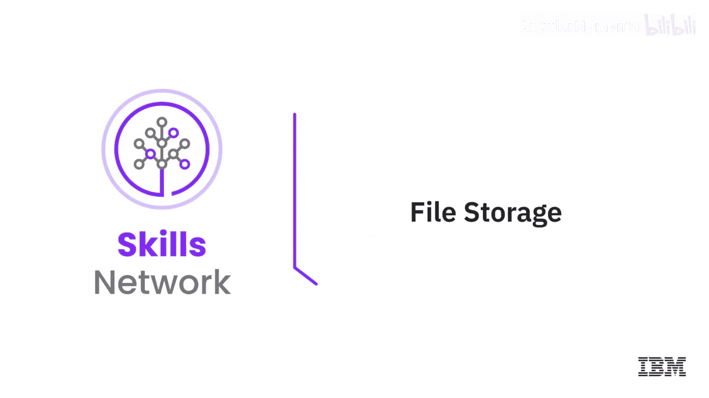
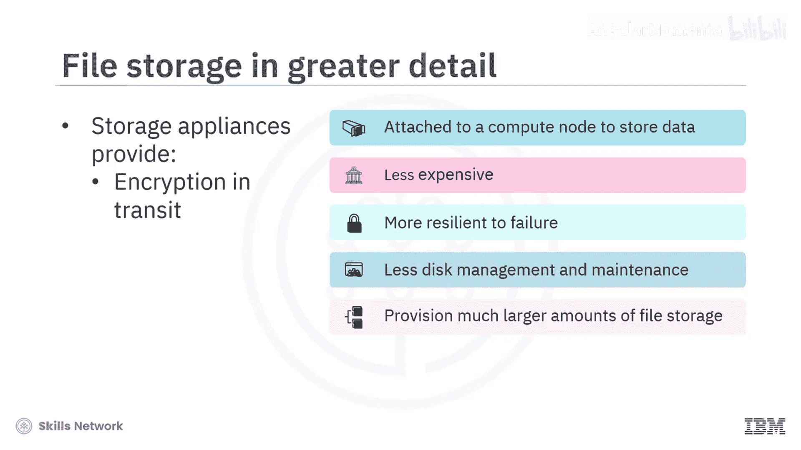
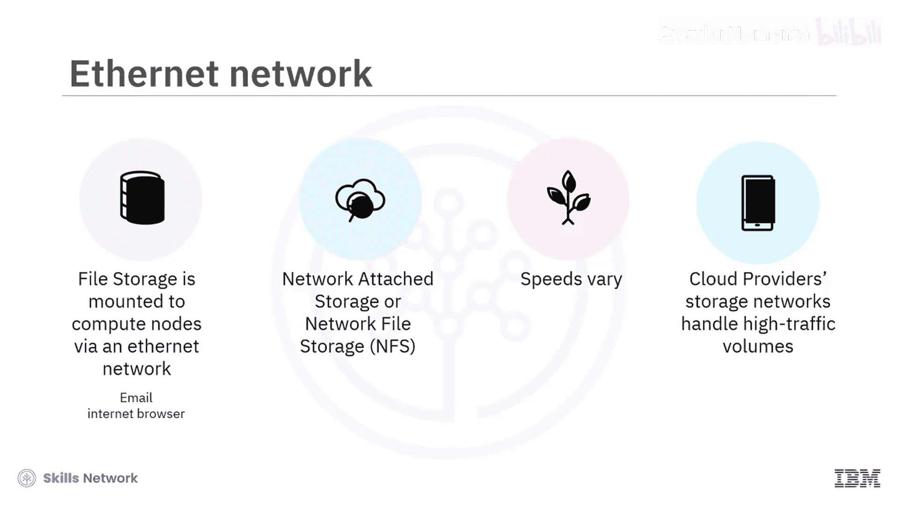
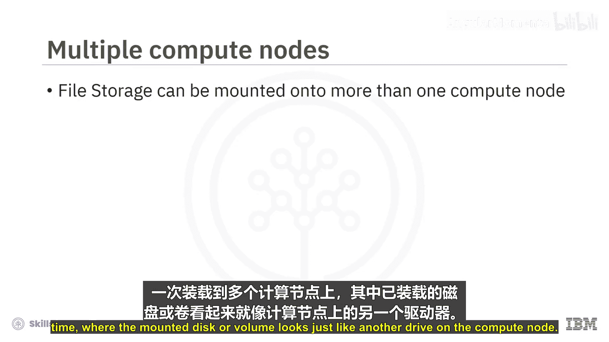
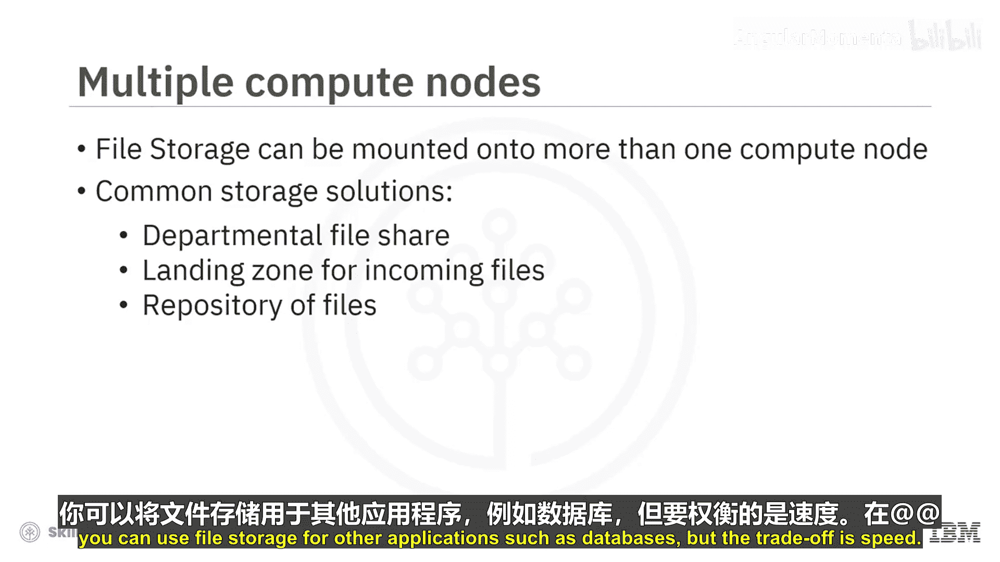
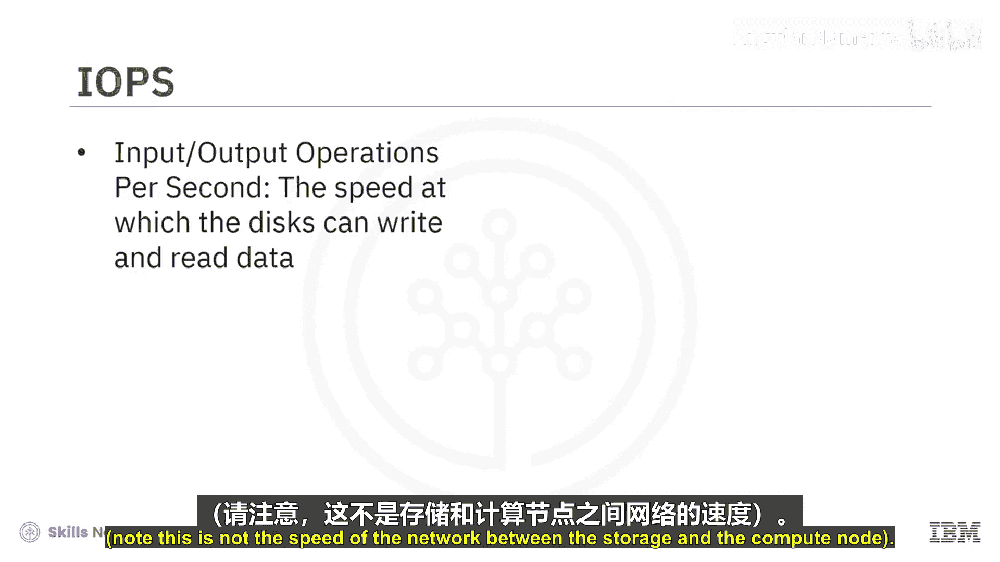
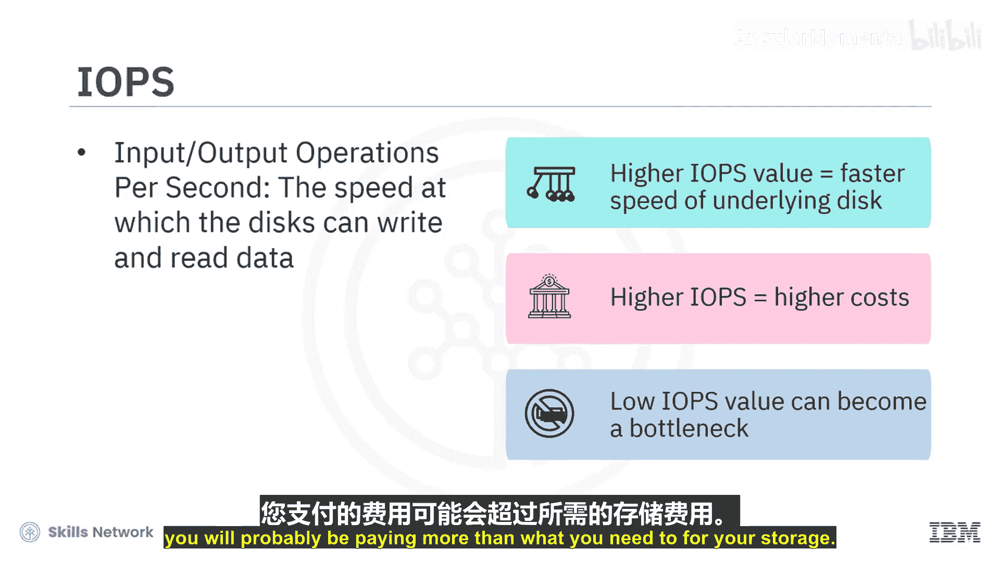
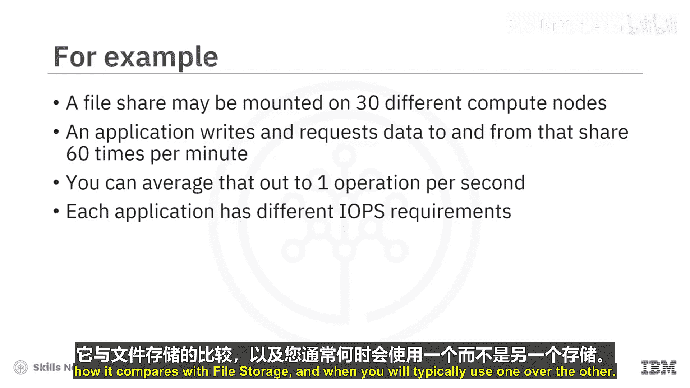

# 【IBM】云计算导论-｜-Introduction-to-Cloud-Computing-p29-03_02_02_文件存储--BV1X66rBqE8G_p29-

In this video， we're going to talk about file storage in greater detail。

Like direct attached storage， file storage must be attached to a compute node before it can be accessed and have data stored on it；

 however， file storage can be less expensive， more resilient to failure。

 and involve lesser disk management and maintenance for you as the user to do as compared to direct attached storage。

You can also provision much larger amounts of file storage and present it as a disk to a server。

File storage is mounted from remote storage appliances。 That is。

 the physical disks are contained in a separate， specialized piece of hardware。

 and they are then connected to the compute node via the underlying infrastructure in the data center。

😊，These storage appliances are not only extremely resilient to failure。

 the data is also far more secure in them as these storage appliances provide services such as encryption and transit。

These applications are all managed by the service provider。

File storage is mounted to compute nodes via an ethernet network。

 the same kind of network that you might receive email or browse the internet over。

 although this ethernet network is normally dedicated to the task。

This means it can sometimes be referred to as network attached storage， network file storage。

 or simply inFS。😊，One of the issues with ethernet networks is that their speed can vary。

 The more loaded an ethernet network is， the more likely it becomes that its speed or bandwidth will be affected。

 Of course， cloud providers build their storage networks to handle very high volumes of traffic。

 But even so， consistent speed cannot be guaranteed。 Therefore。

 file storage tends to be used for workloads where consistently high network speeds are not a requirement。

In terms of workloads， file storage can typically be mounted onto more than one compute node at a time。

 where the mounted disk or volume looks just like another drive on the compute node。

The ability for file storage to be mounted to multiple compute nodes at a time make it an ideal solution where some sort of common storage is required。

 for example， a departmental file share， a landing zone for incoming files that needs to be processed by an application or a repository of files that a web service might access。

In these applications， the potential variance in the speed of the Connect network is not really an issue。

 of course， where cost is an issue， you can use file storage for other applications such as databases。

 but the tradeoff is speed When you provision file storage。

 one consideration you need to take into account is the IOs capacity of the storage。

IOPS stands for input output operations per second and refers to the speed at which the disk can write and read data Note。

 this is not the speed of the network between the storage and the compute Note。

The higher the IOs value， the faster the speed of the underlying disk。

 a higher iOs will also normally cost more。Understanding IOs is important because if the IOs value is too low for your application。

 the storage can become bottlenecked and cause your application to run slowly。Alternatively。

 if the eyeOs is too high， you will probably be paying more than what you need for your storage。

For example， a file share may be mounted on 30 different compute nodes and an application writes and requests data to and from that share 60 times per minute。

You can average that out to one operation per second。With this simple example。

 you can see that each application has different IOPPS requirements。In the next video。

 we're going to talk more about block storage， how it compares with file storage。

 and when you will typically use one over the other。

