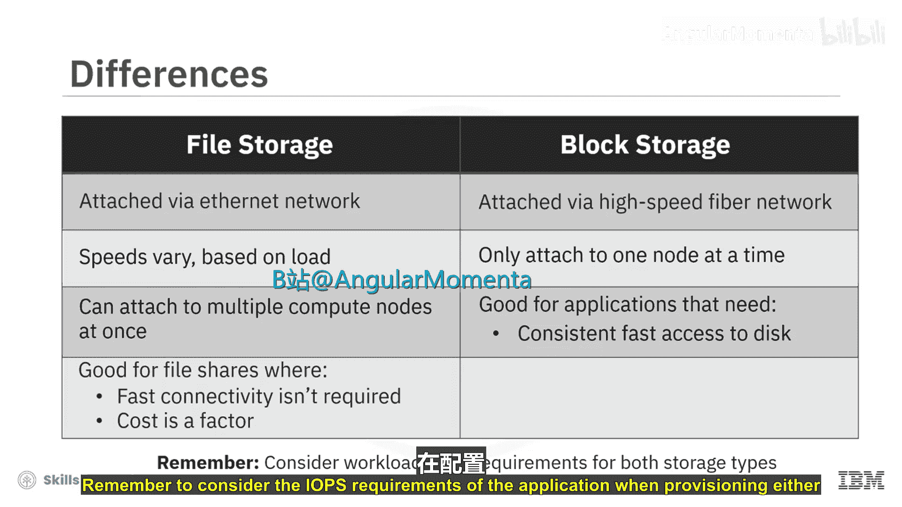

# 【IBM】云计算导论-｜-Introduction-to-Cloud-Computing-p30-03_02_03_块存储--BV1X66rBqE8G_p30-

In this video， we will discuss block storage and how it compares to file storage in the cloud Block storage breaks files into chunks or blocks of data and stores each block separately under a unique address like direct attached storage and file storage Block storage also must be attached to a compute node before it can be utilized for your workloads Block storage like file storage can be mounted from remote storage appliances。

 making it extremely resilient to failure and keeping data far more secure in them on account of encryption and transit and encryption at rest services available on these appliances Block storage is mounted as a volume to compute nodes using a dedicated network of fibers through which signals move at the speed of light These fiber optic networks are more expensive to build than the ethernet ones which deliver file storage which is one reason why blocklock storage tends to have a higher price point however。

🎼The traffic is moving faster and with speed consistency。

 they are perfect for workloads that need low latency storage to work effectively in terms of workloads。

 it is important to note that unlike file storage， which can be mounted onto 80 compute nodes or more Block storage is normally mounted onto only one compute node at a time Since these disks run at a consistently high speed they are perfect for workloads that need consistently fast storage such as databases and mail servers blocklock storage is not suitable for workloads where there needs to be some level of disk sharing between compute nodes for block storage。

 as it is for file storage， you need to take the iOs capacity of the storage into account Most cloud providers will allow you to specify iOs characteristics when you provision storage and in some cases adjust the iOs of your storage as you need so if the requirements or usage behavior of an application changes you can adjust。

Accordingly， so to summarize the commonalities and differences between these two storage types。

 block and file storage is taken from appliances， which are maintained by the service provider both are normally highly available and resilient and will often include data encryption at rest and in transit file storage is attached to a compute node using an othernet network。

 so it is sometimes called network attached or NFS storage file storage is very reliable but the speed of the connecting network can vary based on load Block storage is attached via a high-pe fiber network。

 which is very reliable and consistent file storage can be attached to multiple compute nodes at once Block storage can only be attached to one node at a time file storage is a good choice where file shares are required where workloads do not require lightning fast connectivity to storage or where cost is a factor。

Block Stage is a good choice when supporting an application that needs consistent fast access to disk such as databases remember to consider the IOs requirements of the application when provisioning either file or block storage Hey guys my name is Amy Bla I'm on the offering team here with IBM Cloud and today I want to talk to you about some traditional types of storage file in Block St can give you an overview of what they are and then give you some tips on how to decide when to use one over the other so let's get started with blocklock St。

Block storage is storage where data is written in raw blocks on the storage and it's accessed by the servers that you have through a storage area network。

So you have all of your servers， they can either be on the same network with each other in a different network。

 but they all connect through the storage。Through this storage area network。

Now some of the advantages of using block storage is that block storage provides the lowest possible latency for your applications and you can also use it for those applications that require high performance or lots of IOs another thing you'll find with block storage is that in general it is highly redundant。

 most block storage services， provide a capability that's built in where your data is redundant across the volume so that if so there should be either a volume should go down or a disk should go away you can recover your data from another place without having any kind of impact to your application。

Now file storage。Is connected to your service a little differently than block storages everything。

Is connected on the same network so you have all of your files or your file share here。

Those are all the files and they can all be accessed on the same network by any of the servers on that network。

 so it's network attached storage file storage is highly scalable so you can have multiple file shares on your network and have all of your servers attached to that at one time。

It's accessible to multiple runtime， so here in this illustration we have a single file share that has multiple servers accessing it all at once。

 and you can also have multiple simultaneous reads and writes going to your file share all at one time without having to worry about your data being overwritten。

So how do you know when is the right time to choose either block storage or file storage for your application well first of all you need to think about what you're using it for so for example。

 let's say you have a VMware configuration where you have multiple virtual servers with VMware on them and you need boot volumes well in that case you would use block storage。

If you have workloads such as transactional databases or relational databases that require very low latency and high performance。

 you would choose block storage。In situations where you have a mix of the structured and unstructured data。

 for example， a web hosting server where you have both text files as well as media files。

 then you would choose file storage。And then if you have a collaborative space where you need to have multiple users accessing it all at one time。

 working together， doing you know， reads and writes all at the same time。

 you would choose file storage。So like I mentioned in the beginning block and file storage are very traditional types of storage。

 they're not as flashy and shiny and exciting as some of the new storage services that have entered the market。

 but they are still very relevant and useful for the different types of workloads that you have whether it's on premise or in the cloud。

Thanks for checking out this video on the differences between file and block St with me today。

 if you have any questions or comments or ideas for other videos just put something in the comments below and if you'd like to see more videos like in'll start to look at object storage。

