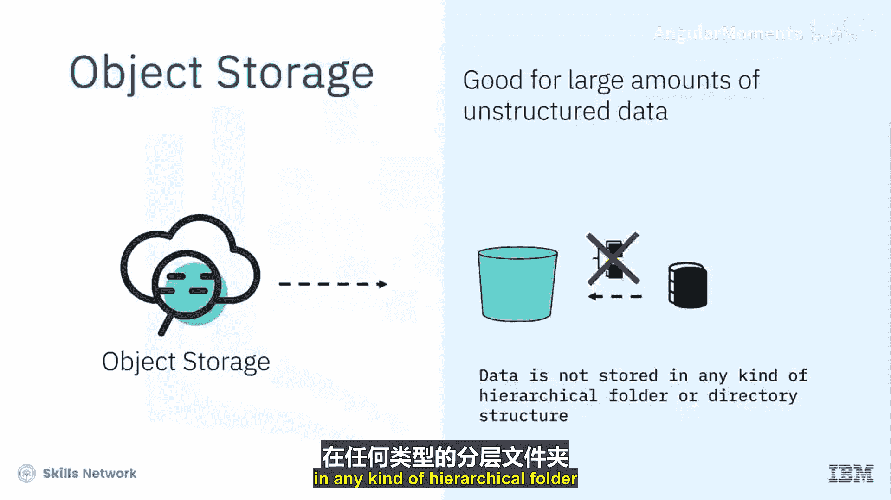
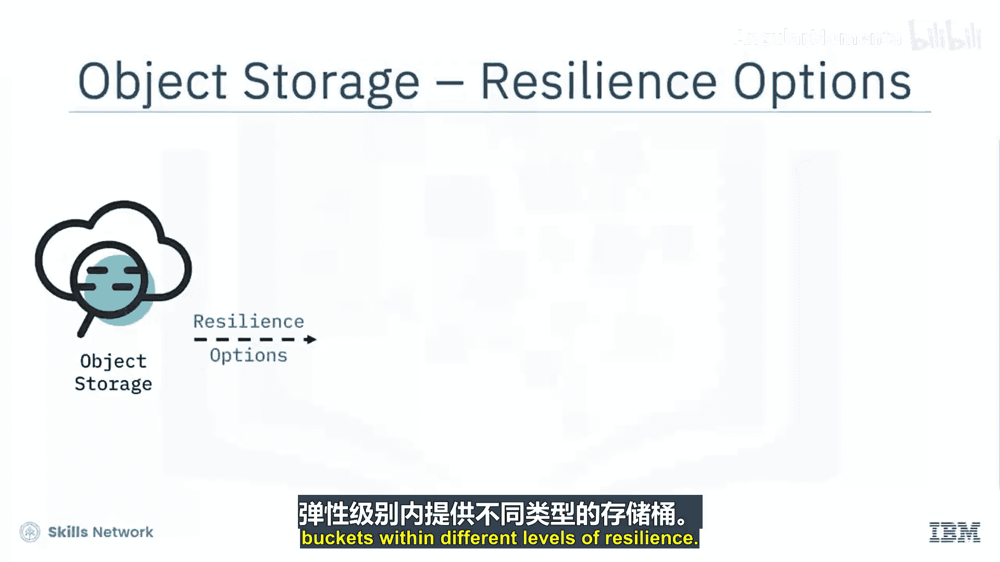
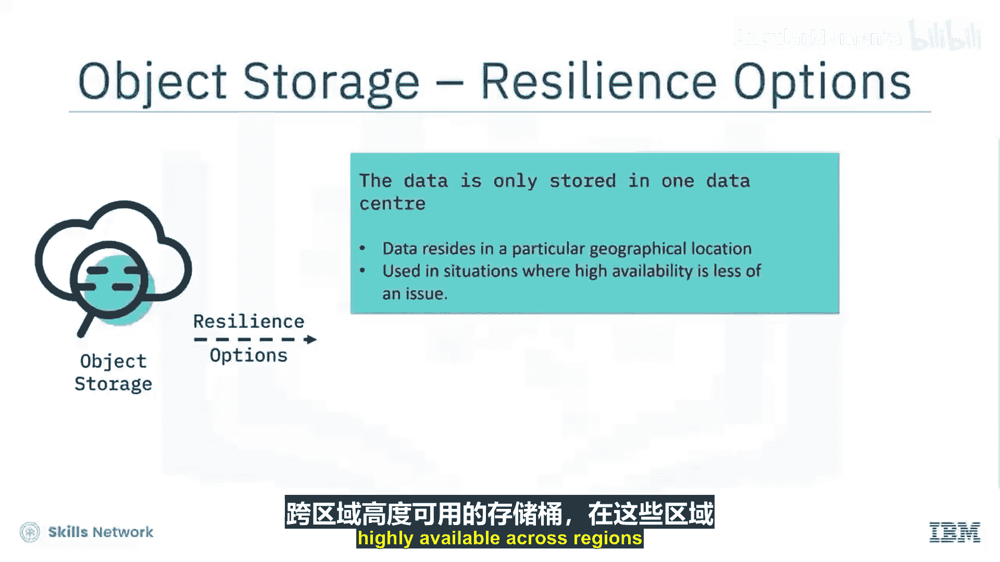
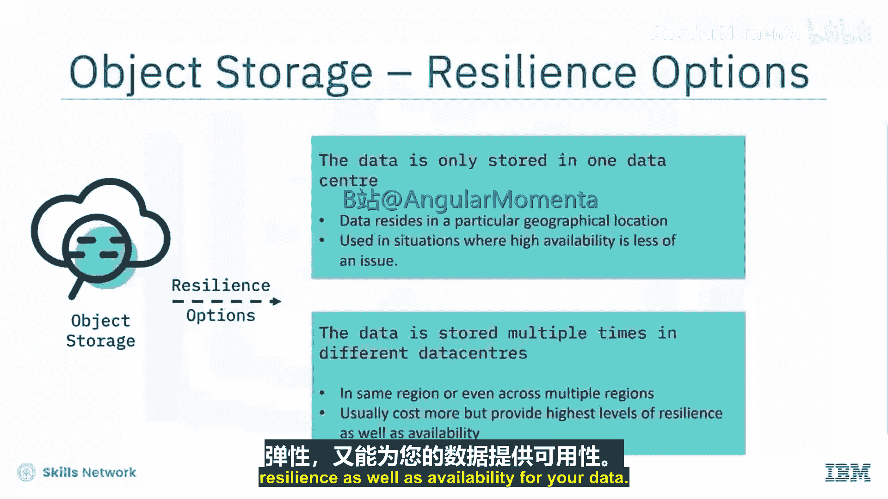
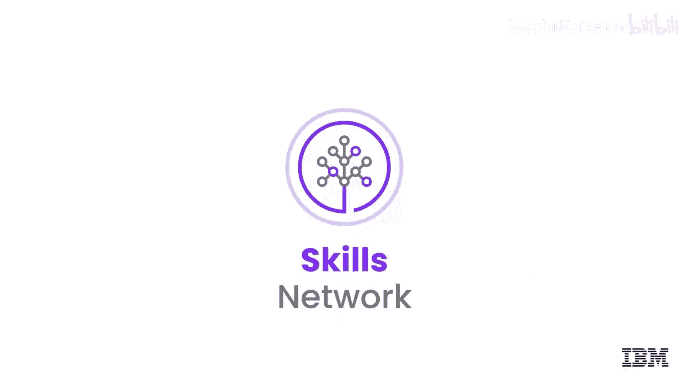

# 【IBM】云计算导论-｜-Introduction-to-Cloud-Computing-p31-03_02_04_对象存储概述--BV1X66rBqE8G_p31-

🎼In this video， we're going to start to understand what object storage is。

 how data is stored in object storage and how it differs from the more traditional storage types such as file and block storage。

 The first thing to note about object storage is that you do not connect it to a particular compute node in order to use it。

 Instead， you provision an object storage service instance and use an API or application program interface to upload。

 download and manage your data。 This means you can directly use object storage with anything that you can call an API and you don't need an underlying compute node。

 The second thing to note about object storage is that it's less expensive than other cloud storage options。

 It's per gigabyte cost is typically a couple of US sense per month， and in some cases， even less。

 depending on the storage tier used。 More on storage tiers later。

 The third and possibly most important thing to note about object storage is that it's effectively。

🎼Infinite with file and block storage， you specify the size of the storage you want in gigabytes or terabytes and then pay a fee based on the size you provisioned with object storage。

 you just consume the storage you need and pay per gigabyte cost for what you use。

 You can keep uploading files and the storage will never run out。

 So when would you use object storage。 Well， objectject storage is great for storing large amounts of unstructured data by unstructured。

 this means that the data is not stored in any kind of hierarchical folder or directory structure。

 Object storage uses buckets and objects are stored within these buckets in a structurally flat way。

 A bucket is a bit like a folder in the sense that you can give them meaningful names and， of course。

 have different buckets for different object types。

 but you cannot place a bucket within a bucket when an object is placed in a bucket。

 It also has some metadata。 Data about the data added to it。😊。

🎼Such as an object I This metadata helps applications to both locate and access the object。

 as well as provide information on the time that the data was stored or last accessed。

 When you create a bucket， you don't need to provide or define any sizing information。

 The bucket will just hold the data that you place inside it and the service provider ensures that there is sufficient storage capacity available。

 buckets can hold as little as a few bytes of data right up to multiple petabytes and you can build up the amount of data stored as slowly or quickly as you like。

 as well as shrink it back down again。 The service provider also takes care of resilience and making sure that the object storage solution is highly available。

 Some cloud providers offer different types of buckets within different levels of resilience。

 For example， they offer buckets which are resilient。 but the data is only stored in one data center。

 This is a good option where data needs to reside in a particular。

🎼Geographical location or in situations where high availability is less of an issue they will then offer buckets which are highly available across regions where the data is stored multiple times in different data centers or zones in the same region or even in multiple regions These options usually cost more but they provide both the highest level of resilience as well as availability for your data Object storage has a very flat storage structure。

 which will explain in the next lesson This data can be anything from text files to audio files and video files from Io data to virtual machine images from backup files to data archives pretty much any data which is static and where fastread and write speeds are not necessary would make a good fit for object storage Object storage would however。

 not be suitable for running operating systems nor applications such as datas or anything else where the contents of the files changes。

So to summarize what we have learned in this lesson。

 object storage is used to store files or objects which are static the data that you can store using object storage can be anything from text files to audio and video files from IoT data to virtual machine images from backup files to data archives you cannot run operating systems or other applications such as databases using object storage objects are stored in buckets you can have multiple buckets but you cannot place buckets within buckets You do not need to specify a size for a bucket you can just use as little or as much space as you need Many providers offer different types of buckets with different charges for each Some are based on resilience and availability while others are based on the frequency at which the objects inside are accessed In the next video will be diving into object storage data tiers and object storage APIs。

