# 【IBM】云计算导论-｜-Introduction-to-Cloud-Computing-p32-03_02_05_对象存储层级与API--BV1X66rBqE8G_p32-

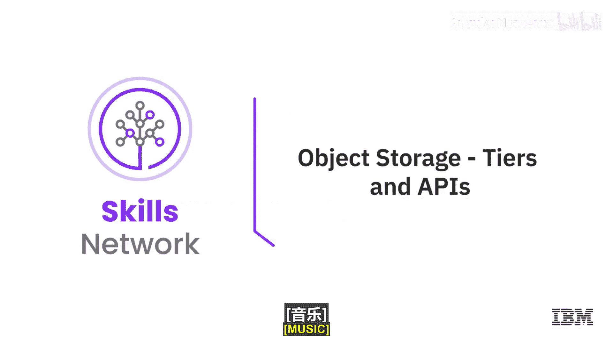

🎼In this video we're going to look more closely at object storage data tiers and object storage APIs Object storage buckets also have storage tiers or classes associated with them and these tiers are based on how frequently the data is accessed a standard tier bucket is where you would store objects that are frequently accessed This tier tends to have the highest per gigabyte cost associated with it a vault or archived tier is where you might store documents that are only accessed perhaps only once or twice a month or less and this will be offered at a lower storage cost whereas there may also be cold vault tier where you would store data that is typically accessed only once or twice a year This storage often costs just a fraction of a US cent per gigabyte per month Often you can also set up automatic archiving rules for your data meaning that if an object isn't accessed for a period of time it will automatically be moved to a cheaper。

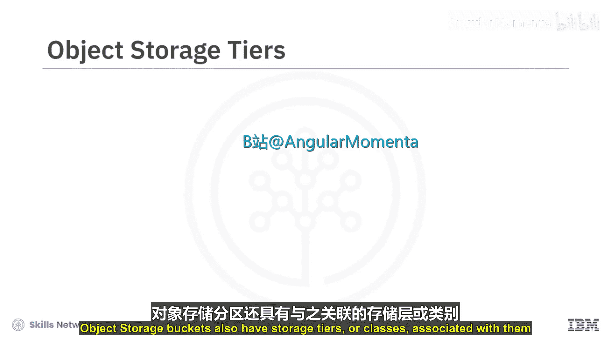

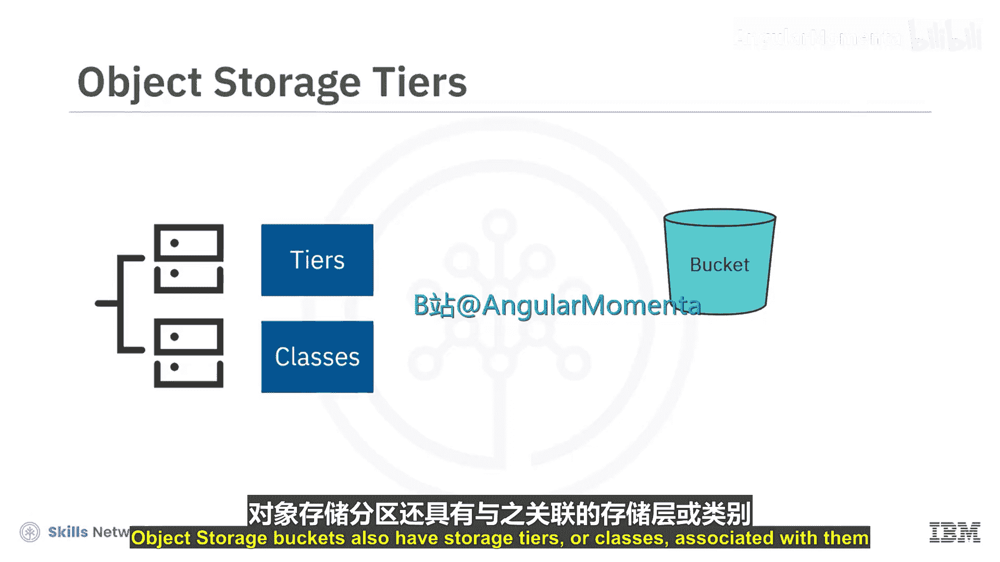

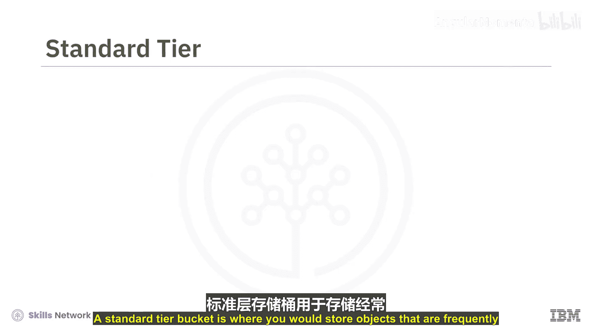

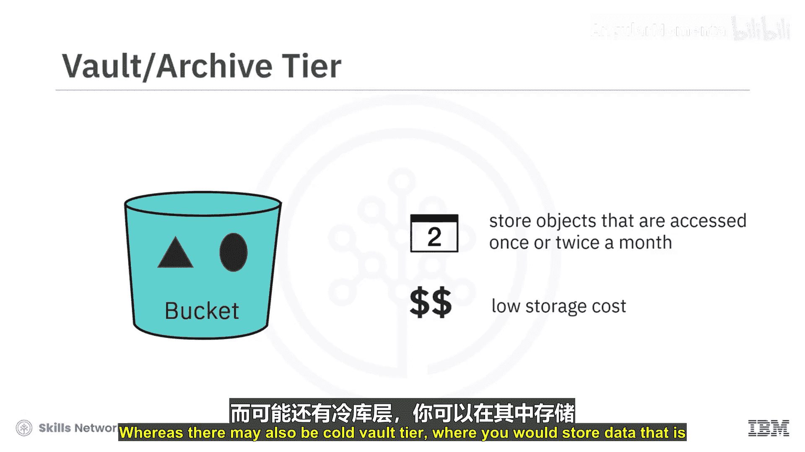

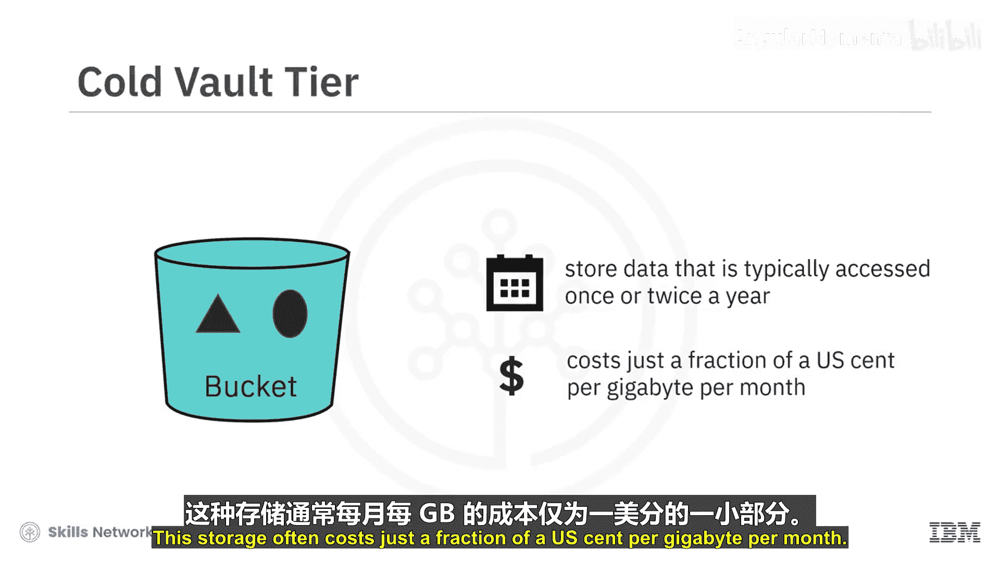

🎼Storage tier The rule uses some of the objects metadata to determine when it should be archived。

 Note that object storage does not come with iOs options Object storage tends to be very slow in comparison with file or block storage where downloads typically take seconds if not longer to complete where providers offer cold vault buckets data retrieval from these tiers can sometimes even take hours because the storage is kept offline if your application needs fast access to files then object storage may not be a good option We've mentioned that object storage is priced per gigabyte used。

 but there can also be other costs related to retrieval of the data these costs are similarly low but access charges can be higher for data that is in a vault or cold vault tiers so it is important to ensure that the data is in the correct tier based on its frequency of access Object storage does not need to be attached to a compute node for you to。

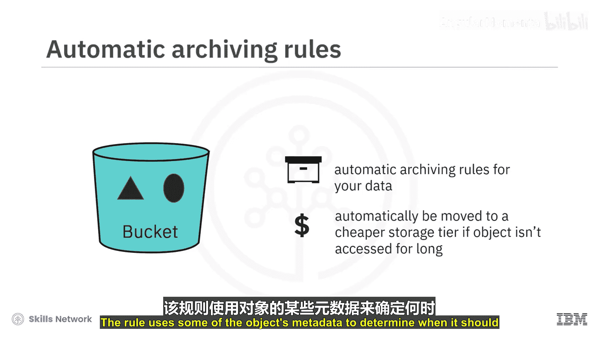

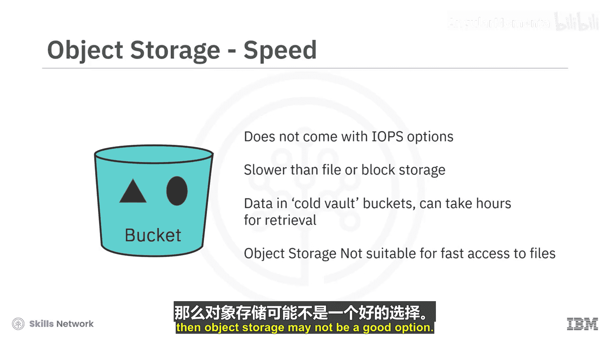

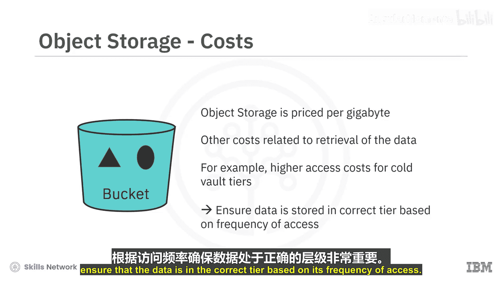

🎼AccesRather， you access object storage through an application program interface or API The most common API for objectject storage is called the S3 API。

 which is a standard based on the S3 object storage offered by AWS Many providers offer APIs to their object storage。

 which is S3 compatible， which is useful because it means developers can write code。

 which is able to access multiple vendors objectject storage The API itself is an HttP based restful API or restful web service The API call allows applications to manage object storage and buckets as well as put upload or get download objects to and from them。

 Object storage is not just for new applications， but can be used to meet requirements for existing ones。

 It can also be used as an effective solution for backup and disaster recovery as a replacement for offsite。

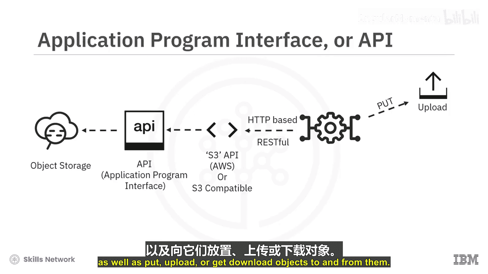

🎼atebased solutions reducing the time to restore data Many backup packages now include the ability to backup data up into the cloud using object storage Object storage is more efficient than tape backup solutions which require tapes that need to be physically loaded into and removed from tape drives and moved offsite for geographical redundancy so to summarize what we have learned in this lesson Object storage has different tiers with different charges for each Some are based on the frequency at which the objects inside are accessed Object storage is priced per gigabyte of storage used per month。

 plus some charges for data retrieval Object storage is much cheaper than file or block storage Object storage is very slow in comparison with file and block storage you can often create rules which allow the automatic archiving of objects to cheaper tiers when they are infrequent accessed Object storage is accessed using an API。

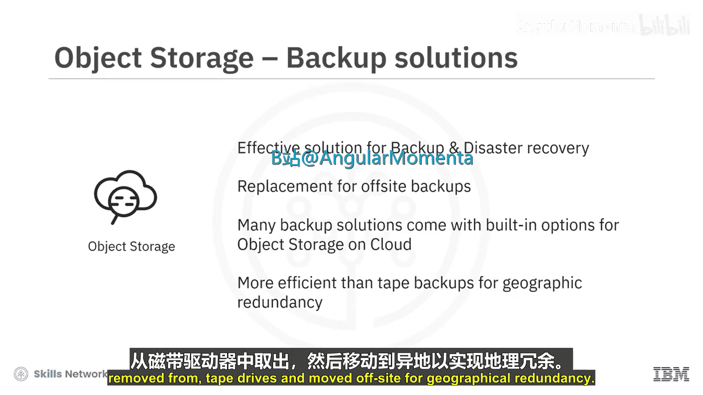

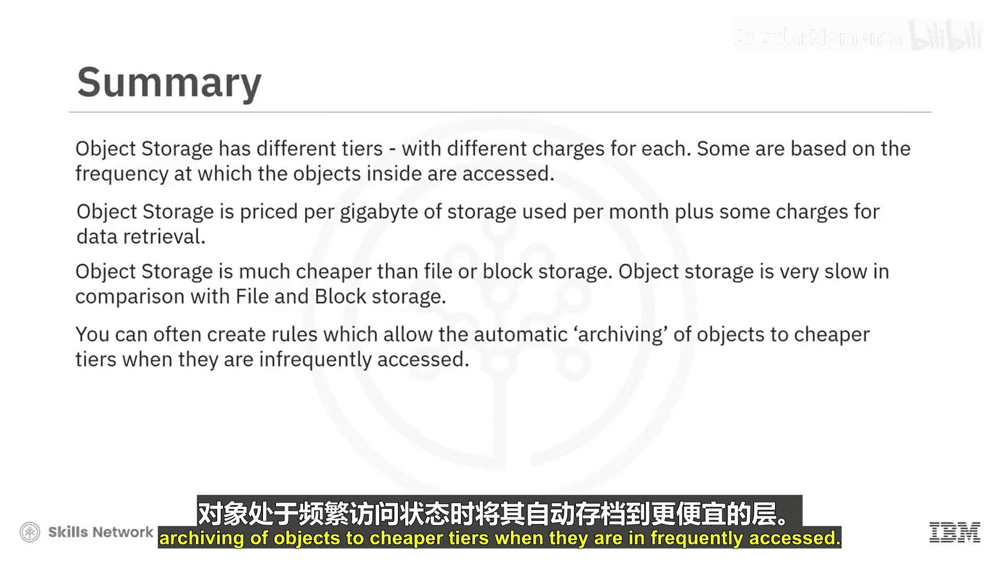

Many object storage providers have an S3 compatible API which means developers can create code that will work against multiple vendor object storage solutions Object storage in the cloud offers an effective backup and disaster recovery solution In the next video we will be covering content delivery network or CDN which is driven by Block St。

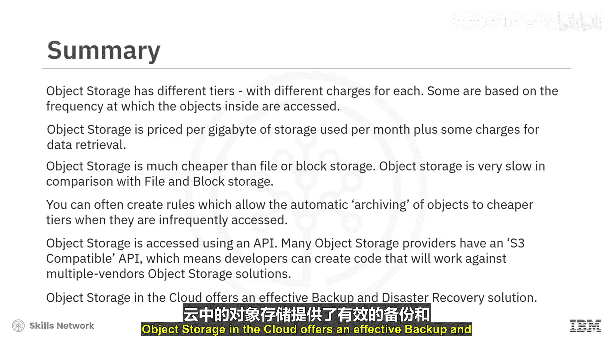

