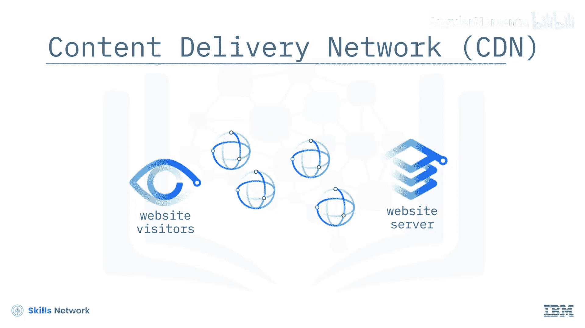
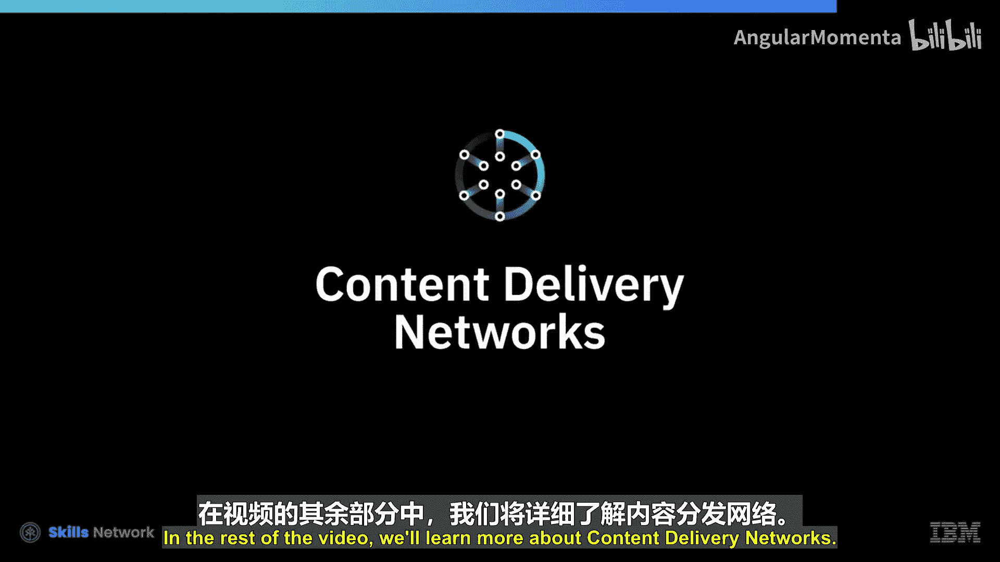
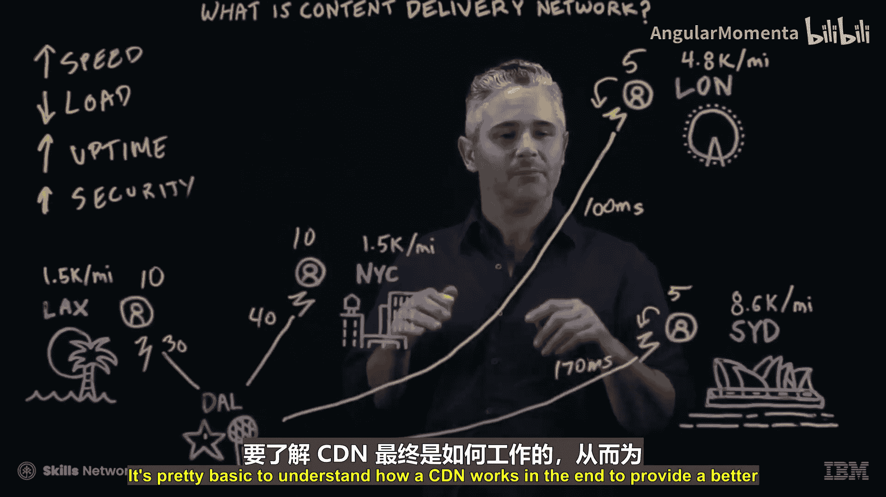

# 【IBM】云计算导论-｜-Introduction-to-Cloud-Computing-p33-03_02_06_内容分发网络--BV1X66rBqE8G_p33-

A contentent delivery network or CDN is a distributed server network that delivers temporarily stored or cached copies of website content to users based on the user's geographic location。

 a CDN stores this content in distributed locations and reduces the distance between your website visitors and your website server。

In the rest of the video， we'll learn more about content delivery networks。

Hi， I'm Ryan Sumner， I'm a Chief network architect with IBM Cloud。

 and today I'm going to help you answer what is a content delivery network。So in short。

 a content delivery network or CDN is a service that accelerates Internet content delivery。

 So in other words， the main benefit of a CDN is that it makes your website faster。

So before I get into describing to you how it accomplishes that and some of the other benefits。First。

 I want to talk to you about some of the challenges that we have where we have users all around the world。

 but we don't have servers all around the world and the experience that those users have due to that dynamic。

So I've got a simple diagram here showing a server hosted down in Dallas， this is my website。

And then I have users all around the world。 So in Sydney， I might have five。In London， I've got five。

New York I might have 10。LA might have 10。I've got 30 users around the world that are accessing my server and my website down in Dallas。

So let's kind of follow a set of these users in their journey。

 let's look at their users down in Sydney。They make a request to the website。

 they've got an 8600 mile hike to Dallas and then an 8600 mile hike back。

 the amount of time that that takes is usually measured in milliseconds and just that round trip might be about 170 milliseconds。

For our users up in London， that might be about 100 milliseconds。

Our users in New York City can probably experience about a  40 millisecond round trip time and over in LA。

 about 30。So as you can see。The further you' are away， the longer it takes。

 ultimately the slower the website will be for you。So this is where the CdN comes into play。

 And this is how it actually accomplishes the increase in speed。

 which is by reducing the amount of distance between the user and the content or the server providing the content。

 So what it does by doing that is is it places these content delivery network endpoints。

In as many locations around the world as possible， and in our case。

 we're going to assume we've got one in just about every location where our users exist。

So now when the user in Sydney or London or New York City or LAA tries to access some content。

It's first retrieved by the contentent delivery Network service and then distributed around the world so we have a single request down to the Dallas server。

It's now then distributed all around the world and our users in London now instead of going all the way to Dallas。

 they're able to retrieve that content directly from their closest geographical location。

Drastically reducing the amount of time that it takes to retrieve that content。

🎼So as you can see here， it's very basic how a CN is able to provide the benefits of to the end user by reducing the amount of time that it takes to deliver the service。

 But what you're not seeing here is an indirect benefit is the reduction in the amount of traffic that actually hits the Dallas server。

 So the indirect benefit is that you actually see a。

A reduction in the load or a reduction in the amount of capacity that you need in Dallas。

To serve all these users。So。Another indirect benefit because of there's this much less validity and so much less stuff happening in Dallas because all these users aren't having to make these trips。

 and I'm also not having to communicate with users so far away。Daas environment may also see。

And increase in uptime。And then lastly， because the users are not really directly communicating with the servers down in Dallas。

 you have the indirect benefit of an increase in security through obscurity。So。

It's pretty basic to understand how a CDN works in the end to provide a better benefit to the end user。

