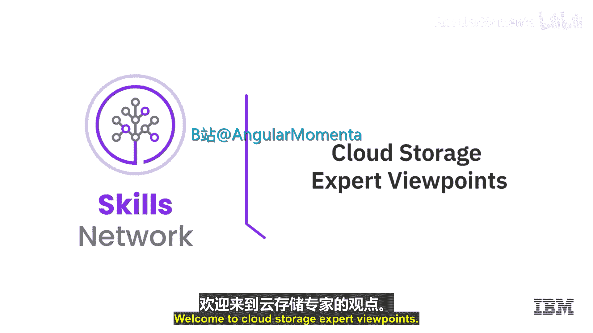

# 【IBM】云计算导论-｜-Introduction-to-Cloud-Computing-p34-03_02_07_专家观点：云存储--BV1X66rBqE8G_p34-

Welcome to Cloud Storage Expert Viewpoints In this video。

 we will listen to several cloud application professionals discuss the factors for selecting cloud St。

😊。

Can you talk about some of the factors you consider while deciding on the most appropriate cloud storage for your needs。

So when I'm looking to get cloud storage for my projects I'm looking at three main things first how much is it going to cost me second what is the speed of data input output from the storage and third。

 how long is it going to be available to me storage can actually be quite complicated often you have to use different types of storages but the first question you need to ask is what is the storage being used for how fast does it need to be how many people are using it how often very important to consider how much is it going to cost and cost can actually be tricky because it's not only the amount of storage you use but often how often and how much you access it So I would say really understand what you need to use this storage for。

And then factor in all those different things into your answer and it'll hopefully help lead you to the right storage or multiple storages you need to use to solve your problem So factors to consider when deciding on your cloud storage needs。

Include cost， performance， security。And operational。E of youth。When you're deciding on cloud storage。

 you're typically deciding between file block and object storage。

File storage will have the interface that's most familiar to most people。

 it's essentially a file system just like the one that you have on your local computer。

It supports multiple clients mounting it for concurrent access。

 and that's typically been the reason that I've went with it in the times that I have。

Block storage does not support concurrent access， but it has a very low latency。

 and it's typically the storage of choice for performance intensive applications。Like databases。

Object storage on the other hand， tends to be the go to for when you have large unstructured data that is not modified very often。

 so for example。Large data sets， video files。Database backups that kind of thing。

Storage can be characterized a number of ways， depending on the type of storage。

 one type is object storage。A second type is block storage file storage such as NFS or database storage SQL or No SQL services now there are different classes of storage or categories of storage that you can get on cloud computing if I'm working with an application and I want to store in user data or some sort of configuration that I'm looking at cloud object storage the cloud object storage while flow gives me this unlimited space or buckets that I can create within the cloud object store。

If I'm looking for a little bit faster where speed is of importance， for example。

 storage for a database， then I might look at block level storage。

This storage works on fiber networks， and so it's a little bit faster than working off of the internet。

 like in Cloud object storage。And then there's the third category is the file storage the downside of file storage is it's a little bit slower than block storage。

 however， because file storage is mounted on a certain server。

 I'm able to use it as a common storage for multiple applications and for multiple servers online with。

Object storage， you may get nice and low cost， but you might not get the highest or the lowest latency because with object storage every time you're updating a tiny amount of a file。

 you're just updating， let's say one letter of a file。

 you have to update the whole object and so you're paying for all of that updating and you're also。嗯。

You also have to wait for that entire object to be updated， whereas if you have file storage。

 you are able to make insertions in the data and usually that file storage is attached。

More closely to your actual compute， and you can get much lower latency that way。And then another。

Type of storage is block storage and you can in the cloud choose block storage optimized virtual machines that have extremely low latency between the block storage and and the server so for extreme low latency that can be a great solution so some of the considerations here are security in encryption I mean ideally you're looking for data to be encrypted at rest and in flight some other factors to consider include data access frequency from you know very active with low latency to less frequent to infrequent or cold storage or even archive for longterm storage。

Another factor is cost， I mean more frequent access and lower latency is generally going to be more expensive those services and business requirements that data is perhaps immutable or protected such that it cannot be modified or deleted。

And another is data life cycle and how to automate。You know， policies to retain， move， archive。

 or delete old data。And then some cloud provider is actually coming up right now with。诶。

Storage area and network so that you can have。A whole bunch of block storage as one storage area network that you can access from your cloud virtual machines。

Another thing to consider is what are the encryption options。

 so fortunately most storage solutions in the cloud right now have the ability to encrypt your storage。

 but you want to make sure that that's a feature。And then another option is。

Content delivery network and for content delivery networks。

 that is an option if you want to have media， for example。

 stored as close to your end user as possible so that when they load your website and look at the images。

 those are loaded in an instant because the media is replicated across all the areas。

