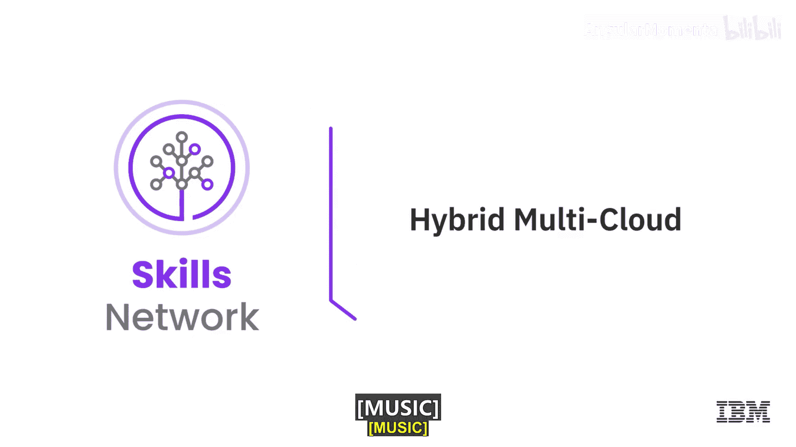
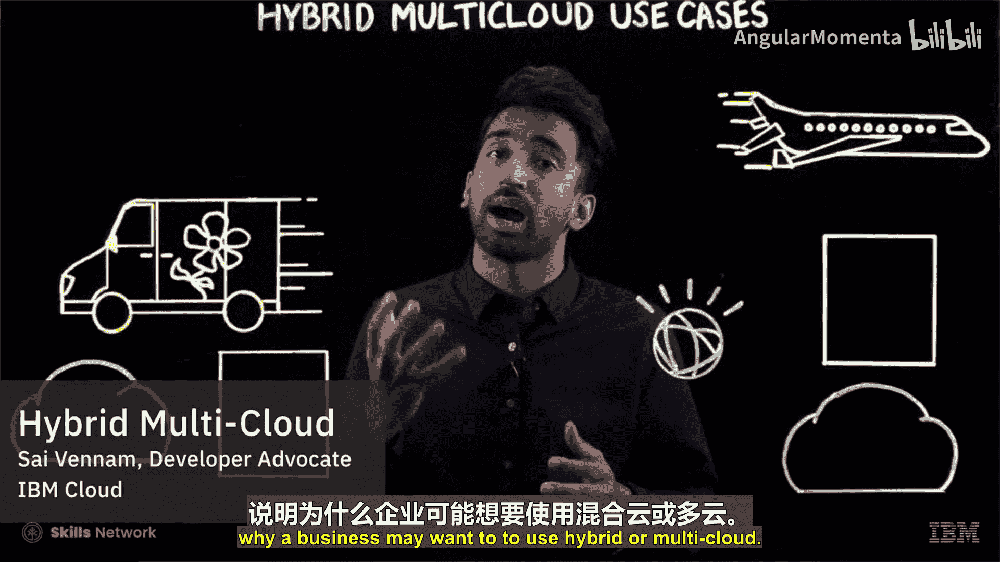
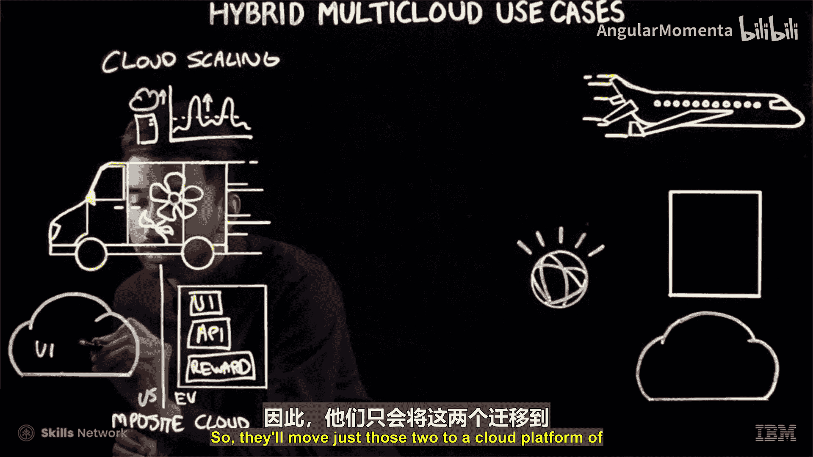
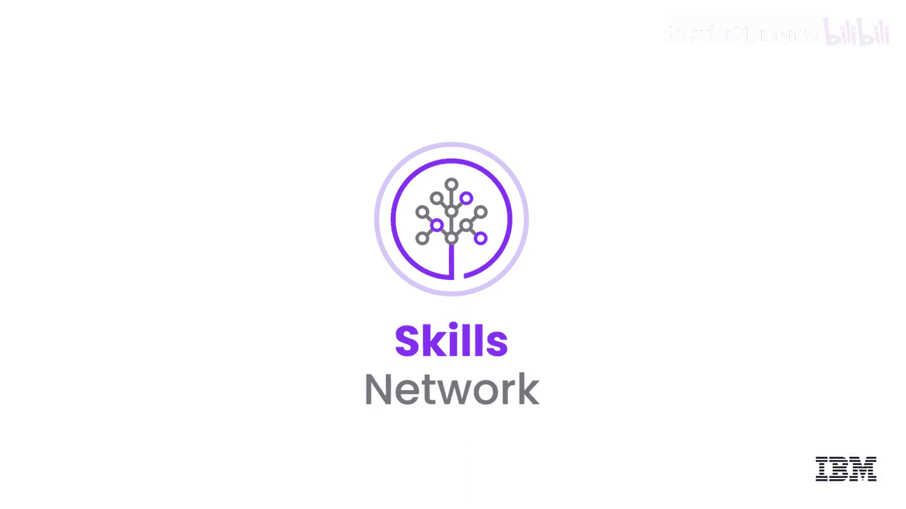

# 【IBM】云计算导论-｜-Introduction-to-Cloud-Computing-p35-04_01_01_混合多云--BV1X66rBqE8G_p35-

Hybrid Cloud， as we covered in the previous lesson。

 is a computing environment that connects an organization's on premise， private cloud。

 and third party public cloud into a single infrastructure for running the organization's applications。

Multicloud is a cloud adoption strategy that embraces a mix of cloud models from different service providers。

 public， private and managed across infrastructure， platform or software services， for example。

 a business may consume email as a service from one provider a CRM application from another and infrastructure from yet another provider。

 so essentially a hybrid multiCud implies you are able to leverage the best of cloud models and services across different service providers and have your applications and workloads working seamlessly across multiple different clouds。

In this video， we will look at some use cases for why a business may want to use a hybrid multiCud approach In this video。

 I want to touch on a few of those use cases for why a business may want to use hybrid or multicloud。

Let's start with the basic one， cloud scaling。Now most of us are probably familiar with this it's one of the main reasons for adopting the cloud now let's say we have a flower delivery service that is able to hit a certain bottom line of users。

They have on premise infrastructure。And it can hit a certain amount of。

User load so visualizing this here throughout a calendar year。

 you can imagine that their load maybe goes up and down and respond to specific holidays。Now。

 to hit those peaks， they could scale up their on premise architecture。

 but that's met with upfront costs and costs of upkeep。Now instead。

 what they'll instead do is take advantage。Of cloud that allows them to scale up in response to that load and then automatically deprovision resources when they no longer need them。

Now this concept is kind of general to cloud computing， not just hybrid or multicloud。

 but that brings me to my next topic and here we're going to be talking about how it can be used to build a composite cloud。

So essentially this is going to be applications that are spread across multiple cloud environments。

 so back to the flower delivery service， let's say they have on- premiseise architecture that allows them to run three major components of their app。

 so let's say they have the web UI。They have some billing APIs。As well as a rewards framework。

Now let's say that this service is actually based in EU。And their European customers are happy。

 but for their North American or American customers， specifically around。

 you know Veterans Day or Thanksgiving， they're noticing that the system is bogging down。

 And so they decide to take advantage of a hybrid cloud or multi-cloud architecture by composing their application across multiple cloud environments。

 So they'll take advantage of data centers in America and essentially they've identified that although their rewards framework can stay on prem in their European side。

 they want to move the billing and the UI capabilities over。 So they'll move just those to。😊。

To a cloud platform of their choice in a North American or American data center。

This kind of allows them to scale up portions in response to say American holidays while keeping their EU portions individually scaled。

 so in this example， the flower delivery Service is able to take advantage of scaling at a global level by using the hybrid or multi-cloud architecture。

Next， let's talk about the airline or travel industry。

So we can first start with an example of modernization。Now， in the past。

 we've seen that you know reservation systems may have been difficult to work with or you might have had to call in。

 but almost all all the airline companies now have a mobile application。

 so most of the time we've actually found that it's about in general not just in the travel industry but 80% of all enterprise applications are actually still on prem and that's likely the case in this industry as well so in this specific example。

Let's say they have a reservation system that's running on prem。

But to create new experiences for their end users。Let's say they've created a mobile application。

That mobile app， of course， has a mobile backend that's maybe running in a public cloud。

And that in turn works with the reservation service。

 so again the mobile H can hit the mobile backend and that in turn works with the reservation capabilities so in this case they've modernized and new user experiences are possible。

But let's take that a step further Now a source for a lot of dissatisfaction for users is whenever their flights are delayed。

 so when a flight is delayed， they may have to rebook new flights。

 the solutions almost always the same。The traveler wants to get to his destination in the easiest way possible。

So what airline industries have been doing is take advantage of the cloud to create maybe a recommendation feature。

So it allows them to book new flights as soon as a delay is recommended or as soon as the delay is incurred。

 and that's going to connect up to that mobile backend service。

 allowing users to be able to book flights through their phone the second a flight is delayed。

This not only proves the bottom line for the airline industry but leads to happier users。

 so that's one way the modernization has been done。Next。

 let's take it even a step further and talk about data。And AI。For data and AI。

 the airline industry has been taking advantage of lots of historical data。

 so over the decades that a company has been around。

 let's say they have historical data when unplanned maintenance has happened on their airlines。

In fact， 30% of all delay time in the airline industry is actually when unplanned maintenance happens。

 so by taking advantage of let's say machine learning or AI capabilities。

 they could hook into all of the legacy data that they have。

Large volumes and connect them up to machine learning and AI capabilities。

This allows airline industries to take advantage of predictive analytics and get insights before errors or before the unplanned maintenance ever occurs。

 this again improves their bottom line leading to happier users and a more efficient airline industry。

Now today we talked about four major use cases for hybridbri and multicloud platforms。

 so cloud scaling and composite cloud and the F delivery service。

 as well as modernize and data and AI for the airline industry。

Another reason for adopting hybrid multiCud strategy is to prevent lockIn to a specific vendor's cloud platform and having flexibility of being able to move workloads from one cloud platform to another as the need arises。

In the next video， we will understand what a microservice's architecture is， its features， benefits。

 and use cases。

