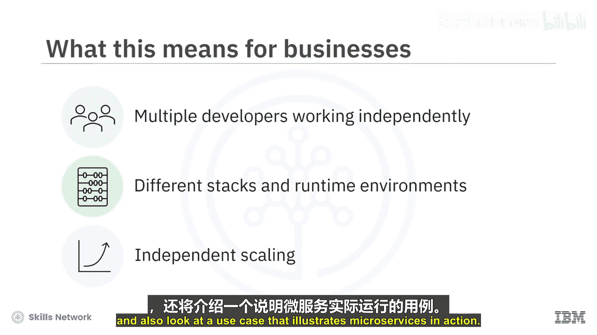
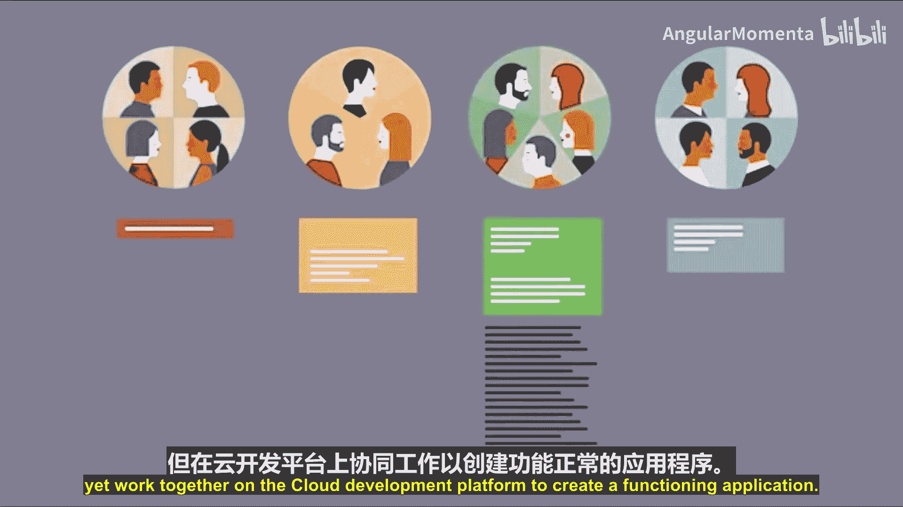
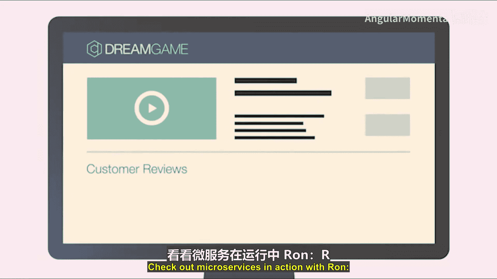
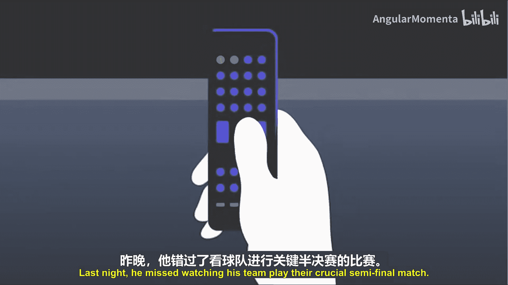
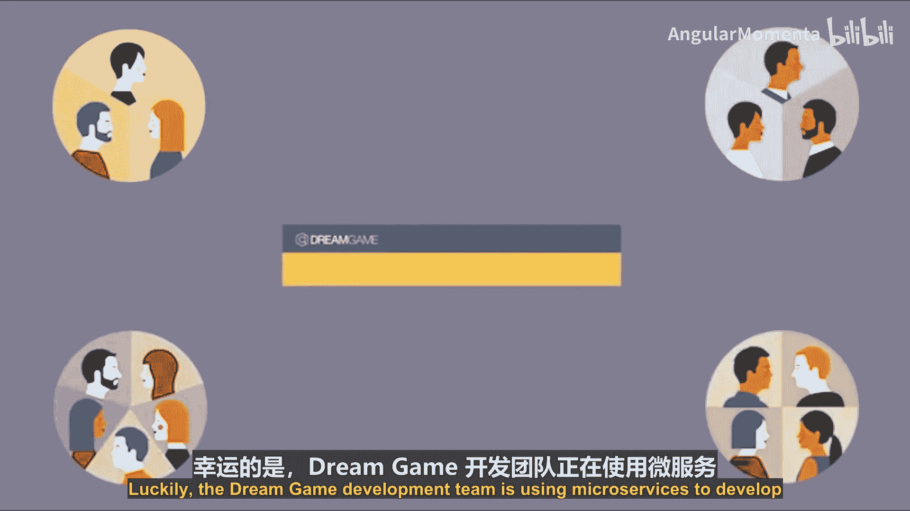
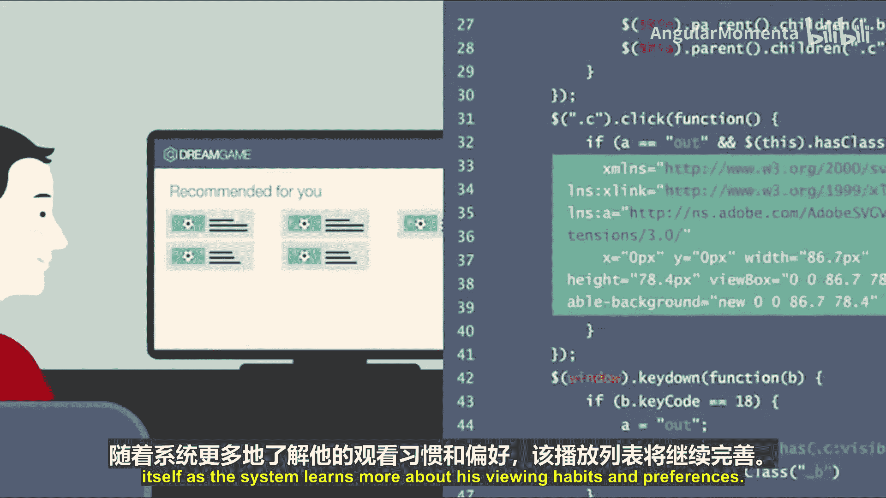
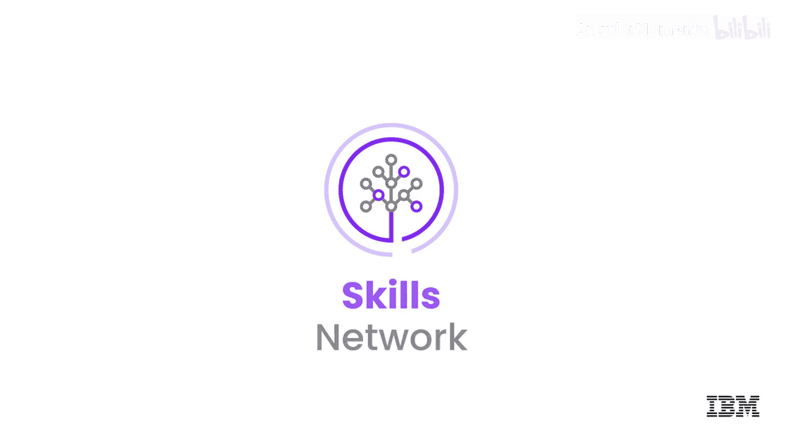

# 【IBM】云计算导论-｜-Introduction-to-Cloud-Computing-p36-04_01_02_微服务--BV1X66rBqE8G_p36-

Microservices architecture is an approach in which a single application is composed of many loosely coupled and independently deployable smaller components or services these services typically have their own stack running on their own containers they communicate with one another over a combination of APIs。

 event streaming and message brokers for a business what this means is that application components can be developed and updated more efficiently by multiple developers working independently。

Teams can use different stacks and runtime environments for different components components facing too much load can be scaled independently。

 reducing the waste and cost associated with having to scale entire applications。In this video。

 we'll look at how microservices have shaped application development and also look at a use case that illustrates microservices in action。

The way developers work to build applications is changing In the past。

 software was built as large monolithic applications where a team of developers would take months to construct a large application built on a common code base。

 These developers would write every part of the application from start to finish。

Now， after decades of software development， there are vast amounts of code already out there that developers can use as the base of an application。

 meaning they no longer have to create every line of code from scratch。

Cloud development platforms provide developers with an ecosystem of code that can be easily and securely integrated into applications。

Now， instead of building one huge application on one team， developers break into small。

 independent teams where they write smaller amounts of code called microservices。

🎼Microservices break down large applications into their core functions， for example， search。

 recommendations， customer ratings or product catalogs。

 each is developed independently of one another， yet work together on the cloud development platform to create a functioning application。

A container is the distribution method for each microservice。

 meaning it delivers the code where it needs to go。🎼Containers are plug in play。

 so if one microservice isn't working for an application。

 developers can take it out and put in a different one without disrupting how the rest of the app functions。

Check out microcroservices in A with Ron。

Ron is a soccer fan who uses an online streaming media service called Dream Game。

🎼Last night， he missed watching his team play their crucial semifinal match。Luckily。

 he can watch the match tonight on Dream game。 when he logs in。

 he sees the most popular content among all dream game users。 After some searching。

 he finds the match he's looking for。

What he would really like is to find his game with one click。

Luckily， the Dream Game development team is using microservices to develop a better user experience for viewers like Ron。

The first microservice is a content catalog housing the millions of games that Dream Game offers。

🎼The small team of developers organizes each piece of content with metadata that describes them。

 This metadata feeds into a second microservice， the search function。

 which ensures that Ron's search results are captured and compared to the dream game catalog。

🎼The third micro serviceice recommendations captures data about the most popular content among all dream game users。

 This is what generates the homepage that Ron saw when he first logged in。

 These three microservices are all in their separate containers， ready to join the application。

 But before they can work together， they have to find one another。

 they do this by using something called service discovery。

 which creates a roadmap for these and many other microservices to communicate。

When microservice find each other， they communicate using an application programming interface or an API。

So when Ron searches for his favorite soccer team， the search Microservice is communicating to the content catalog in an API about what Ron is looking for。

Now back to the goal at hand， to get Ron to his soccer game with just one click。

 the development team working on the recommendations microservice is updating the code。

 adding an analytics algorithm。

Using analytics， the recommendations microservice will compare Ron's viewing history and preferences to popular content among other users。

 including soccer fans and viewers in Ron's geographical region and demographic。

 since the developers didn't need to create the code from scratch。

 they are able to deploy this new functionality in a matter of days。

These updates happen behind the scenes as the rest of the microservice containers function normally。

The next time Ron checks dreamam game， instead of just seeing the most popular or newest content。

 he sees a personalized playlist that will continue to refine itself as the system learns more about his viewing habits and preferences。

The result， Ron finds his favorite team's latest game right away。

The microservice approach lets developers quickly innovate applications in parallel and lets users like Ron focus on the things that really interest them。

 And when those interests are changing and growing faster every day。

 microcroservices help businesses keep up and grow with their customers。

