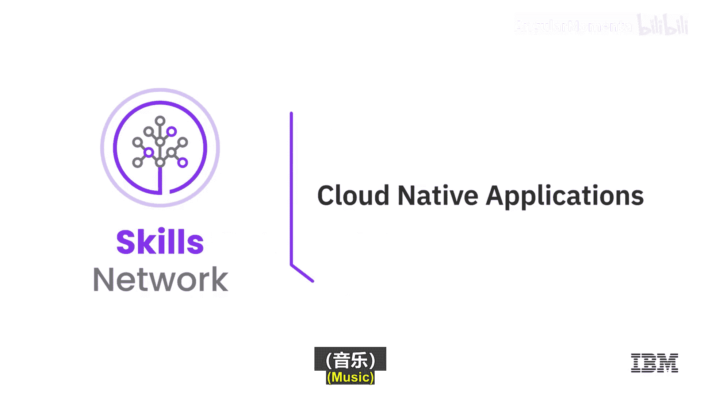
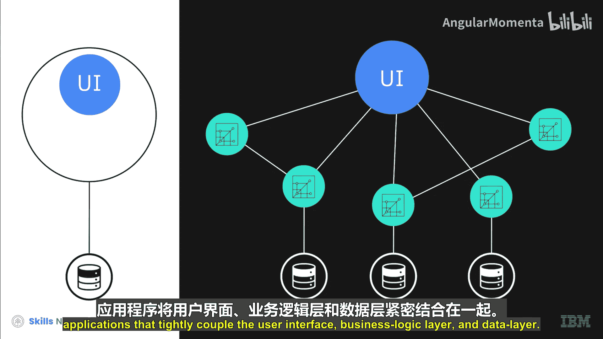
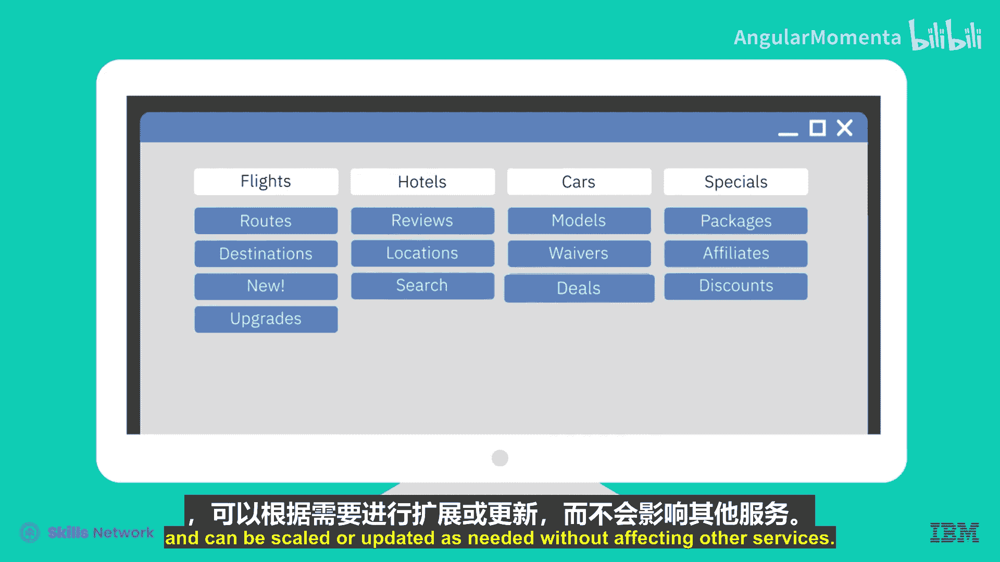
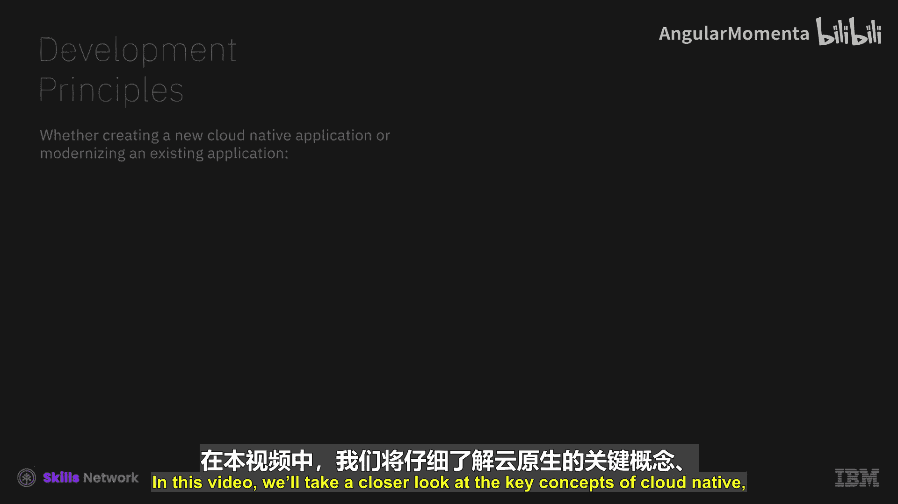
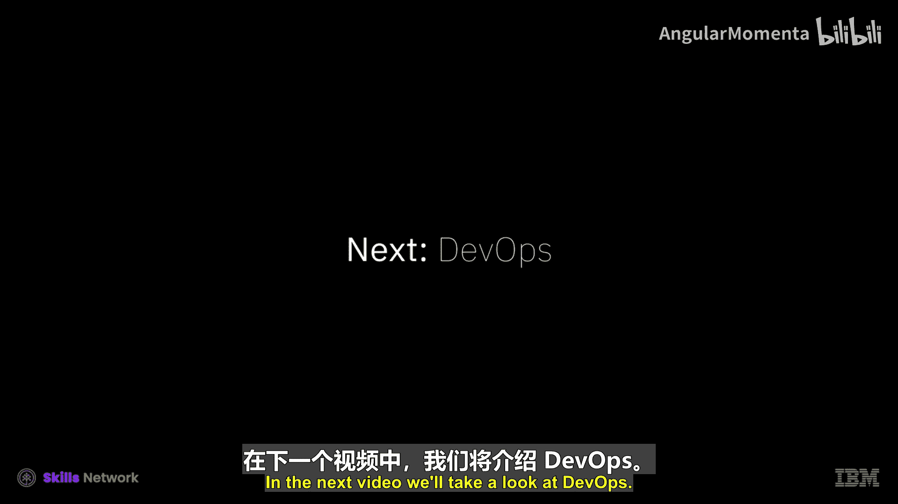
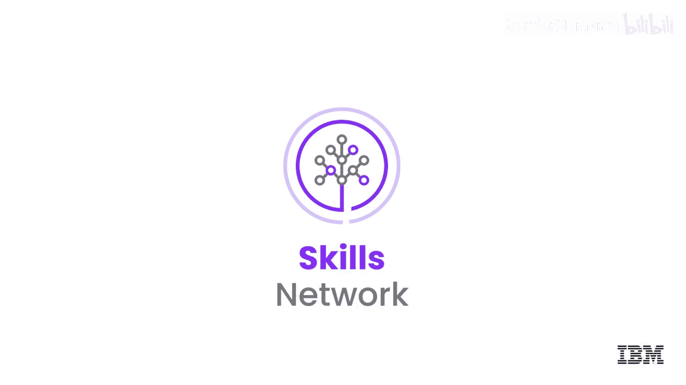

# 【IBM】云计算导论-｜-Introduction-to-Cloud-Computing-p38-04_02_01_云原生应用--BV1X66rBqE8G_p38-

Simply put， a cloud nativeative application is an application developed from the outset to work only in the cloud environment or an existing app that has been refactored and reconfigured with cloud nativeative principles。

A cloud nativeative application consists of microservices working together as a whole to comprise an application。

 yet each can be independently scaled and iterated through automation and orchestration processes。

These microservices are often packaged in containers。

 which are executable units of software in which the application code is packaged along with its libraries and dependencies so that it can be run from anywhere。

The independence enables frequent iterative improvement of cloud native applications without disrupting the experience of end users。

Cloud native applications are unlike traditional or monolithic applications that are built out of one huge piece of software。

Applications that tightly couple the user interface， business logic layer， and data layer。

Let's take the example of how a cloud native application might be used on a travel website。

Each topic covered by the site， flights， hotels， cars， specials， is its own microservice。

Each microservice may roll out new features independent of the other microservices Specials and discounts can also scale out independently while the travel site is presented to customers as a whole。

 each microservice remains independent and can be scaled or updated as needed without affecting other services。

Whether creating a new cloud native application or modernizing an existing application。

 developers adhere to a consistent set of development principles。

Follow the Miservices architectureect approach by breaking applications down to single function microservices。

Rely on containers for maximum flexibility， scalability and portability。

Adopt Agile methods that speed the creation and improvement process through quick iterative updates based on user feedback。

In this video， we'll take a closer look at the key concepts of Cloud native。

 its benefits and use cases Hi， I'm Andrea Crawford and I'm with IBM Cloud。

So today we're going to talk about cloud native apps in the heritage world we have our lumpy monolithic apps。

And in the new world， we have our microservices living on the cloud。

If we take a look at this diagram here， we see we have cloud infrastructure。This is your private。

 your public， and your enterprise infrastructure， cloud native apps apply to hybrid and multi cloud situations。

We also have our scheduling and orchestration layer。

This layer is all about control planes like our Kubernetes。

We also have our application and data services layer。This layer is all about backing services。

And being able to integrate our application code with existing services that may be available on other clouds or even on premise。

We have our application runtimes， these are what were traditionally or conventionally known as middleware。

And over here， well， that's where we have our cloud native apps。

 this is the sweet spot right up here。So our application code。Is actually designed。

Built and delivered very differently for Cloud native than it would be for conventional monolithic lumpy apps over here。

So let's talk a little bit about why cloud native apps can actually leverage benefits like。

Enabling innovation。Business agility。And most importantly， from a technology perspective。

The commoditization。Of this solution stack over here。

So as time has progressed and technologies have matured and emerged。

A lot of the services are actually being refactored lower down in this stack。

This means that core surface are starting to have a lower center of gravity。

 freeing up innovation at this level over here。So what are our use cases for when to build a cloud native app？

Star everything。Everything that lives in the cloud should have。A cloud native app， design and App。

This means our application code needs to be instrumented with things like standardized logging。

 standardized events， and being able to match those logging and events to a standard catalog that multiple microservices and cloud native apps can use the last thing we want to do is have our development squads have to figure out what their log and event messages should be Let's standardize that because we want to be able to commoditize that as well We also need to have things like distributed tracing。

When we get over into the microservices world over here。

We have a lot of moving parts this means we're going to need to leverage services core to the system like load balancing。

 service discovery and routing these are the kinds of things that are commoditized in this layer here with things like Istio。

And with the emergence of newer projects like K nativeative。

 and so if we were to recognize the benefits for cloud native apps and to sum it all up。

We are all about enterprise and engineering at scale。In the next video， we'll take a look at Dev Ops。

