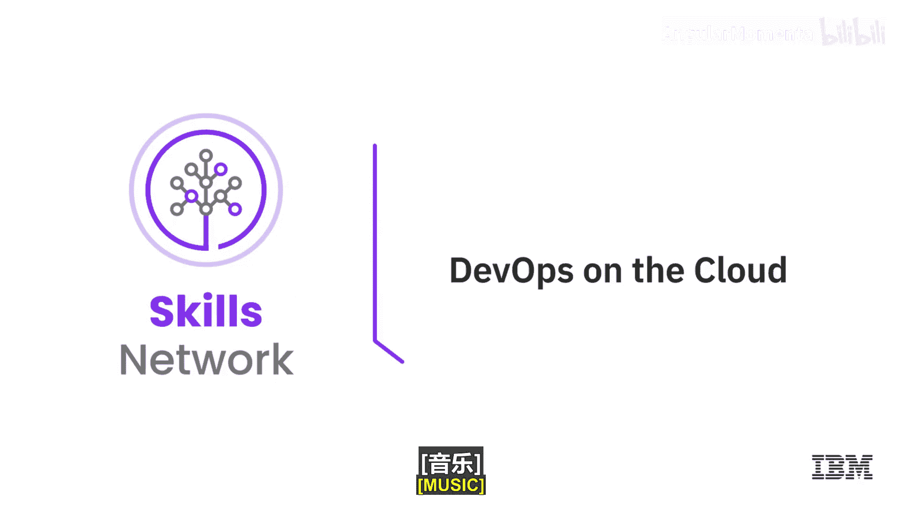
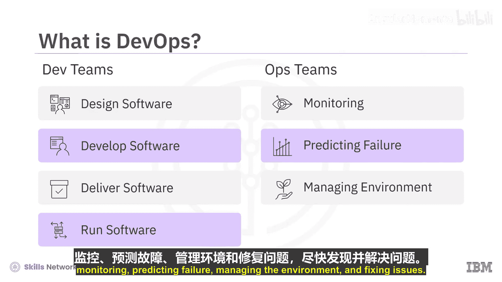
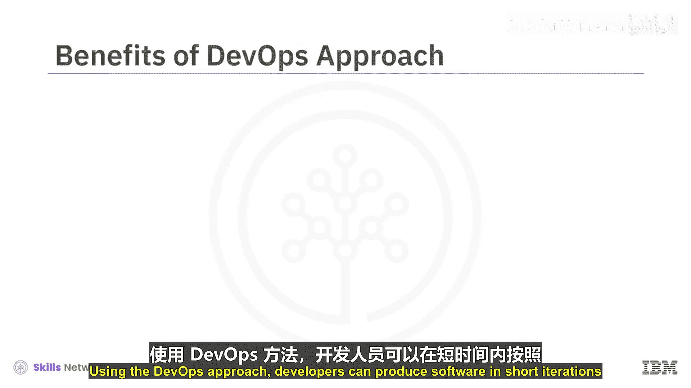
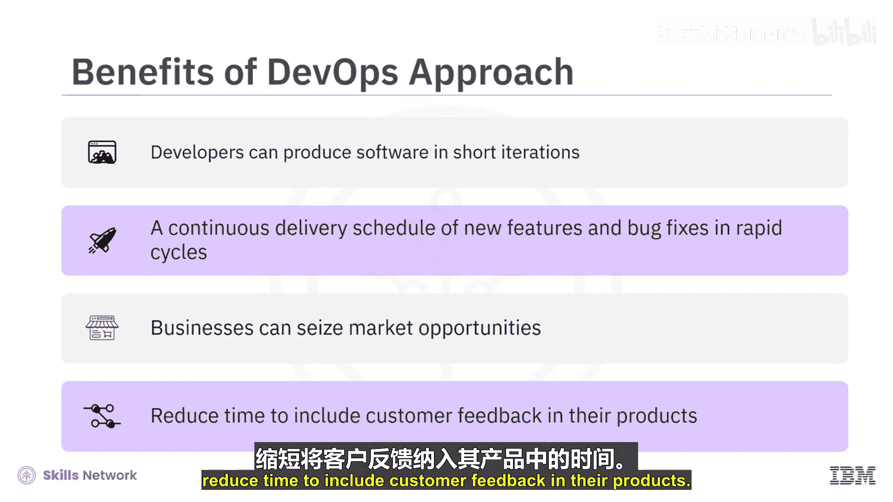
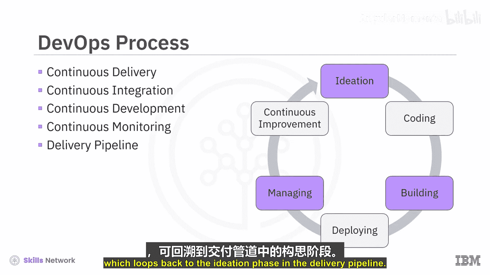
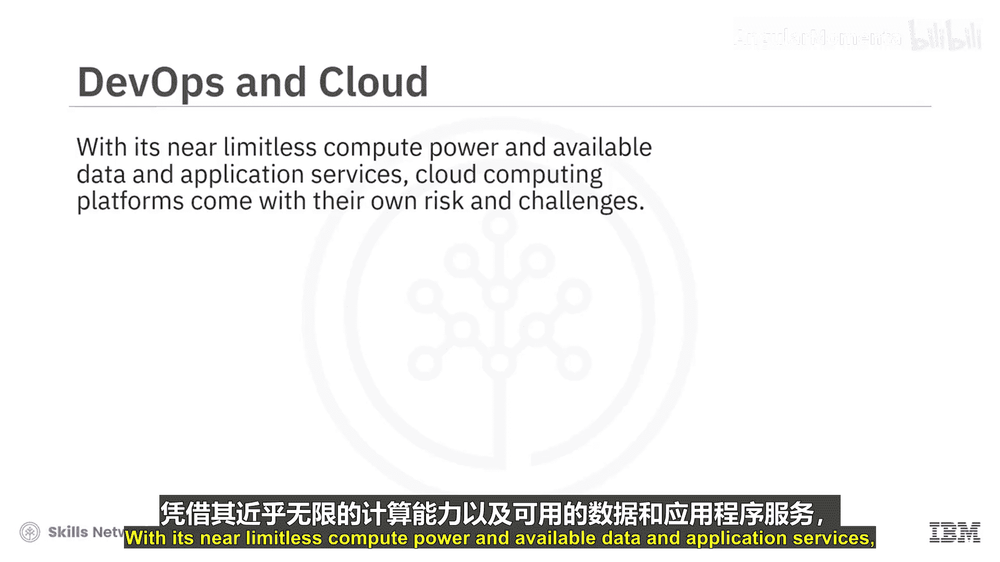
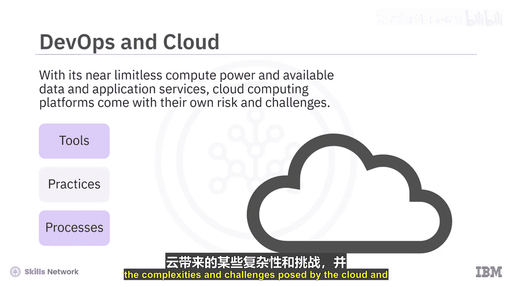
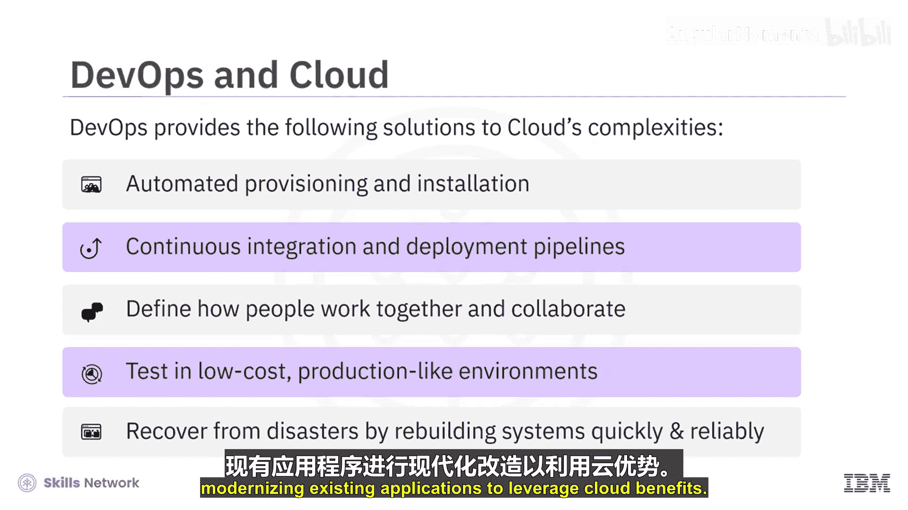

# 【IBM】云计算导论-｜-Introduction-to-Cloud-Computing-p39-04_02_02_云端开发运维--BV1X66rBqE8G_p39-

Development teams need to design， develop， deliver and run software as reliably and efficiently as possible operations teams need to identify and resolve problems as soon as possible by monitoring。

 predicting failure， managing the environment and fixing issues combining development and operations with the ability to monitor and analyze and optimize bottlenecks gives us DevOs a collaborative approach where business owners and the development operations and quality assurance teams collaborate to continuously deliver software。

 a DevOs approach applies agile and lean thinking principles to all stakeholders in an organization who develop。

 operate or benefit from the business software systems， including customers， suppliers。

 partners by extending lean principles across the software supply chain。

 DevOs capabilities improve productivity through accelerated customer feedback cycles unified。

Measurements and collaboration across an enterprise and reduced overhead。

 duplication and rework using the DevOs approach developers can produce software in short iterations on a continuous delivery schedule of new features and bug fixes in rapid cycles and businesses can seize market opportunities and reduce time to include customer feedback in their products the DevOs process involves continuous delivery。

 which is about delivering small welldesed highqu increments of software to customers continuous integration creating packaged builds of the code changes released as immutable images where immutable implies that when modifications are needed。

 the entire component is replaced with an upgraded version continuous deployment which involves progressing each new packaged build through the deployment lifecycle as rapidly as possible continuous monitoring with tools that help developers understand the performance and。

Of their applications even before they are deployed to production delivery pipeline。

 which is an automated sequence of steps that involves the stages of ideation， coding， building。

 deploying， managing and continuous improvement which loops back to the ideation phase in the delivery pipeline while DevOs can apply to applications anywhere there is especially a compelling case for DevOs when it comes to cloudready and cloud native applications with its near limitless compute power and available data and applications services。

 cloud computing platforms come with their own risks and challenges DevOs tools practices and processes are helping tackle some of the complexities and challenges posed by the cloud and allowing solutions to be delivered quickly and reliably Let's look at some core capabilities that DevOs provides to help building and running applications in the cloud a lot more manageable。

DeevOs best practices make it possible to programmatically provision servers build middleware。

 install application code and fully automate the installation process in a way that is documented。

 repeatable， verifiable and traceable application deployments often involve considerable complexity The DevOps practices of continuous integration and continuous deployment help create a fully automated deployment pipeline。

 which is important all through the application development lifecycle Cloudn applications form a complex distributed system with multiple moving parts。

 independent tech stacks and rapid release cycles DevOs principles are essential to define how people work together to build。

 deploy and manage applications in a cloud native approach With the DevOs best practices of automated provisioning and continuous deployment developers quality Pro and other stakeholders can in。

LCost production like test environments that were previously not available。

 enhancing both productivity and quality When systems are compromised or struggling to recover from natural disasters。

 DevO's best practices make it possible to rebuild these systems quickly and reliably DevOs provides a powerful set of principles。

 practices and tools to realize the full potential of cloud nativeative computing。

 as well as for modernizing existing applications to leverage cloud benefits。

