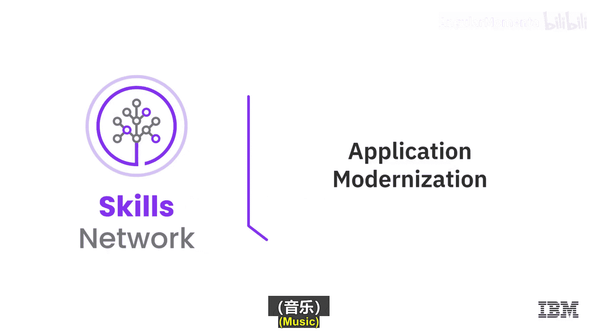
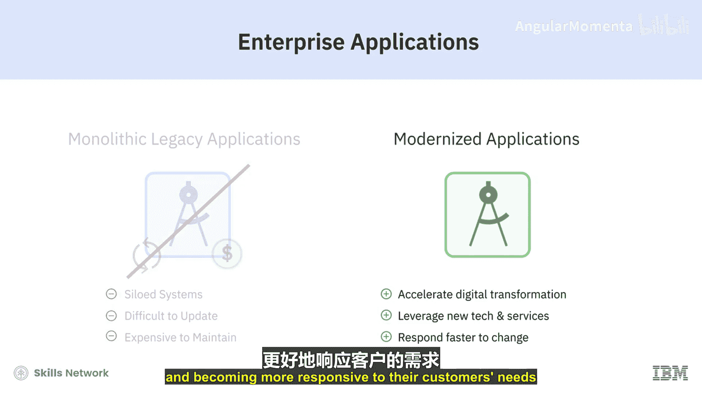
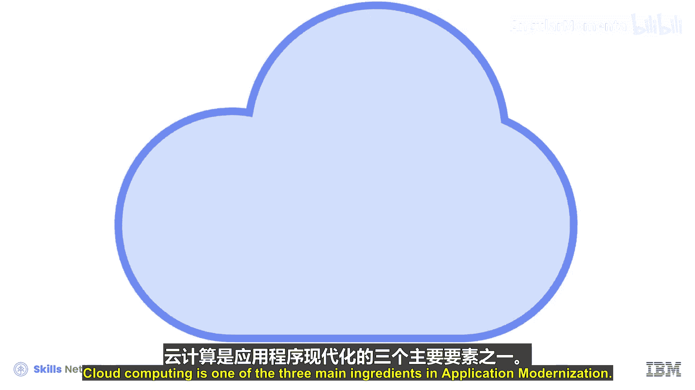
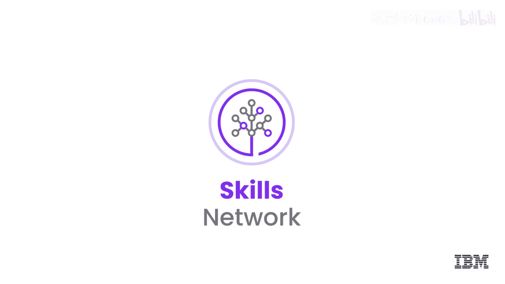

# 【IBM】云计算导论-｜-Introduction-to-Cloud-Computing-p40-04_02_04_应用现代化--BV1X66rBqE8G_p40-

Many organizations have huge investments in existing applications that are often siloed in legacy systems and are very difficult and expensive to update and maintain。

Modernizing these applications can unlock great benefits for these organizations。

 such as accelerating their digital transformations。

 enabling them to take advantage of new technologies and services。

 and becoming more responsive to their customers' needs and changing market dynamics。

Cloud computing is one of the three main ingredients in application modernization in the rest of this video。

 we will see how and what else application modernization entails。

Hi， I'm Eric Minnick with IBM Cloud， and I want to talk about application modernization and three huge transformations that have been going on together。

so we've got three things going on， they're interrelated， and this is what we're seeing。

 this change in how we're doing architecture， infrastructure， and our ways of working。

 how we deliver。And if we go back in time a little bit。

 you we saw applications that were very monolithic。

They were running on physical servers and we used waterfall style development where we'd have long plans and we'd say。

 okay， this is going to be our planning phase or development phase or testing phase。

And we could plan out a year as a project and that's really what we've gone away from so if we look at how most organizations are working today。

architectecturally， they've got some sort of distributed architecture it's usually related to like a service oriented architecture。

 the the big buzzword a few years ago。Um， but some sort of distributed architecture。

 we have a bunch of web services， they're talking to each other。

 weve got some databases on the back end。And then some front ends that kind of go through all that。

On an infrastructure level， they're running on some sort of a virtual machine， right？So we said。

 we could probably do better than having to order a new server every time we have a new service。

Let's virtualize this stuff and we need a little more density along the way。

And from a way of working， you know， agile development。

Pretty normal and then trying to figure out a little bit of what happens downstream。So。

This kind of takes us up to where a lot of teams are today， but not really where they're going。

And so if we look at kind of that next phase。We're taking another path at this service oriented architecture and really shrinking the sizes of the services。

 taking advantage of the more dynamic infrastructure we have。

And we're calling these now microservices， right？Micro services。

So we got a microservice architecture， so very small。

 very focused services moving away from a lot of the heavyweight XML based communication we saw in soA towards more rest based communication and things like that。

 but same idea， let's keep breaking into smaller and smaller pieces。

 we have more independence of what we ship more rigor in saying this service needs to be independent from another service so I can change these things by themselves。

On the infrastructure side。Cloud。Cloud's pretty popular and this could be public cloud。

 this could also be private cloud， I'm painting with a very broad brush when I say cloud here。

And then from a delivery and a way of working， we could say that Devops。is really key。

 and I would include in this approach like site reliability engineering SRE。U。

More the ways of working we have today。No。That's fine and interesting but what do these things have to do with each other and I'd argue that what we're really seeing is modernization in how the applications are delivered and how they're built what they are and while you could walk into any large enterprise today and you'll find somebody who says we are going through a cloud transformation and you'll often find somebody says yes。

 I'm in charge of leading the DevOs transformation and you'll walk in enterprise architecture and they'll say yes。

 we are pushing microservice architectures individuals think that they're going through three separate transformations but they're really tied right？

If I'm。Doing microservices， right， and I have new microservices all the time。

And in order to get a new microservice up and running。

 I'm over here and I have to order a new physical server and then rack and stack it a couple months later。

I'm not going to get any time to market benefits。The resilience benefits that I'm going to normally look for for microservices are going to be modest at best right microservices want cloud infrastructure。

 you want to be able to say I've got a new microservice。

 let me put it in a container and just run that container right now and scale that dynamically。

Similarly， Cloud really likes running microservices， the benefits of being able to dynamically scale。

Are really cool when you have a lot of small things that you might need few of or a lot of。

It's not as interesting when I've got a monolith。That isn't even distributed。 How do I scale that？

Bigger cloud server。And then all of this is kind of baking in this idea of speed and resiliency。

And DevOs brings that together， right， the developers who have always wanted speed， the operations。

 people whove always wanted that resiliency。They're going to be programming that cloud， right。

 the programmable infrastructure the cloud provides needs operations。

 people who understand resiliency， but bring some of that development skill in。

And to really take advantage of these new infrastructures， the new architectures。

 you need these new ways working， and you also are going to say if this is going to give me time to market benefits。

I can't be back here。And say， yeah， no we've got a one year project plan that we're just going to execute。

I need to be able to be more agile and adapt in my planning and my responsiveness to the business。

 I need to better wire up my application so they can be more easily monitored and more resilient we have to have the application in a way that it knows when one of these services is failing and we can spin up another。

So。This is really， for me fascinating that you walk into these organizations everywhere and they're undergoing these three different transformations。

But they're always doing them together and when they don't。Doesn't quite work。

So you've got these three transformations going on at once。

And you'll hear us talk a lot about application modernization right see that written across the top here。

And when I think of application modernization。I think it's just this， it's this transformation。

Right here。Going from these kind of monolith or service oriented architectures to microservices。

 adopting cloud， modernizing our ways， working towards DevOs and SRE。

That's Atmod and it's a really exciting time and it's really great when you're able to go after it in a holistic fashion。

