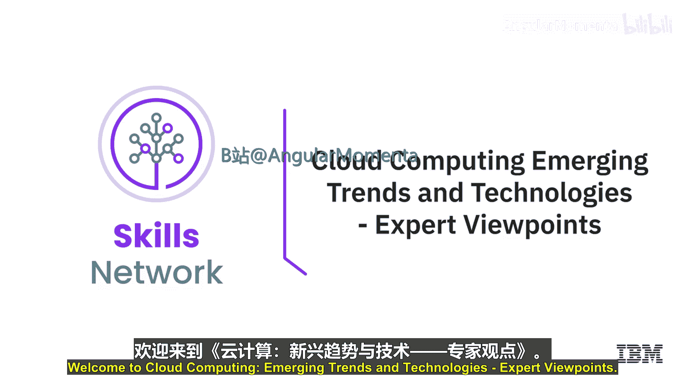
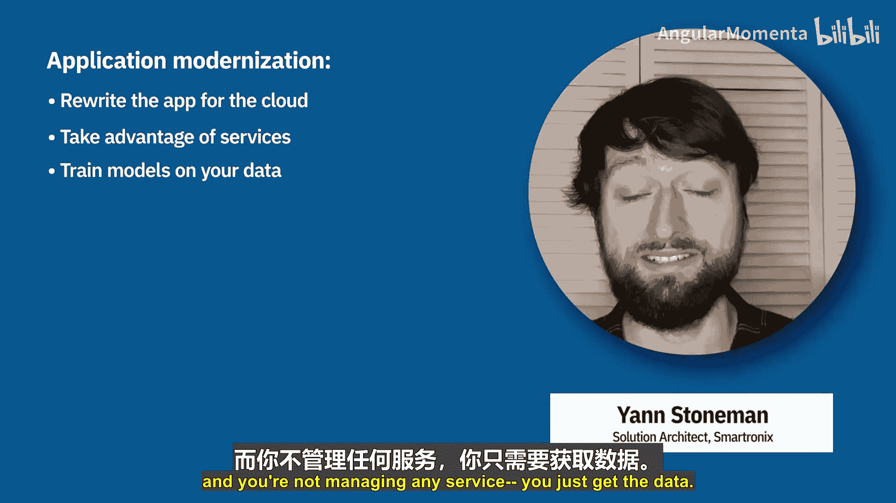
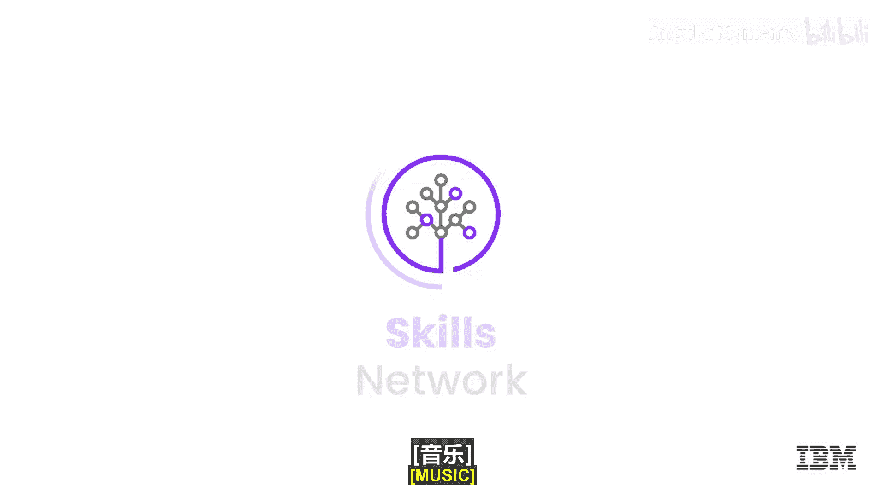

# 【IBM】云计算导论-｜-Introduction-to-Cloud-Computing-p41-04_02_05_专家观点：云原生与新兴云趋势--BV1X66rBqE8G_p41-

Welcome to cloud computinguting， Emerging Tds and Techologies expertert Viewpoints。

In this video， we will listen to several cloud application professionals discuss trends and technologies in cloud computing。

😊，The top three trends that I see coming in the next couple of years are as follows。

 first is this idea of a hybrid cloud。As IBM has predicted。

 a lot of companies and clients will move from a single cloud provider to multiple cloud providers that could be multiple public clouds or a public cloud in on premisem private cloud。

Second， I see this big surge of edge computing becoming more prominent in cloud computing now the terms may seem quite different from each other and disjointed。

 but in many sense the cloud computing will go on the edge。

The numbers state that quite overwhelmingly， there are 75 billion devices are supposed to come up online by 2075 and the edge computing in order to be able to communicate between devices and back to the server is going to be very crucial and lastly。

 it's the usage of machine learning and artificial intelligence to make decisions for us in the cloud computing space。

So these are my top three trends that I see coming in the next couple of years。

So one of the emerging trends in cloud computing is serverless and that's the area of cloud computing where all you need to do is give the cloud your application logic and that means。

You don't need to patch any servers， you don't need to。

Manage the high availability of your infrastructure。

 you don't have to put in multiple availability zones。

The cloud provider takes care of all of those operational issues for you and all you do is give it the code and it runs it on demand。

 so every time you have an event triggered， let's say it's a voice assistant and every time you talk to it。

 it triggers a cloud function。That is what that's what serverless is and so developers love it because with serverless。

 you don't need to do all the undifferentiated work。

 though the work that does not make your app unique。

 you can focus on the logic that makes your app unique。

So in terms of emerging technologies one of the big ones is cloud native cloud native architecture and that includes the trend towards microservices basically dividing up monolithic applications what would have been monolith monolithic legacy applications into you know granular microservices and this affords a whole range of advantages another one is containers and container orchestration systems and most notably the。

Docker and Kubernetes technologies。Another is serverless services where some functional code can be spun up with very low latency without the need to manage any virtual servers。

 and the term cloud native architecture really encompasses some combination of all of these。

In terms of emerging trends。So I'd like to discuss a couple trends I see all the time in cloud computing right now first of all we have serverless computing and that's the idea that you don't have to worry about anything other than writing the code for your application you don't need to know are you deploying Kubernetes do you need to know IP addresses is this Linux nothing and I really see this is the future because you don't want to have to worry about how it's deployed managing RAM managing CPU。

 any of that stuff， you just want to create code and the easier that it is to get your code from written to deployed and running well。

 the better and to win for everybody？Another area that's emerging in cloud technology is DevOs。

And with DevOs。You have the developers a lot more integrated with operations。

 so you've got a CICD pipeline where the developers can push their own code and see it live on the servers or the serverless functions。

And that。You know， Devopps is a term that。Has a lot of different definitions。

One definition I've enjoyed hearing is that it means the developers are talking with operations and vice versa。

 that there's a dialogue going on and it's not just how it was in the past where the developers hand over the code。

 but the developers really see，The life cycle through to it being maintained in production。

In terms of emerging trends。We're seeing comprehensive cloud services for building data pipelines。

 data science in general and artificial intelligence services。

 and specifically we're seeing low level AI services to build AI solutions from the ground up。

Along with higher level pre trained AI solutions for things like image recognition。

 speech applications， you know， just to name a few。

Another whole area of advancement is in the area of cybersecurity。

 it's obvious that cybersecurity is something that we have to be constantly aware of and improving all the time。

 and we're seeing a constant stream of improvements to secure your network perimeter compute resources and data in the cloud。

Another emerging trend in cloud computing is application modernization。

With cloud providers coming out with all these amazing services that do a lot of things for you。

The companies are thinking， waitai a second。The cloud provider is doing certain features of our application better than we are。

 and instead of continuing to maintain that part of our application ourselves。

 let's rewrite the application to take advantage of these cloud native services， for example。

 there are services now that do transcription or image recognition and rather than have your own。😊。

You know， inference and training servers that you manage and you use open source。

 you know machine learning models that you host and you train those models on data that you give it。

Don't do any of that， just drop the images in a image recognition service of a cloud provider and。

And you're not managing any service， you just get the data。

