# 【IBM】云计算导论-｜-Introduction-to-Cloud-Computing-p42-05_01_01_什么是云安全-第一部分--BV1X66rBqE8G_p42-

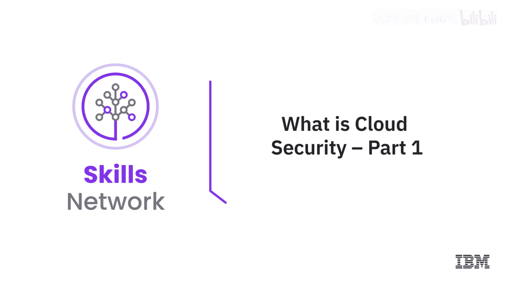

Welcome to what is Cloud Security Part1 Today， organizations are moving towards digital transformation with the introduction of cloud computing。

 They are changing their infrastructure and incorporating cloud based tools and technologies。😊。

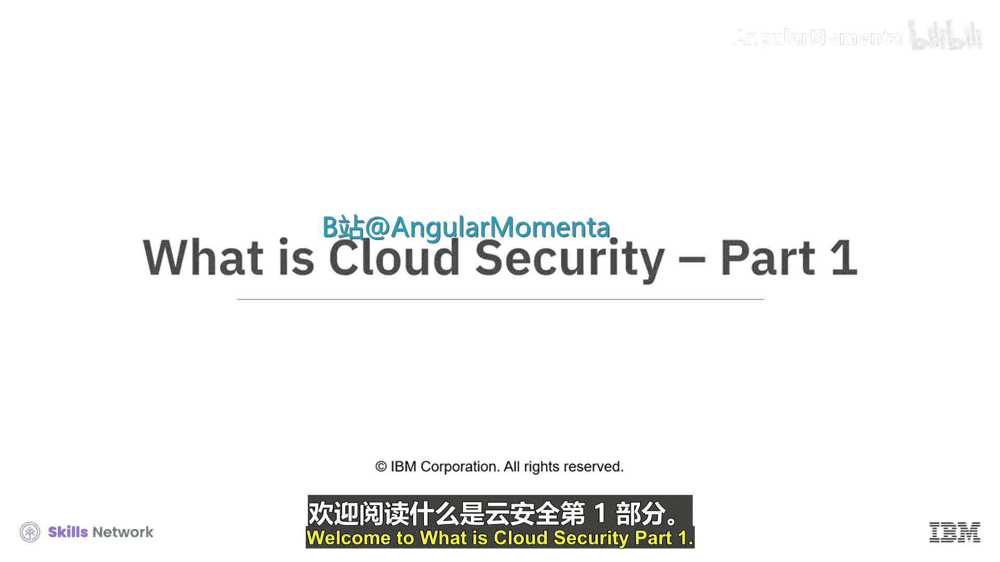

This transition to cloud based environments can have several adverse consequences。

If cloud based technologies are not used securely， the organizations can be subjected to external threats that can be a danger to their business security。

Thus， to gain the maximum benefit enterprises when using interconnected Cloud technologies require the best cloud security procedures in technology。

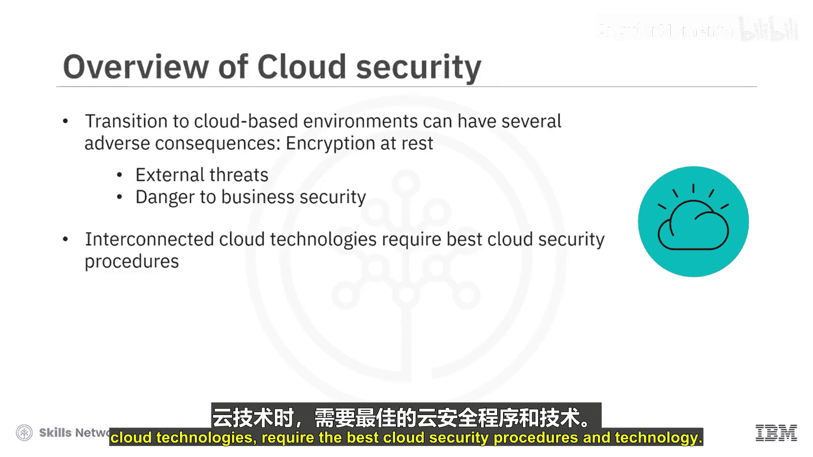

A cloud computing environment offers different as a service models that enable organizations to offload many time consuming I related tasks。

 Exles are infrastructure as a service， IS platform as a service， pass and software as a service。

 Saas computing models。😊。

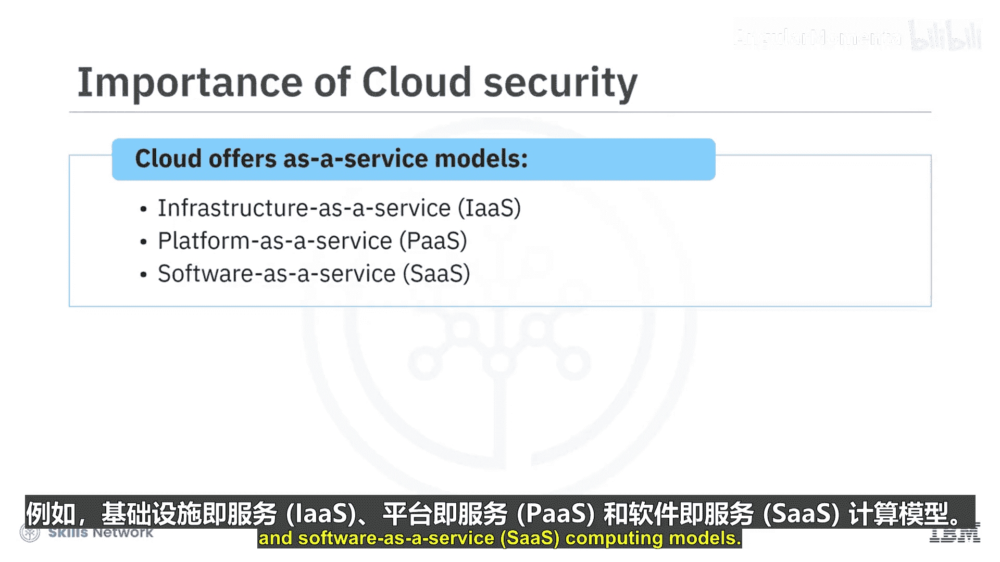

However， while using these services， organizations may encounter many challenges related to data security。

Although third party cloud computing providers follow security best practices and ensure the integrity of their servers。

 data asset management is still the responsibility of the organization availing these services。

 with the evolution of cloud computing environment。 Security threats have also become more advanced。

 These threats target cloud computing providers because of a lack of transparency in the data movement and access across the cloud。

 Thus， organizations need to be compliant and have the right approvals when managing client data stored on the cloud。

 A successful deployment of the cloud infrastructure is dependent on the countermeasures to secure against modern day cyber attacks。

😊。

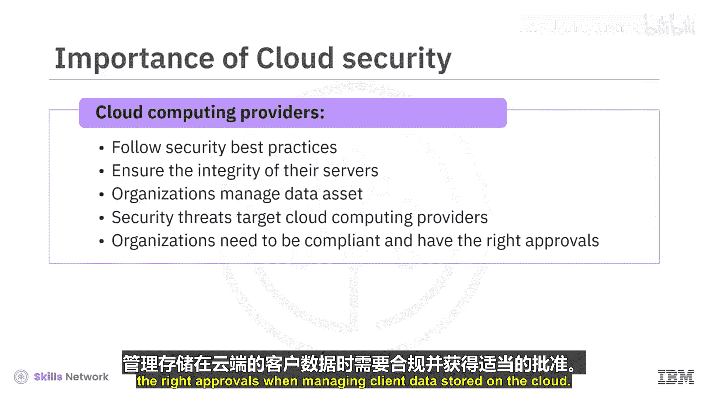

You should have adequate cloud security solutions in all cloud environments。

 whether they are private， public or hybrid， to ensure business continuity and security。

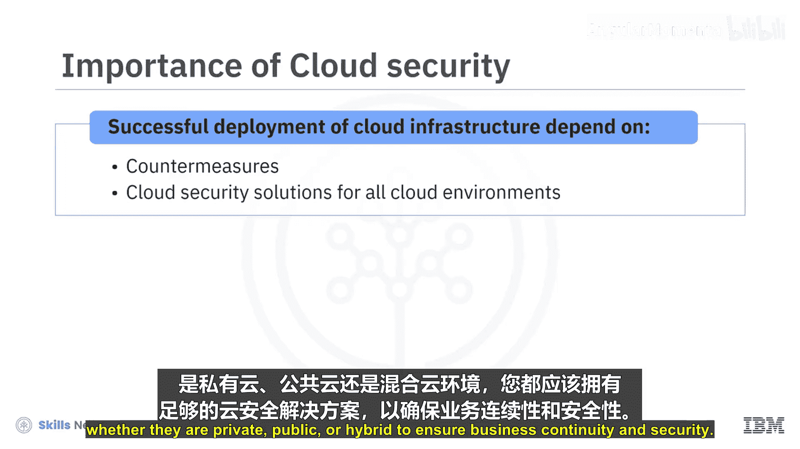

Identifying the right cloud security solution requires various considerations。 Let's discuss them。

First is lack of visibility in a public cloud environment。

 It is difficult to keep track of who is accessing your data and which cloud service they are using outside your organization。

Second is multi tenancy in a public cloud environment。

 Multiple client infrastructures might be hosted by the same cloud computing provider。

 Your services might get compromised by malicious attackers when targeting other businesses。

Another challenge is access management and shadow I T。

 You may find it difficult to restrict unfiltered access to your services from any device and geolocation in a cloud environment。

 Finally， misconfigurations of assets are also accountable for breached records in a cloud environment。

They include inappropriate privacy settings or retaining default administrative passwords。

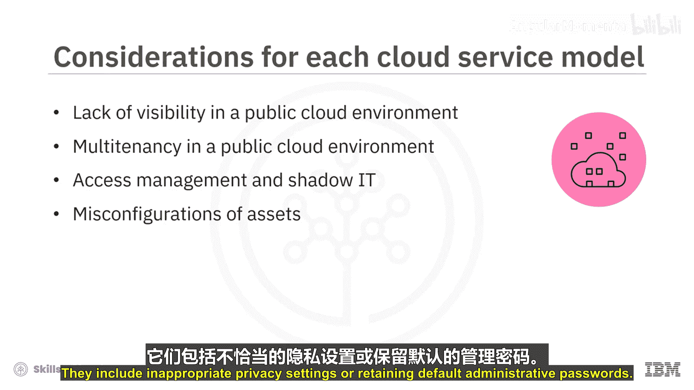

Next， let's discuss some evolving threats and risks in cloud computing。

 Insider threats are caused by current or former employees， business partners。

 contractors or anyone who has had access to systems or networks in the past。They can， at any time。

 abuse their access permissions。 This category of threats is invisible to external security systems and thus are more dangerous。

 Another prevalent attack on the cloud computing system is distribute denial of service， D D S。

A DD S attack targets the server on the enterprise by overloading it with traffic from multiple synchronized systems。

The attack works through simple network management protocol SN NP， used for modems， printers。

 switches， routers and servers。The cloud faces another critical risk and that is data breach。

A breach can be due to a leak in the cloud security measures used by your organization。

Miicious users may gain access to sensitive data and misuse the information。

A breach can cost the organization a financial and reputation loss。

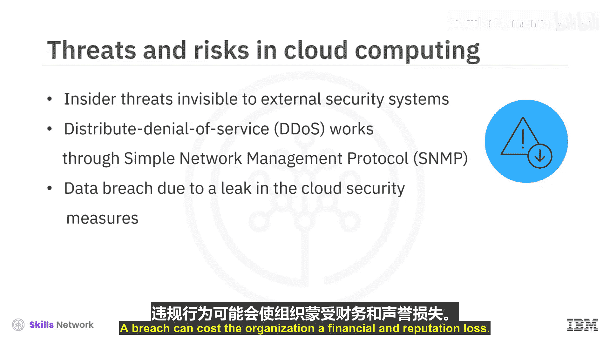

Now， let's understand the different security models used in cloud computing。

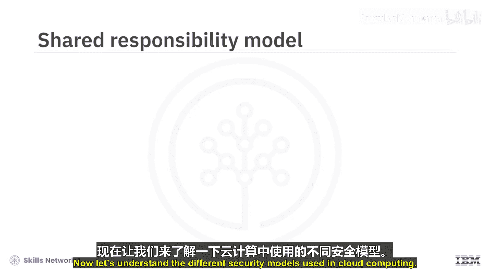

A shared responsibility model is a cloud security framework where the organization hands off certain I security responsibilities to the cloud computing provider。

 Each party， the cloud provider and the user are accountable for different aspects of the security and they work together for the full security coverage。

 They are different types of shared security models for Ios， Pass and Saas。

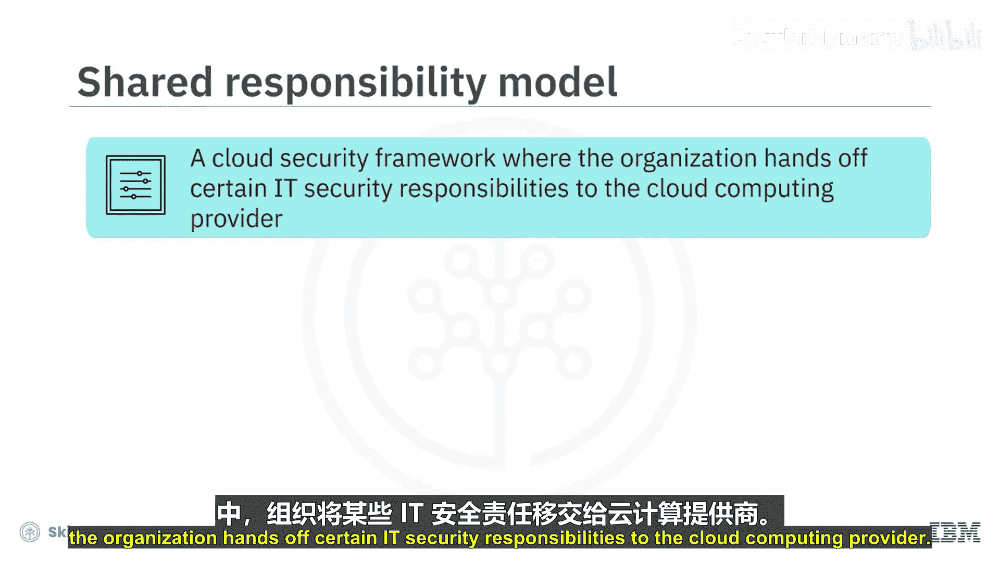

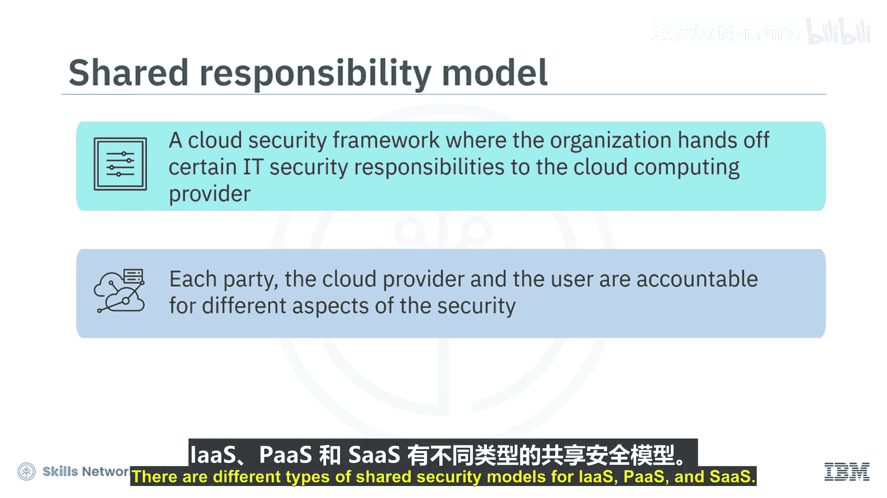

And I ask， the provider looks after the physical security of the infrastructure at their data centers。

IS users are responsible for the security of the software。

 including the OS required to run their applications and their data。In pass。

 the provider secures the platform， including the OS， user subscriptions and login credentials。

 but the user is responsible for the security of any code or data or other content produced on the platform。

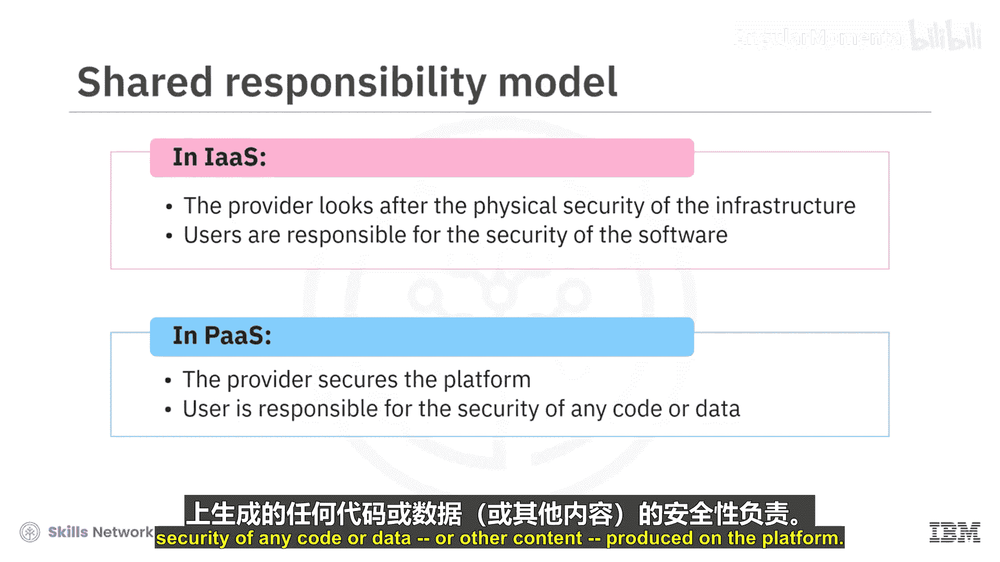

However， in Saas， the provider is responsible for almost every aspect of security。

 including underlying infrastructure， service application and the data the application produces。

 Use still have some security responsibilities， such as protection of logging credentials。

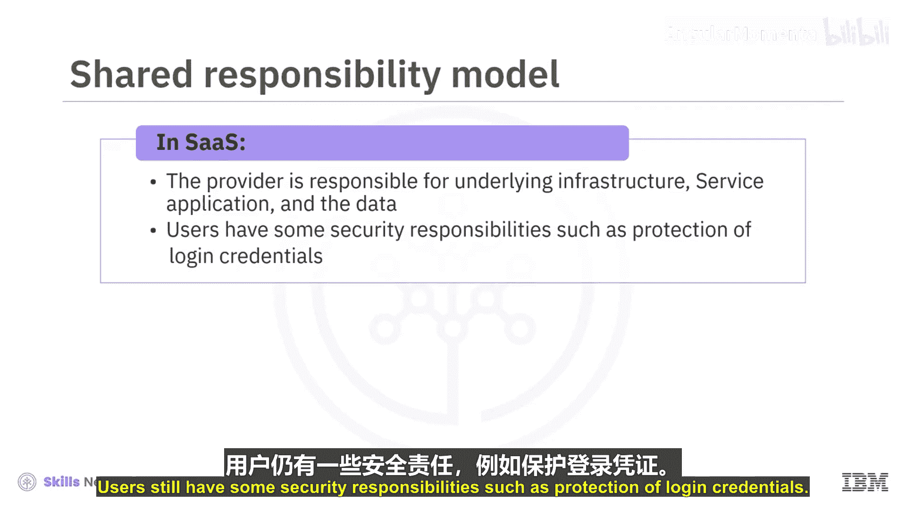

。