# 【IBM】云计算导论-｜-Introduction-to-Cloud-Computing-p43-05_01_02_什么是云安全-第二部分--BV1X66rBqE8G_p43-

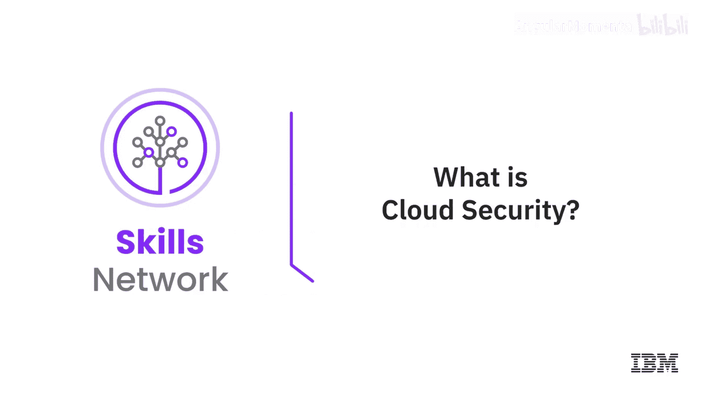

Welcome to what is cloud security Part 2 Or are migrating their workload to a hybrid cloud environment。

 increasing the threat attack surface This expansion can result in new data security and compliance challenges thus you require a robust data centric cybersecurity program to protect your data。

In addition， you require centralized visibility and monitoring against unauthorized access， exposure。

 or data theft across your enterprise data environment。

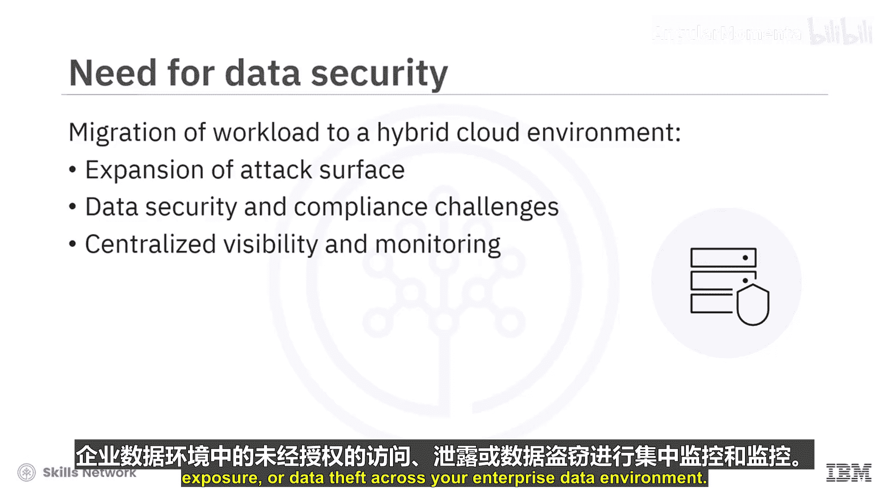

Let's discuss some data security capabilities that you can implement to protect your data to secure data。

 you can improve maturity across people， process and technology。

 identify your most critical data assets who has access to them and how they are protected。

 you can prevent data loss by detecting， preventing and enforcing policy violations to avoid accidental data loss。

Implement data security governance by establishing process， metrics。

 and continuous steady state data discovery and classification。In addition。

 it is critical to monitor database security by enforcing data protection and compliance policies across hybrid cloud environments。

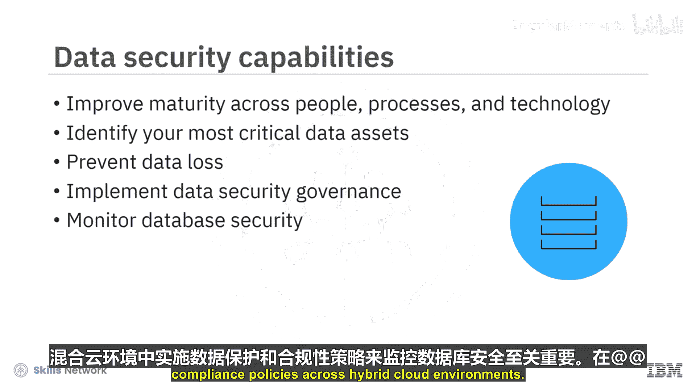

Your next focus in a cloud environment should be the management of access controls and authentication。

You need to develop cloud identity and access management， IAM。

 strategies that provide and work on zero trust architecture， risk protection。

 and constantly authenticate any user to any resource。

An organization should consider the following points while building the IBM cloud。

Modernize at your own pace， matching your business requirements。

 retain your existing investments and on- premises applications while slowly inducting the right cloud IAM architecture to complement or replace your framework。

 establish a zero trust implementation that will provide a centralized access control。

 preserve client confidentiality， reduce insider threats and secure your remote resources。

 zero trust model and plan， use an environment that securely connects the right users to the right data at the right time。

 under the right conditions， while also protecting your organization from cyberths。

Enable scalability for your cloud IAM for millions of users or transactions without a major modification of the infrastructure。

 another element of cloud security is cloud network security， which refers to the security measures。

 technology， policies， controls， and processes used to protect data on public。

 private and hybrid cloud networks。

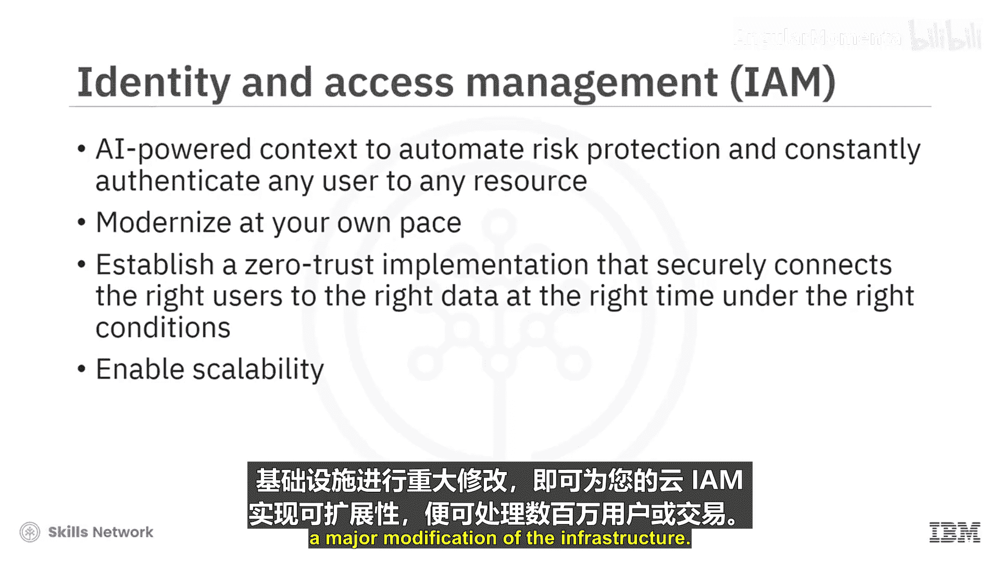

There are many security implications when you extend your network to a cloud environment to meet modern network security requirements。

 organizations need to deploy and manage network security built directly on the cloud。

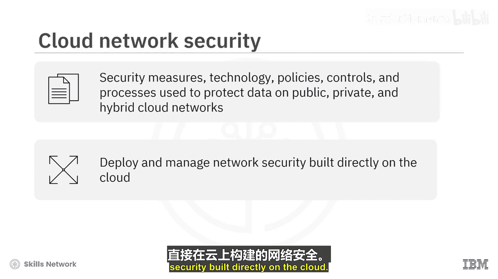

The benefits of cloud network security are centralized security monitoring and management。

 easy management and updating of granular policies。

Real time detection and powerful prevention against intrusions， DDs and other web based attacks。

 automated configuration and management， helping to eliminate misconfiguration errors and maintain control over traffic。

Encryption services to protect data at rest and in transit centralized protection and management of identity and access。

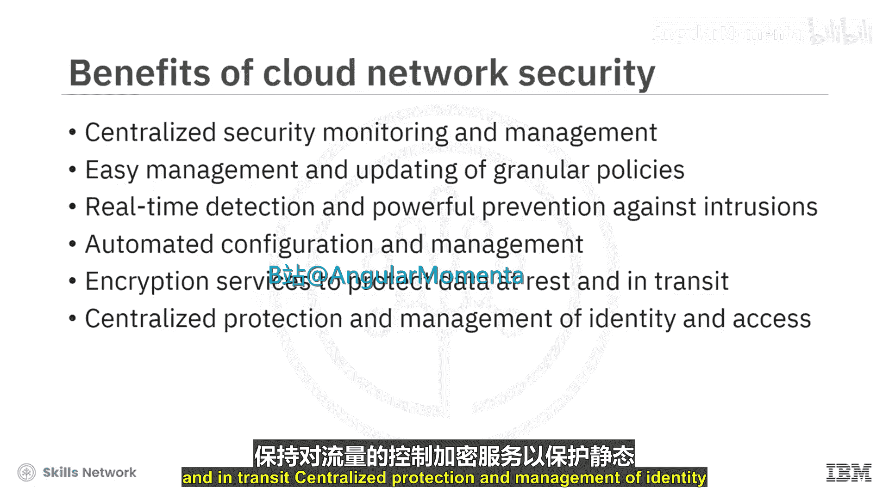

Let's summarize the best practices you can follow for cloud security。

 there are some critical steps under three phases that you can follow first is identifying your cloud usage state and risks。

 second is protecting your cloud system and third is responding to attacks。

The first phase comprises identifying how your data is accessed， detecting unn cloud usage。

 checking your configurations for cloud services， monitoring for signs of malicious usage of cloud data。

In the second phase， you can protect your cloud system by assigning protection policies。

 encrypting sensitive data， formulating policies for data sharing。

 restricting data sharing to unknown devices， implementing a bo protection and mitigation solution。

 using a proper anti malware solution。

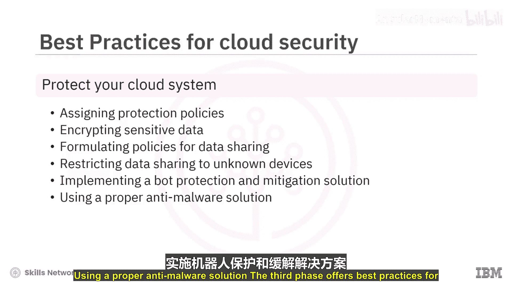

The third phase offers best practices for responding to attacks and attempts to attack。

Add additional authentication and verification steps for high risk access scenarios。

Add new policies for new cloud services。

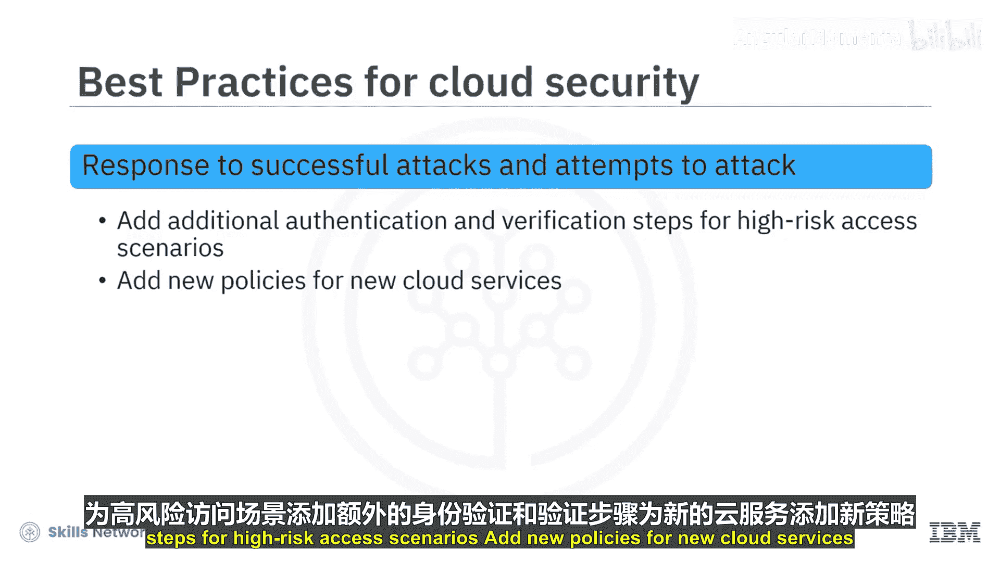

The National Institute of Standards and Technology in IST。

 has made a list of best practices and principles that establish a secure and sustainable cloud computing framework。

These principles are NST's five pillars of cybersecurity framework， identify， protect， detect。

 respond， and recover。Another emerging technology in cloud security that supports cybersecurity framework is cloud security postureture management。

 CSPM。CSPM solutions are designed to address a common error in many cloud environments。

 that is misconfigurations。CPSM also addresses issues by helping in the deployment of the core components of cloud security。

They include identity and access management， IAM， regulatory compliance management。

 traffic monitoring， threat response， risk mitigation， and digital asset management。

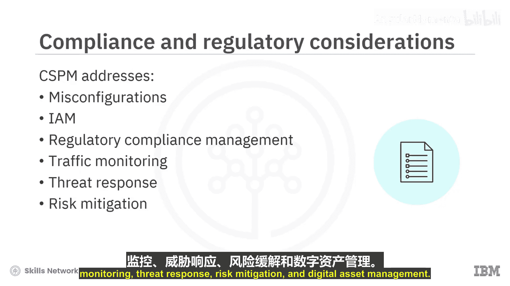

The colossal increase in cloud adoption across the cyber world will motivate cyber criminals to target organizations in the cloud environment。

Although organizations are taking adequate security measures。

 they are still vulnerable to cyber attacks。The current major trend in cloud security includes multicloud strategies such as cybersecurity mesh。

 zero trust security models， hybrid and multicloud environment， cloud native tools and applications。

 deployment of DevSAC ops， securing remote workforces。

 and AI and machine learning for threat detection。The focus is on privacy and data protection regulations。

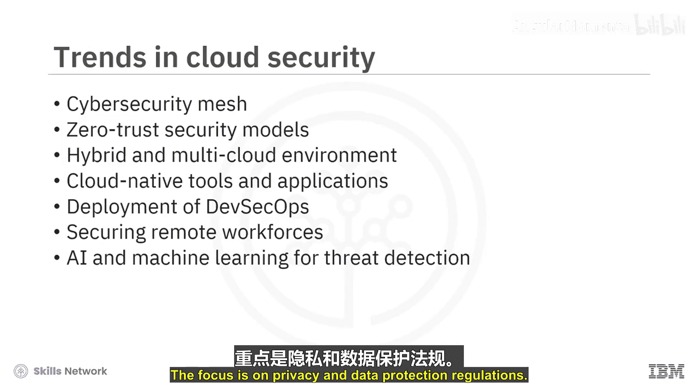

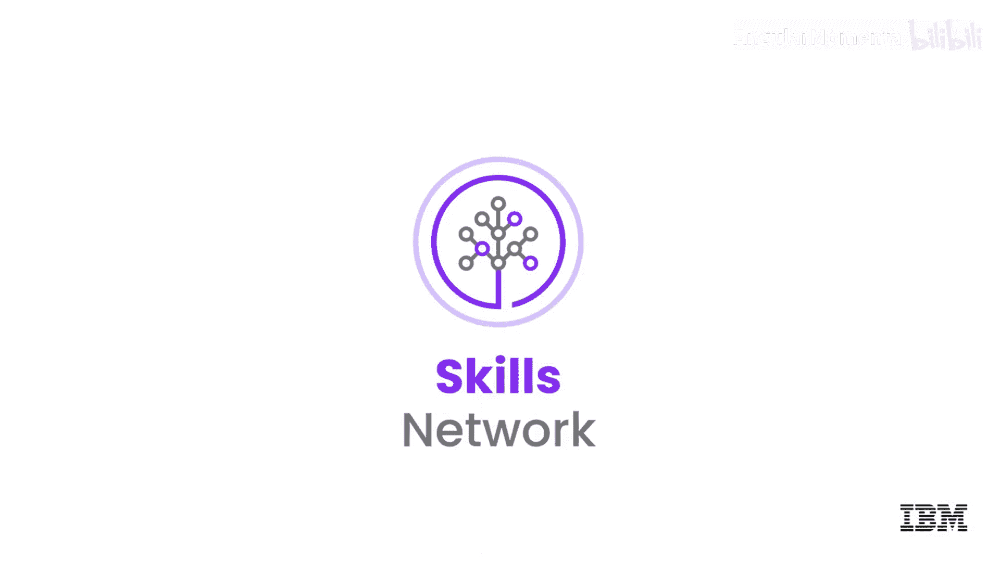