# 【IBM】云计算导论-｜-Introduction-to-Cloud-Computing-p44-05_01_04_身份与访问管理--BV1X66rBqE8G_p44-

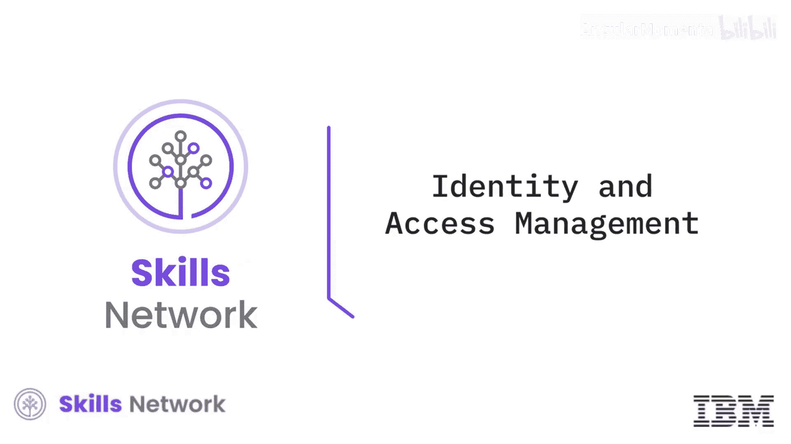

🎼According to the cloud Security report by cyberse Insiders。

 the top cloud security concern of cybersecur professionals is data loss and leakage。

 unauthorized access through misuse of employee credentials and improper access controls is the single biggest perceived vulnerability to cloud security。

 followed by insecure interfaces and APIs。

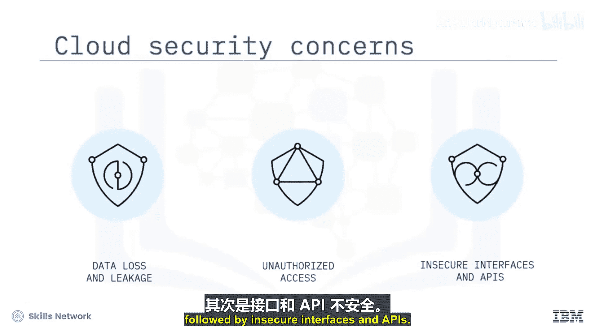

In this video， we will look at how identity and access management， also known as access control。

 works as the first line of defense， allowing you to authenticate and authorize users and provide user specific access to cloud resources。

 services， and applications。

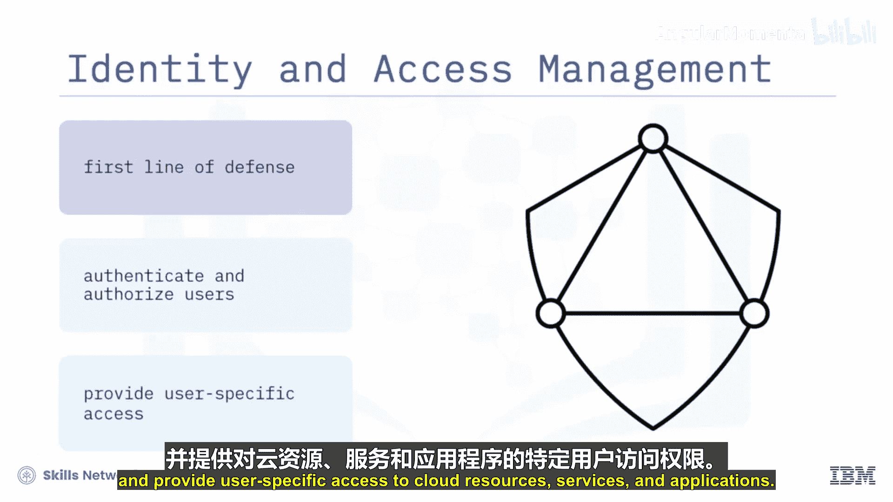

A comprehensive security strategy needs to encompass the security needs of a wide audience。

 including organizational users， internet and social based users。

 third party business partner organizations， and vendors。There are three main types of users。

 administrative users， developer users and application users。

Administrative users include cloud platform administrators， operators， and managers。

 roles that typically create， update and delete application and service instances。

 and also need insight into their team members' activities an attacker on an administrative account can steal data from production database service instances。

 deploy malicious applications inside the customer' domain。

 or even to face or destroy existing applications。Developer users include cloud application developers。

 platform developers， and application publishers developer users are authorized to read sensitive information and to create。

 update and delete applications。The third type of user is the application user。

 these are the users of the cloud hosted applications。

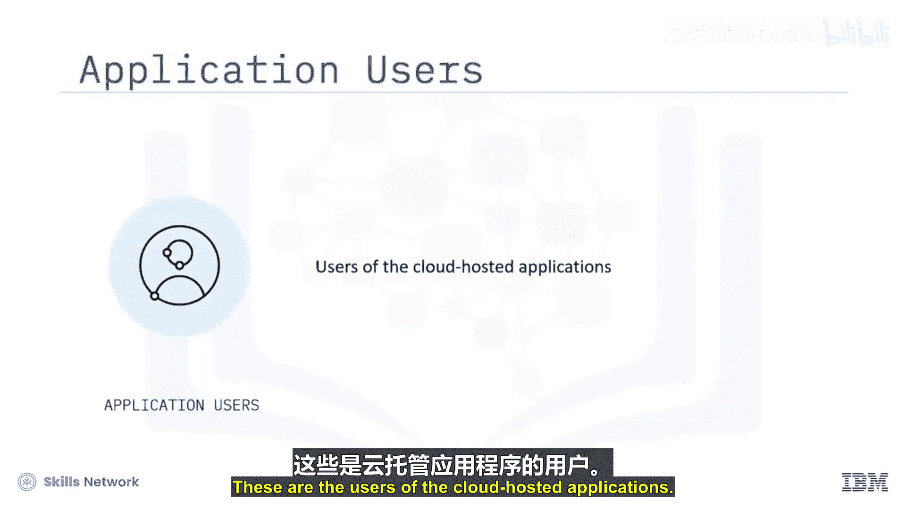

Let's look at the key components of identity and access management and how they work。

Authentation or the Ident service enables applications deployed to the cloud to authenticate users at an application level based on a range of identity providers such as the cloud directory。

 social identity provider such as Google， LinkedIn， Facebook and Twitter。

 enterprisese hostsed identity provider， and cloud hosted identity provider。

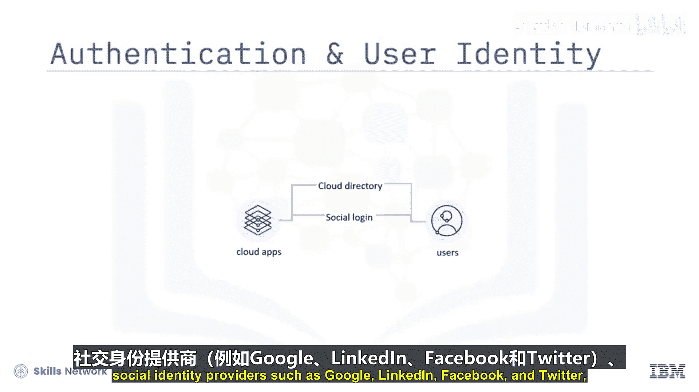

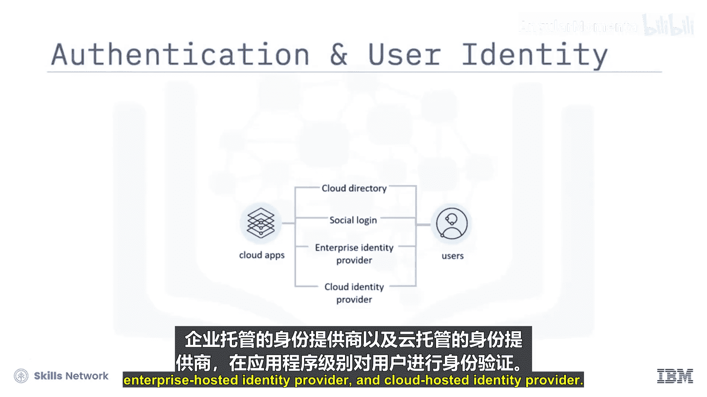

Sometimes API keys or unique identifiers are passed into an API to identify the calling application or user。

Multifactor authentication is used to combat identity theft by adding an additional layer of authentication for application users such as single use passwords or pins。

 certificates， tokens， risk based authentication such as changes in the user's location。

 past activity， and preferences。Cloud directory services are used to securely manage user profiles and their associated credentials and password policy inside a cloud environment a directory service within a cloud means that applications hosted on the cloud do not need to use their own user repository。

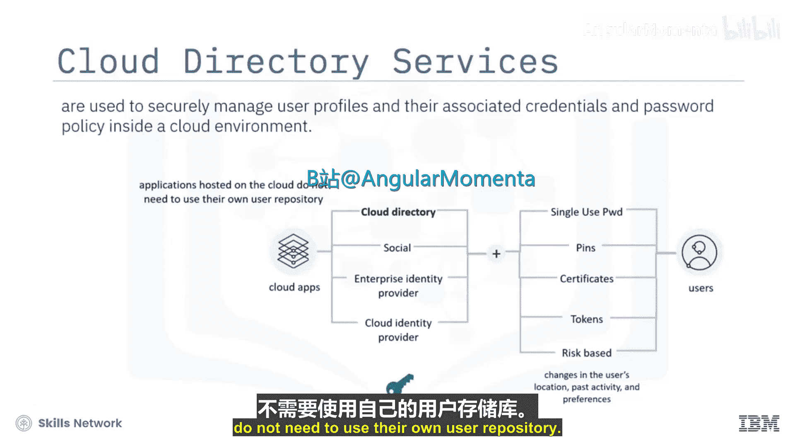

Reporting helps provide a user centric view of access to resources or a resource centric view of access by users reports typically give information about which users have access to which resources。

 which users have changes in access rights， which access is being exploited by each user and under which conditions。

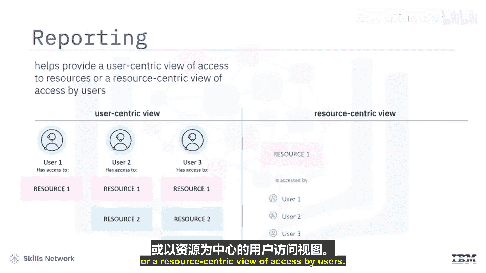

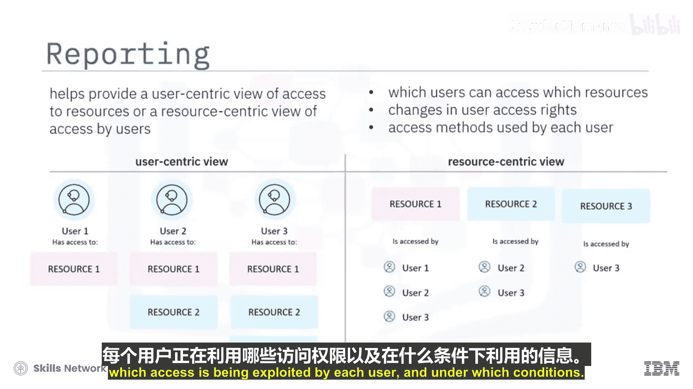

Audit and compliance is a critical service within identity and access management framework。

 both for cloud provider and cloud consumer Aors use these processes to validate implemented controls against an organization security policy。

 industry compliance and risk policies and to report deviations。

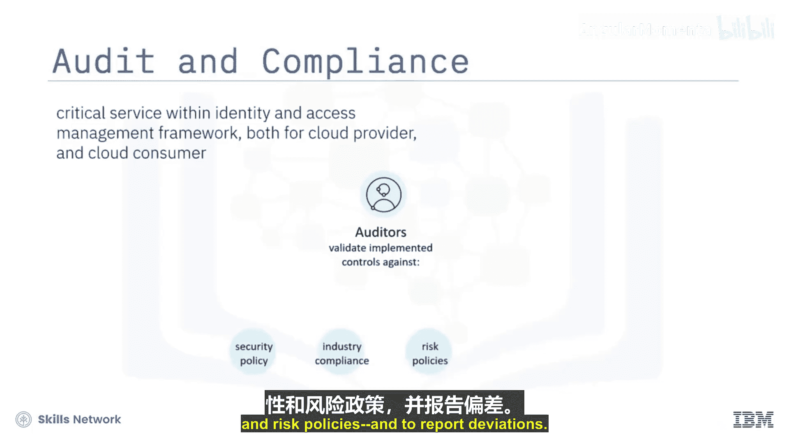

User and service access management capability enables cloud application and service owners to provision and deprovision customer。

 partner and vendor user profiles with minimal human interaction this streamlines access control based on the role。

 organization and access policies defined by the owner。

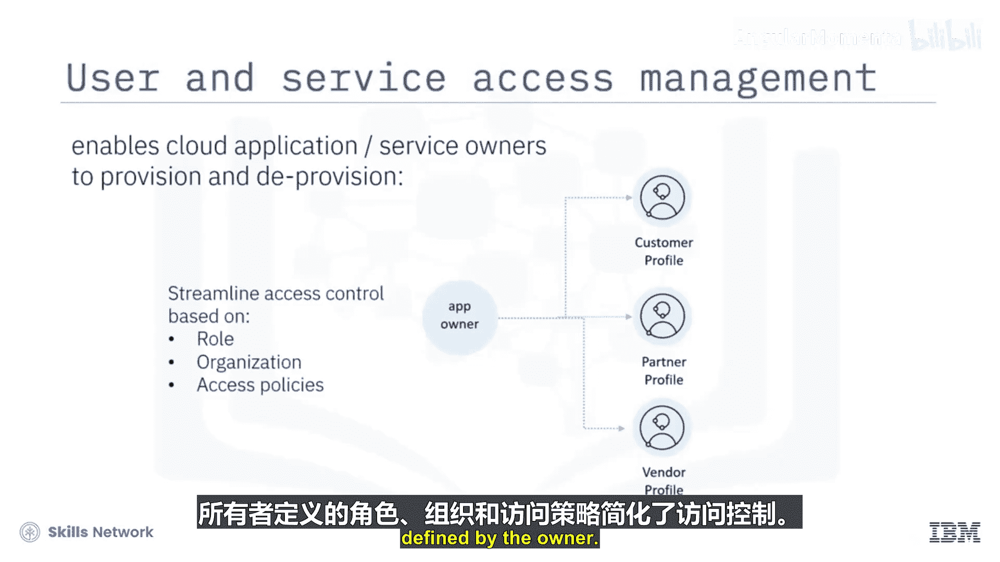

User accounts of administrators or developers give access to sensitive information in order to mitigate the risks of these accounts being hacked into。

 you require maximum control over the whole life cyclee of these users Some of the controls that can help secure these sensitive accounts include provisioning users by specifying roles on resources for each user。

Password policies that control the usage of special characters， minimum password lengths。

 and other similar settings。Multifactor authentication。

 like time based one time passwords and immediate deproing of access when users leave or change roles。

Cloud providers offer identity access and management services。

 typically including the ability to create access groups， add users to access groups。

 and manage access for existing users。

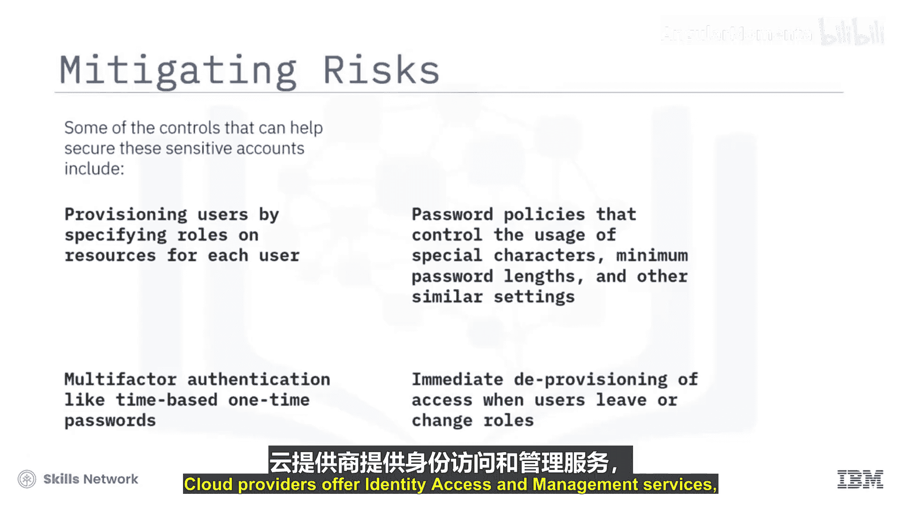

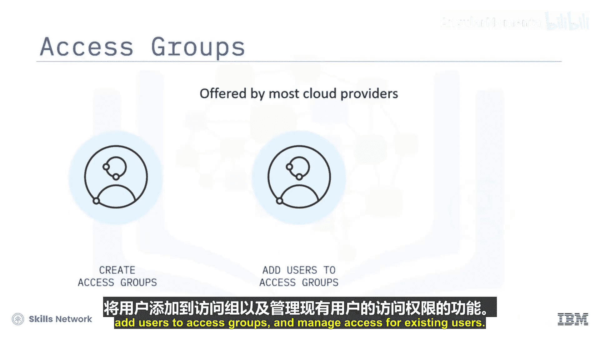

An access group is a group of users and service IDs created so that the same access can be assigned to all entities within the group with one or more access policies。

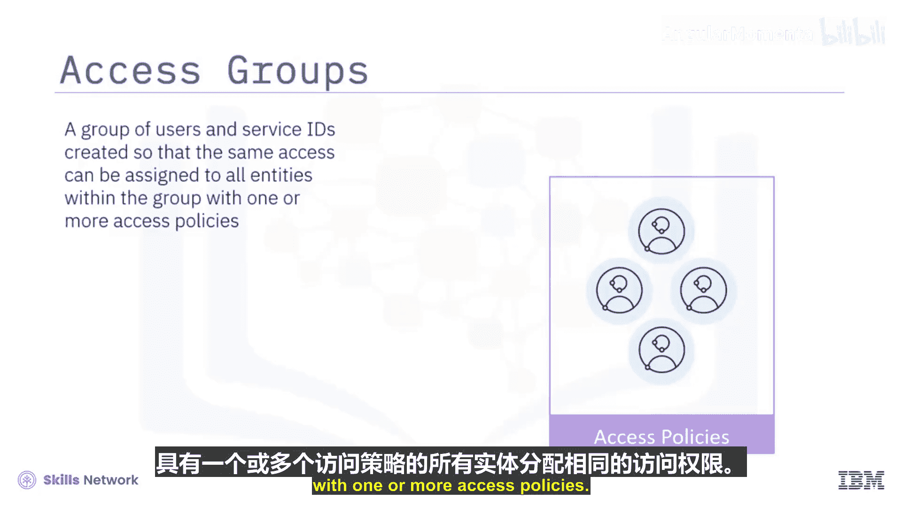

Access policies define how users， service IDs， and access groups in the account are given permission to access account resources。

Policies include a subject which can be users， service IDs or access groups。

 a target which is the resource or provision service offering to which you want to provide access and role。

 which defines the actions allowed on the target of the policy that is the resource to which the access is being granted。

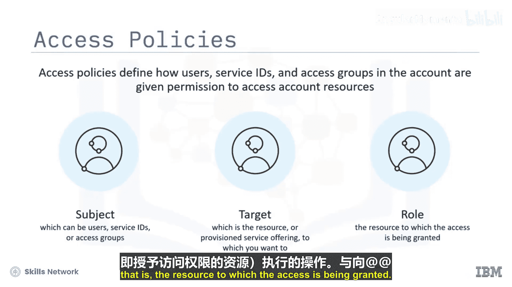

Access groups provide a more streamlined access assignment process as compared to assigning individual access to each user and help reduce the number of policies in an account。

In this video， we learned how identity and access management work as the first line of defense to secure the cloud。

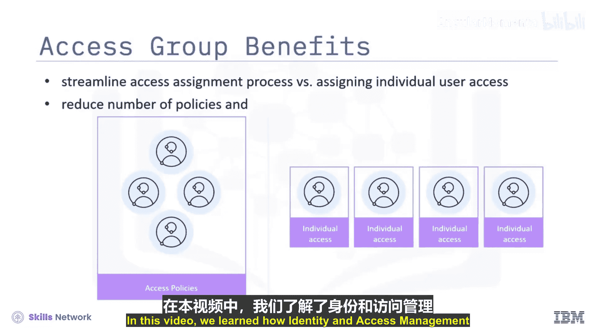

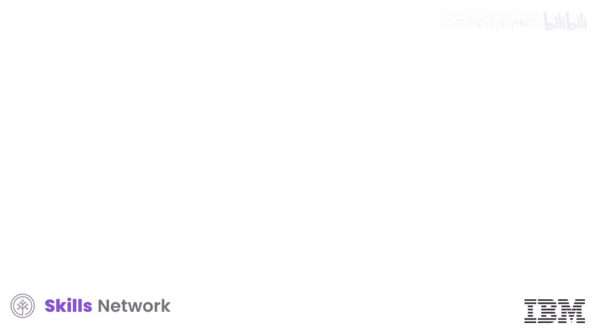