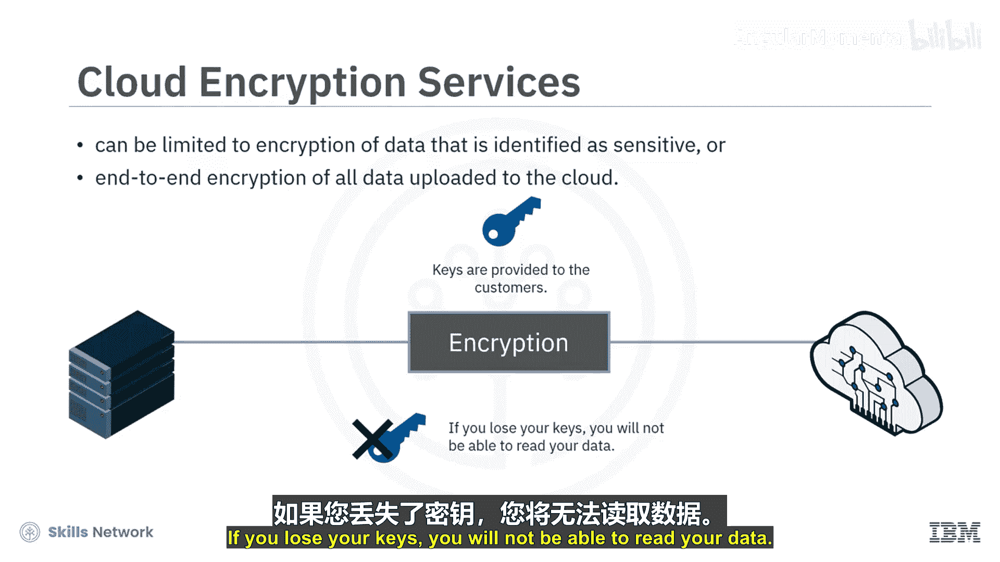
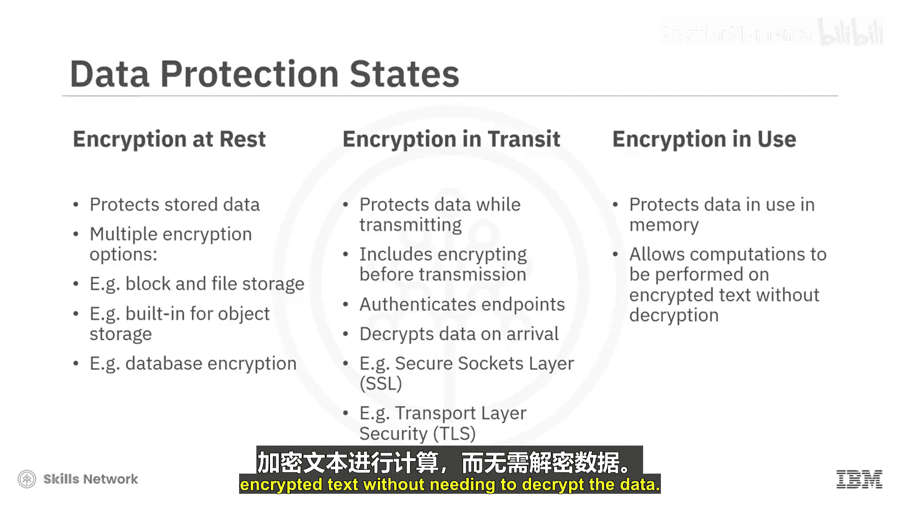
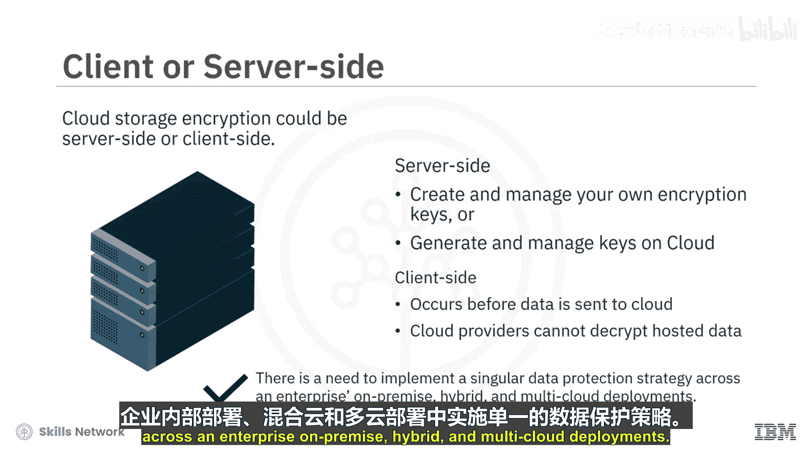
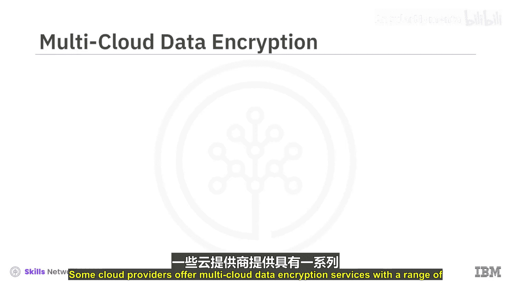
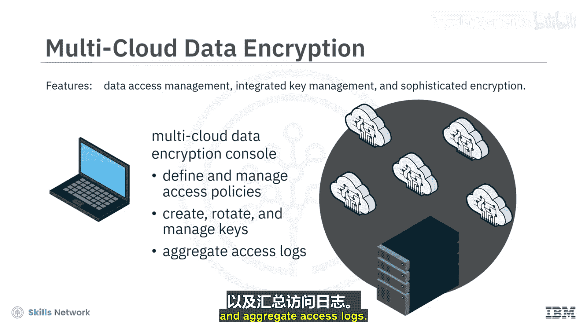
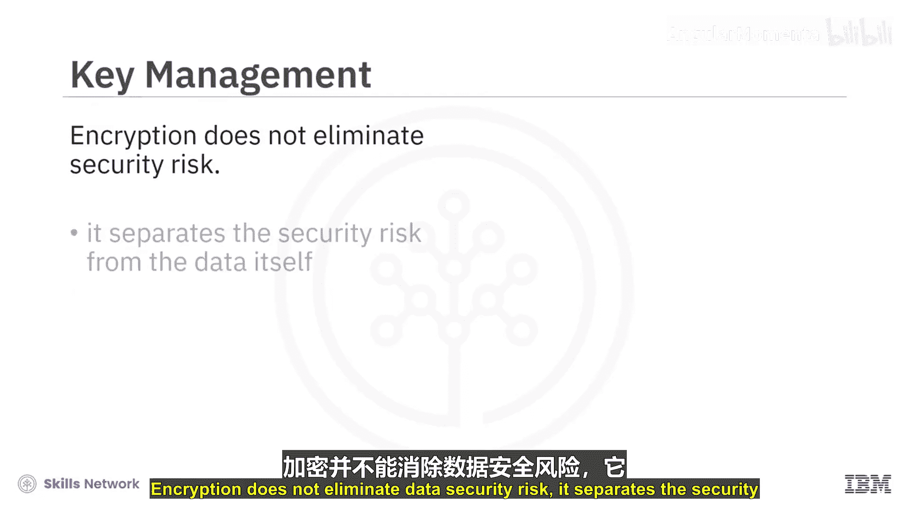
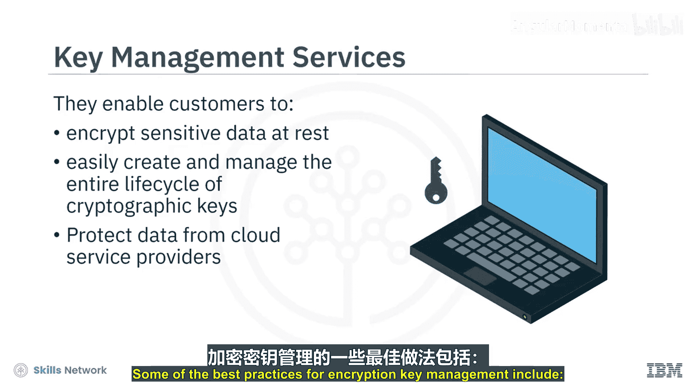
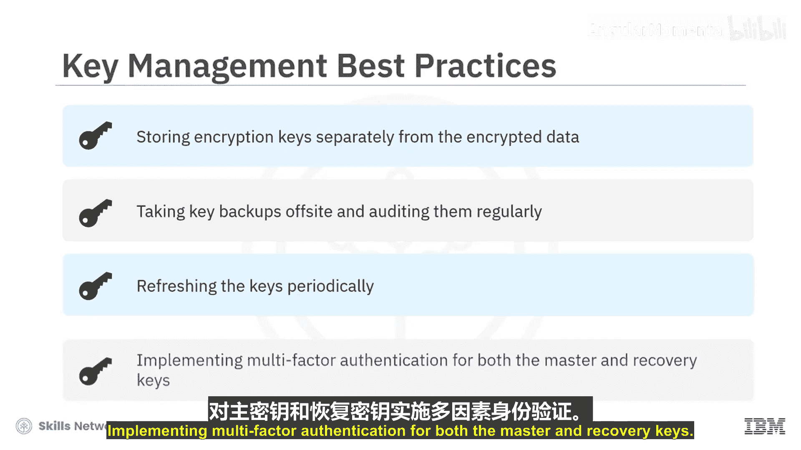

# 【IBM】云计算导论-｜-Introduction-to-Cloud-Computing-p45-05_01_05_云加密--BV1X66rBqE8G_p45-

Given the concerns around data security and privacy， especially in public cloud environments。

 encryption plays a key role and is often referred to as the last line of defense in a layered security model This protection not only encrypts data but also provides robust data access control key management and certificate management In this video we will take a closer look at cloud encryption encryptncion is defined as scrambling data in a way that makes it illegible there are two parts to an encryption system the encryption algorithm and the decryion key the encryption algorithm defines the rules by which data will be transformed so that it becomes illegible and the decryption key defines how the encrypted data will be transformed back to legible data encryptncion ensures that only authorized users have access to sensitive data and when access or intercepted without authorization data is unreadable and meaningless cloud。

Providers offer various cloud encryption services This could be limited encryption of data that is identified as sensitive or and to end encryption of all data uploaded to the cloud data is encrypted upon receipt and encryption keys are passed to the customers to decrypt data when needed Keys need to be managed securely if you lose your keys。

 you will not be able to read your data Data needs protection in three states at rest in transit and when it is in use encryptncion at rest protects data while it is physically stored in a database or the storage layer depending on the application and business requirements there could be multiple options for encrypting data at rest such as encryption for block and file storage built in encryption in object storage and database encryption services encryptncion and transit protects data while it is transmitted from one location to another encryptncion and transit includes encrypting the data before transmission。

Authenticating endpoints and decrypting and verifying data on arrival Secure sockets layerer or SSL and transport layerer security TLS are commonly used protocols for encryption in transit they are not only used when accessing website securely but also for data moving between servers and services within the cloud encryptncion in use protects data when it is in use in memory for computations It allows computations to be performed onened text without needing to decrypt the data Cloud storage encryptncion could be serverside or client side Serside encryption occurs after cloud storage receives your data but before the data is written to disk and stored for serverside encryption you can either create and manage your own encryption keys known as customer supplied encryption keys or you can generate and manage your encryption keys using key management services offered by the cloud storage provider。

Known as customer managedaged encryption keys clientientside encryption occurs before data is sent to cloud storage This way users can utilize encryption keys and algorithms that are not visible to the cloud provider making it virtually impossible for cloud providers to decrypthoed data given that a majority of enterprises today operate in multi-cloud environments there is a need to implement a singular data protection strategy across an enterprise on premise。

 hybrid and multicloud deployments Some cloud providers offer multi-cloud data encryption services with a range of features such as data access management integrated key management and sophisticated encryption that combine to deliver the scalability and flexibility to help protect the most sensitive workloads across the enterprise regardless of where the data resides using a multi-cloud data encryption console you can define and manage access policies create rotate and。

🎼manage encryptncion keys and aggregate access logs encryptncryion does not eliminate data security risk It separates the security risk from the data itself by moving security to the encryption keys these keys need to be managed and protected against threats in order to keep the data secure key management services offered by some cloud providers help perform lifecycle management for encryption keys that are used in cloud services or customer built applications they enable customers to encrypt sensitive data at rest and to easily create and manage the entire lifecycle of cryptographic keys that are used to encrypt data Since the keys remain in possession of the customer the data is protected from cloud service providers as well as from other users some of the best practices for encryption key management include storing encryption keys separately from the encrypted data taking key backups offsite and auditing them regularly Ref。

The keys periodically， implementing multifactor authentication for both a master and recovery keys。

