# 【IBM】云计算导论-｜-Introduction-to-Cloud-Computing-p46-05_01_06_云监控基础与优势--BV1X66rBqE8G_p46-

Cloud-based deployments can be complex， monitoring performance across an entire stack of applications and services can be time consuming and draining on internal resources。

 this is where cloud monitoring solutions come in cloud monitoring solutions assess data application and infrastructure behaviors for performance resource allocation。

 network availability， compliance and security risks and threats。

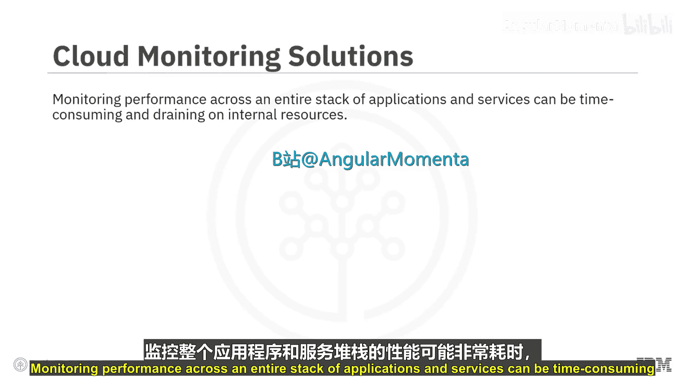

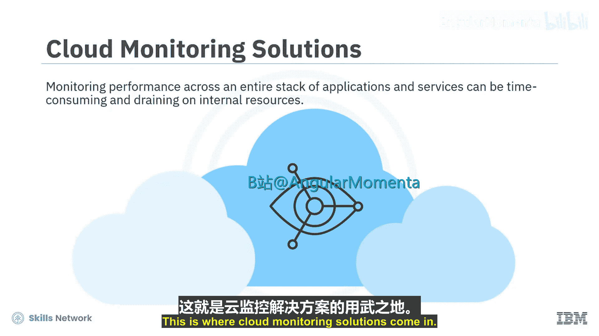

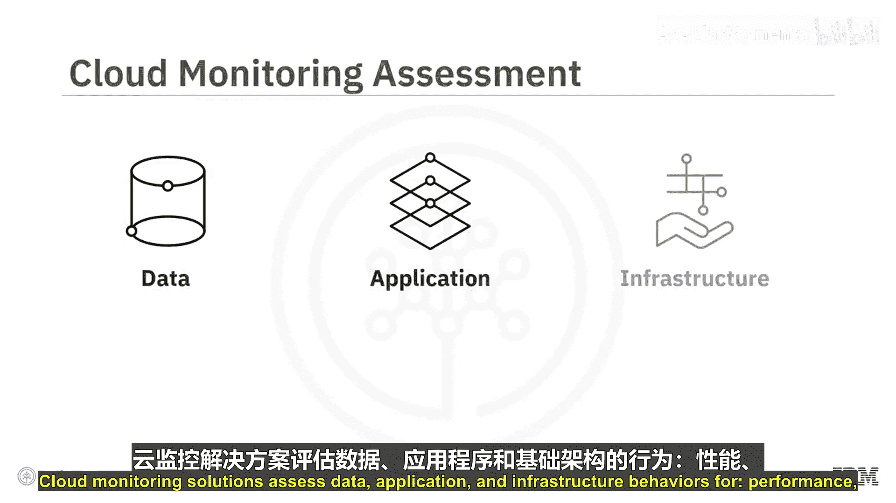

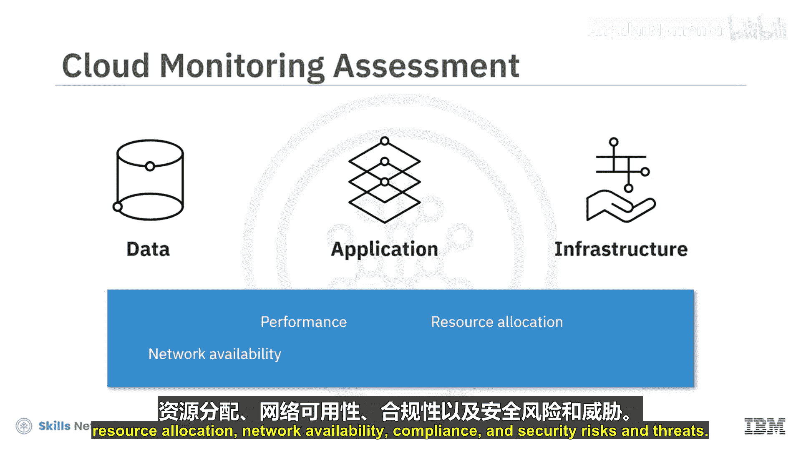

Cloud monitoring is not just about automated tools it includes the strategies。

 practices and processes that need to be in place for analyzing tracking and managing cloudbased services and applications It also serves to provide actionable insights that can help improve availability and user experience Cloud monitoring helps to accelerate the diagnosis and resolution of performance incidences control the cost of your monitoring infrastructure mitigate the impact of abnormal situations with proactive notification get critical Kubernetes and container insights for dynamic microservice monitoring troubleshoot your application and infrastructure Cloud monitoring solutions are designed to give organizations visibility and control over their entire cloud- based infrastructure they provide data in real time with round the cloud monitoring of virtual machines services databases and applications Multilayer visibility into。

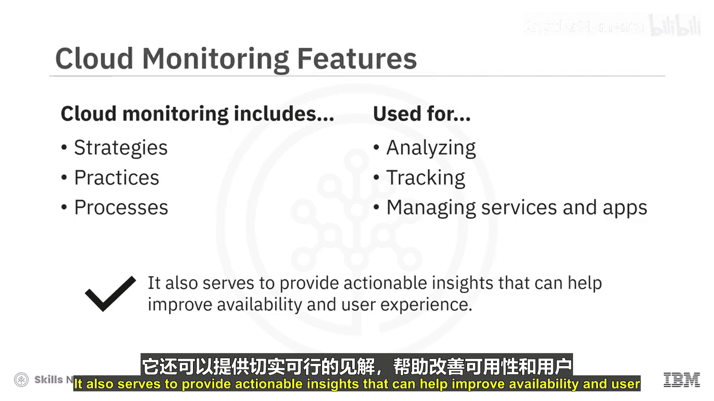

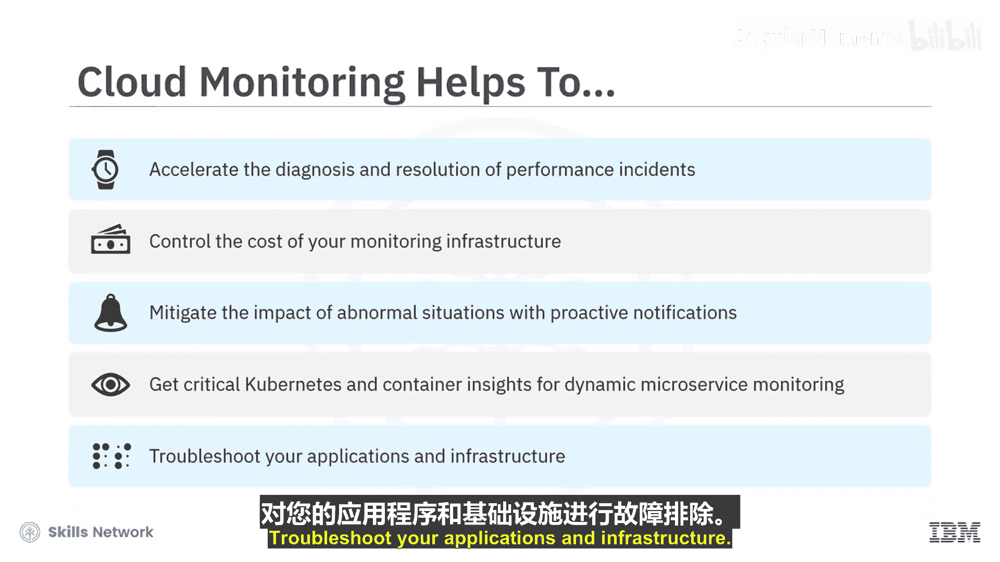

🎼Application， user and file access behavior across all cloudbased applications and services。

 Adv reporting and auditing capabilities for ensuring regulatory standards are being met large scale performance monitoring integrations across multi-cloud and hybrid cloud environments One way to categorize cloud monitoring tools solutions is to break them down into infrastructured database and application performance monitoring infrastructure monitoring tools help identify minor and large scale hardware failures and security gaps so that the developers and administrators can take corrective action before problems affect user experience database monitoring tools help track processes。

 queries and availability of services to ensure the accuracy and reliability of database management systems。

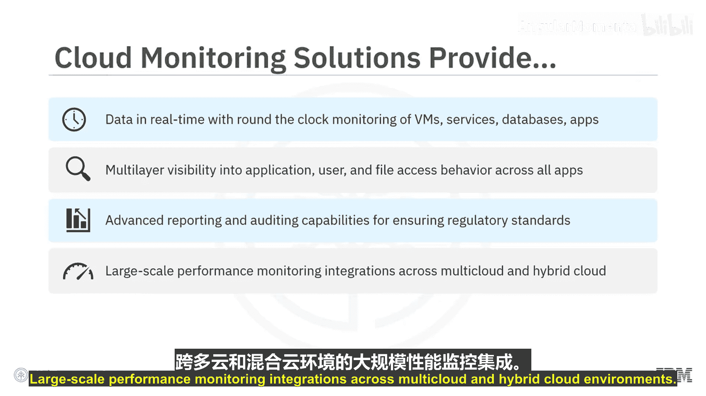

Application performance monitoring or APM measures application availability and performance。

 providing tools needed to troubleshoot issues in an application's environment APM solutions help improve user experience Me application and user service level agreements or SLAs minimize downtime and lower overall operation costs To get the most benefit from your cloudbased deployments you can follow some standard cloud monitoring best practices leverage end user experience monitoring solutions to capture the performance of an application from the point of view of its end users These solutions monitor user journeys to track parameters such as application response time and frequency of use under varied conditions these insights will help you to improve customer experience significantly Consider moving all aspects of your infrastructure whether in private public or hybrid clouds under one unified monitoring platform。

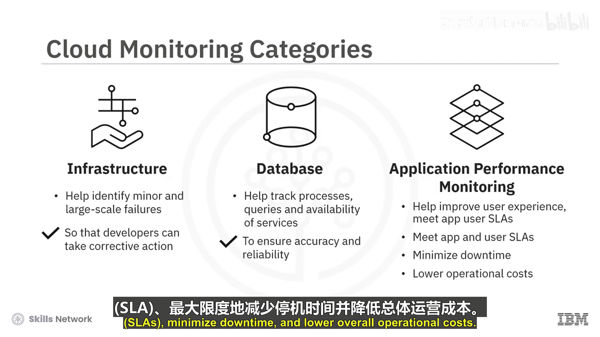

This can help you to manage all your KpiIs in one place with complete visibility into performance optimization Use monitoring tools that can help you track the usage and cost of your cloud resources and services increase cloud monitoring automation This can help you gain significant operational efficiencies simulate outages and breach scenarios to evaluate how well your monitoring tools capture and alert against failures Cloud monitoring needs to be a priority for organizations looking to leverage the benefits of cloud technologies It will help you manage and optimize your cloud resources for cost and performance and create better customer experiences。

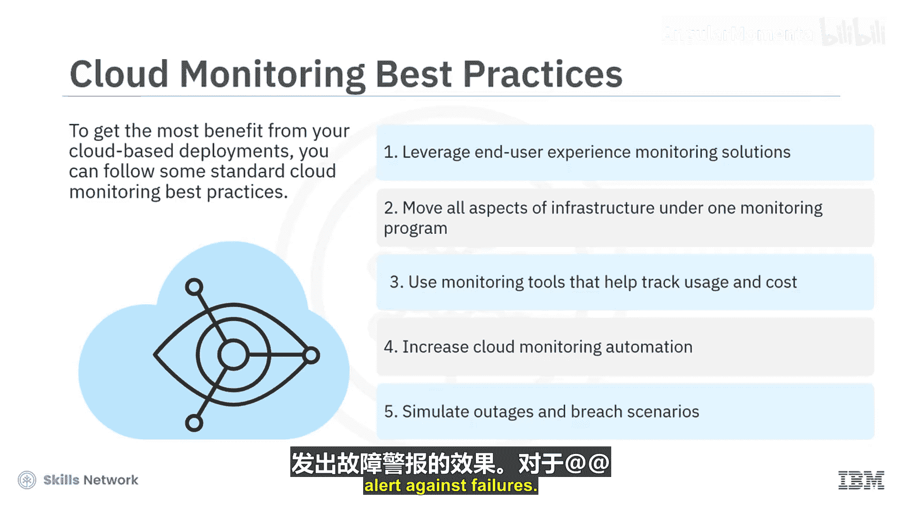

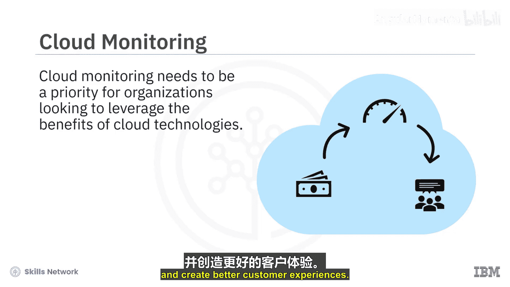

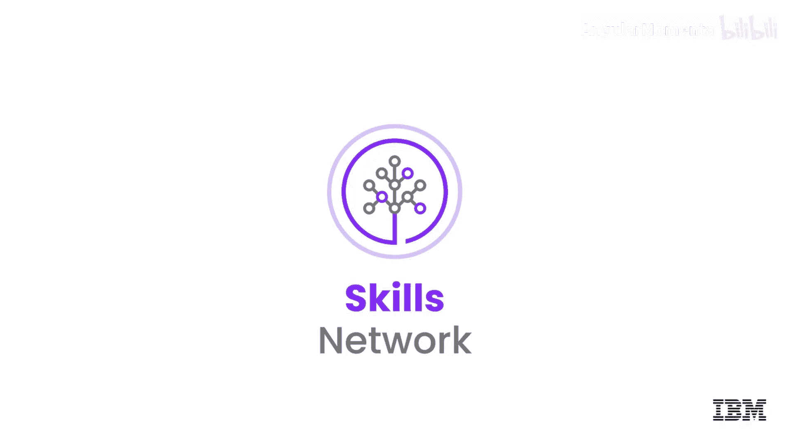