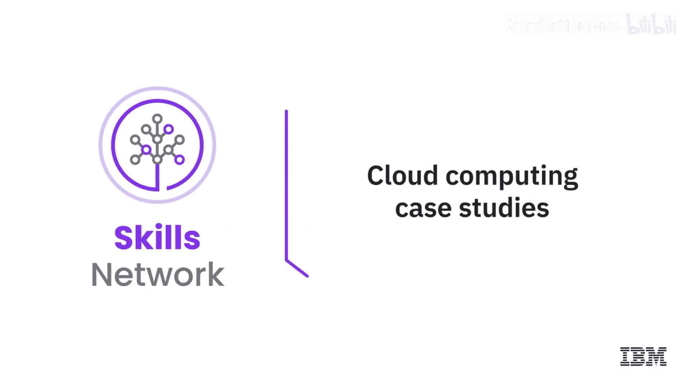
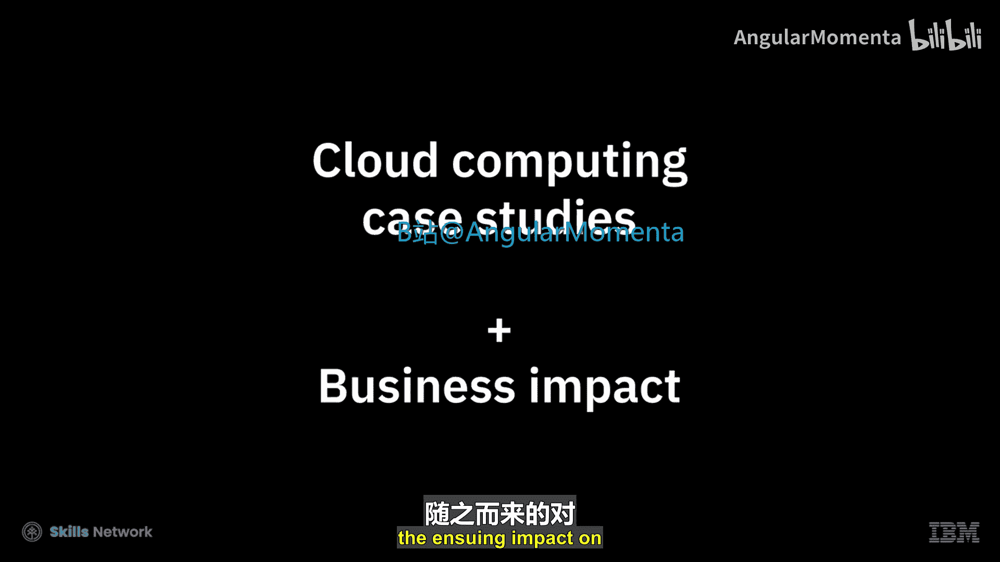
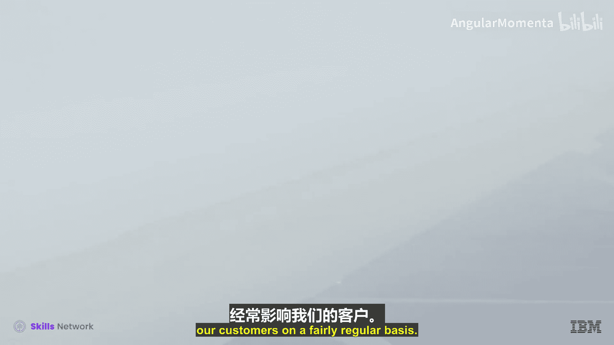
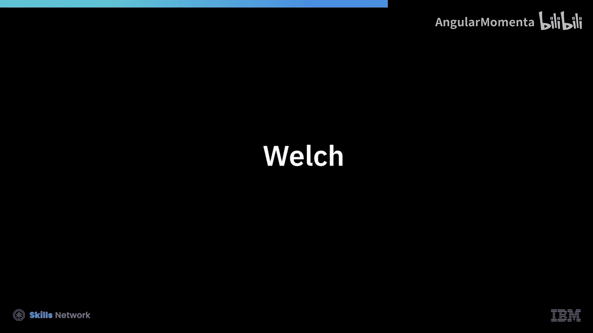

# 【IBM】云计算导论-｜-Introduction-to-Cloud-Computing-p47-05_02_01_不同行业垂直领域的案例研究--BV1X66rBqE8G_p47-

In this video， we will look at some case studies that demonstrate the use of cloud computing in real business scenarios and the ensuing impact on these businesses and the customers they serve。

The weather company's mission is to map the atmosphere of the Earth and based on that。

 generate the most accurate and hyperloc forecast which can be subed out to all over consumers and devices which number in millions across the globe weather is unpredictable and we need to be able to spin up and spin down as fast as weather happens。

 our normal day-to-day load is 30 million unique users and when we peek into severe weather that can go north of 100 million across our products。

So we generate forecast on demand and our forecast on demand system is responsible for generating forecast at a resolution of one square kilometer grid We deliver forecast on demand to the tune of 250 billion per day on the backside of that is our API platform and that system operates at a scale of about 150。

000 requests per second If our products don't work and don't work fast people's lives are in danger。

Imagine a hurricane is approaching east coast of the United States as it is approaching the coast。

 usage of my weather data goes up tremendously， it can go up from anywhere from two times to five times。

It took us six months to migrate into IBM Kubernetes from our previous provider and what we've noticed is some real efficiencies with DevOs。

 it's reduced our workflow and pipeline by about 80%。With the latest hurricane。

 we were able to scale with IBM cloud very easily， very seamlessly IBM's Kubernetes service allows us to scale as fast as the weather happens As we migrate it of a platform to IBM Cloud Kubernetes services one of the biggest advantages is that this is a managed service which allows our team not to have to maybeset our system enables them to do other work with the migration to IBM cloud Kubernetes we've gained the ability to have automation security bake in this is the feature in the component that was very manual for us in the past IBM's security team proactively now notifies us of any security vulnerabilities。

 the tools and the investment that the companies made gives us capabilities that we would have never had before it gets us very excited and it gives our developers and engineers opportunities to build new things that they wouldn't have otherwise been able to do the global reach that IBM and the IBM cloud together with our technology with our capabilities for forecast。

Give us the ability to extend our products and services to keep people safe all over the world。

Good afternoon ladies and gentlemen welcome prettyip arrival In the scenario where there's a flight cancellation or some other off schedule operation we've had a system where we find new seats and flights availability for those customers but I think oftentimes customers didn't necessarily know that that was the best option for them What we wanted to do was create a system where they could actually see alternate options The goal was to facilitate a better experience for our customers on how to get to their destination in an automated fashion on the channel of their choice our business。

 hurricanes， storms， other natural events impact our customers on a fairly。

そす。What happened and this is a true story， the hurricanes hit， and nobody said this is ridiculous。

Our customers were being impacted by the hurricanes immediately。

 Why are we mitigating risk of a traditional rollout when we have the power of the cloud and this is exactly the scenario that our customers need this capability。

🎼I think people now realise that these kind of activities and integration are much easier when we can use cloud technology and especially microservices we can break problems into much smaller problems and those get much easier to wrap your head around and develop This is the technology that we need to be adopting now in order to keep pace with our customer expectations。

🎼。🎼，🎼What I loved about my job at Samspaca Mayo is that it challenges me every single day。

 technology moves so agile that I had to keep up with it and what I love is that the company is also on that same road。

 driving towards its digital transformations。 Our customers are now demanding quicker time to market and also a more broad portfolio of products。

 we need to keep up and the liver like the best service and the best products that they can get in the least amount of time。

 We implemented Sap as forhanna on IBM cloud since it brings us a coste infrastructure and also it's quite scalable。

 Samits Pamao is now turning from a product drivenven company to a service drivenn company。

 The accounting area now has real insights on real time of our financial statements that they didn't used to have and also on our supply and chain area。

 especially on the procurement。 They now have the dashboard that helps them。

🎼Take decisions right on time。

My name is Muke Sharma and I'm the senior manager of IT at Welch Food。

 Wel just started as an organization 150 years ago and pretty fast it became the national owned by the farmers。

 it's a coop。🎼And we value the sweat equity our farmers put into it。

 So that's what drives us every day that our farmers are working out on the farms and we're working here to make sure the organization gives the best benefit of each dollar spent back to them We IT is the heart of the business。

 all the manufacturing systems， any manufacturing data which comes in through different processing ERP systems and you name it So we started this journey with the private cloud and then at the same time we have started the process of asking ourselves on any new application request。

 can it be run in the public cloud the approach we have taken as slowly and steadily start to move these non-mission critical systems which can be done better by somebody else。

 let them run outside， let them spend time on it while we spend time on our core values。

🎼Liquid power is a company that sells products that when you inject them into crude oil or gasoline pipelines。

 it changes the flow characteristics to such a point that you can either one increase the flow of those fluids or secondly use less energy to actually push the fluids down the pipeline We needed to become a standalone company under Berkshire Hathaway without any experience in running our own infrastructure or SAP We had to come up with the solution that was best for our business to operate as a standalone company So there were many decisions we had to make do we go cloud do we stay on premise how do we create our own infrastructure and back office and what's the best decision for us not only today and now but in the future going forward so I'd talk to some CIOs and IT professionals if you had a blank sheet of paper what would you do cloud or go on premise without a doubt all of them say。

This whole process and the migration to the cloud is giving what we believe is a competitive advantage and what I really love about having IBM with SAP on the cloud is it's scalable。

 we can do it much faster and change in a much faster time period than we could otherwise。

