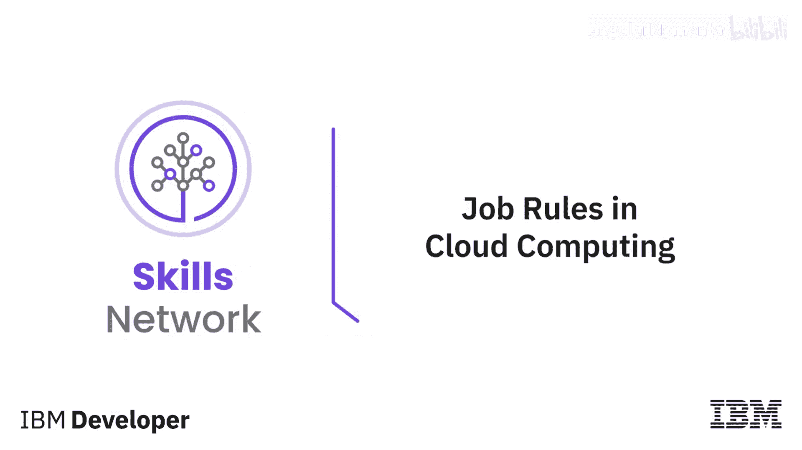
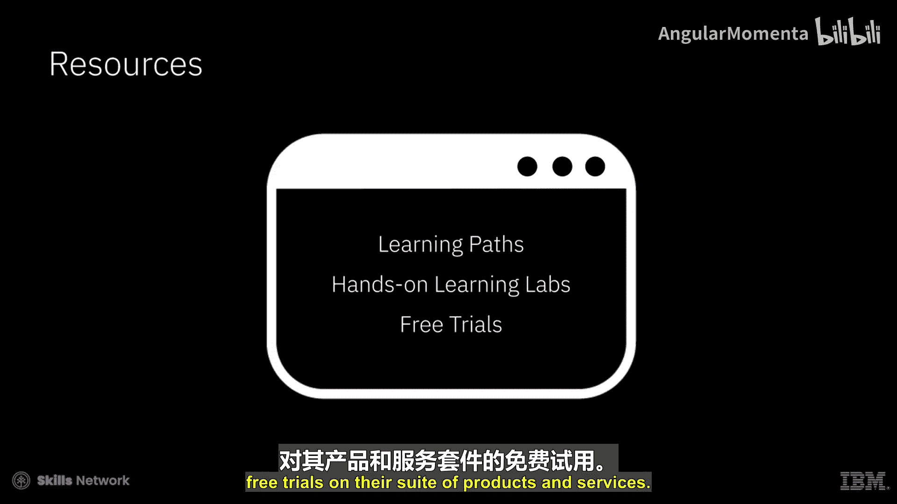
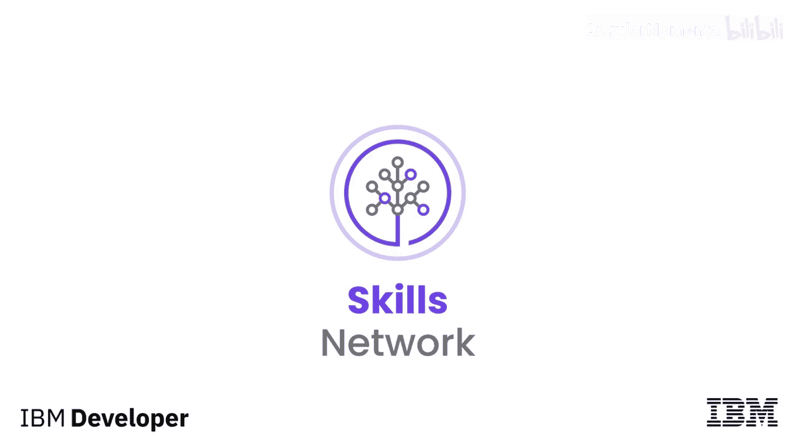

# 【IBM】云计算导论-｜-Introduction-to-Cloud-Computing-p48-05_02_02_云计算领域的职业机遇与岗位角色--BV1X66rBqE8G_p48-

Cloud computing is a key part of enterprise's digital transformation strategy as more and more companies are moving critical business processes and applications to a mix of cloud infrastructures。

 qualifiedified cloud computing professionals are in high demand。

 with a compound annual growth rate of 14。1% Grandview research estimates that the cloud computing market will reach a revenue of 1554。

94 billion in 2030。😊，Employer demand is outpacing the number of qualified candidates available。

 Gartner Talent Nuurron databasease of more than 1 billion unique job listings scores the hiring scale for jobs requiring cloud computing skills at 78。

 which means employers are finding it difficult to get the right applicants for open positions in cloud technologies。

There are many specialization areas within this domain。

 Here's a look at some of the common roles available currently。

 One cloud developers or cloud software engineers work through all phases of the software development lifecycl。

 writing， testing and maintaining the code。 They work with the front and back end of applications。

 as well as platforms and systems that their applications run on。😊。

Cloud developers need to have a mix of technical skills， business knowledge。

 and experience with at least one of the major cloud providers。

Technical skill for a cloud developer would typically include knowledge of data structures。

 distributed systems， operating systems， and algorithms。Experience with databases。

 proficiency in commonly used web application development languages such as Python， Javascript， Java。

 HTML and CSS。Two， Cloud integration specialists are responsible for integrating new cloud services。

 applications and infrastructure into the organization's portfolio of internal systems and existing cloud services。

These specialists assess the implications and trade offs between different solutions as they relate to the integration between external and internal systems。

 optimize integration and user experience， and ensure that performance standards adhere to service level agreements set with the enterprise。

ThreeClo data engineers are responsible for designing。

 developing and deploying scalable data pipelines and data services；

 They look at integrating new data management technologies and software engineering tools into existing infrastructure。

Their responsibilities include understanding existing systems to recommend automated integration of disparate data sets。

Collaborating with data scientists and researchers to develop predictive models and proofs of concept。

Promoting best practices that enable teams to accelerate their consumption and understanding of data。

 improving overall efficiency by introducing new engineering processes and tools。

4 cloud security engineers provide expertise around the systems and processes needed to protect the confidentiality。

 integrity and availability of an organization's systems and application data。

 They determine security requirements。 plan， implement and test security systems。

Perform threat simulations to detect possible risks。

Recommend innovative technologies that will enhance the security of cloud based environments。

Cloud security engineers need to have deep knowledge of cloud platforms and services。

 software design patterns and dev ops， tools and methodologies 5 cloud Dev ops engineers collaborate with development and operations teams to create reliable and rapid release pipelines for software and updates。

 This may typically involve。😊，Creating custom automation tools。

 building and maintaining configuration and deployment frameworks。

 tracking design bugs and automating the debugging process for developers。

Maintaining and deploying web based applications， monitoring security issues。

 measuring performance against expected business outcomes。

Containerization expertise is increasingly a must have for DevOs engineers。6。

Cloud Solutions architects work to translate business requirements into application architecture and design。

Some of the technical skills as required for a cloud architect role include。

Deep knowledge of cloud platforms and services。 Deep understanding of software design patterns。

 knowledge of Devops， tools and methodologies。Good understanding of networking。

A high level understanding of key security concepts。

Solution architects work closely with cloud developers， networking specialists， security engineers。

 integration specialists， and DevOs engineers to architect and design solutions。

 there are several resources available for learning cloud technologies in a variety of delivery methods。

 including instructor led courses， self paced online courses， online videos， books。

 and also technology- focused community forums。Many cloud providers have dedicated learning portals with extensive resources available on the complete range of cloud technologies and services they provide。

They offer learning paths， which make resources available as per specific career roles。

Hands on learning labs with interactive learning resources that can be filtered by role。

 level or product， free trials on their suite of products and services。😊。

