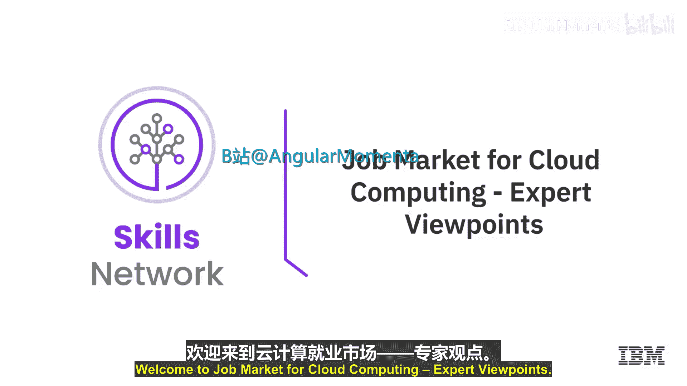
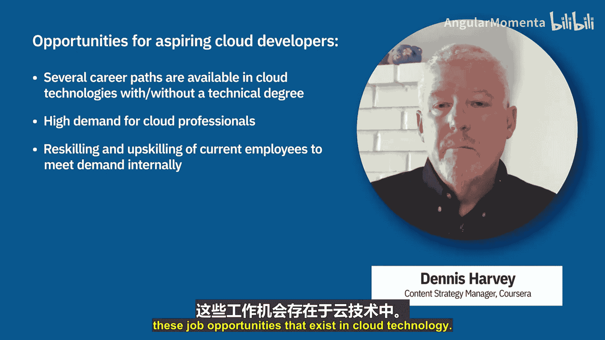

# 【IBM】云计算导论-｜-Introduction-to-Cloud-Computing-p49-05_02_03_专家观点：云计算就业市场--BV1X66rBqE8G_p49-

Welcome to Jo Market for Cloud computinguting expertert viewpoints。😊。

In this video， we will listen to several cloud application professionals discuss the job market and the nature of opportunities available in cloud computing for people aspiring to get into this field。

 They will also discuss what they foresee as the future of opportunities in this field。😊。

With more companies adopting some sort of cloud and becoming more cloud of error。

 there is no lack of opportunities for aspiring software developers you could get into this field as a cloud architect where you're thinking about how to architect applications which by the way look a lot different than if you were developing applications monoth applications on a single server versus developing applications for the distributed cloud so that is a very prominent role another role could be data for data engineer where you're looking at building pipelines for data to flow from there's this source databases and other storage into perhaps data science models that are deployed at scale on cloud。

Another very important role is that of a cloud security engineer， and in that role。

 it'll be your responsibility to see that all of the different layers of your cloud are secure for your developers and your end users。

So there are so many opportunities for people thinking about getting into cloud computing。

You'd be surprised how many companies are still not in the cloud。

 and it's very clear that they're all going to go to the cloud eventually because。

It's just so much better for so many reasons that we've talked about。And。

There is not enough talent right now to fill all of that demand and that demand will just keep coming。

Really， there are so many things to know about the cloud， one person can't know them all。

 so if you just learn one or two things about the cloud really well。

You're already going to be really valuable to some company。

Let's say you just know storage service and one compute service really well or even just decently that is really valuable to many companies and if you're just getting started I would recommend。

Get a certification， I had zero experience in the cloud and I got a certification and by getting that cloud certification。

 I was instantly more visible to recruiters and I got a job and so if you don't have the experience on your resume。

Start off by getting a certification。Depending on your area of interest you can get into different fields under cloud computing if you like programming you can be a cloud application developer you should have knowledge of frontend and backend technologies like Python。

 Java， Aular React etc it would also require you to have database skills in relational databases like SQL and MysQL。

 as well as NoSQL databases like Hub MogoDV， etc。There is a rapidly increased demand for machine learning and artificial intelligence you need to have good understanding of machine learning concepts and should have the ability to handle and process V data。

You can choose the career path of being a big data scientist， machine learning engineer。

There is also need for cloud professionals with specialization in cloud security skills。

 these professionals should understand cloud security and also leverage the cloud security tools offered by organizations。

Another opportunity for cloud computing is in the area of DevOs DevOs engineer will need understanding of DevOs tools like Docker。

 Kubnetes， GitHub， etc， they should also focus on understanding the CICD pipeline and automating the process of development and deployment。

Suffice it to say there are a myriad of career paths in the cloud technology space including professional career path options for people with and without you a BS degree or a nontechnical college degree companies cannot find enough trained people and cloud technology so opportunities and demand are definitely out there。

 in addition companies are focusing on training their current employees both you reskilling and upskilling to meet this demand internally。

 so Coursera is committed to helping people without college degrees or people that are making career changes to access the job these job opportunities that exist in cloud technology。

