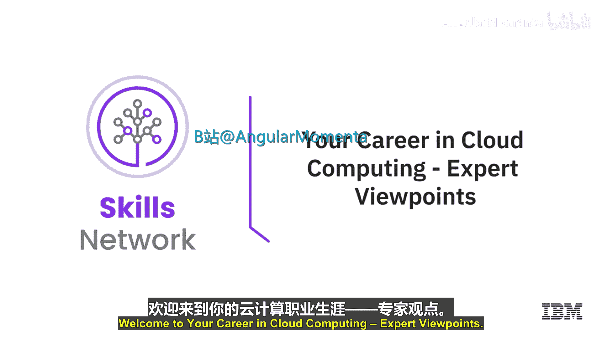
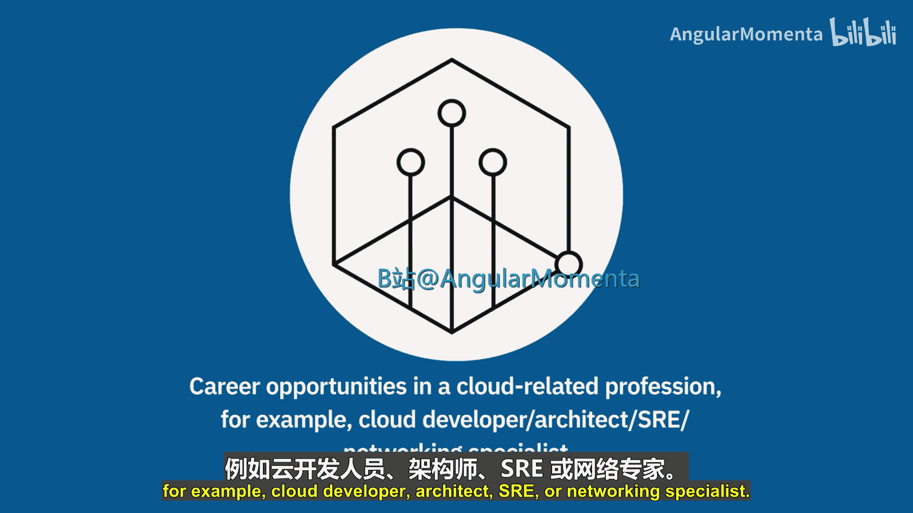
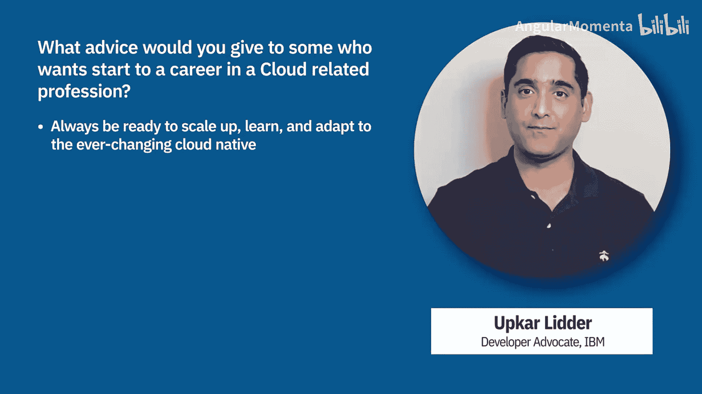

# 【IBM】云计算导论-｜-Introduction-to-Cloud-Computing-p50-06_02_01_专家观点：您的云计算职业生涯--BV1X66rBqE8G_p50-

Welcome to your career in cloud computingut expertt viewpoints In this video we will listen to several cloud application professionals discuss career opportunities in cloud computing。

 for example， cloud developer， architect， SRE or networking specialist。

First of all the cloud native landscape is very diverse and it's very intimidating。

 so when you see the Cloud nativeative computinguting Foundation map of different layers and different solutions in each layer it can get quite scary very fast so my first advice to anybody entering cloud computing field would be to really get a solid foundation and understanding of the basics。

How is developing forclo different than developing something on your laptop or on a single server or a small cluster？

So think about how you would architect your application differently for the cloud computing world。

 how would you split it up into smaller services that talk to each other instead of creating a big monolith。

 and why does that matter？So if you want a job in a cloud related profession。

I would realize for the first part that almost all the tools that the actual professionals use are available。

 many are open source and many have free versions just out there on the internet so I think the most important thing is just go and get your hands dirty use the tools that the professionals use start learning there's so much free education out there and so many resources in the internet quite frankly to get you almost all the way there but reading only good so far。

 so use the tools run the code， create the code， do whatever you need to do and honestly if you start creating projects that's going to be one of the most attractive things to a recruiter in my personal opinion I think it's really important to never stop learning and to always apply what you learn to projects whether they're at home at work or at school。

My second advice to beginners would be to try different cloud platforms and see how an application is approached or architected in these different platforms。

 you can learn a lot by looking at different architectures。

To start a career in cloud related professions， start learning on your own from different sources。

 you can start by learning basic cloud concepts。Learn about the various career opportunities that cloud computing has to offer。

Once you know which profession interests you the most， enroll in a specialized course for the same。

Get handsome knowledge by creating some projects on your own and hosting them on your GitHub rep。

Once you are confident of your skills， it is always a good idea to get certified。

Keep yourself informed about the different opportunities in companies and keep a plan。

The advice I would give to someone who's thinking about a career as a cloud architect is if you don't have any years of experience。

Just get a certification to start out with or get a few。 you'll instantly become。

Validated in front of recruiters and。Even if you don't have the。

Battle experience of making mistakes yourself in production。

You will be able to understand the high level of the services and then get into into the wheels when the time comes。

One thing you got to be comfortable with cloud development is learning all the time。

All the services are changing all the time and you can't be an expert in anything really。

 because it's changing all the time， so be comfortable with all the ambiguity。You know。

 here are a couple of suggestions for you， one is to get certified from one or more of the cloud providers。

 IBM， AWS， Microsoft or Google Cloud， and to do that。

 I would recommend taking advantage of costeffect online courses like those offered by Coursera to assure that you gain the knowledge you need to both pass the certification exam and to you know perform the job that you're after and succeed in your cloud journey。

And then I would recommend augmenting your certification with some hands on experience either obtained on the job or by taking advantage of guided projects on Coursera or even experimenting with your own hands on projects in the case of Coursera guided projects。

 they're designed to provide you with。Hands on experience with some skill in approximately two hours。

And try things out in the cloud， so just get your hands dirty and spin up a virtual machine in the cloud。

 spin up a function， write a function。Make it go to a。Q， which goes to another function。

 just try hooking things up together in the cloud and one more thing about the career advice。

Once you get your cloud certification， put that on LinkedIn because。

Recruiters search for cloud certifications and that's pretty much a guaranteed interview for you。

And my final advice would be be always ready to skill up this landscape in this cloud native world changes really fast and you have to be on your toes and always learning new things in new technologies and frameworks。

