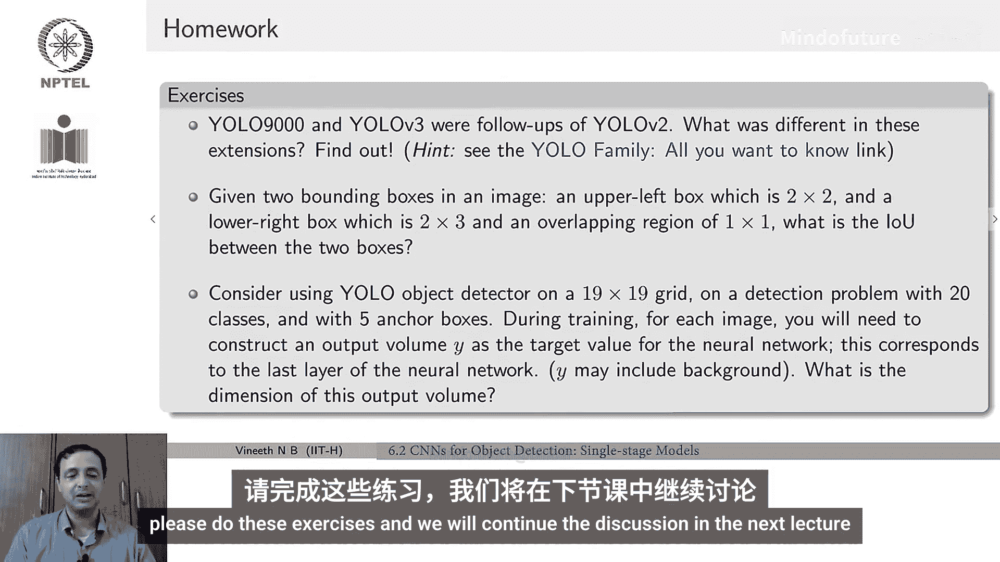

# 【NPTEL】计算机视觉的深度学习 p100 P100_用于目标检测的CNN - 单阶段模型 -BV1vNWkzpEua_p100-

We will continue now with dense sampling methods for object detection。Before we go there。

The exercise that we left behind from the last lecture。

Why is smooth L1 loss less sensitive to outliers than L2 loss？

When the deviation of the predicted output from the ground roof is high。

 which happens when you have outliers， the squared loss or the L2 loss exaggerates the deviation。

Which also results in the gradient exaggerating it which could cause an exploding gradient problem。

This issue gets mitigated within L1 loss。Because L1 loss is not differentiable at zero。

 we use a smooth version of it known as a smooth El1 loss which mitigates the problems caused due to outliers。

So， we set that contemporary methods can broadly be divided into region proposal methods and dense sampling methods。

 so we will now go into dense sampling methods which are single stage detection frameworks。

The most popular。That is still used today is known as Yolo， or you only look once。

The first version of Yolo was developed in CPR of 2016。It's a single stage detector。

You could say that all these single stage detectors are loosely based on over feet。

 they all use only convolutional layers， no fully connected layers。

 and speed along with good performance is the main aim。So。

The high level pipeline is you resize an image， you run a convolutional network。

 you get a set of outputs。Then you do non max suppression to identify your final bounduning boxes。

Let's see it in more detail。So here is an overall flow。Given an input image。

You first divide the image into an S by S grid。And each grid cell is responsible for the object with its coinciding center so。

 for example， if you took this particular grid cell here that would be responsible for this object dog here and has to predict those bounding box of sets。

So， each grid cell predicts B bounding boxes， B is another hyperparameter and confidence scores for each of these boxes so you can see here that each grid cell can predict multiple bounding boxes and a confidence for each of those bounding boxes。

And each grid cell predicts just one probability per class。

 so total of C classes would mean C total probabilities。

 you could consider that this is computing a quantity which is given by probability of class I given an object so that is a conditional probability。

The final predictions can be encoded as you have an S cross as grid。

Then you in each grid location you predict be bounding boxes for each of those be bounding boxes you have five values。

 what are those five values for coordinates that could be the center of the object。

and the width and the height and a confidence for each bonding box so that amounts to 5 and then you have C class probabilities per grid cell and that's how you get S into S into B into 5 plus C。

That's the total number of outputs that you would have in your output layer before applying nonmax suppression。

So each bounding box gives four coordinates， X， Y， W H。

X Y are the coordinates representing the center of the object related to the grid cell and W H are the width and height of the object relative to the whole image。

And the confidence score。😊，Given for each bounding box reflects how confident the model is that that bounding box contains an object。

And also how accurate。The boxes。 so you could view the confidence to be。Probability of an object。

 any object at this point， you do not know which class it belongs to。

 So this is the probability of an object。Into the intersection over union of the ground proof with the predicted box。

 so confidence takes into account both of these quantities。

And you have the conditional class probabilities for each class in each grid cell。

Regardless of the number of boxes B。Predicted by each grid cell。

Ylo predicts only C class probabilities for one grid cell。So。

 you could assume that those C class probabilities are these conditionals here given by probability of class I given an object。

So if you multiply these confidence scores。These class conditionals with your confidences you would get。

Probability of class I given an object which is the conditional class probability and the confidence which is given by probability of object into the IOU between ground truth and predicted values which amounts to the probability of class I into the IOU of the ground truth and predicted box so for each cell we are saying what is the probability that this class occurs in this grid cell and for the predicted box how much O IOU does it have with the ground truth。

What loss function do you use to train Ulo The loss function effectively combines the several components that you need to count to ensure that each of these quantities that is being predicted is close to the ground root so you see here there are multiple terms so the first term so let me first explain these indicators here1 Ij object indicates if the J bounding box predictor in cell I is responsible for that prediction。

Remember， every cell predicts be bounding boxes。So Ij here corresponds to the J bounding box。

Predicted by I cell。And one eye denotes if object appears in cell I。

Now let us look at what each of these quantities are doing。

 so if you are looking at a particular bounding box predicted by a particular cell you are first trying to ensure that the X Yi predicted by the network is close to the expected X hat Y I hat。

Then you are ensuring that the width and the height predicted by the network is close to the original width and the height。

 these are taken a square root because you have a width and a height in two dimensions so you take a square root here。

And the C and C had other confidence values， so you also try to ensure that if the confidence is low with respect to what the confidence should have been which would have been one if an object was there。

 you also try to ensure that that is minimized and all these sums as you can see is done for。

Across all of your grid cells and across all of the bounding boxes predicted by each of these grid cells。

And you do the same even when an object is not present you would want the confidence to match the expected confidence which in this case would be zero so that's what these two terms in sense are complementary for positive and negative classes and finally the last term here denotes the conditional class probabilities matching the expectedal conditional class probabilities。

So these are the different terms in the loss function used to train the network。

What are the limitations of such an approach？Yo V1 had a few limitations。Firstly。

 it detects only a small number of objects。It misses objects that are small or close to each other because of the methodologyology itself。

 because of the spatial constraints of the methodologyology and how many objects you can present that could be overlapping。

It ended up having a high localization error and a relatively low recalled。To overcome these issues。

Yo v2， which was proposed as an extension of Yoo v1 introduced the idea of anchor boxes into the Yolo framework。

 these anchor boxes are similar to what you saw with faster R CNN。

 so lets see how these anchor boxes work。So。There are five coordinates predicted per anchor box， Tx。

 T， Y， T， H， TW， and TO， lets see each of them。So if the cell is offset from the top left corner by cx C y。

The top left count of the image and the bounding box has width and height Pw and P H。

Then the predictions corresponding to the anchor box are given by。Bx is sigma of Tx plus cx。

 so you can see here that sigma of Tx is right here， Similarlyly By would be sigma of Ty。

 so thats that's the other coordinate of the same location plus c Y。

And BW and BH are written in terms of scaling multiples over Pw and pH。So Bw and B H are Pw into。

Exponent of Tw so tw is a predicted quantity， so Bw is given by by what scaling factor should you change the width or the height。

 it is similar to predicting an offset but the offset is a multiplicative factor for width and height。

And finally the probability of the object into the IOU。

 which is the quantity that we just saw for Yoo v1 is sigma of Tn that is the conditional class probability So those are the different quantities that are predicted by the network and which relate to the actual bounding box that that grid location is trying to point to remember that each anchor box predicts only these five values。

This is the this is the Bx B Y B W B H are the actual bounding box corresponding to these values given by the anchor box there have been several variants of yo since V2。

While we may not be able to go through every variant。

 lets quickly see a couple more to see how this family of architectures has evolved。In Yoo V3。

 there were a couple of interesting improvements such as logistic classifiers and multi scale。

Logistic classifiers used logistic regression to predict objectiveness score as well as for the final classification。

What is the difference？Ylo V2 or V1 used softmax on an anchor box or a grid location to make the final class prediction。

 which means that a particular anchor box could only have one class label as its final assignment。

This was modified to have a logistic classifier， a binary classifier on each class label。

This hence allows a particular anchor box to have multiple class labels。

This was done in particular because certain data sets had labels like person and woman。

 both of which can be true and they wanted to ensure that these kind of options are not precluded。

There was also a new backbone introduced in Yo V3， which。

Is gone which has since gone on by the name Darknet 53。

 is it has 53 convolutional layers with re connections。Beyond this。

There were also multiscale predictions introduced where the Yolo V3 model predicts three boxes at three different scales to improve the detection of smaller objects which could get detected at a different scale than larger objects。

This was done using spatial pyramid pooling where a modified SPP block was added to the backbone and it concatenated multiple max pooling outputs with different kernel sizes to get the multiscale effect。

While Yoo v2 used five anchor boxes per grid cell， Yoo V3 uses three anchor boxes but three at each of three scales。

 so totally there are nine because of this。With Yoo V3。

The architecture of Yolo could be explicitly split into three parts。

 a backbone which is like a feature extractor from a given input image。

 a CNN which is trained on large scale image classification tasks is first applied on the image at different scales perhaps to get different representations。

They a neck which typically is used to exchange information between scales。

 both spatial and semantic information， so at this stage it was common to aggregate and refine features。

And finally， of course， the head which performs classification as well as post processing steps like NMS or non maximum suppress。

Subsequently came Yoo v4， which introduced a gamut of changes。In particular。

 it used an architecture called the CSP Dark net 53， an improvement of Dark net 53。

which also had cross stage partial connections within its architecture。

 this improved the computational efficiency of the model according to the creators of this particular framework。

And。The meh activation function was considered to be better performing on the Yolo V4 model。

Beyond this， they also had spatial pyramid pooling and something called a path aggregation network to combine features across scales。

 they also introduced a spatial attention module to refine the features better in this particular case。

In the training procedure itself。Yo V4 introduced a technique called bag of freebies。

And what they mean by this is they mosaic or tile different augmentations of a given image。

This improves the ability of the model to detect objects outside its usual context if you had a particular image。

You divide it into say four parts now you take a particular part and make one kind of an augmentation on it。

 a different part， make another augmentation on it so on and so forth and mosa them to get a new image where the context could be slightly different from the original image of that object。

Building on this， they also used drop block instead of Dout where they could drop an entire block in the architecture。

呃。To achieve regularization in this context。A few other improvements in Yolo V4 was self adversarial training where perturbations were introduced inside the input images。

To make the model think that this was not the class and the model is forced to learn that this belongs to that particular class。

This brings robustness to the model， this phenomenon is also typically studied as adversarial training or adversarial robustness in neural network literature。

Finally， for the hyperparameter optimization， they used genetic algorithms。

 which is a family of algorithms to automatically learn such hyperparameters。

This was done during the first 10% of the training process。

 after which an annealing schedule was used to alter the learning rate。

Please don't worry if you have not understood every part of this Yolo architecture。

 in fact if we had to build on it we will see that the initial versions of Yolo which we have covered were subsequently further extended to Yolo v5 in 2020 which include auto in anchor and scaled Yolo versions。

This has gone on to Yoo v6 which introduced a backbone and a very focal loss for classification。

 Yoo v7 which introduced an extended efficient layer aggregation network and model scaling。

 they also changed the bag of freebies。To introduce reparametricized convolution and course label assignment。

 Yoo V8 brings in anchor free split ultralytics head。

Then there is Yolo NAS then more recently in 2024， Yolo V9 which brought in the information bottleneck principle reversible functions。

 programmable gradient information and so on， and finally the most recent version of Yolo which is Yolo V10。

 which introduced consistent dual label assignments for NMS free training。

 no non- maximal suppression。And this brought in significant efficiency into their model。

Why are we discussing Yolo at this length？While many object detection models have surpassed Ulo inaccuracy。

Ylo remains the choice for real time object detection。

 especially on edge devices and small compute or small memory devices。

If you would like to know more about any of these Yolo architectures。

 Id recommend you to look at this comprehensive review of Yolo architectures。

 which has been recently updated in fact in 2024。Moving on。

 there was another single stage detection method known as the single shot multibox detector known as SSD。

SSD again uses an overfe like methodologyology， you can see here that given an input image。

The initial part of the network is a VGG like network。

Then on there are convolution layers that keep reducing the size and you can see there are some skip connections that take you from a convolutional layer directly to the classifier。

😊，Let's see them in a bit more detail。So you have multiscale feature maps for detectionuction because you are sending these convolutional layers directly to the output。

 these convolutional feature maps directly to the output。

 these ones directly to the output so the output layer receives the feature maps from convolutional layers of different scales that is why multiscale feature maps。

Then we also see that for each of these convolutional layers。

 there are a different set of convolutional filters that connect it to the output layer。😊。

So this initial layer here。Goes through a three cross3 cross4 into classes plus4 that is the number of outputs that it has that is the number of that is the size of the convolutional filters that you have rather which gives the corresponding output in the output layer and so on and so forth for each of these intermediate。

Convolutionional layers。So if you took any one of these feature maps。

 let's take a feature map layer with a feature map of size M across n with C channels。

Then that would give Mcros n locations， so each of those pixel locations in one of those feature maps。

Could be a center of an object， for instance。 So each of them is like a gridit cell。

 if you could compare this to eo and the bounding box offset values。

Are relative to that grid cell location， So you have remember you see here that each of these convolutional maps predict。

Classes plus 4。 That's the number of values that they will predict。

So a class probability for each class plus four values for the bounding box offset corresponding to each pixel location in these convolutional feature maps。

So。As feature maps get smaller and smaller when you go through later parts of the network。

 so you can see here if this was your ground truth boxes in your original image and you can see here an  eight by8 feature map followed by a four cross 4 feature map。

 so're an eight cross 8 feature map if you looked at the anchor boxes for each of these gridtz cell locations。

Each of these anchor boxes would predict a set of values the way we talked about the previous slide so if you had k anchor boxes with different aspect ratios as you can see here。

 SSD would predict C class specific scores plus4 anchor box of offsets that's what we saw on the earlier slide as C plus4 is the number of channels that you had for each of your convolutional layers when you connected them to the output layer so for an m cross n feature map you would totally have C plus4 into k anchor boxes into MN outputs because you are assuming now that each pixel can be the center of an object。

And you have k anchor boxes around each of those pixels and each anchor box predicts C class probabilities and four bounding box offset。

So that's why for each M Mcross and feature map， you would have these many outputs in the SSD framework。

What is the loss function you use here very similar to the loss functions we have seen so far SSD implements a localization loss function and a confidence loss function so the confidence loss function compares the confidences of x and C C are the predicted class probabilities and x's are the ground truth and the way the ground truth is written is you have x sub ij superscript P is given by 1 or0。

Depending on whether there is an object or not an object。

 if the e default box or the anchor box default box and anchor box are the same synonymous here。

The8 default box matches the Jth ground truth box of category P。

That is the notation for these excise and L and G are the predicted and ground tooth box parameters lets see each of these loss functions in a bit more detail。

The localization loss for SSD is given by once again a smooth L1 loss。

It also has a factor X IJK in the beginning to say whether that is a class or not。

 because you would only want to evaluate this quantity when a class is involved。

 that is when this would turn out to be1。And this Ls are the predicted offsets and GJ hats are the ground truth offsets and these ground truth offsets are given by GJ hat Cx is GJx minus DIx。

 which is the center of the current anchor box you just ensuring that you are GJ represents the correct offset with respect to the anchor box under question and you are normalizing it with respect to the width and the height for the x and y dimensions。

And this quantity here is the exponential factor that we were using to scale the width and the height instead of an additive factor we said that Yolo uses a multiplicative factor for the width and the height and because that had an exponential term there using a log here to reverse the operation so that is going to be your ground truth。

Scaling factor that you would want your network to predict and when you take an exponent of that all you would get rid of the log here and you would get your correct correct expected width and height。

The confidence loss which is the other loss with SSD is a softm loss of class confidence probabilities。

 so it is given by the first term for all your positive bounding boxes which is your standard cross entropy loss and the second term for your negative bounding boxes where。

There is a class label corresponding to a background class which you would want to maximize so C0 here corresponds to a class label known as background which is considered as one of the classes you would like to predict。

And C hat is your standard softmax activation function。In its practical implementation。

 both Yolo and SSD have this problem is that most anchored boxes are likely to be negative when you compare with something like a faster RC。

So， to counter this， you select negative examples that have the highest confidence loss such that you maintain a ratio of negative to positive to be about 3 is to 1。

Because otherwise， remember that even if you had0 objects in a single image。

The number of anchor boxes and the grid cells that you have if you take SSD。

 it is in fact going to be per pixel， you will have K different anchor boxes and that can be a huge number in terms of the number of boxes that are negative and have no object in them。

And then learning can get affected and which is the reason you do this。Hard negative mining。

 which when you train， you only select some of those boxes。

That have a very high confidence loss and only use them in the loss function that we talked about。

 remember， the loss function considered those negative boxes also。

SsD also used a data augmentation strategy。Where given an original image。

 the original image was also used。It also randomly sampled patches from images。

Trying to ensure that the minimum I O U with the actual object is in a predefined set of ranges to ensure that the network gets exposed to different kinds of patches from images and different kinds of。

Objects and their overlaps。With this approach， SSD could outperform yellow and faster R CNN。

All detection methods are measured using an evaluation metric known as。Map or mean average precision。

Precision refers to the standard precision metric used in machine learning methods。

Average precision talks about the average precision obtained across all of your classes and the mean is across all of your bounding boxes。

So， one typically measures MA at a particular IUU。So。

 how do you confirm whether you have predicted a bounding box or not。

 so you pre specify a particular IOU such as 0。5 and say that as long as my predicted box has at least an IOU of 0。

5 with my ground root box I am going to consider my prediction correct。

So that' is how correctness is defined to get your precision and then you take the average across the classes and the boxes that you have predicted。

So you can see here that SSD matched faster RCnN in its MA。

 but at a significantly higher FPS at a significantly higher frames per second rate。

 which was the main objective to make these single stage methods much faster in practice。

You can see that this was also the number of output boxes are significantly higher obviously with SSD because you do it for every pixel and they also showed that this works reasonably well with different input resolutions。

😊，A third single stage detector approach is known as the feature pyramid network or FPN。

FPN uses the idea that feature from feature maps from initial layers may not really be suitable for detection。

They are high resolution when you go through a convolutional network。

 the initial layers are high resolution and then as you go deeper the resolution gets lower and lower and lower。

😊，But the initial layers， although they high resolution。

 we have seen from our visualizations of CNNns that they may not really be capturing semantics of objects in those initial feature maps。

But they are the higher resolution ones so we are caught with this dilemma where the lower resolution feature maps have more richer features for detection whereas the higher resolution is in these initial feature maps。

How do we bridge this gap is what feature Pery network tries to do。

So here here is a visualization of how a feature pyramid network attempts to bridge this gap。

So if you were to use an image pyramid。To be able to do detection。

So one thing you could do is you could subs sampleample your images。

And for each resolution of the image， construct a feature map and predict for each of those feature maps。

 or you could take your input image。Construct feature maps and lower and lower resolutions and finally predict at the least resolution。

Or given an input image。Construct feature maps at different resolutions that as you build many convolutional layers and predict at each of these resolutions。

And what feature feature pyramid network suggests is you do construct feature maps at different resolutions as you go through a convolutional network。

 but now you ups sampleample and get back feature maps at higher resolutions and now make predictions。

So this way you try to get your semantics at at your least resolution。

 but ups sampleample back to transfer the semantics to a higher resolution。

Let us see how this is done in the architecture， so this is the overall architecture。

 so you have an image。😊，You have a con layer stride 2， then 0。

5 x denotes a sub samplingampling max pool layer2 cross two pool max pool。

 then you have a con2 with a stride  for a max pool。A con 3 with a stride 8， a max pool。

 a con 4 with a stride 16。A max pool and a con 5 with the stride 32。

 so you can consider that is like a rest net that is used。In the FPN。

 all convolutional feature maps C1 to c5 are treated with a one cross 1 convolution which you see on these arrows here with 256 channels。

And。M5 is ups sampleampled by a factor of 2 to get the next M4。

 but before you get M4 you get the signals from C4 after applying your1 cross 1 convolution and combine these output of c4 with1 cross 1 convolution and M5 to get M4。

And you similarly continue to do this to get M3 and M2。

Once you do this a3 cross 3 convolution is applied on M4。

 M3 and M2 and this is done to reduce the allysing effect of Ms。

 remember that we are up samplingling when we go from M5hi to M4。

 M4 to M3 and M3 to M2 and up samplingling recall we said could result in allysing so to smoothen out those allysing factors we use a 3 cross3 convolution which takes us from M4 to p4 p3 p son on and so forth。

So finally， you are left with all of these Ps here which are provided to individual object detectors to get your final to get your final predictions。

A more recent approach to object detection focused on the loss function that' is used to train these object detectors。

So this was known as Ra on it。And the loss function that was proposed is known as the focal loss。

 which was proposed in ICCV of 2017。And this relies on the intuition that。😊。

Two stage detectors were known to be more accurate than one stage detectors。

 one stage detectors were obviously faster。And its surmised that two stage detectors are more accurate。

Because this lesser class imbalance between background or negative classes and object object containing。

Or positive proposals。 Remember， when you do selective search。

We restricted ourselveszs to only 2000 region proposals。Whereas in one stage detectors。

 you could be dealing with 100，000 regions because you could be getting multiple anchor boxes around each grid cell in SSD。

 it is on each pixel of the feature map。But even with Yolo。

 you may be predicting be bounding boxes for each of those S by S grid cells。

 which could be a very high quantity。So how do we address this imbalance between negative or background classes and the actual positive classes？

Whenever you have such an issue of where there are many negative examples which really don't help the the model。

 and there are only a few positive examples， certain things that could happen are。

Training could become inefficient because the easy negatives are not really giving any useful signal。

 There could be so many kinds of easy negatives that it's not really going to help the model learn how to distinguish the positives from those negatives because that class of negatives or the background may be extremely vast in detection。

 so the background could be the sky could be grass could be buildings。

 It could be any of those and all of them are still a background。😊，Secondly。

The loss could get overwhelmed because of the negatives instead of the positives and this could degenerate the training process lead to degenerate models。

To some extent， the hard negative mining that we spoke about in SSD。

Where we try to ensure that the final loss only uses。

Where there is a significant confidence loss and ensures that the ratio of three is to one between negative and positive。

That does alleviate these issues， but the issue still remains。So。

 what this particular paper proposes is that cross entropy loss for using the for the classification branch of detection could be inherently bad。

Let us try to see why remember that the cross entropy loss is defined by minus log p in the multi class setting it just turns out to be minus log p log loss as we mentioned。

And over their empirical studies， they observe this graph here where if you notice。😊。

Even when you have。If you observe the gamma is equal to0， remember when gamma is equal to 0。

This loss introduced by them known as the focal loss would turn out to be this coefficient will turn out to be1 when gamma is 0 and the loss would just become your standard log loss or crossintropy loss。

 so when gamma is equal to 0 blue is your standard cross entropy loss and you can see here that even when the network predicts a high probability for the ground root loss class the loss value is fairly non-trivial you get a fairly high loss even when the model is predicting a high probability for the correct class。

And this can defeat the purpose of learning。So what？

The retina net with focal loss proposes is one you could do a balanced cross entropy where the minus log p。

 the log loss is weighted by some quantity alpha and alpha can be given as some inverse class frequency that is one way to do this。

But this retinate method also proposes a focal loss。

Which considers the predicted probability itself to fine tune the loss。

So you weight your log loss with 1 minus pt times gamma where gamma is a tunenable focusing parameter。

 so gamma is a hyperparameter that you have to provide while training the network and the final focal loss。

Gives this quantity， if you observe here。Let's assume gamma is a certain value such as5。

So when P is high。This quantity is going to become low and you are bringing down the overall loss because when P is high。

 you want the loss to be low。And when PT is low， let' us say it is 0。1 because gamma is 5。

 you would still have this quantity to be a reasonable quantity and the log loss would be maintained at a high level when your probability predicted probability PT for the ground truth class is low。

That's the main idea of the focal loss。The ret architecture otherwise uses FPN。

 the feature peryraid network that we spoke about。Along with the focal loss where you can see here the first part of it is the feature permity network itself。

 then for each of these scales you have a classification subnet and a bounding box a regression subnet and the classification subnet uses the focal loss to learn。

There are all implementations of all of these contemporary detection methods。

 both dense sampling methods and the region based proposal methods in a popular library known as detectron Deron was provided by Facebook AI research。

 especially to promote usage of object detection algorithms。

 so if you are interested in implementing any of these object detection algorithms for any of your projects。

 you can look at Deron or Deron 2 for further details。So。

 your readings are a continuation of object detection for dummies this time part4 for the dense sampling methods。

Here is a tutorial of the entire Yolo family of methods and tutorials on understanding SSD。

 FPN and RetinaNe。A few exercises to leave behind。We only covered Yoo v1 and Yoo v2 in this lecture。

Ylo also had a Yolo 9000 which talked about scaling Yolo to 9。

000 categories and a Yolo v3 which was very close to Yolo 9，000 in its ideas。

However these different from Yoo V2 is going to be a homework for you。

 please do read the link that was given in the reading section in the previous slide for understanding Yolo。

😊，And a couple of more simple problems given to bounding boxes in an image an upper left box which is to cross to。

And a lower right box， which is two cross 3 and an overlapping region of one cross one。

 what is the IUU between the two boxes？To understand Yolo better。

Consider using Yolo on a 19 cross 19 grid。On a detection problem with 20 classes and five anchor boxes。

During training。You have to construct an output volume y as the target value for the neural network。

What would be the dimension of this output volume？Remember that in Yolo。

 we set s into S into 5 b plus C。Try to use that formula here to find out what should be the output volume for this particular yellow object detectors。

Please do these exercises and we'll continue the discussion in the next lecture。

