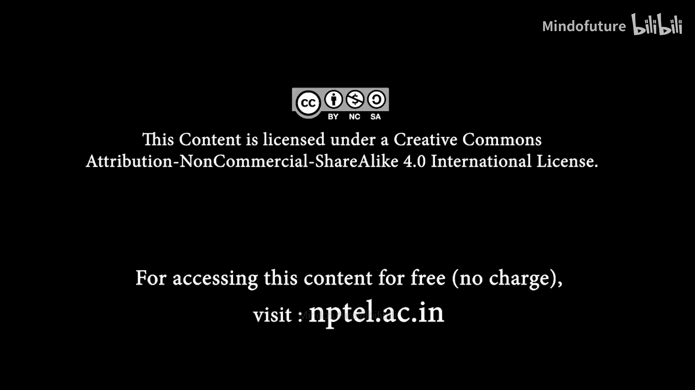
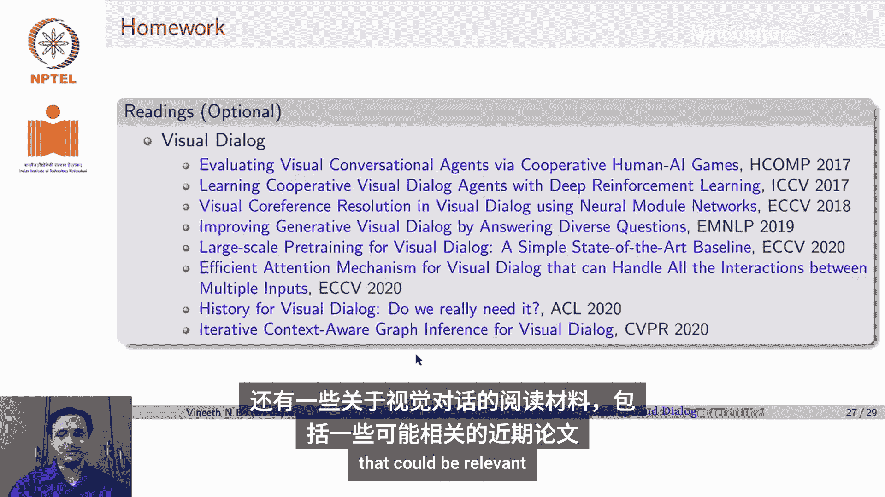

# 【NPTEL】计算机视觉的深度学习 p108 P108_附加内容 - 超越字幕 - 视觉问答和对话 -BV1vNWkzpEua_p108-

🎼Yeah。

The relevance of RnN models。And attention models in computer vision。

Becomes pronounced when you look at problems at the combination of vision and language。

This setting results in many sequence learning problems。We saw one in the last lecture。

 image captioning。And we'll now go go even further and talk about tasks such as visual question answering and visual dialogue。

 one question that we left behind。Was。Instead of image captioning can we do the opposite。

Go from caption to image。Using any models that we've seen so far。We can。

 but not using the models that we have seen so far。

 we will see generative models quite soon and see how we can use them to do caption to image generation in visual question answering which you can think of as an extension of the image captioning task。

The overview of the task is given an image such as what you see here and given a question such as what is the mustustache made of？

The goal is for our system， a deep learning model to give the answer bars。

So you need an understanding of the question。You also need an understanding of the image。

And the relevance of that question to a specific part of an image。

And then be able to give a reasonable answer。Here is a demo of how this。

VQA task works given an image and the question， where is the kid sitting？

If you had a good trained model for this particular task。

 the kind of answer you would get is the sync gets 99% confidence。

 which is actually true if you look at the image。This is actually a demo from a website known as Cloud C developed by Dr Barra and David Pararick at Georgiaia Tech。

You are welcome to go to this link and try out visual question answering on your own images。

Before we go forward and talk about what models you can use to solve VQA problems。Obviously。

 we will be looking at combinations of seenance， orinance and attention。When we say rance。

 we also subsume LSTMs and GRUs in that same term。Before we discuss those models。

Let's discuss the kind of data sets that one needs to solve VQA problems。

So far we have needed image classification data sets， image detection data sets。

 image segmentation datas， and to some extent what we saw in the last lecture。

 image captioning datasets。In each of those。The expected data set to train the model is self evident。

For this task VQA， things are a bit more complex， so let us see a few data sets that have been developed to address this problem。

So， this was the first dataset set known as the VQA dataset developed in 2015 this dataset has images and questions such as what you see on this image here given an image there are two questions what color are her eyes what is the mustache made of similarly for the second image how many slices of pizza there is this a vegetarian pizza。

The third image is this person expecting company。What is just under a tree under the tree and the last one。

 does it appear to be rainy， does this person have 2020 vision？As you can see。

For each of these questions， the model needs to understand the question。As well as the image。

And the relationship between the image and the question。So in this VQA data set。

You can see that the answers are open ended。And the answers are also multiple choice answers。

 so you are given a set of options and the model has to choose one of those options as the output。

Why is this important？Which means the task for the model becomes classification again。

Given a set of options， the model has to output a softm over or a probability vector。

Over the set of options。And the option with the highest probability is the predicted output of the model。

So， this VQA data set has about 250，000 images。😊，Wwhich is obtained from a data set known as MS Coco MS Coco stands for Microsoft Common Object in context。

And this dataset was developed for the image captioning task。

That data is extended for the VQA dataset plus about 50k abstract images such as these。

There are a total of about 750，000 questions。😊，Across these images as you can see。

 given a single image， you can have multiple questions and there are a total of about 10 million answers because for each question you need multiple answers to choose from。

And each question is answered by 10 human annotators。This is the VQA dataset。

Another data that was developed in 2015 is known as the Coco QA dataset。

This again used the Microsoft Coco data。As I just mentioned。

The Microsoft Coco dataset was a image captioning dataset。So。

 the Coco QA data used those captions to automatically generate QA pairs， question answer pairs。So。

 for example， given this image， if there was a caption。

 the caption is converted now into a question and answer the question could be。

How many leftover donuts is the red bicycle holding？And the answer is three。

What is the color of this T shirt， the answer is blue and where is the gray cat sitting the answer is window。

You can see that one can obtain question answer pairs from a caption。

The only constraint here is that the answer is a single word。Which is true of many VQA dataset sets。

This data set had 118，000 question answer pairs on 123，000 images。There were four types of questions。

What object？How many。What color and where were the kinds of questions in the dataset set。

In subsequent years in 2016 was developed another popular data set。😊，Known as visual 7 W。

This data has images and questions such as what you see here。

What endangered animal is featured on the truck in this image。

 the answer is bald eagle and the other options are sparrow， hummingbird and raven。Similarly。

Where will the driver go if turning right？If you look at this particular image here。

 you could then say on it 2434 road。And then you have other options。

 which are similar road names that may be relevant。So 7 w in the title of the data set stands for。

What。😮，Where。When。Who。Why。How and finally， which。This is a different kind of a question compared to other data sets。

 the which question here is given an image at this bottom left。

 the question could be which pillow is farther from the window。

And the answer would be what you see in this yellow box here。Which step leads to the tub？Once again。

 the answer would be the yellow box here。Which is the small computer in the corner once again the answer in the yellow box here。

That is the reason it is called visualual 7W， this data set has about 328。

000 question answer pairs on around 47，000 images。As we just saw， there are two kinds of tasks。

 the telling task， which is what we saw on the top row and the pointing task where we have to point to a particular part of the image to answer the question。

Another data more popular in recent times is known as Clver was developed in 2017 and this data set。

😊，Is a semi syntheticthe data which helps answer reasoning questions so the questions can be a bit complex so given an image as what you see in the top left here。

 the question is how big is the gray rubber object？

That is behind the big shiny thing behind the big metallic thing that is on the left side of the purple ball。

That sounds like a complex question， but of one reasons we are talking about this gray object at the back。

This particular one is what we are talking about， and one has to ideally understand several sub partss of the question to be able to answer such reasoning questions。

So the clever dataset has about 100，000 rendered images and 1 million automatically generated questions。

 the answers to these questions are single word answers but to get the answer one needs to pass the question very carefully。

The questions are indeed complex and require reasoning skills。

Having seen a few of the data sets that are used for visual question and answering。

Let's now see a few models that have been developed。For addressing the VQA problem。

One of the baseline models that you can obviously think of for using for visual question answering is a combination of an LSTM and image features that you get out of a CNM。

So given an image。You have a CNN， in this case， you see a BGG net。And at the end of the CNN。

 you get a fully connected layers representation， which is in this case 1024 dimensional。Similarly。

 for the question， you pass each word through different time stepss of an LSTM。

The output of an LSTM is a vector， which is again 024 dimensions。😊。

You cancatenate these two and send it through a few fully connected layers。

To make a final prediction of what the answer should be。If your answers were among a set of options。

 you would have cross entropy loss and everything that you see here。

All the parameters of every part of the network that you see here can be learned via a back propagation on that cross entropy loss。

So hope you understand how you can train these architectures。Although we are adding。

The abstractions that we have learned so far， CNNN's RNNs attention。

 we are trying to mixmat them to solve these problems。

 hope you can take away that none of these components violates how you can use back propagation to learn the weights of the network。

 using back propagation and gradient descent stays constant through all of these kinds of architectures。

Another baseline model that was developed in 2015 for visual question answering was a simple method again where given an image。

An image feature was extracted out of one of the layers， one of the outputs of the layers of CNN。

And for the question， a simple bag of words frequency histogram was used as the text input。😊，So。

 these two were concatenated and using a simple neural network the model predicted what was the right answer among a set of options。

Having seen these simple baseline models。Let's now try to see if you can improve upon these baseline models by getting more complex models。

One of the efforts in this direction was in CVPR of 2016 known as stacked attention networks for image question answering。

In this particular model。Given an image。You get a representation out of a CNN。

And very similar to attention models that we talked about on top of a CNN。

 you take a certain convolutional layers feature map。

 you would then be able to map that to spatial locations in the original image。

Now you have featured vectors corresponding to each part of your image。

You now take the question and pass it through an LSTM， you can do convolution if you like。

 we will see this a couple of slides later。And the output of the LSTM gives you a representation for the question。

This question is passed to the feature vectors of different parts of the image。

And between the feature vectors of the image。And the question representation。

 the model gives us a certain attention map on different parts of the image。

Based on this attention map。And the representation of the question。

There is another level of attention that is performed on the image feature vectors of different parts again。

That leads to a different representation， which we expect is the final solution and that representation is finally。

Taken to the output layer where a softm over the options in answers gives you the final outcome。

Let's see a visualization。😊，So in this case， if you have the original image。

What the Stagged attention network does is the first attention layer focuses on all referred concepts in the question。

So， we saw here in the previous slide that the first attention layer decides which parts of the image to focus on and which parts does it focus on wherever there are concepts that are present in the question so it could be in this case。

Bicycle， basket and objects in the basket in this case the question was what are sitting in the basket on a bicycle？

The second attention layer。Based on the attention that you get in the first attention layer。

The second attention layer。Chooses to focus only on the part of the image that contains the answer。

And that's what helps us finally predict the outcome。So in the second step。

 you narrow down the focus of the attention only on the part of the image that contains the answer。

And hence， the model can predict the answer among the set of options as dog。

This leads us to a follow up question， so we in the model that we just saw。

 we performed attention only on the image。We took the question representation as it is and tried to use a relationship between the question representation and different parts of the image based on attention。

So， even in the attention that we just used on the previous slide。

 it was soft attention which weights different parts by certain weights that are learned and that can facilitate back propagation。

But now we ask the question， can we also introduce attention in the question？

This was done in a model known as the hierarchical Coten model， this was published in 2016 Europes。

In this particular model， the words give it all， we have co attention。😊。

Which means we attend both on parts of the image。As well as parts of the question。

And the hierarchical part comes from we first get an embedding at a word level of the question。

 then at a phrase level of the question and finally on the entire question itself。

Let's see this in more detail。Given a question。We extract its word level embeddings。

Frase level embeddings and question level embeddings at this point in time you can assume that this is something that you get by passing through some neural network。

So how do you what is the input in these cases do you really give the text as input not really remember for all of these problems that involve text for to a large extent you have a vocabulary of words and each word in your question corresponds to a one hot vector on your vocabulary where you put a one for the index in the vocabulary that this word belongs to and a0 everywhere else。

That would be the input。That you give for a particular word。So you extract word level。

Prase level and question level embeddings。At each level， you apply co attention。

 so both for a word level map embedding。You apply attention on the question as well as the corresponding image。

Similarly for the phrase level and the question level。

The final answer is based on all the coatend image and question features。

So if you see carefully here when we say what color on the stop light is lit up so you can see here this is the question and the ideal answer you would expect is green。

So you first take word level emittings。And you attend to one part of it， in this case。

 you can see that the attention is focused on stop。Similarly， at the same time。

 the attention on the image is also seems to be focused on somewhere around the traffic light。

In the next higher level of the hierarchy， the attention is focused on different phrases in the question in this case you can see the maximum weight goes to the phrase called the stop light。

And once again， you can see here that the image is a bit more confident now and focuses completely on the stoplight。

Then at the highest level of the hierarchy for the question。

The attention map tells us that light is what we are focusing on and at that stage the attention on the image focuses only on the light inside the traffic signal。

And that results in the answer， green。So， let us understand this in some more detail the question hierarchy。

 so at a word level you get a word level embedding as we just saw。😊。

How do we get the phrase level and question level embeddings to get the phrase level embedding。

 you can take embeddings of each word of your caption。

Perform convolution across those inputs with multiple filters of different widths and you would get vector representations such as these。

 which is what we call as phrase level embeddings。Then we perform maxpo over the convolutional layer and we then get a question level embedding through the LSTM that we give that max pool output。

That gives us a representation at the question level。Here are some results。So you see here。

The image and the question is what is the man holding a snowboard on top of a snow covered question mark。

 the answer is mountain and the other example is what is the color of the bird and the answer is white。

Here are the word level coattenion maps in this case the question the part of the question that' is being focused on is snowboard top snow covered and the image focus at that point is a bit on the snowboard and a bit on the person and in this case the focus is on color of bird and the model suggests attending to the part to the bird in the image。

For phrase level coatt。In this case the focus is on holding snowbir。

 snowboard on top of snow covered and the focus in the image。

 red being high and blue being low similar to heat maps that we saw with explanation methods。

 so you see that the model is focusing on other parts of the image other than the person。

 similarly for what is the color of the bird， the model seems to be focusing on the area just around the bird to be able to isolate the color。

And， finally。When the model comes to a question level attention map。

 what is the man holding a snowboard？On top of a snow covered。

 the model looks at everything other than the person to be able to get the answer mounted。

And in the other example， what is the color of the bird。

 the model is looking exactly at the bird to give the answer white。

We will now move on to the second task that we planned to discuss in this lecture。

 which you can consider as an extension of visual QA， which is visual dialogue。

So the overview of the task is given in the illustration here， this was first done in 2017。

Given this image。And given this caption， which says a cat drinking water out of a coffee mug。

Visual dialogue is like a chatbot。But a chat bot that asks and answers questions with respect to an image rather than simple free text。

So let's see an example， what color is the mug？The bot answers white and red。

 so you can see the mug there。Are there any pictures on it？No， something is there。

 can't tell what it is。Is the mug and cat on a table， Yes， they are。

Are there other items on the table， yes， magazines， books， toaster and basket and a plate？

And as you can see， there is a toaster in the background， there is a basket。

 and this is a fairly comprehensive list for a machine to give an answer as。

So here is a demo of how visual dialogueo works given this image。

The bot says a man and a woman are holding umbrellas。The question that a human can ask。

What color is his umbrella？The bot answers his umbrella is black。What about hers？

This is a tricky question because。The model has to understand that the question is about the umbrella and secondly the question is about her umbrella。

 which means the model needs to know that there are two people， one of them is a male。

 one of them is a female and then be able to answer this question and the bo does says does say hers is multicolored。

How many other people are in the image， I think three， they are occluded。Once again。

 this demo comes from Cloud CV developed by Dr Bra and David Para， at Georgiagia Tech。

You are welcome to go to this link to try out visual dialogue and see for yourself how it works。

Let's now formally define how you would go about solving this task。

 this is not like a traditional classification problem。

 does not even seem like a traditional sequence learning problem where you give out a caption for an image。

Then how would you go about formalizing it and solving it？Given an image， I。

A dialogue history of question answer tus， Q1 a1， Q2 A2， so on and so forth till  Q T1 t minus 1。

80 minus1， those are your previous question answer tuples。And you have a follow up question。

That is current at this time， in this case the question is is the other one holding anything？

And the task here is to produce a free form natural language answer80 that answers this current question QT。

So one question you could ask here is how do you evaluate the answer？

The evaluation here can be tricky。And typical store scores used in natural language processing such as blue。

 which we saw earlier， meteor roe， we won't get into them now。

 but it is known that such scores often correlate poorly with human judgment。For example。

 you could have multiple answers said in different ways that could answer a question。

 but not all all of them may correlate with a score。Of one single ground truth answer。

So how do you study this？You could probably have what are known as human turing tests where you give out a generated sentence and then ask a bunch of humans to read the quality of the sentence。

Now， this could work because based on how a human looks at it， it' is called a human tuuring test。

To check whether the human can make out whether the answer is generated from a machine or whether the answer is generated by a human。

 so you could introduce that as one of the questions that you ask the human in addition to rating the quality of the answer。

The challenge here is that this kind of an evaluation could become expensive because you may have to compensate humans to participate in the evaluation。

And it could also be subjective depending on what human is evaluating a system。

 so different humans could evaluate different answers differently。So。

 how do we go about evaluating such a system， so let's see that now so given an image。

The dialogue history and the current question。What data sets for visual and dialogueo do is give about 100 answer options。

These answer options could be。Answers to 50 most similar questions。30 popular answers。

And maybe 20 random answers， so you pick these 100 answers。And ask your model。To rank。

All of these answers as the outcome。So the model's job is given these 00 answers you could once again have a softmax which gives you a probability vector across these 100 options。

 but using that probability vector you can now rank order your options。

 the highest probability will be the first rank， the second highest probability will be the second rank。

 so on and so forth。But how do you judge the goodness of this ranking？😊。

You can do a couple of things to measure the performance。

 you could check the mean rank with respect to the ground truth so you expect that the model will give the first answer as the ground truth but that may not always happen in one case you may get the third ranked answer to be the ground truth in one case you could get the seventh rank answer to be the ground truth and in one case the 41st answer that you ranked could be the ground truth which would be a poor outcome。

So the mean rank with respect to the ground truth across all your test samples could be one performance metric that you could use。

Another that another metric that' is also used is known as the mean reciprocal rank。

So the mean reciprocal rank could be for one particular test question if you predicted。

A set of ranks for the options and the third position of your predictions was the correct answer so which means your correct rank is 3 let us assume that for another question your second rank option was the correct answer and for another question your first ranked option was the correct answer。

Then your mean reciprocal rank would be given by1 plus one by 2。Plus1 by3。

 divided by3 because those are the total number of options that you have which you would get as 1。5。

 you would get that to be 1。83 by 3， which gives you 06 month。This would be the mean reciprocal rank。

When would the mean reciprocal rank be 1 if your first rankd option always is the ground truth？

And when would it be zero if your last rank option was your ground truth。

So mean reciprocal rank is another performance metric that you can actually use to be able to study the performance。

Let's now come to the kind of models you can use in to perform visual dialogue task。So。

 it is once again encoder decoder frameworks where the encoder could be a late fusion encoder。

 a hierarchical recurrent encoder or a memory network encoder。

And the decoder can be generative or discriminative。

We will see some of these examples over the next few slides。

Here is an example of a late fusion encoder in this particular case。

The image is this one that you see here。You have a previous history of question and answers。

 so the man is riding his bicycle on the sidewalk。Is the man wearing a helmet？ No。

 he does not have a helmet on， Are there any people nearby， Yes， there's a woman walking behind him。

 That's the dialogue history。 And the current question， Qie is given by。

 do you think the woman is with him。So we have to give an answer 80 for this question now。So。

 you provide the image to a CNN， you provide the current question to an LstM and you provide the entire history concatenated as a single text input。

To another LSTM。You fuse or concatenate the outputs of each of these models， the CNN。

 the current question LSTM， and the history LSTM， and you can now have layers after them to reduce the dimension of that final representation and you provide this to a decoder to get the final answer。

We will talk about decoders in a moment， but at this point we are discussing the encoders of models that are used for visual dialogue。

This is one kind of a model known as the late fusion encoder。

Another kind of an encoder is a hierarchical recurrent encoder where。

You have once again an image goes through a CNN， gets a representation。

 the current question goes to an LSTM。But now this LSTM also gets the image representation as input。

Then for each round of the history of the dialogue history， you send it through。

One instance of the LSTM and get different representations for each step in history。

Now you have another LSTM that combines these inputs from previous dialogue history and the current question and the image。

And the output of that。Next level of the STM LSTM is passed on to the decoder to get the output。So。

 this is called a hierarchical recurrent encoder because you have an LSTM。😊。

To take inputs of the image， current question and the dialogueg。

 and you have another LSTM that combines these inputs before passing on to the decoder。

This is the hierarchical recurrent encoder。A third kind of an encoder is a memory network encoder which uses an attention idea。

Where once again image through a CNN question through an LSTM， concatenate the representation。

 compress the representation， that is the first part。Once again。

Each of the dialogues in history goes through a different instance of the same LSTM and you get different representations for each of these question answers in the dialogue history。

Now， you also bring the。Current image question representation along with the representations of the history and you now look at an attention step here。

 you see an attention or history to decide which part of the dialogue is relevant to answer the current question remember for a long dialogue you may be referring to a sentence that was stated to three organizations before to answer a current question and using an attention idea gives us this kind of an approach so you take an inner product of the current question an image which gives you an idea of the alignment remember we talked about alignment when we talked about attention。

For encoder decoder models where we talked about attention of the hidden state in a decoder。

with respect of the alignment of a hidden state in the decoder with respect to a hidden state in the encoder。

And we said that one way you could do alignment is through a dot product or inner product。

 so this what you are seeing here is an attention which checks for alignment。

Between the current image and the question with respect to history to get an attention map over the history which is a weighted sum。

 then you combine this with the current feature vector of the image and current question and then you pass that to the decoder to get the final answer。

Once again to remind you， every component that you see here is differentiable and you can learn all of these through a back propagation step。

Even attention or history is simply a weighted combination of inputs which can be back propagated through。

Coming to the decoder part of such models， as we said， decoders can be generative or discriminative。

In a generative decoder as an example。During training。

 you would maximize the log likelihood of the ground truth answer sequence；

 you would want your decoder to generate the correct answer sequence。

And during training you maximize the log likelihood of generating that ground truth answer sequence once again when you actually implement them these would be implemented as if you had a decoder LSTM at each step you would output a word that would give you a cross entropy over a vocabulary and you would have multiple time steps in your LSTM and the addition of those cross entroies would be your loss。

Or in this case， the log likelihood。 Remember， cross entropy is a way of。

Minimizing cross entropy is equivalent to minimizing negative log likelihood in this case。😊。

At test time or evaluation， you use the models's log likelihood scores over your vocabulary and rank your candidate answers。

Whereas in a discriminative decoder。😊，You take the input encoding and compute a dot product similarity between the input encoding and the LSTM encoding of each answer option you could use any encoding method here we will not get into that here you would probably need some knowledge of NLP to understand how you can get encodings of text but let's assume now that you could get some encoding there are what are known as Word tobe embeddings G embeddings so on and so forth。

 you could use them to get an encoding for the answer options and the input encoding。

Now you compute a dot product and that dot product is fed into a softmax to compute posterior probability over all your answer options。

And during training， you would maximize the log likelihood of the correct option。

And at test time or evaluation， options are simply ranked based on their posterior probabilities which you would get as output of a softmax。

This is how you could model the decoder of such encoder decoder models to solve the visual dialogueog task。

Let's see a couple of examples。So here you have an image。

The initial caption is the skiers stood on top of the mountain。Then you have the dialogue。

 how many skis are there， hundreds？Are they ready are they getting ready to go downhill？

I think so my view is at the end of the line。Is it snowing？No， there is a lot of snow， though。

Can you see anybody going downhill？ No， my view shows people going up small hill on skis。 I can't。

 I can't see what's going on from there。And so on and so forth， as you can see。

 is a meaningful dialogue。One more example for you to see at your leisure for visual dialogue。

If you'd like to know more。You can read these papers。

 there are some of them which are more recent which we didn't get a chance to cover in this lecture we covered the most basic methods。

 but if youd like to know more you can follow some of these recent papers。

And we' are going to leave one question here。Can you come up with better methods to evaluate visual dialogueog systems？

Think about it may not be a non trivial answer may not be a trivial answer。

 think about it and we will discuss the next time。A few more readings for visual dialogue papers。

 including some very recent papers that could be relevant。Here are some references。

