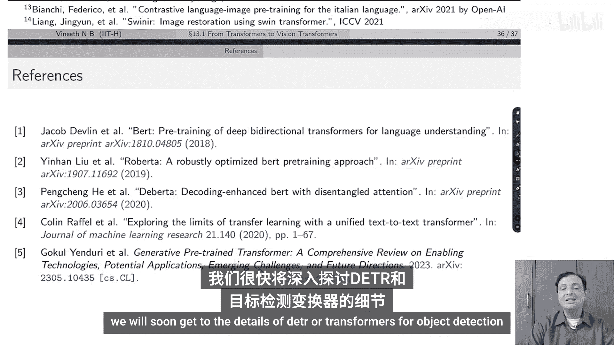

# 【NPTEL】计算机视觉的深度学习 p110 P110_从Transformer到视觉Transformer -BV1vNWkzpEua_p110-

In one of the previous week's lectures。We talked about self attention。

And the transformer architecture。Which served as a harbinger for revolutionalizing。😊。

NLP tasks to process text modalities。Since then。The transformer architecture has become a default go to choice for data。

Across different modalities， including text， vision， speech， or even graphs。In this module。

We will talk about transformers for computer vision。In particular， we will begin this first lecture。

With the journey from transformers to vision transformers。Most of this lecture。

Is based on Justin Johnson's deep learning for computer vision course from the University of Michigan。

We are grateful to him for making his materials publicly available。😊，As we already discussed before。

Transformers revolutionized NLP tasks by introducing a novel architecture based on self attention mechanisms。

This helped in several NLP tasks like machine translation。😊，Language understanding。Text generation。

Question answering。Named entity recognition。And many more。After the initial transformer's work。

There have been architectures like Bert， Roberta， debera。

P5 and the entire popular GP series which represent major contributions in transformer based models developed for NLP tasks。

When we talk about transformers in computer vision。😊，One thing to note is the transformer encoder。😊。

Typically requires a sequence of vectors as input。😊，In language applications。

This sequence is just the set of ordered。Word embeddings that correspond。

To the tokens within the input。However。How do you do this when your input is an image？

Is every pixel a token？If you do that。It blows up memory usage and computations。

If you have a 224 cross 224 color image。You would end up needing to store。

Three channels are G into 224 into 224 whole squared。

Because for every pixel you need to evaluate self attention with respect to every other pixel。

Which would total up。To a total of about 22 billion parameters for each self attention calculation。

This is simply。Not sustainable。So then。How do we adapt transformers to computer vision？

Is the first core problem youre going to discuss。This was first proposed in a paper called an image is worth 16 into 16 words transformers for image recognition at scale at ICA 2021。

What they proposed is if you consider an image of size 224 cross 224 cross 3。

 assuming it is an RGB colored image。They suggested。To break the image into 14 cross 14。

Patches or small images。Each of size，16 cross 16。Which means？

You would now have a total of 19 to6 patches across your image size。Now。

 each of these input patches can be considered as independent patch tokens。Each of shape。3 cross 16。

 cross 16。Now they project each of these patches。Into a D dimensional vector。

 we will soon talk about what this projection involves。

Once this is projected to a D dimensional vector。They add the positional encoding。

 which is somewhat similar to the positional encoding that we saw with transformers。

 but also has some differences which we will talk about soon。😊。

And once we have these patch tokens embedded it into a d dimensional vector。

And a positional encoding appended to the datamissional vector。😊，This is sent。

To a transformer encoder， very similar to the NLP transformer。

And the rest of the process is almost the same as the NLP transformer in NLP tasks like say machine translation。

For every word。That is given as an input token。 you may have。

Approximately an equivalent word as an output token。However。

 when you are trying to adapt vision transformers for image classification tasks。

You only need one output， you dont need 19 to6 output tokens coming out of your transformer decoder。

How do you handle this？😮，They proposed the use of one additional token called your classification token。

Which is also learnable， which also gets updated during your back propagation。

This classification token is also called CS token。And no。At the output。You have。A similar。

Classification token that the decoder outputs。And this classification token is projected to a c dimensional vector of predicted class scores through a softmax operation which is similar to standard neural network last layers。

And one then takes the arg max of the outputs of the linear projection to give your final class prediction through the vision transformer。

 putting everything together。Your vision transformer looks somewhat like this。Now。

 let us talk about one more level of detail here， which is your。

Position embes in the case of an NLP transformer。The position embeddings are fixed。Po。

Encodings of the relative position of。A word in a sentence。Howeverever은？In a vision transformer。

They proposed to number these patches as say0，1，2，3， so on and so forth。

But they found that simply giving these numbers as additional positional encodings did not really help or did not significantly improve performance so what they proposed is to have a table like structure。

😊，Where for each of these positions of patches in your image。

 they have a corresponding D dimensional vector。which is now appended to the corresponding patch in your set of 19 to6 patches and these de dimensionional embeddings that correspond to each position are also learnable and also get updated during back propagation。

Now， let's try to compare this with what we saw earlier。We said that if we used a pixel as a token。

For an image of size 3 cross 224， cross 224。We had 22 billion parameters。While now。

We have 14 into 14，19 to6。Whole square because for every 19 to6 patch tokens。

 you need to have each of the attention with respect to each of the others。

Which totally adds up to roughly about 380416 parameters this is about 150 kb per transformer layer。

And see this significant reduction from 22 billion。😊，To just 38000 an odd。Now。

 one question you could be having in your mind now is。

Are we now solving computer vision without convolution？The history of computer vision。

For a large part has always relied on the convolution operation。😊。

So have we now managed to address computer vision tasks without convolution？Not really。

The linear projection。In the input layer。Is actually a 2 d convolution。

With stride being the path size itself。Besides that。Even the MLP layers in transformers。

Strictly speaking are actually one cross one convolutions。So， convolutions are being used。

 but in a different way in the transformer architecture。😊，Now， in this work。

They empirically compared the vision transformer to residual networks。

They in fact came up with a few different variants of the vision transformer。😊，The B variant。

 which has 12 layers。The L variant which has 24 layers and the h or the huge variant。

 which has 32 layers b for base。😊，Alpha large and H for huge。Within this。

 they could also vary the path size from 14 cross 14 to 16 cross 16 or 32 cross 302。

Please keep in mind that the smaller the path size yields a bigger model because you are going to have more number of patches inside a given image。

😊，Now， they compared this with renets by deciding what data set to pretrain these models on。

The first result on the left， you see a comparison of training these models on the INe data set which as you may know has 1000 categories with 1。

2 million images。And they actually found that residual networks perform better than all of these VIT models in this particular case。

😊，However。When the pre training was improved。They found。

That when the models were trained on the Inet 21 k data set。The Renets and VTs almost were at par。

And when this pretraining was improved to the JFT data。

 the JFT 300 million is an internal Google data set with 300 million labeled images。😊。

And when they pre traineded on JFT and then fine tuned on Igenenet。

 they found the performance of VITs on Inet to outperform renets。😊，So， the conclusion was that。

VITs do need significant amount of pre training to outperform restNes。However。When you do that。

 VITs need significantly lesser training time。😊，And are more efficient use of compute than restnets。

WO。One could hypothesize that convolutions are quite costly when compared to simple matrix multiplications that get used in feet forward networks or MLP or self attention computations。

This helps in VITs making more efficient use of GPUs。

Since the vision transformers were first proposed。There have been other works that have managed to improve the VIT performance in different ways。

One of the early improvisations called how to Tra your VIT。

Proposed the use of regularization methods like weight decay。Sttochastic depth。

Or drop out in the feet forward layers of the transformer。

Or using augmentation strategies like mix up。Or R augment which provides a random augmentation among a set of predefined augmentations。

These helped improve the performance of vision transformers。Or an improvement。Called the D I。

 it stands for data efficient image transformers。Proposed the use of knowledge distillation。Where。

A teacher CNN model typically large was used as a teacher for training a student VIT model。

This is done using the standard cross entropy loss for the student model。

As well as a K divergence loss between the outputs of the student model。And their teacher model。

Recall that K divergence measures the divergence between two probability distributions。So。

 you could take the output of the teacher model and the student model as two different probability probability distributions and compute the KL divergence between them。

😊，To do this。This work also introduced a distillation token which is once again a learnable token provided as input。

😊，And the corresponding token at output， the distillation token is used to match the teacher using KL divergence。

And this work also called D I showed that this idea。Improvve the imnet top1 accuracy。From 77。9 to 83。

4。In fact， they went even further when they used a higher number of training epochs or higher resolution of images。

If one now compared。VIs and standard convolutional neural networks if you take the example of residual networks。

One observation we have made through the course is that in Cs the resolution。😊。

Typically decreases as you go deeper and deeper inside the neural network。😊。

And the number of channels typically increases。😊，This leads to a hierarchical architecture。😊。

And the intuition is that such an approach is useful since objects can occur in multiple scales。😊。

And you would hopefully discover these objects。😊，Of different scales in different layers of such an architecture。

However， with a VIT。😊，It follows what is called an isotropic architecture。

 which means each block of a vision transformer has pretty much the same architecture。😊。

The same resolution and the same number of channels。So you could ask the question。

Are we then losing out on hierarchical information？Can we make VITs hierarchical？

And this is what was done in a follow up work called the Sw Transformer。

 which was published in CBPR of 2021。😊，The wind transformer。😊。

Try to introduce the notion of different scales or hierarchy in the representation learning of vision transformers。

How did they go about this？😮，Given an input image。Which is say3 cross H cross w。

3 being the number of channels for color， H cross W being the actual resolution。

This goes through a patch partition and linear embedding very similar to what we saw with the vision transformers so far。

But then before they do this， they divide the image into four cross four patches and project to C dimensions。

How does this happen？If your image is 3 cross h cross W。

They propose breaking the image into three cross 4 cross 4 patches， which is 48 dimensions4 into 4。

16 into 3。And now your image becomes 48 cross h cross 4。

AndW cross 4 because youve divided the entire image into four cross4 patches。

And each of these patches now， which are h cross 4。H by 4 cross W by 4。

Is of 48 dimensions corresponding to 3 cross4 cross 4。

Now they take this 48 cross h by 4 cross w by 4。And projected linearly to C dimensions。

so this 48 now becomes C very similar to how we saw the linear projection in your。

Vanilla vision transformer。Now， how does this build on？Once they do this at the first layer。😊。

They now merge to cross two neighborhoods and patches now effectively become8 cross8 in terms of the receptive field。

😊，Which leads to a h by 8 cross w by 8。Overall， resolution。How does this work？

You had your C cross H by 4 cross w by 4。When you merge to cross two neighborhoods。

 this now becomes h by 8。Cross W by 8。But because of the merger。

Each2 by  two is now accumulated and now each of these slots here is has 4 C channels C。

And then merging of2 into 2 leads to 4 c。This is now projected linearly to 2 c dimensions and that is how you get。

😊，Do see。Cross H by 8， cross W by 8。Now， this is then progressively implemented to once again merge。

😊，2 by  two neighborhoods now the patches or there is original receptorive field becomes effectively 16 by 16。

😊，And your。Dimensions at this stage become 4 C cross h by 16 cross w by 16。

And this is repeated further to get HCc。😊，Cross H by 32， cross W by 32。Now。

 this gives an effect of learning your image at different scales and hence getting a hierarchical representation of your input。

😊，A couple of questions now arise。While the original goal of the vision transformer was to make self attention computation efficient。

By now going back to Hcro W grid of tokens， once again your attention matrices are going to be head square w square approximately。

Which is quadratic in image size。How do you handle this？😮，To handle this。

 the s transformer proposes breaking down the image into m cross M tokens。

And computing self attention。Only inside each window。How does this help？Now。

 because your image is divided into m cross M tokens。So you have a total of。And。Cross M here。

So which means？The total number of parameters is going to be m into M that is m square。

But then for every patch you need to compute self attention with respect to every other patch。

 so you' are going to have an M square here。But then the size inside each of each of these tokens is given by。

😊，H by M。Into。W by M。This hence becomes a total of m square Hw。

 which is linear in image size for self attention computation。

The sprint transformer uses m equals to 7 in their work。

The other question you could ask is because we are restricting self attention to only within each of those M by M windows。

😊，How would you capture long range relationships within an image after all。

 the purpose of self attention was to capture the context of a particular object with respect to any other part of the image。

How do you handle this？To do this， they introduced the notion of a shifted window attention。

Where the attention windows are progressively changed or shifted in a hierarchical manner。😊。

That enables interactions between patches across different levels of abstraction。

 but this captures long range dependencies while maintaining computational tractability。😊。

This is crucial in applications like image classification。

 object detection and semantic segmentation。😊，How do they do this？😊。

Given any particular layer where you have these m by m tokens or m by M parts where you compute attention only within each part so you have。

A patch here。And you have this local window here within which you actually compute your self attention。

They now rotate how these local windows are computed between successive layers of the vision transformer。

😊，In one layer， if these are your self attention window patches in the next layer this becomes your self attention window patches and then this process keeps repeating。

😊，To see it in more totality。You start within a particular transformer layer using layer normalization。

 then apply your window。Self attention here。And then that goes to a layer normalization module。

 then an MLP module and then in the next transformer layer you use a shifted window。😊，Attention。

 self attention and this process is once again repeated between successive blocks of your overall architecture。

So， one question you could ask here again is what happens to your positional encoding or embedding？

So， swim transformers dont use absolute positional encodings the way vision transformers do instead。

They encode a relative position between patches using learned bias which is included inside your self attention computation。

😊，This B is a learned bias matrix of dimension m square by m square corresponding to your patches and this gives you the relative position of your different patches that you are studying within an image。

And with this， they actually showed that they could get higher accuracy than vision transformers with distillation while they could also do this with significantly less lesser time。

😊，In terms of milliseconds per image on a V00 GPU。When compared to other vision transformer architectures like DIT。

While we have discussed vision transformers and spin transformers in this lecture so far。😊。

Over the last couple of years， both these architectures have become a general purpose backbone for a diverse set of vision tasks including image classification。

 object detection， semantic segmentation。😊，In terms of object detection。

 we have an architecture called the DETR， which we will see in the next lecture。And for segmentation。

 we have the very popular segment anything which we will also discuss in this module。😊，Beyond these。

Clip for vision language tasks uses vision transformers。

 and there have also been other architectures like Sw IR for image restoration。

If you are interested more。I will highly recommend you to also look at the corresponding references for these topics we will soon。

Get to the details of D ETR or transformers for object detection。

