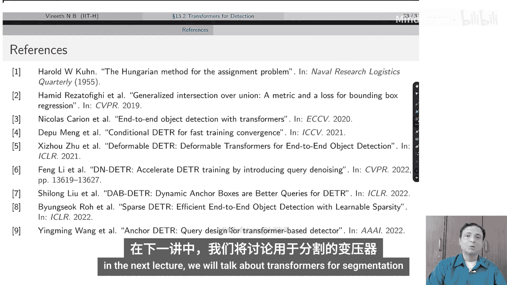

# 【NPTEL】计算机视觉的深度学习 p112 P112_用于检测的Transformer -BV1vNWkzpEua_p112-

Continuing。With the transformerss module。We will now talk about。

How transformers have been used for the task of object detection。So we begin。

In the previous lecture by talking about how transformers have transformed。

NLP by offering more efficient and effective ways to model sequential data。And in the last lecture。

We spoke about how vision transformers or VIs extended this architecture to vision tasks by。

Replacing CNNs with self attention modules and could outperform。

Existing methods on image classification benchmarks like Inet。

Moving on to the next popular task in computer vision， which is object detection。We know。

From the earlier lectures on object detection that it involves processing large volumes of data。

And making fine grain decisions at the level of bounding boxes for each object in an image。

Existing object detection methods like faster RCNN。

 FCN and that family of methods rely on a bunch of handcrafted components like anchor boxes non maximum suppression and also a few thresholds which makes the overall architecture and framework complex and at some even inefficient。

So what can we do with transformers here？DETR was introduced in 2020。

As an end to an object detection framework using the transformer architecture。

That made the entire object detection pipeline far simpler than the previous frameworks like fasterster R CNN。

Here is the overall architecture of the DETR or detection transformer for object detection。

You can see here。That you provide your input features， input image to a CNN。

Get a set of image features。Add positional encoding。

And now these patches along with the positional encoding is fed into the transformer encoder。

 very similar to how we saw with VTs。And you get a set of embeddings for each of these input tokens as the output of the transformer set of encoders。

This is provided as a side input to the transformer decoder in the ETR。

Along with a bunch of inputs which are called object queries， we will talk about this soon。

Corresponding to these object queries， we get。Output encodings of the decoder。Each of which is fed。

Into a feet forward neural network to finally make a prediction of whether there is a class in that particular embedding。

And what were the bounding box coordinates are offsets for that particular embedding？

Note here that you can also have no object as a class label。Especially。

For areas where the corresponding object query LED to a background。

This is the overall idea we will talk about more specific details over the next few slides。

Before we go there， though。One important formulation of such an approach is that because the transformer decoder outputs a set of encodings。

The task now becomes a set matching problem。Matching a set of decoder outputs。

With a set of ground truth bounding boxes and labels in your original training data。

How we match these two sets using a loss function is one of the aspects of what we are going to talk about over the next few slides。

So， the main components of DATTR are a set based global loss。

That forces unique predictions via bipartite matching between these two sets and a transformer encoder decoder architecture。

The input image， as we mentioned。Is passed through the convolutional neural network to extract a set of feature maps of dimension C across H across W。

These feature maps because they go through a CNN。Capture the visual information of the image at different spatial scales。

 as would be expected for feature maps that come through a CNN。

Very similar to what we saw with vision transformers。

These feature maps are flattened to get a sea cross HW matrix。

And to each of these there is a positional encoding that is added based on the position of these feature maps in the original image。

😊，This allows the model to keep track of where a particular bounding box or a patch was present in the original image。

Once the positional encoding is appended。These tokens are fed to the transformer encoder。

Which goes through。A few blocks to get a set of final encoder representations given by D cross HW。

The encoder similar to vision transformers consists of multiple transformer encoder layers each with self attention mechanisms and feet forward networks。

The self attention mechanisms as expected allow the model to capture a global context and relationships between different parts of the image。

😊，Now， these encode representations are fed。Alongside。

A set of learnable queries to the transformer decoder。

These learnable queries that are fed into the transformer decoder。

Are also called position encodings or learnable position encodings in the DETR paper。

These learnable queries represent possible object locations and class information。😊。

The decoder similar to the encoder consists of transformer layers with self attention and feet forward networks。

And it also receives the encoder representations as an additional input。

 so the decoder attends to both the encoded image features。

And these object queries to finally make predictions about the presence。

 location and class of objects。We will come back to this in a moment once we complete the pipeline。

So， these output embeddings of the decoder are each fed through a feed forward neural network。

To get the final predictions of a class label。And a bounding box coordinate corresponding to each of these decoder embeddings。

This is the overall pipeline of the DATTR framework。Now you could ask the question。

What are these learnable queries， what do you feed inside them？As the name states learnable。

These are initialized with random vectors which are also updated by a back propagation through training。

So then why do we give them as input， what do we want to get through them？

Please keep in mind that in a transformer。The number of output encodings depends on the number of input tokens provided to the transformer。

So these learnable queries， in a sense。😊，Allow the decoder to transform them to a set of output embeddings which then map to bounding boxes in the image。

So that is the main purpose these learnable queries serve。

 the paper also tries to visualize them to understand which aspect or part of the image each of these learnable queries focused on。

 for example， one of them could have focused on say just the left part of the image。

 one of them could have focused on a large central part of the image and so on and so forth。

For more details about these visualizations， please do see the DTR paper。No。

You could ask the question。How do we know how， how many objects are in the image to know how。

 how many output embeddings to have。To do this， the paper simply suggests to have n as an upper bound on the number of objects that could be in any test image or train image。

So the decoder predicts an upper bound of。Encodings each of which could or may not correspond to a bounding box with an object。

So what happens if one of these encodings does not correspond to an object？

The model simply matches that to a no object class。With no specific bounding box coordinates。

That allows the model to take these decoder embeddings and map them to a set of bounding box and class predictions in the ground truth and do a set matching between these two where the bounding boxes that correspond to the background or where there is no object are simply replaced by a no object class。

The nice thing about this approach is that。The transformer decoder or the overall model predicts all of these outputs in parallel for all object queries this allows end to end training without any post processing steps or two stage networks。

That bit popular。In earlier versions of object detection frameworks。

So here is another view of the transformer architecture used in DATTR。

You have your image features that are fed into the encoder。

You can see here that a spatial positional encoding is fed along with the image features to the multi head self attention module。

 which follows the typical set of layers in a transformer。Now。

 the encoded outputs of which there could be multiple depending on how many encoder blocks there are in a given architecture。

It's fine。Into the decoder。In an intermediate stage now the object queries that we spoke about。

 which are learnable vectors are fed into the decoder。

And the spatial encoding which was given to the encoder， is also fed to the decoder。

To accordingly inform the multi head attention module inside the decoder。

And the decoder outputs as many embeddings as object queries and each of which is fed to a feet forward network to predict the class label。

And a corresponding head for predicting bounding box coordinates。

Which is similar to how object detection is done， even in faster RCNN frameworks。Now。

 coming to the critical module of how the set matching is done at the output。

DTR predicts n objects in each decoder pass with n larger than typical object counts。

 It is an upper bound of the number of object instances you may see in a given image。

Unlike existing object detection methods like faster R CNN or FPNs。

 DTR does not rely on thresholds or heuristic assignment rules for matching proposals or anchors to ground truth。

So how does it go about this final assignment？As mentioned earlier， it uses a loss function。

To achieve an optimal bipartite matching between the set of predictions。

And the set of bounding boxes in the ground truth images used for training。How is this done？

If why denoted the set of ground truth objects。Tided with one additional label for no object to match the size of Y hat。

 the set of n predictions。Then a bipartiteid matching between these two sets。

Is found by considering a permutation that obtains the least loss in matching these two sets of predictions。

Just as an example。If your transformer decoder or the DETR predicted。

 say five bounding boxes each with a certain class label and a corresponding bounding box coordinates。

You know， check this with。Your ground truth。Where in a particular image you may have had only two objects。

So if you had two objects with certain class labels， say C 1 and C 2。

The remaining are simply padded with。No object。Or null set to indicate that there were no objects beyond those two。

Now a set matching is done between these two sets。In such a way that you consider the mapping。

That gives you the least error among all permutations of taking a set and matching it the ground。So。

 every ground truth element now Yi can be seen as C B where C is the class label and B is the bounding box information。

And for a prediction with index sigma of I please keep in mind that sigma was the permutation that was considered of the predicted bounding box and class labels。

P hat is the probability of class C and B hat is the predicted box。

So your matching loss between these two sets is given by。You ideally want to minimize a loss。

 so you want to minimize。The error between your predicted bounding boxes and your ground truth bounding boxes。

You want to maximize the probability of finding that particular class in that bounding box corresponding to that object and that is why you see a negative sign here because you ideally want to maximize this probability。

Let's put this together further as to how the model actually uses these losses。

This matching follows a very well known matching algorithm known as the Hungarian matching algorithm you can look at this paper below if youd like to know more details about Hungarian matching。

So because it uses the Hungarian matching algorithm， the loss is also called。Hungarian loss。

Where you try to maximize the probability of the correct class。Minimize the error。

In measurement between the predicted bounding boxes and the true bounding boxes。

And please keep in mind that you now try to take a matching loss that considers the least among all of these permutations so remember that when you match two sets a certain ordering of set one could match the best with set2。

You take all possible permutations and choose the one with the least error。

That's what the Hungarian loss attempts to do。Beyond this， DtR also。

Innovates on the other typical loss that is used in object detection frameworks。

 which is the L1 loss。Which measures the error in bounding box coordinates。

Because album loss can have different scales for large objects and very small objects if their relative errors are similar。

They instead propose to use a linear combination of an album loss。

And a generalized IOU loss IOU stands for intersection over Union。

Please recall our discussions on semantic segmentation to understand what IO means they use this version of generalized IU loss。

Along with the L1 loss as the bounding box loss used to train the DtR。

With this approach they show that they outperform faster RRCnN， various versions of faster R CNNnN。

 including the FPN variant by significant amounts while following very simple overall architecture with primarily innovations on the side of set prediction。

While DTR was a significant step up in terms of using transformers for object detection。

It also had limitations。It demands significant computational resources for a primary reason。

 which is the quadratic complexity of the self attention mechanism。Keep in mind that。

DTR almost takes information at a pixel level and has to compute self attention。

Across all other pixels in the image， which has quaratic complexity。 This could make things very。

 very slow。It has long training schedules because it initialized attention weights as 1 by Nk equal attention to all initial all pixels or all input patch tokens with respect to the patch token that you are considering。

Where N K is the number of key elements。In an image domain where this could be almost image pixels or small patches Nk can be very large and this approach of initializing your attention weights through uniform distribution can make training very tedious and convergence。

Take a very long time。It was also found that DHTR had limitations in dealing with small objects due to how the self attention mechanism worked。

So how can these issues be addressed？There have been a few approaches to handle these。

 let's look at them。How can we reduce the quadratic computational complexity of self attention？

There was a follow up method called deformable DTR， which tried to address this issue。

How did they go about doing this？They considered the fact that there have been earlier methods that have tried to address the notion of self attention or attention a little differently。

One by having a sparse local attention only within a neighboring window instead of doing self attention with respect to every other part of the image。

There have also been attempts on what is called defformable convolution。

Deformable convolution is an approach， nothing to do with transformers， which tries to。

Deffinine or redefinine convolution a little differently。Typically， in convolution。

You place a filter。At the center， pixel location。And you convol with a three cross  three neighborhood or a5 cross 5 neighborhood around that pixel。

What deformable convolution suggests is。😊，Instead of prefixing this neighborhood to be 3 cross 3 or 5 cross 5。

Why can't that neighborhood be learnable offsets， So you could do convolution on say， this neighbor。

 this neighbor。And say this neighbor。And this neighbor。

This neighbor and so on and so forth and these offsets are actually learned as part of deformable con convolution and once you get these offsets you just perform convolution using the standard procedure。

Inspired by this approach。Dformable DTR suggests that while computing self attention。

Instead of computing the attention with respect to every other input token in the image。

It proposes to learn a few offsets。And only compute attention with respect to those other input tokens。

Because of this similarity to deformable convolution or this inspiration from deamable convolution。

This method is called deformable DATTR。Now， recall that multi head attention in transformers can be written using this equation that you see on the slide。

Now， let's understand this better。If Q is a query element。With feature ZQ。

K is a key element with corresponding feature xk。And M denotes an attention head。

C is a feature dimension。And omega Q and omega K are the sets of query and key elements。Then。

 multi head。Attention features can be computed as。You have your attention。

Remember that in transformers you have multiple attention heads。

 so m varies from 1 till capital m those are the number of attention heads。

Q K denotes the attention of a particular query element Q with a key element K。

Wwhich is then multiplied with the weight matrix w prime into the xk that is the feature or the value that you are considering for computing that attention query key and value。

And all of these attention hits are finally。Agggregated in a weighted manner using these weights。 WM。

 this is is how attention is done in transformers。Now， there are a couple of implications here。

 one is if your attention weights AMqK are initialized uniformly to 1 by Nk。

It causes slow training and convergence。Secondly。The computational complexity of multi head self attention can be written as order of Nq square。

Plus N K C square， sorry， Nq C square plus N K C square plus Nq into N K into c。Now， of N Q and。

NK are your number of queries and keys， which typically would be of the order Hw。

 which is the resolution of the image or a subsampled resolution of the image。

Because of this Nq into Nk。This is now going to be quadratic in your original feature map or image size。

What can we do about it？Deformable DETR inspired by deformable convolution。Proposes。

A deformable attention module。Which focuses only on one set of tokens or sampling points near a reference point。

It takes away the feature map size out of the equation while computing self attention。

How is this implemented？The deformable attention feature is computed by。Your attention。

 which is the attention head of。Q query， Q with。自己。Into your weight matrix。

 but now your x is not the complete x， but only a few x locations whose offset with respect to the current position Pq is also learned as part of your deformable D。

How many such cases do you have？K equals one to capital K。

Dformable DTr uses k equals just four in its implementation。

 which means instead of computing self attention with all other input tokens of the image。

Deformable DTR computes it with only four other locations。

 which is a significant reduction in the number of computations。

The rest of the attention in computation is similar to what we saw on the previous slide。Since k。

 which is the number of those deformable attention samples， is significantly lesser than hw。😊。

This has a nice implication。Your complexity of the deformable attention module is given by 2 into NqC square。

Plus min of HWC squared and N Q K C squared。I recommend you to look at the paper。

 especially its appendix， to understand how this was exactly derived。😊。

But for the encoder where the number of elements would be Hw。This would become order of HWC square。

And for the decoder where you only give a certain number of object queries。

 the complexity becomes order of NKc square。For the encoder HW corresponds to the feature map which means it is only linear in the feature map and in case of the decoder it is even independent of the spatial size of the input。

This significantly speeds up computation when compared to DETR。

Here is the overall computation of the deformable attention inside deformable DETR。

You have your input feature map。You have your reference point， which you' are considering。

For which you need to compute self attention。So you consider your query feature。Now。

 you compute a certain number of offsets for each he， so the figure shows3。

 but the implementation uses k equals 4 in deformal DTR。

And you only now compare self attention with respect to those many locations。

Relative to the position being or the reference point being considered。

You do this for different attention heads and the rest of it is very similar to your standard attention where you get your。

Attention waits for the different heads and you use them to aggregate the outputs of the attention heads to get your final aggregated sample values or your final。

Attention output of deformable attention module。They also propose the use of multi scale features to improve the performance of deformable DATTR。

In this case， very similar to how multi scale is used in many other CNN approaches。

Given a particular image。They take the feature maps。At different layers of the CNN。

Please keep in mind the DTR or deformable DTR starts by sending your image through a CNN and only takes the output feature map of that CNN as inputs to its transformer encoder。

Now you can consider feature maps in different layers。

 each of which will represent information at different scales。Once that is obtained。

 deformable DTR simply concatenates or flattens all of these image feature maps and then computes self attention just like how it did in the basic module。

😊，So， in a sense， you could assume that the concept of scale is taken away by simply flattening out that entire set of feature maps before giving as input to the transformer encoder。

The rest of it is very similar to what we saw on the earlier slides。

It also had a couple of other improvements， one being iterative bounding box refinement where。

Deformable DTR。Used a mechanism where each decodder layer refines the bounding boxes based on predictions of the previous layer。

So， each decoder block outputs a set of bounding box predictions which are given as input to the next decoder block。

 which refines those bounding box predictions and so on and so forth。

This also led to a variant of the deformable DETR called a two stage deformable DETR。Where。

You could say they were inspired by the two stage detection frameworks like faster R CNN。

Where the encoded outputs was also fed as input to the deformal DTR rather than just be informed at a particular stage。

This allowed them to consider the encoded outputs of the transformer as region proposals where the objects could lie those become your object queries。

Which are then used。Through the transformer decoder to get your final output embeddings。

Using these approaches， they showed that they could perform significantly better than DATTR in significantly lesser time。

You can see here the gray line corresponds to DTR and you can see that it achieved。And MA P。

 or average precision of 43。6。 What you see as those jumps are the。

The learning rate stepped down in one of the later iterations of training which leads to a significant bump up in performance and you can see here that in deformable DETR you get an improved MA at a significantly number significantly lesser number of training time or epochs。

You can also see the different variances with iterator bounding box refinement and the two stage deformable DTR。

 which showed improved performance when compared to the base deformable DTR。

 there were a few other improvements of DHTR that also were proposed。

Db DATTR or dynamic anchor boxes DHTR。Formted DTR queries as dynamic anchor boxes。

 the learnable queries that were given as input to the decoder of DTR where dynamic anchor boxes we will see this in a bit more detail in a few slides from now。

There was also another improvement called the DN DTR or the denoizing DTR。

 which tried to improve the set matching in DETR by introducing a denoizing technique。😊。

So they made the decoder of the transformer。Do dennoizing in one task and do set matching in another task。

 and they showed that doing this helps improve the set matching performance of DR。

There have been a few other approaches like cascade DETR。Dino and more recently grounding Dyno。

 but we will talk about one more method in this module before we move forward to the next task of segmentation。

And this method is called Dno， it is a very popular method and stands as a default method of choice for detection today。

And that's the reason we are choosing to discuss this。

Dino stands for DTR with improved dennoizing anchor boxes。As the name suggests。

A lot of their improvements revolve around。These learnable queries that are given as input to the transformer decoder blocks。

It incorporates a few other novelties too。It incorporates elements from DNBTR to bring in dennoizing training。

It introduces a look forward twice scheme for better bounding box prediction。

And it also introduces a mixed query selection for anchor initialization。

Let's see these in detail over the next few slides。

Some of the contributions in Dno were borrowed from some of the other methods we spoke about。

They followed denoizing DTR in adding noise into the transformer decoder layers to perform the task of denoizing。

They also followed the deformable DTR and used deformable attention。

To get better computational efficiency。Following Db DTR。

 they also formulated queries as dynamic anchor boxes which are refined step by step across the decoder layers。

Apart from these improvements that they borrowed from previous work。

 they also introduced contrastive denoizing training to improve the set matching step of DTR。

They also introduced mixed query selection。To initialize your learnable queries to the decoder better。

And they also came up with a strategy called look forward twice to improve the bounding box prediction across different。

Different de decoder blocks。Let's see each of them now。Contrast of dennoizing training。

 which was one of the improvements proposed in Dno。

Was mainly in the decoder blocks where they introduced two groups of contrasting contrastive denoizing。

Where they had a positive group of tokens and a negative group of tokens or embeddings where the positive group of tokens was supposed。

😊，To reconstruct well the dennoized input， so each of these were queries that were given with some noise and the reconstruction had to give a dennoed output。

But where there was a negative group。😊，The decoder had to predict a no object in those in in those enings。

And they had two such groups here。And one other improvement they had over the dennoizing DTR is what you see on the figure here。

 which is explained on the next slide。Where Dyno uses two hyperparameters， lambda 1 and lambda 2。

 where if the noise added is less than lambda 1 which is one of the hyperparameters。

 then it is considered a positive query。For which the decoder is expected to reconstruct the corresponding ground truth boxes。

 those are your golden boxes here and when the noise is between lambda 1 and Lada 2。

The decoder is expected to predict no object for corresponding queries。

Which is what you see as this brown tokens here。Now。

 this is what they called as contrast of denoizing training and how did this help？

When there are multiple anchors that are very close to an object。

The model may typically get confused as to which anchor to use for predicting an object in in its output。

This can lead to two problems， one duplicate predictions and two incorrect anchor selection。

They showed that through contrast of dennoizing training。

Dino can distinguish minor differences between anchors to avoid these issues。

A second contribution that they brought in as mentioned， was mixed query selection。Typically。

 queries in D ETR， the learnable queries that are given to the decoder。😊，Have two parts。

A content part。And a positional part。What Dtr and DN Ter did。

Was they considered only the positional queries？Which was learn and updated。

And the content queries were all just considered to be zero vectors right so these learnable queries that were given to the decoder。

😊，Where just positional information like x， Y， H and W。

 where is the bounding box located and what is its width and height。

And that was obviously learned as part of the decoder block and the content queries was given as zero vectors。

 so there was no learnable query given for what is inside that box it was only positional information。

😊，This is how DTr and D and DT are。😊，Provided these queries to the decoder blocks。

Deformable Dtr does something slightly different where they also give in one of its variants if you recall the the two stage variant。

Where they give the output of the encoder as region proposals to the decoder。Now， in this case。

Your anchors， which are your position information。And the content information are given as learnable queries to the decoder。

😊，And both of which could be learnable。 that's why we say dynamic。Now， what Dyno does is to go。

To provide a mixed query selection strategy。Where they they say that in deformable DTR。😊。

Your encoder features are preliminary content features and may or may not really help the decoder and could also mislead the decoder。

So， what they do is they make these content queries to be learnable。And static。

 I'll talk about what static means in a moment。But the possessional  queryries here。😊。

Are the positional queries of the top K encoder outputs of your transformer encoder blocks。So。

 you have a bunch of bounding box encoder outputs of your end of your transformer。

You have your positional information of where your bounding boxes could lie from that。

And that is used to initialize your position queries that go into the decoder。😊。

While the content queries are kept learnable and static by static here。

 we mean is that they are kept the same for different images at inference during training they are learnable。

😊，This is what they call as mixed query selection in the Dyno framework。And finally。

 as mentioned earlier， they also introduce a strategy called look forward twice。

They observe that in deformable DETR。😊，The bounding box predictions。At every decoder block。

 each of these blocks here are decoder layers or decoder blocks。

They predict a bounding box and you have an auxiliary loss at that decoder block itself。

To inform that bounding box whether it was correct and by how much it was away from the ground route and that is the loss that is actually used to train the bounding box in each decoder block。

They in fact， block gradient back propagation from later blocks to earlier blocks for the bonding box prediction。

Dino finds this approach to be a look forward once approach and instead proposes a look forward twice approach where。

The parameters of layer I are influenced by losses for the bounding boxes in layer I as well as i plus 1。

You can see here that both this and this the gradients propagate to update your bounding box of sets in a given layer。

They call this as a look forward twice approach。Using these improvements。

 they show that they significantly outperform。Most other detection methods by large amounts。

 as you can see here。And they also do it with a smaller model size than many other。Frameworks。

 especially ones that use Sw transformers。For more information on the detection framework discussed in this lecture。

I would recommend you to look at this review article on object detection with transformers or look at this walkthrough of an object detection code on hugging face。

😊，The references are provided in the slides， you are welcome to look at them for more details of each method。

In the next lecture， we will talk about transformers for segmentation。

