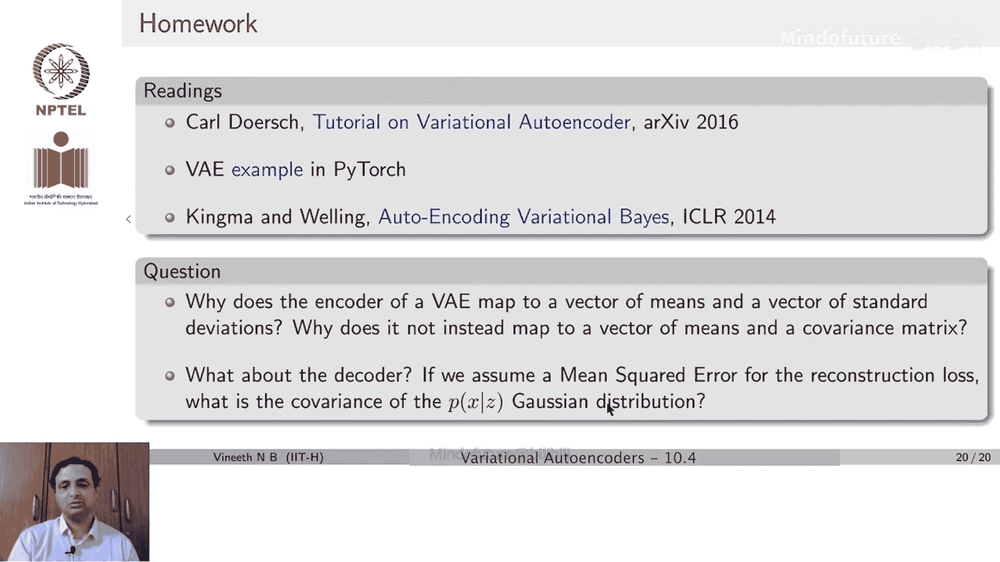

# 【NPTEL】计算机视觉的深度学习 p117 P117_变分自编码器 -BV1vNWkzpEua_p117-

Let's now move on from Gs。To another kind of deep generator models。Called variational auto encoders。

Popularly known as Vs。Before we talk about variational auto encoders。

Let's briefly recall auto encoders which we covered last week auto encoders are neural networks that are used for unsupervised learning where。

The network attempts to reconstruct the input itself as the output。

Auto encoders have an architecture such as this where the input is compressed into a bottleneck layer where a certain representation of the input is available。

Which is also called a latent code， which is then used。😊。

Through a decoder to reconstruct the output which wed ideally like to resemble the input itself。

The question wed like to ask in the context of this week's topic is。How can we use such an approach？

To automatically generate images。Remember。That we said when we spoke about auto encoders that once you train an auto encoder。

We generally discard the decoder。And given an input。

 we use the encoder alone to get a low dimensional representation of your data。

Lets try to see now if we can reverse this idea。And at the end of training can we discard the encoder instead of the decoder and using some vector as code if we can generate images close to the training data distribution as you can see the goal is close to whatganNs we are trying to achieve but achieved with a different perspective。

The idea of variational autoencodederrs was introduced around the same time by two groups of researchers。

 Kingma and Welling in a paper known as autoencoding variational bay， published in ICLR of 2014。

 also by Resen Muhammad and Viisttra called stochastic back propagation and variational inference in deep latent Gassian models which was published in ICML of 2014。

Let's try to understand variational autoenderrs now。

At the crux of Vs is about learning what is known as a latent variable model。

In a latent variable model， our objective is to learn a mapping from some latent random variable Z。

To a possibly complex distribution on x， which we assume is the training real world distribution that wed like to generate data similar to。

Mathematically speaking， you would then write p of x is equal to the integral of the join distribution。

 p of x z dz。Where p of x Z is equal to p of x given Z into P of Z。

And we assume here is that the prior or the marginal distribution。😊，On Z。

 the latent variable is something simple。And how would you get p of x given Z？

P of x given Z we assume is some function of an input vector z。

So that would be the simple mathematical construction here。The question we are asking is。

Can we somehow learn given training data， assumingum here it' unsupervised learning only x？

Can we learn to decouple the true explanatory factors or the latent variables？

Underlying the data distribution， which is perhaps generating the data， for example， in phase images。

You may want to assume that there is a latent random variable called identity。😊。

A latent random variable called expression， so if we say a person a is happy。

 you should be able to generate a face image of person A in a happy mood。So， in this case。

 identity and expression would be latent variables。

And those latent variables may assume different values。

 identity may assume values of different people like ABC and expression may assume different values like happy。

 sad， angry， so on and so forth， and the combination results in generation of specific kind of images。

😊，So， we are talking about。A latent set of variables in this case represented as Z 1 z2 and a function G that takes us from this latent space to the original data space how do we learn such a function G that takes us from Z to x。

We are going to assume that we are going to use a neural network to learn such a function that takes us from Z to x。

 so this conditional distribution here。So， given a vector Z。

 we ideally should be able to use a neural network to give us a vector x。The question now remains。

 where does Z come from？Computing the posterior P of Z given x is intractable because we don't know what Z look like that is not available to us unfortunately we need that to be able to train the G of Z model。

😊，Without values of Z， we cannot train the G of Z model also。So how do we get around this problem？So。

 as you can see so far， variational autoenderrs offer a Bayesian spin on an autoenr。😊，So。

 if we assume that our data is generated using this generator process where Z are a set of latent random variables which we assume belong to a certain prior distribution we sample from a true conditional distribution which results in x which is the training data distribution that we see the intuition here is x could be an image。

Whi is generated from some latent attributes such as a class label and orientation attributes。

 so on and so forth。So， we could say that the class label is a person's face。

 the orientation is in which direction he or she is looking。

 attributes could be the color of the face， the color of the eyes， the color of the hair。

 so on and so forth。And the problem now for us is without knowing what these zs are。

We need to estimate the。The parameters of this conditional distribution p of x given Z。

 the theta parameters is something that wed like to estimate without having access to Z。

How do we do this is the core idea of VAs？To start this process， let's assume now that。

There is a prior distribution on the random variable Z。

 which for convenience we are going to assume is a unit Gaussian。And the moment you have Z。

You can now construct a neural network which we call the decoder network with certain parameters theta。

 which are the weights of those layers in the decoder network。

And the decoder outputs a set of means and variances。

Which can then be used to sample and get data similar to X。So。

 the conditional distribution P the of x given Z here is assumed to be diagonal Gaussian。😊。

Thats for simplicity， one could assume a multivariate Gaussian with a certain covariance matrix。

 but the procedure gets a bit complex and we are going to keep it simple as a diagonal Gaussian whose means and variances are predicted by the decoder network each dimension of that multivariate Gaussian the mean and the variance is predicted。

Now， from base rule， we know that p theta of x z given x。

 which is our posterior is given by p theta of x given z into P theta of z by p theta of x。Now。

 if we observe the terms on the right hand side。P Theta of X given Z。

 we just talked about how you can obtain it。Assume that your zs are a unit Gaussian and learn a decoder network which can give you the output x。

 so that gives you P3 of x given Z。What about P3 of Z？

We just said we are going to assume that to be a Gaussian， so that is an assumption。

What about the denominator？P the of x。Unfortunately， that is an intractable integral。

To be able to find out what distribution and what parameterization of that distribution x comes from is something we don't know at this time。

So what do we do to get around this？We are now going to assume that there is some other distribution。

Q phi of Z given x。Which we will now call as an approximate posterior。So。

 this is obtained using an encoder network。What does the encoder network to it takes in your training data distribution。

 so that is where your neural network takes in all the inputs from your training data。

It has a set of layers parameterized by some weights which we denote as phi。And it outputs。😊，Again。

 set of means and variances of a multivariate Gaussian of a multivariate diagonal Gaussian distribution。

That is given by the approximate posterior Q phi z given x。So if you put all these pieces together。

 we now have。The encoder below and the decoder on top。

The encoder takes x and gives out a set of means and variances for this approximate posterior distribution Q phi of Z given x。

And once you have that distribution， you can sample a Z from that distribution。😊。

And that sample Z is given as input to your decoder network and the decoder network outputs a set of means and variances which corresponds to P theta of x given Z and given these means and variances you can sample from P theta of x given Z to get your output images or reconstructions。

😊，We assume here that both Q sub phi and p sub theta are multivariated Gaussians with a certain mean and a diagonal covariance so each dimension is independent。

So how do we train such a network， let's try to understand that。We， I didn't like to train。

The decoder network， just like the normal auto encodeder。So because it' is going to construct。

 give us an output x。Wed ideally like to use something like a reconstruction loss。

 something like a mean squared loss to ensure that this reconstruction here is as close as possible to x itself that should definitely be one term of our loss function what else do we need to do。

We also want to ensure。That。This approximate posterior Q phi of Z given x should be close to the prior of Z that we assumed。

We assumed for the decoder network that Z comes from a unit Gaussian prior。So。

 wed ideally like Q phi of Z given x to be close to the distribution p theta of Z。

 which in our case we assume to be a Gaussian with mean 0 and identity matrix as its a covariance matrix。

Let's try to put these together and get the formal loss function to train such a variational autoenr。

Remember the goal here is to do a maximum likelihood estimation。

 we have a training data given by excise and we ideally like to learn the parameters theta which are the parameters of your decoder in such a way that you maximize the likelihood of that distribution generating your training data points that is your maximum likelihood estimation for your dataset。

We are going to convert that to a log likelihood maximum estimate maximum log likelihood estimation where the product gets converted to sum and then you have log of P Theta which makes things a bit simpler mathematically。

😊，Now， p theta of x， which is this internal term here。

Can be given I can be given by integral p theta of x Z d z。By definition。

And this can be expanded as p theta of x given z into P theta of Z d z。Unfortunately。

 we are once again left with an intractable integral in this particular case。

So let's try to see how to solve this maximum likelihood estimation problem we are going to solve with with with a twist。

😊，So， let us rewrite the maximum log likelihood estimation problem we have the log likelihood log of P theta which can be given by expectation over。

Z vectors sample from the approximate posterior of log of P theta effects。

So if we sample Z vectors from your approximate posterior and give as input to the decoder。

The likelihood of generating samples similar to the training distribution must be high。😊。

That's what this first sentence means。Now， log of P theta of x can be written using base theorem as log of。

P the tau of x can be written as。P theta of x given z into P theta of z by P theta of z given x that is just the baian written in a different way。

And to this particular expression， we are going to multiply and divide the approximate posterior。

It's just a simple multiplication and division by a cont。Now。

 once we have this expression equivalent to the maximum likelihood estimation setting for this problem。

We can group terms differently to write this。😊，Write this in a different manner。

So the first term here。We can have。Log P Theta of X given Z。

Stays the same way and we write that as this first term here， the expectation over Z。

Log of Pv of x given set。Then。You have。Another term here。Q5， Q5 of Z given x and P theta。Ideally。

 you would be able to write that as plus expectation over Z。Log of。P theta of Z。

By Q phi of Z given x。Now， instead of adding it， we are going to subtract it and write it this way。

So we have a minus expectation over Z log。Q5hi Z given x divided by P theta of Z。

 it is just the reciprocal with a signine change in the beginning。

And then the remaining terms are these two terms here。

 p thetas that given x in the denominator and Q phi in the numerator， which is what the third term。😊。

Gives us， that's what the third term gives us。 So it's just grouping terms and writing it differently。

Now， if you observe the second and third terms here。

 you will notice that the second term is the care divergence betweenq P phi。😊，Of Z given x。

 the approximate posterior。And the prior on Z。And the third term is the Kl divergence between the true posterior Ptheta of Z given x and the approximate posterior Q phi of Z given x。

That is what is written here below we are going to write the second term as a certain k divergence and the third term as a certain k divergence。

😊，Now， if you observe here。Kl divergence is a non negative quantity。

 so the third quantity here will be greater than or equal to 0。

And because this is a log likelihood estimation problem， we ideally like to maximize this quantity。😊。

So， to maximize this quantity comprised of these three terms where the third term is greater than or equal to 0。

Can be achieved by maximizing the first two terms by itself。

So what we are saying now is we have a lower bound。Which is given by these first two terms。

Remember the third term is non negative and is added to that so this entire log likelihood will be lower bounded by these first two terms。

😊，So， if wed like to maximize the log likelihood， we can maximize this lower bound。

This lower bound is also known as evidence lower bound or。Elbow。

It is read out as elbow and thats why it is written like this。

 but it is actually EBO evidence lower bound it is also known as the variational lower bound。😊。

And this entire procedure of optimization is known as a method that method called variational inference。

😊，Where we introduce a variational distribution in this case。

 the variational distribution for us is the approximate posterior Q5hi。😊，And using that。

 we try to learn the parameterizations of a distribution。

So our goal now is to find theta star and phi star。Which maximize。This evidence lower about。

That's what like to do。So， let us put this together we now are saying that we have introduced an inference modelq phi of Z given x。

 the approximate posterior。That tries to approximate the original posterior by optimizing the variational lower bound that pi saw remember these two terms here are exactly what we had as the two terms here expectation over z log p theta of x given z minus the k divergence between approximate posterior and prior on z。

Which is writing the same thing here。And we parameterize Q phi of Z given x using our encoder network。

So， we now have an encoder and a decoder network lets see them individually before we put them together in this context so given training data X we provide that as input to an encoder。

😊，The encoder outputs means and variances of an approximate posterior distribution。

Which we'd like to have it as close to the prior onset set。

Then we sample from Z and use the decoder to be able to generate x。

 which wed like to have as close to the training data distribution。So how are we going to train this？

😊，If you look at the loss by itself， this is the overall loss in this case we are going to maximize so not perhaps a loss just the objective function。

 but there is one problem in this training procedure。

If you notice what we said was we give the input distribution to the encoder。

The encoder gives out a parameterization of the approximate posterior。Then we sample from a prior。

Which is then given to the decoder and then you get your final output。

Which means we now have an encoder decoder model and autoto encoder where in the middle step or the bottleneck layer step。

We are going to sample a vector rather than forward propagate a vector。Why is this a problem？

That sample may not be deterministic and we would not know how to pass the gradients。

Through that bottleneck layer to the encoder。That is a challenge。What do we do？

We ideally somehow have to ensure that that sample that we get becomes independent of the encoder output because if it becomes independent of the encoder output。

You can simply pack propagate your gradients through your decoder and encoder and assume that the randomness is coming from some external quantity。

😊，How do we separate？The randomness from the encoder output。

This is done using a trick known as the reparametricization trick。😊。

And this was one of the main contributions of the effort in the method called variational autoencoder。

 a simple trick， but that solves the problem in back propagating through this network。😊，So。

 remember that we are going to sample Z from say some approximate posterior distribution。

 which is given by a Gaussian distribution with mean at a certain mu z of x with variances of standard deviations given by sigma z of x。

Now， a sample that is drawn from such a distribution can be rewritten slightly differently。

 we can parameterize that sample Z as Z is equal to。

You instead randomly sample a vector from a unit standard normal distribution。

Multipliied by the standard deviation learned by the encoder network。

Add the mean learned by the encoder network and now this becomes a sample。😊。

How did this get around the real problem remember while in the earlier steps so far you could now consider this to be something like this so you have a set of layers in a neural network。

😊，So， the earlier version of the variational autoencoder。

 one of the layers became stochastic where you had to sample a vector and it was not a vector forward propagated through a neural network as we have seen so far。

So because there was a sample， we would not have known。

How to back propagate through that layer to the earlier layers in our case， they encoder。So。

 the reparaitization stick trick suggests that let us fix that layer as output of a previous layer。😊。

And instead， bring in this stochasticity from a different variable from the outside and not that layers output itself。

😊，If you see here now that new sample is given by mu of Z。Which are outputs of the encoder。

Sigma of Z， which are the outputs of the encoder also。Into epsilon。

 which you could almost consider now like a bias vector which is coming from noise。

It doesn't really affect back propagation into earlier layers。

 it is just an external input given in that particular layer and now you can back propagate through the entire network using gradient descent the way we have seen it before。

😊，So you now have given x in the encoder， you generate muse and sigmas。

Then you sample Z using the re parameteraization trick。

 go through the decoder and generate muse and sigmas at the output from which you can sample。😊。

And get any generations。So with the reparaization trick。The entire variational auto encoder becomes。

D back probable and you can use gradient descent and back propagation to update the weights in the VAE and train the network。

😊，So， as before。The objective function here。Is given by。

Minus scaled divergence of Q phi and p Theta plus expectation of log p theta of x given z。Now。

 lock P the of x given Z turns out to be a simple reconstruction loss wed like this to be close to your training distribution so you can use even a mean square error to maximize this likelihood the second term。

What about this first term， how can we is that differentiable。

 how can we get the gradient for it to you for getting for doing back propagation？😊。

The key there is that we have assumed Q Phi to be a Gaussian with certain means and variances which the encoder provides。

😊，We also assumed Ptheta of Zed to be a unit Gossian。

And the K divergence between Gaussians is a well definedfin formula which is differentiable。

 so that is what helps us ensure that we can compute the gradients and back propagate and train this network end to end。

😊，So that completes our discussion of how VAAs are learn。

To summarize and differentiate from auto encoders。Traditional autoto encoders are learned by reconstructing input。

And they are often used to learn features the low dimensional representations。

 which could then be used to train another neural network or an SVM or to train any other supervised models。

😊，On the other hand， variation auto encoders conceptually are a marriage between Bayesian learning and deep learning。

😊，And after training a variational auto encoder。😊，You could discard the encoder。

Just sample from your prior Ptheta of Z a unit Gaussian and now your decoder has learned to generate images。

 taking a unit Gasian as input to generate images that look close to your input data distribution。

That's what allows VAE to become a generative model。What can VA do？

Here are a couple of examples where a VAE was trained on the Ms data and the Fface dataset。😊。

You can see here that is the MD data set。😊，When the latent variables。

which are the zs in your V are modified by small values remember we be sampling some vectors you can see that the generated images that is the output of the decoder gradually varies as the Z value is varied。

That shows us that the variation auto encoder has indeed learned。😊。

Lant variable values that are capable of generating data smoothly on the manifold on which it lies。

Similarly， just like how we software GNS on the freeray phase data set。

You can learn latent variables such as expression and pose。

Which as you change the values of those corresponding low latent random variables。

You end up getting generations of face images with different poses and different expressions。

What else can VAs be used for they have plenty of applications we will see some of these next week in detail but here are a few examples image and video generation。

Super resolution。Forecasting from static images。Image in painting many more。

 and we'll see some of them next week。VAs have also been extended in numerous ways over the last few years。

😊，While we may not have the scope to cover all of these in this course。

Here are a few pointers if you'd like to know more。

The original authors extended VAAs to get a semi supervised variant where you can use labeled and unlabeled data to learn the VAE。

Another popular extension rather a powerful extension was conditional VA where you could generate given a particular class label for instance。

 so in the example that we have seen so far in the construction that we have seen so far we considered it to be an unsupervised learning problem。

😊，And just thought only data was given and we were generating more data。

 you could modify that to assume that label data was given to us and at inference if you give a certain class label the VA you would generate data points belonging to that class label。

Those issues are discussed in conditional VA。There is another variant known as importance weighted v which weights the latent random variables differently to get more powerful generations。

Then there is a dennoizing VAE which you could consider as an extension of the denoizing auto encoder to a VAE setting。

Then VAs have also been used for graphics， a popular network is called the inverse Gs network。

 which uses a VAE like strategy。😊，To learn latent variables that can give you control in generating various kinds of。

Objects，3D objects and so on and so forth。 You could control the。The light angle， the rotation。

 the kind of object， so on and so forth using an inverse graphics network which effectively uses a VAE strategy。

And finally， another。😊，kindind of a network called adversarial autoenrs。

 which brings together GNs and VAEs， which is going to be a topic that we discuss in the immediately next lecture。

😊，Your homework for this time is to go through this tutorial on variational autoenr。

As well as go through this VA example in Pytorch。If you' are interested。😊。

It may also be worthwhile going through the original paper on variational autoenrs。

And here are a couple of questions for you to think about。

Why does the encoder of a VA map to a vector of means and a vector of standard deviations？

Why does the encoder not map to a vector of means and a covariance matrix this is the encoder remember then gets you the approximate posterior。

A similar question， what about the decoder？If we assumed a mean square error for the reconstruction loss。

 the second term in your objective for VA， remember can use mean square to get a reconstruction loss。

What is the covariance of the P of x given Z Gaussian distribution？

What do you think it look like？Think about it and well discuss soon。

