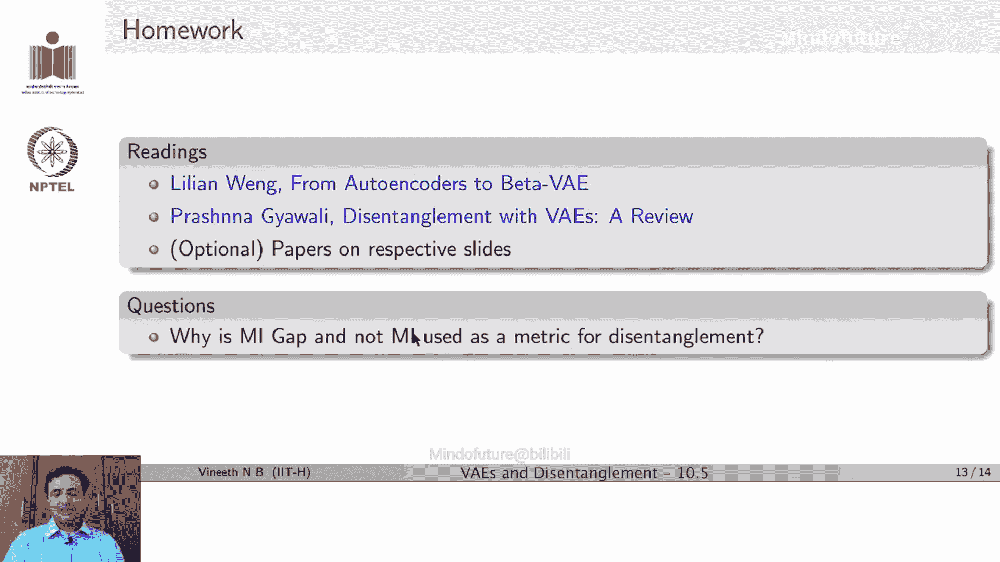

# 【NPTEL】计算机视觉的深度学习 p118 P118_VAE和解耦 -BV1vNWkzpEua_p118-

We will now move on to another important notion in Gen models。Which is called disentanglement。

This notion is more closely associated with variational auto encoders。

Vs and we'll discuss why this is so also as part of this lecture。

To start with what is disentanglement？Disentanglement is about isolating sources of variation in observational data。

If you had an image of a big red apple。Can you separate？

The generative factors for such images as corresponding to size big。Coour。

 red and shape or object apple。Can we enforce deep learning models？

Deep generator models in particular to isolate these factors while learning such a model。

Why do we need such an approach？If we could disentangle the generative factors。

It allows us to generate new images that may not be in an observed data set。

If your training data had images of small black grapes and big red apples。Can we generate an image。

Corresponding to a small black apple。Obviously， you may not find such an image in a real world data set。

But using a deep generator model can be hypothesize how this would look by setting the color to a particular value。

 setting the size to a particular value and the object to a particular value。😊。

You would be able to do this reliably only if the latent variables in your gener model。

Issoollate these components of images。Here is an example of face images。In this case。

 the latent variables could correspond to gender age， hair。And perhaps the race， so on and so forth。

So， if we knew which latent variable corresponded to gender。

 one could manipulate that latent variable alone to be able to generate different images of different variations going from say female to a male gender。

 as you can see in the example here。Why variational auto encoders？

You perhaps know the reason already， we probably already used the word word latent multiple times。

Unlike generative models， GNs， generative adversarial networks where the latents are not learned。

Remember that in a G， the latent vector is a noise from a Gassian。You don't learn it per se。

In a variational auto encoder， the latent variables are learn。

If one could now ensure that those latent variables are disentangled。

You may have a lot of control on what kind of images you can generate out of the VA。So。

 we call the V overall architecture and formulation， so you have your input data x， the encoder。

Provides the mean and variance of an approximate posterior。

Which is tried to become which over learningning tries to become close to a pre assumedumd prior。

Then a vector is sampled from the prior， the decoder reconstructs the data from that sample vector。

These latent variables here， which could be a vector of multiple dimensions。😊。

If they are disentangled， you can generate more control data。Obviously。

 VAE G frameworks such as adversarial auto encoders。

Can also benefit from disentangling this latent variable in a VA。

The first work that brought this notion to the attention of the community and also developed a method to allow disentanglement was known as beta VE。

 This was published in 2017 ILR。Its largely a variant of VAE itself。

 let's see what kind of a variant。If you recall the variational autoencor loss。

 there are two terms in your evidence lower bound in your elbow。

One term which minimizes the negative log likelihood。In other words。

 it maximizes the log likelihood of generating that kind of data， which is in the training set。

And the second part is the part which minimizes the k divergence between the approximate posterior and the true posterior。

 which of course breaks down into two terms which we finally use while training the VAAE。😊。

Another way that we could write this recall now that。In the VA this was the complete objective。

 but we broke this down into two parts and we finally use only the kL divergence between Q phi of Z given x。

And the approximate post up and the prior。P theta of Z。

 that's the final K divergence that we use after applying the evidence lower bound。

This is the correct kale to start with， but this gets simplified to the kale that is written on the right side。

😊，Now， this term here。Can now be written。 This entire objective can be written in a slightly different manner。

 We can say that we'd like to maximize the log likelihood of generating x from Z。

Subject to the constraint that the approximate posterior Q phi。And Ptheta of Z， the prior on Z。

 the k divergence between these two quantities is as small as possible。To say as small。

 we say that the care divergence should be less than some positive constant delta。

This is another way of writing out the same objective。

You can say now that we are maximizing the probability of generating real data while keeping the distance between real and approximate posterior distributions small。

Which boils down using the evidence lower bound to keeping the distance between the approximate posterior and the prior small。

How does this help？Now。Keeping this。Optimization problem in mind。

This this optimization problem can now be written as a lagrangian with a laggrangian multiplier using the KKT conditions。

 this is very similar to how one would write out the support vector machine objective。😊，So。

 this would turn out to be maximizing the log likelihood and minimizing the constrained term that we had here。

 this constrained term when we have a lagangian would turn out to be DkL。😊。

Minus delta and that would then go to the numerator and you would have a lagrangian multiplier beta using the standard lagangian approach to optimization。

So， here that is what we write， we write the first term as it is the objective function minus beta which is the lagangian multiplier。

Into the constraint that we had here， which is。Kl divergence between approximate posterior and prior minus delta。

If you expand this。The first term stays as it is， the second term becomes minus beta into the KL。

When we say KL， we mean KL divergence。Plus beta delta since both beta delta are quantities that are greater than or equal to 0。

 that is how we define them。😊，So， you are left with saying that this quantity is going to be greater than or equal to。

The log likelihood minus the kL divergence remember now we are writing this as a maximization problem。

When we do minimization， the sign will change。One can now write the beta V loss to be。

Minimize minus log likelihood， negative log likelihood。

Plus beta times the kl divergence between approximate posterior and prior。

It almost seems like nothing changed from a standard VAE， which is partly true。😊，In this case。

 when beta is equal to 1， you would have the standard V， however。

 in this case when beta is made greater than 1。It introduces stronger disentanglement in the generative model。

 Why is this so？Between these two terms that are used to train a VA， the first term recall。

The goal is to improve the reconstruction capability of the decoder。

And it is the second term here that tries to learn the latentence of the variation auto encoder。So。

 by giving it a stronger weight， we are trying to make the latents be learned better in a more disentangled way。

The only problem now is this could limit。The representation capacity of Z。Thus。

 causing reconstruction problems of the entire V。 that brings us to another question， which。

Almost looks like a trade off between disentanglement and reconstruction capability。

By increasing beta in a beta Ve， we get better disentanglement。

But the training procedure now thinks that the second term is more important in this case this particular term here is more important and the first term is slightly less important。

So if the first term is slightly less important， this leads to。Lesser。Reconstruction performance。So。

 to address。This issue to be able to get good reconstruction and good disentanglement。

 there was another method introduced in Europes of 2018 by Chinaital， which is known as beta TCVA。😊。

Let's try to understand this at this time。So， the beta TcV looks at the K divergence term between the approximate posterior and prioror。

And then decomposes it into two parts。How is this decomposition done。

 this decomposition is done by looking at this term here， the approximate posterior Q phi。Z given x。

Now， this could also be written as。Q肺。Z given？A particular data point accent now assume that you have a set of data points。

goinging from say1 to capital n and each X is one data point where I comes from1 to n。

 so that is the X that we are talking about it's each of the data points this is the same as just an expansion of writing the approximate posterior。

So by standard probability， we can now write this as the joint probability。Bye。The probability on。

エクセ？Assuming all data points are equally likely the denominator here would be 1 by n so it a constant so you could now say that we could replace the approximate posterior with the joint。

Probability between the latent and each data point xN。

This now means that the scale divergence between the approximate posterior and the prior。

Can be broken down into two parts or can be written now as kl between Q phi of Z Xn the joint。

With respect。To the prior on Z。And the first term here， Q phi can now be broken down into two parts。

 one， the K divergence between the marginal on z with respect to the approximate prior and the second term would be a K divergence。

Between the joint distribution， Z Xn。And the product of the marginals。Q of Z into P of Xm。

This is given by the mutual information between Z and n and denotes the indices of the data points on x。

Note that mutual information is defined as to a constant factor of a care divergence between the joint distribution between to random variables and the product of its marginals。

Now， how does this decomposition help？Once we have this decomposition。

One notice is that the second term here which is the marginal kale。

 we are going to call that the marginal kale because the approximate posterior has now been marginalized earlier we had Q phi of Z given x but that got marginalized and the other term now came into the mutual information。

😊，This marginal kale is actually the component responsible for disentanglement。Hence。Trying to。

Palize the mutual information may actually lead to poorer reconstruction， keeping this in mind。

 we now want to ensure that we focus on the marginal scaleale while we learn a VA that is the term that we want to wait with a beta。

Before we do that， we are going to do one more thing which is decompose the marginal scale divergence even further。

The marginal scaleale divergence。Can be decomposed into a term which looks at the K divergence between。

Z， the random variable and the product of the marginals of each dimension of Z。

This term is known as total correlation。Total correlation， although the name is a misnomer。

Is a concept from information theory which is a generalization of mutual information to multiple random variables if you add two random variables。

Z and n that we saw on the previous slide， you look at the joint and the product of the marginals of the two random variables。

And take the K divergence。In total correlation we do this for all the random variables that are involved in Z in this particular context。

 those random variables for us are the different dimensions of Z。😊。

The second term here is the dimension vice scale divergence and the sum of all of them so weve broken。

The overall k divergence of Z into dimension wise quantities。Why is that important？

Because in disentanglement， we'd like each dimension to have a unique existence。Now。

 if you look at this decomposition， one notices that total correlation is perhaps most important for disentangled representations。

😊，Because that is the term that is responsible at looking at each dimension of Z to the overall Z。

 this leads us to the final loss for the beta TCV， which simply puts together all the components that you have seen so far。

 the negative log likelihood， the mutual information the total correlation and the dimension y scale which is each are the different components we saw what is different。

Notice now that your beta is only on your total correlation and not on any other terms in your overall objective。

This allows us。To focus beta for disentanglement only on that term and not affect the reconstruction capabilities of the VA。

Having seen beta VA and beta TCV。One question that arises now is。

How do you evaluate whether your generative model has learned to disentangle effectively？

While one way is to generate different images and check qualitatively whether those images represent different generator factors。

That can become a tedious exercise for many generative factors。

One such metric that's been proposed in recent years is known as mutual information Gap MIIG。

Where the idea is to use the mutual information between generative factors G。

And latent dimensions Z in some way。What do we mean by generative factors？

These are factors that we know exist in the data。If we say big red apple。Size。

 color and object represent the generative factors。

The idea is to see if the latent dimensions z that are learnt。

Capture these generative factors in some way。And wed like to use the mutual information between the random variables G and the latent dimensions Z to capture this。

How do we do this？😊，We compute the mutual information between each generative factor。

 G and each latent dimension Z I。You would then have an entire matrix of mutual information between every pair G1 and Z 1。

 G1 and Z2， G2 and Z 1， so on and so forth。What do we do with all of these mutual information values？

For each generative factor， GI。Consider。The latent factors that have the top two mutual information values。

Let's call them Z J and Z L。Once we have this， we define the mutual information gap as the difference in the mutual information values between these top two latent factors。

So， mutual information of GI with Z J and G with ZL is going to be the mutual information gap with some normalization factor on the outside。

😊，What is the normalization factor1 by head G， which is the entropy of G intrinsically thats remember entropy is minus summation P out p of that generative factor。

And。This normalization takes care of averaging this across all of the generative factors。

 So averaging by K and normalizing by H entropy。Provides us values that lie between0 and 1。Clearly。

 if the mutual information gap is zero， which means both these latent factors have a high mutual information with the same generative factor。

That would be bad disentanglement because both those latents are learning the same thing they are not disentangled。

On the other hand， when MIG is1， it is good disentanglement。

One question here is why do we use the mutual information and not why do we use the mutual information gap and not just mutual information itself？

😊，Think about it it is homework for you if you need to understand this better read the paper called isolating sourcesur of disentanglement a Europe's 2018 paper which defined this metric。

Another metric for checking disentanglement that's been recently proposed in ICLR of 2018。

Is known as the DCI metric。DCI stands for disentanglement。

Completeness and informativeness and there is a quantity defined for each of these。To compute them。

 lets first train any model， say beta V to learn latent representations。

Get the latent representation of each image in a training data or or the test data set for that matter if you that is where you would like to study for disenttanglement。

😊，Then we train a linear regressor。So， you learn k different linear regressiongressors f1 to fk that predicts each generative factor G given the entire latent vector Z。

So， you have。K different generator factors and hence k different linear agressors how do you learn them for each input image you would get a latent factor z。

And you want to now use that to predict what was the gender here？

Or what was the color of this apple that would be the value of each generative factor。

Once we train these linear reggressors， remember the linear regressor will give you a weighted combination of each of the latent factors。

That's what linear regression does。So you would now have an entire matrix WIj。

Which tells us how much a latent factor zdi is important to predict a generative factor G。

We are going to call this the relative importance matrix。

 which is the absolute value of WIJs which are obtained through regressors。

Once you get this relative importance matrix。There are quantities defined for disentanglement。

Completeness and informativeness。Let's look at disentanglement first。This metric。

Tries to capture the degree to which a representation disentangles underlying factors of variation。

This is obtained by。Looking at DI defining DI as1 minus H P where H is the entropy of P。

And what is the probability distribution P here？PI is defined as a vector of PI Js。

For each generatorrative factor GJ， where each P J is given by。RIJ in that matrix。

Divided by all the entries in that particular row I corresponding to that latent factor。So。

 that is the disentanglement score of the8h latent。

 so we ideally want that latent to predict only one generative factor and not predict all of them well。

So， the total disentanglement score is then given by summation rhi D remember D here was the disentanglement score of only the eighthh latent。

 so the overall disentanglement score is given by summation rhi DI where the coefficient rhi is given by summation over J Rj divided by summation over Ij Rj which is the normalization over the column of that importance matrix。

The second metric is completeness， which is the degree to which each underlying generative factor is captured by a single latent variable。

😊，For each generative factor， GJ。The completeness is defined as 1 minus h of Pj where Pj is defined as above here。

If a single latent variable contributes to GGS prediction， the score would be 1。

 we only want one latent variable to correspond to a generative factor。

If all latent variables contribute equally to GJ's prediction， the score is 0。😊。

Because that represents the opposite of disentanglement and we call that situation as maximally overcomplete where all latent factors correspond to just one generative factor in the data。

The third metric is informativeness， how informative are the disentangled latent representations？

This measures how useful a representation is about in capturing the underlying factors。😊。

This is considered with respect to specific tasks， for example， a classification task。

In which case you would like the latent representation to capture information about the object of interest。

How do we measure this？The informativeness of Z。About GJ about a particular geneative factor GJ is given by the prediction error between the original generative factor and the predicted generative factor which is obtained using one of those reggressors that we had defined earlier。

Obviously。These metrics， including informativeness。

 do depend on the goodness of those reggressors that you use in the first step。😊。

That completes a discussion of disentanglement， hope it provided you an introduction to the topic a couple of methods that enforce disentanglement。

As well as how to measure whether a generator model is disentangled。As homework。

 please read this excellent blog called from auto Enrs to beta VE and another blog on a review of disentanglement with VAs and optionally the papers that we refer to on the slides。

😊，The question that we left behind was in the first mutual information gap metric。

 why the gap and not just mutual information itself。😊，Think about it and we'll discuss the next time。

At references。