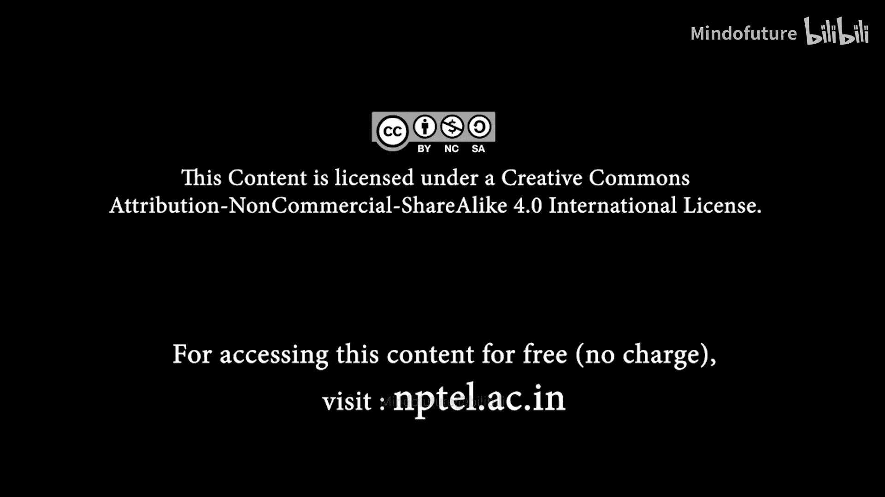
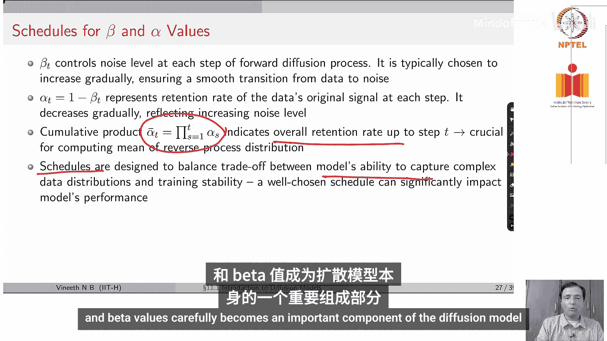

# 【NPTEL】计算机视觉的深度学习 p119 P119_扩散模型和DDPM介绍 - 第一部分 -BV1vNWkzpEua_p119-

Last week。We discussed。A few kinds of deep generative models。Especially GNs and VAs。This week。

We will move on to another category of deep generative models。

Which have changed the scene of how images and videos are generated these days。And these are。

Diffusion models。Before we go ahead and discuss the topic of diffusion models itself。

Let's quickly review。😊，The question that we left behind in the previous lecture。

Which was in the context of variational auto encoders and disentanglement。The question was。

Why do we use the mutual information gap？And not mutual information itself。

As a metric for disentanglement。I hope you had a chance to look at the paper that was suggested。

At the end of the lecture， which was isolating sources of disentanglement in variational autoenrs。

The reason for this as stated in this paper is if you have a generative factor。

 say G1 which is a variable。And you have say two latent variables， L1 and L2。

Which are learned as part of the variational auto encoder。

The mutual information that is considered here is between a latent variable and one of the generative factors。

If only the mutual information is high， it only talks about how a particular latent variable maps to this generative factor。

But the mutual information gap。Measures the difference between the mutual information of L1 g1 and the mutual information of L2 g1。

If both of them are high， it tells us that L1 and L2 are not disentangled enough。

Both of them are capturing the same generative factor。

And this helps penalize unaligned latent variables which becomes a good metric for disentanglement。

Besides。A corty of this is if one latent variable。Reliably models a generative factor。

It is not required for other latent variables to also provide information about this factor。

If you would like more information， you can go back and read this paper for more information。

With that。Let's come to diffusion models。A quick review of the canvas of generative models themselves。

In general， geneative models aim to learn the underlying distribution of data so that the model can then generate new samples similar to the original data distribution。

We saw gangs。Which have a competitive process between a generator and a discriminator。

 as also shown here。We also saw the variational auto encodecoder which was a probabilistic approach with an encoder and a decoder where the latent layer in between had a probabilistic model from which one sampled and the decoder generated。

New samples from the distribution。Normalizing flows are another category of generative models which are essentially invertible transformations that model data distributions so you have an x corresponding to your data。

You learn a function F ofx that takes you to a latent space。And then， your。

Decodeder function if I can say so or the inverse function exactly is the inverse of the original f and that helps reconstruct and gives you X prime in this case。

😊，But the topic for this week is diffusion models。Which generate data by reversing a noing process。

Hopefully this will become clear as we go through this lecture。

Here is a high level introduction of diffusion models。

The inspiration for diffusion models in deep learning comes from the physical process of diffusion itself。

Where particles spread out over time due to random motion。

How could that be connected to deep learning or gene models。

 we are going to see that over the next few slides。

Diffusion models consist of a forward process that gradually adds noise to data which eventually leads to an image that looks just like Gaussian noise so you have a starting image that comes from a data which you want to replicate and create more generations of。

You keep adding noise at multiple time steps until you go on and hit just Gaussian noise。

 that's the forward process。A reverse process in a diffusion model does exactly the opposite。

 starts with a noise and tries to dennoice and end up with your original data。

 which is the generative aspect。Morals that are trained to accurately reverse the diffusion process。

😊，Can recover the original data distribution from just the noise distribution itself。

And that's the key idea of your diffusion model。Denoizing diffusion probabilistic models also called DDPMs。

Are a specific type of diffusion model。That use a probabilistic approach for the reverse diffusion process。

 which we will see as we go through this lecture。And this reverse diffusion process is modeled as a sequence of learned conditional distributions。

😊，As you can see here， you have a conditional distribution p of xt minus 1 given xt。Similarly。

 you go all the way back until you have p of xt given xt plus 1 p of xt minus1 given xt all the way until p of x not given x1。

What do you do with this？😮，This。Entire diffusion model is characterized by a Markovian forward process we will talk about a Markov model as we go forward。

😊，I modeled by a Markovviian forward process where each step adds a small amount of noise and the learned reverse process which we parameterize with the neural network denos the data at every step。

DDPMs have shown impressive results in generation of images， videos， or even molecular structures。

Popular image generation tools like Dli stable diffusion are all examples of implementations of diffusion models。

They have shown high versatility and effectiveness in generative models。

Before we go into how diffusion models work or DDPMs work。

 we may need to set down a few preliminaries on the table。

Lets start with the basic Gaussian distribution， quite sure all of you are aware about this also known as normal distribution is a probability distribution typically characterized by its bell shaped curve。

😊，And the probability density function of a Gaussian is given by 1 by root 2 pi sigma square exponent of minus x minus mu hole squared by 2 sigma square where you have the mean mu and the variance sigma square。

Why are we talking about this， this becomes critical to DDPMs as they are implemented today。😊。

The other preliminary we ought to consider is the notion of a stochastic process。

One can view a stochastic process as a random variable over time。

It is a collection of random variables xt indexed by time t。

 which represents evolution of a probabilistic system over time。

Each realization of a stochastic process is a path or a trajectory that a system can follow examples of this could be stock prices。

 temperature fluctuations， population dynamics， there is a random variable at a given time step and then there are also random variables at subsequent time steps which together form stochastic process。

Some key properties of stochastic processes are stationity which states that over time in expectation。

This stochastic process retains the same distribution。Independence。

What plays out at any given time does not depend on the outcomes at any other time step。And finally。

 the markov property or which is also called memory memory lesslessness。

 which simply states that the current state only depends on the previous state and nothing else。😊。

A simple way to understand a stochastic process is if you are walking from place A to place B。

 a random walk， you don't have any objective in mind。Then at every step。

 you are free to go in any direction， that's the independence。At any step。

What you do depends only on where you arrived at in the previous time step that coordinate is what decides which coordinate you will go to in the next time step that' is the markov property。

These define a stochastic process。A Markov chain is a stochastic process with a Markov property。

 which means the future state depends only on the current state。

And Markov chains are typically defined using a transition matrix which gives a probability matrix of transitioning from one state to another。

So if there were n possible states there could be。Perwise probabilities of how likely one is to go from one state to the other。

And these pairwise probabilities are documented as a transition matrix。

Very popular examples of use of Markov chains in machine learning is hidden Markov models。

Which were extensively used for speech processing for many years。

One of the last prearies that we would need is known as a weer process or brownian motion。

This is a continuous time stochastic process。😊，Which has a few properties。W not of0 is0。

 the process starts at 0。And the difference between Wt and WS for any two time steps S and T is given by a Gaussian distribution with mean 0 and standard deviation t minus s。

For0， less than。Equal to S less than p。It simply states that the increments are normally distributed。

And the increments are independent for non overlapping time intervals。

And the parts of the process are continuoustuous with probability 1。

Why are we talking about this will become clear when we start discussing the math of diffusion models。

And a Winer process is a fundamental building block for many applications in finance。

 physics and engineering。😊，A very popular example is the Black Shohoals model for option pricing in finance markets。

The final preliminary that we would need are SDEs or stochastic differential equations。😊。

I these are typically used to model systems with random behavior。😊。

That can be influenced with both deterministic componentsnce and stochastic competence。

The general form of an SDE is Dxt is given by mu of xt comm into DP plus sigma of xt commity into DwT。

What are the variables here xt is the state variable at time T。

Mux of Xt committee is known as a drift coefficient， which is a deterministic trend。😊。

Sigma of Xt comm is the diffusion coefficient which talks about the variations or the noise that could happen at every time step or the random fluctuations。

😊，And DwT is an increment of the wener process itself。

This is used Ss are used to describe the dynamics of systems which typically have noise such as in financial markets。

 physical processes， and biological systems。With that。

 let's come back to DDPMs and talk about its foundations。

DDPMs are based on stochastic differential equations。Which model systems with random perturbations？

As we already mentioned， these diffusion models。Have a forward diffusion process。

Whi add noise to data in a Markov chain， which means the noise in a current step is added to the data that just came in the previous step by itself。

So， adding noise to data at subsequent time stepss gradually degrades the signal or an image that is given as input to the forward diffusion process。

It also has a reverse diffusion process。Whi is learnable or a learn markov chain that dennoises the data and thus reconstructs the original signal from noise。

The training objective that' is typically used maximizes the likelihood of the reverse process generating the original data just from noise。

So， one could see this Ddium in a simple concept as you start from an xn。

 which is a given data point。You keep adding noise， go to x1。Keep adding noise。

 go all the way till Xt， which now is just Gaussian noise。And then in the reverse process。

 you start with a sample from the Gaussian noise and then keep going backwards until you reconstruct your original sample just from noise。

That's the overall idea。The success of DDPMs depends on how well we design this forward diffusion process and the reverse diffusion process。

So the rest of the foundations are going to be based on how we are going to design this forward diffusion process and the reverse diffusion process。

Let's start with the forward diffusion process。The forward diffusion process is generally defined by a sequence of Gaussian transitions。

 which means。From your given data point， xO， which is an image。

 you add Gaussian noise at every time step。How is that paraized？You can write this as a distribution。

 a conditional distribution queue of xt given xt minus 1 as。A normal distribution。At Xt。

Whose mean is given by root 1 minus beta t x t minus 1 and beta t i。

Where beta T is the variance of the noise added at a given step T。

You may wonder why we have these kinds of terms root 1 minus beta t and beta t it is fairly straightforward remember after multiple time steps we want to end up with。

A standard normal distribution which is centered at0 and has a variance of I。

If wed like to get there， we ideally want this beta t to be 1 and we want the coefficient of xt minus 1 to go to 0 over multiple time steps and choosing your coefficients this way automatically lens itself to reducing the component of the data in subsequent time steps。

And increasing the component of the noise in subsequent time steps until you end up with a Gaussian noise itself。

This。Conditional distribution can be together written as a join distribution Q of x1， comma x2。

 comma x3 so on and so forth till xt， which we doote as x1 to T。

 given x not where x not is your original data which now can be written as a product of your individual conditional distributions Q of xt given xt minus1。

Where t goes from1 to capital t。This is how we formally define the forward diffusion process。

In a diffusion process， not necessarily in deep learning。

 even in other subjects is typically defined by a diffusion kernel which gives you the connection between the entity that you are measuring at a given time step to any other time step in that evolution of the entity。

In this particular case， the diffusion kernel would be given by。

Q of any random xt right remember in the previous slide we had written it asq of xt given xt minus1。

 just the previous step alone but now wed like to generalize this using and write out the diffusion kernel which generalizes this asq of xt given xn can be written as again a Gaussian distribution。

Where you have root of alpha t x0。Into1 minus alpha T I where。Alpha t is simply 1 minus Bta t。

Why do we have two different variables， alpha t and beta T， it is for convenience。

Bta T can be looked at as a measure of noise that we add to your data。

Alpha T can be looked at as a retention factor， how much of your original image that you keep。

And wherever you see a bar on top， that is alpha t bar。In those cases。

 we are referring this to as the product of multiple alpha t so in this particular case alpha t bar would be。

Alpha 1 into alpha 2 and so on and so forth till alpha t， which can be given as pi。

S going from 1 to t alpha s， which can be written as pi s going from 1 to T 1 minus beta s alpha and beta are complementary quantities。

Now， why do we write out alpha this particular way？

We write we write out alpha in this particular way because。You could write out。Any ex us。

Root of alpha t。X t minus1。Plus。1 minus root alpha t， some noise that you sample from your Gaussian。

 which is say epsilon t minus 1。Now this。If you circle backwards。

 one more time step can be written as root of alpha t alpha t minus 1， x t minus 2。Plus。

1 minus alpha t。Alpha t minus 1。Epsilon t minus2， where epsilon t minus2 was the noise added in the t minus2 step。

And if you keep going this way， you finally end up with root of。Alpha t bar。

 which is the product of all the alphas。Into x0 plus root of 1 minus alpha t bar。Epsilon not。

 which is the noise or Epsilon， which is the noise added at the first time step。Why is this correct。

 please keep in mind that whenever you add to Gaussians， lets say you had a Gaussian。😊。

Whi has variance sigma1 square i and another Gaussian， which is variance sigma 2 square i。

If you merged these two Gaussians， you would end up having a normal distribution which is given by 0 into sigma 1 square plus sigma 2 square I。

 why does this matter in this particular case when we combine two Gaussians into two time steps。

 you will be your standard deviation。Would turn out to be？Let's write that out。

Your standard deviation will turn out to be。Root of 1 minus alpha t。

Plusus alpha t into 1 minus alpha t minus 1， which is nothing but root of 1 minus alpha t into alpha t minus1 and that keeps repeating until you get to the point where you can write this as root of 1 minus alpha t bar which。

Corresponds to the product of all the alphas so far。

That's the standard notation used while talking about diffusion models。

Which means when you sample from your diffusion kernel。

 you have xt equals root of alpha t bar x plus。Root of 1 minus alpha t bar epsilon where epsilon comes from your standard normal distribution。

And as t tends to capital t。Alpha t tends to0， which means xt becomes a sample from your standard normal or Gaussian distribution itself。

What's the notion of a diffusion kernel once again it captures。The distribution。

 the conditional distribution of accessing any particular sample xt from your starting sample xn。

 we parameterize that in this particular way。Now， let's actually see how the distribution evolves in the forward diffusion process。

The distribution at time t， which we denote asq of xt can be expressed as an integral over the joint distributionq of x not xt。

You have an integral Q of x nor xt。Over x n is what Q of xt is given by and this joint distribution here can be further decomposed asq of xt given x n intoq of x n。

And this decomposition reflects the combination of the input data distribution through Q of xn。

And the diffusion kernel， which is Q of xt given x mod。As you can see in the figure here。

 Q of Xnt is starting with XO just add a bit of noise， then you add some more Gaussian noise。

 some more Gaussian noise， some more Gaussian noise and as you add some more Gaussian noise you are also reducing the amount of information that you are keeping from the previous step from the data itself and you eventually get to just a sample from a Gaussian itself。

So this is sometimes also called ancestral sampling to sample fromq of xt。

 we first sample xn from your original data distribution P of xN and then apply the diffusion kernel to get xt asq of xt sample that from the conditional distribution Q of xt given xnaught。

Which means you could view your entire forward process as just a single step through the diffusion kernel where you can access your x at any given time step from your original data using this diffusion kernel conditional probability expression。

That was about the forward process now let's come to the reverse diffusion process。

The reverse diffusion process is defined as p theta of xt minus1 given xt。

 which is a Gasussian again with mean mu theta of xt commity and sigma theta of xt commarity。Now。

 the moment we use mu theta and sigma theta， it should give you a hint that these both are learned functions parameterized by some weights or coefficients theta。

What do we do here， which means this reverse process reconstructs xt minus1 from xt by denoizing。

Using some learned model as part of its steps。How do we learn what do we learn we will talk about over the next few slides but with this setup your joint distribution of your reverse process which is P theta of x not to t can be written as p of xt which is where you start from。

And then you have your conditional probabilities p of p theta of xt minus1 given xt into and all the corresponding conditional probabilities that are possible the product of all of those that is what is your overall joint distribution。

And as you can see in the figure here in the reverse process you start with noise and at every time step you keep dennoizing a little and you keep denoizing a little。

 keep dennoizing a little and you keep repeating this about 50 to 00 times and finally you end up with the data that you started with。

😊，And that becomes the generative process。What is this dennoizing function when we talk about reverse diffusion？

The denizing function we refer to is the mu theta which was the beam of your Gaussian for your conditional distribution in the reverse process itself。

This mu theta is given by 1 by root 1 minus beta t xt minus beta t divided by root 1 minus alpha t bar epsilon theta xt T。

What are we doing here？This is very similar to the reparametricization trick that we saw with variational autoenderrs where。

Instead of this being a random variable instead of sampling a mean or a variance。

 we write out the mean in terms of a noise epsilon and only model epsilon in your learning process this will become clear in the next few minutes。

Here epsilon theta is the neural network output in the reverse process。

 so let us see what this neural network is trying to do。

This denoizing function aims to reconstruct the original data from noisy observations。

You could view the reverse process as at each step。

You estimate what noise you may have added at that time step in the forward process and subtract that noise remember in the forward process you added noise。

In the reverse process， you try to guess what noise or you estimate what noise was added in a particular time step in the forward process and subtract it。

And by iterative repeated subtraction one starts with noise and ends up denoizing it and goes towards the clean data XOt as part of the reverse process。

Accurate noise prediction now becomes very crucial。

 which means the job of a neural network in the reverse process is to predict the noise itself once the noise is obtained you simply subtract it from your data at every time step and you keep going backwards in the reverse process until you generate an image。

Let us see how this denizing function mu theta comes out you start with the forward diffusion process。

which was given by xt equals root of alpha t bar x0 plus 1 minus alpha t bar epsilon。

 we saw this a few slides ago where epsilon is a sample from your standard normal distribution。

If you rearrange the terms here to express x not in terms of the other variables here。

 you can see that this would become。Root。Alpha t bar x0。

 which is equal to xt minus root 1 minus alpha t bar epsilon and bringing your alpha t down you would end up with this particular term here。

 which is1 by root to alpha t bar xt minus1 minus root of1 minus alpha t bar by root alpha t bar epsilon。

For the reverse process， wed ideally like to predict xt minus 1 from xt。

The forward process for xt minus1 is given by xt minus1 is equal to alpha bar t minus1 x plus 1 minus alpha t minus1 bar epsilon prime where epsilon prime is another sample of the noise from your standard normal。

Why did we do this， we are now going to take this expression for xn and substitute it in this expression for xt minus1。

Let's see what that leads us to。By putting things here into。The representation for xn itself。

 I am not going to work through every step but you can follow the math that is going on here and your final denoizing function that estimates xt minus 1 from xt comes to a typical form which is given by mu theta of xt comma t which is 1 by root 1 minus beta t remember that would be the same as 1 by root alpha t。

Into xt minus beta t by root 1 minus alpha t bar epsilon theta xt t。

Where epsilon theta is the neural networks estimate of your noise。

Now let's see this using a simple example。😊，Here is a one dimensional example with a linear noise schedule。

You start with the data point， say5。And you begin with a beta T value to be 02 for every time step。

 it need not be the same for every time step， but we are going to use one。

To be the same in this particular toy example。In your first time step you start with xn which is5 here in your subsequent time time step。

 which is x1 and the second time step would be given by x n into root 1 minus beta t plus root beta t into epsilon 1 where epsilon 1 is just a sample from your standard normal distribution similarly in your next time step x2 you would have this expression and as you go on until xt you would end up having this expression。

As you can see this particular expression here， considering 1 minus 0。

2 would be less than 1 will go to 0 eventually and this would go towards 1 eventually as you go to times step capital D。

In the reverse process。😊，You begin with a predicted noise which is something you predict through a neural network。

 you dennoise data would look somewhat like this， sorry you start with a noise and then you predict an epsilon T from a neural network。

 add that to your noise that you started with and then you keep going backwards backwards backwards until you finally reach5 as a sample obtained from noise all the way through。

We are still going to go into a few more details if you have not been able to follow so far。

 hang on as we go into more details。Now， how do you train this neural network that's in the reverse process remember we didn't talk about any neural network in the forward process。

😊，But before we go even there， one question you could ask is why do we need all of this neural network in a DPM？

😊，So， the reason you need this is if you once again went back and considered say x not that you are starting random variable。

 you went from there x1 and you kept on going until say xt minus 1。

 then xt and you kept going until you hit x cap which is your first final time step。Now。To go from。

X1 or x t minus 1 to xt we already said is given by a conditional distributionq of xt givenq of xt minus1 which is well defined once you have beta t or alpha t this part of it is well defined now the reverse process which isq of xt minus1 given xt is unfortunately not known to us。

We are not able to get that， so we are going to represent that with a p theta of xt minus 1 by xt。

 which we will try to approximate through a neural network and hence use the reverse process to get back a generation from noise。

Now， the objective for training your overall GDPDPM should obviously be to maximize the log likelihood of the data under the reverse diffusion process。

 which means you ideally want to maximize over theta which are the parameters that you want to learn expectation over all your cues from x n to xt log of P theta xn to T。

Where Q represents the forward diffusion process。The question now is what should be the objective function to train？

The objective function to should encourage the model to accurately reconstruct the original data from the noise。

which is going to be your log likelihood itself and in this particular case your log likelihood can be broken down into a sum of conditional log likelihoods which can be written as log of pxt plus summation t going from 1 to capital t log of p theta xt minus1 given xt。

This objective in this case， the negative of the log likelihood is typically minimized。

 you can maximize your log likelihood or minimize your negative log likelihood using stochastic gradient descent。

😊，Now， there is one more aspect to all of this， which is。We said that in the reverse process。😊。

It's parameterized by a neural network with parameters theta。

Which is also optimized via stochastic gradient descent。What does the neural network do？

At every time step。It tries to predict what was the noise added at that time step in the forward process for a corresponding image。

And once the neural network predicts that， you can subtract that noise。😊。

From your sample that you got from your Gaussian and keep going。

Through the reverse process until you generate your data point。

The question now is how do you train that neural network that can predict the noise？

The loss that is used is this particular one here， which is。

The training loss is a weighted sum of squared errors and what does the squared error represent the squared error represents your mu theta which is the mean at a particular time step minus what should be the data point or the overall beam that you started with for the process itself。

Now， it happens that this particular expression for mu theta can be simplified。

Because of the definition of mu theta itself， if you go back and look at the definition of mu theta a few slides ago。

 you see that mu theta can be written in terms of betas， alphas and epsilon thetas。

Since beta is something that we choose while adding a particular noise at every time step of your forward and reverse process。

What you end up really training your neural network for is your epsilon thes。

 so it is not the mu theta， it is just your epsilon thetas by itself。

Which means your final loss to train your neural network。becomes something like this。

 which is epsilon， which is the noise that would have been added in the forward time step for the equivalent and forward process in an epsilon theta is the epsilon that is predicted by the neural network which is parameterized by the given parameter theta。

Then remaining terms come here because of taking the gradient from the definition of mu theta。

You also see that there are weights wT that define how you want to weight this particular error term at every time step。

 remember。The neural network that predicts this epsilon at every time step is the same in every step of the diffusion process。

😊，So， you can choose to change this weight as to how much you want to weigh the sum of the squared error at any given time step now how do you sample from your DDpM。

So， when you want to generate new samples at the end of training your diffusion model。

 you just take a sample from your standard normal distribution。Then you get xt minus 1。

which is given as a normal distribution with mu theta xt commma T and sigma theta xt comm T and both of these come from the neural networks prediction of epsilon theta。

These parameters， mu theta and epsilon theta are learned during the training phase in terms of your epsilons that we just talked about。

And you substitute for that and you end up getting an expression for xt minus1 and you keep repeating this process over and over again until you get your original x n so you iteratively dennoise until x n is reached。

😊，The quality of your generated samples depends on how well your learning of your reverse process。

 which is how well the neural network learns to predict the noise in modeling that decides how well you can model your overall data distribution。

The variance schedule can also be adapted during sampling to control the trade off between diversity and fidelity。

If you have very high variance， you may be able to generate diverse set of samples from just a single noise sample that you got that you get。

 but it could also give。You lead to loss of fidelity with respect to what you want to really capture。

 so a higher variance may increase diversity but reduce fidelity and has to be chosen carefully。😊。

The sampling process is inherently stochastic because you do have a randomness introduced at each time step because of sampling from a Gasian distribution。

 remember that the epsilon that you have was predicted by the neural network and based on which you keep going backwards in the reverse process。

😊，This can lead to a variety of generated samples that captures the diversity of the radar distribution。

So， this is how your are sampling after training your GDPDPM looks like you take a sample from a standard normal so this would be your reverse process that goes from Xt all the way back till xn so you take a sample from a standard normal distribution then xt minus1 is given by this particular formula with respect to Xt where epsilon theta is something that is predicted by a neural network and。

Sigma T is also predicted by a neural network and Z here is another sample from a Gasian distribution that comes at every time step to add more diversity to the generation an important component of DDPMs and diffusion models is how you choose values for beta and alpha。

Beta T controls the noise level at each step of your forward diffusion process。

It is typically chosen to increase gradually in the beginning you dont add too much noise。

 but as you go through later time steps you take higher values of noise。

Alpha T as we mentioned can be set to capture the retention rate， the complement of B T。

 and that typically decreases gradually reflecting increasing noise level。😊。

The cumulative product of the alphas indicates the overall retention rate between xn and any random sample xt in the forward process。

 which means your schedules for your beta and alpha values。

Can capture the trade off between the models ability to give you complex data distributions or capture complex data distributions as well as training stability on the other side。

 so choosing alpha and beta values carefully becomes an important component of the diffusion model itself。

