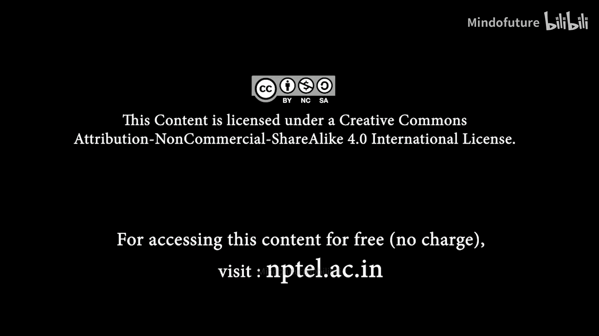
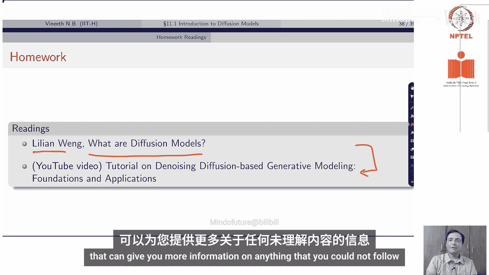

# 【NPTEL】计算机视觉的深度学习 p120 P120_扩散模型和DDPM介绍 - 第二部分 -BV1vNWkzpEua_p120-

Continuing with our discussion of diffusion models and DDPMs。

Remember that we mentioned that DDPMs are a probabilistic way of modeling the reverse diffusion process。

And。The way that comes into effect in DDPMs is through the use of variational inference in the formulation and how we actually end up implementing the loss function itself。

This part of DDPMs， you could say is similar to the derivation of VAs。We ideally want this posterior。

P of xt or the joint distribution， P of x n to xt given x naught。

we approximate that with a tractable distributionq of x to T， which is also a joint distribution。

We already know that the variational lower bound in this case is given by the expectation over cues log of p theta of x0 to t。

Divided by Q x1 to T， given x n， youre going to show how this comes in the next few slides。

And this lower bound can be broken down into a data likelihood a prior。And a Kale divergence term。

 which is typically used as the loss function for your training your model。

Let' us look at how this can be derived very similar to your variational auto encodederrs。So。

 you begin with your evidence lower bound， which is p theta of x0 to t divided by x1 to t given x n。

You expand p theta of x0 to t through the product of the individual conditional probabilities so you have p of xt into p theta of xt minus 1 given xt and so on and so forth。

And you substitute this into your。Elbow term and separate out the terms to end up getting expectation of  Q x noaught to t log of pxt which comes from here and when you put this product into this term you end up getting the summation because of the log and you have log p theta xt minus1 given xt divided by  Q xt given xt minus1。

And this can further be separated by the linearity of expectation Eq log pxt plus summation t going from 1 to t Eq log of p theta xt minus 1 xt divided byq xt。

 xt minus1。It' is not very important to know how this derivation came。

 but we will do this here for completeness。So， if you continue this decomposition。

 your are left with this previous term here is nothing but the k divergence between these two distributions and hence you can write the second term here as the k divergence betweenq of xt given xt minus1 with p theta of xt minus 1 given xt。

😊，One of the fundamental principles of variational inference is when you want to maximize a particular quantity any function say f of x。

 the way variational inference goes about this is to replace this with another function G of x which you know is always less than record f of x and as you maximize G of x f of x automatically gets maximized in that process this is the key idea of variational inference in general so that is the key idea that we use here and we end up。

Maximizing the negative KL divergence or minimizing the KL divergence between。

Qq of xt given xt minus1 with p theta of xt minus1 given xt。

In intuitivetuitive terms what you are doing now is trying to match your reverse process and your forward process remember the goal of training this diffusion process was making the reverse process guess what noise was added in the forward process and subtract that from your sample and keep doing that iteratively so this kL divergence tries to match the forward and reverse processes。

So to maximize the elbow， we minimize the care divergence stems， which helps us with this alignment。

And this learning is typically performed using SGD， which is commonly used with KL divergence。

A slight deviation here。In trying to understand diffusion models or DDPMs in a different way。

Is through what are an alternate approach for generations which are score based models。

Score based models have been used in the past。For learning a score function。

 which is the gradient of the log density of your data distribution， for example。

 S of x can be written as。Graient over x log of px。This tells us。

How close we are to the original data distribution。

This score function here captures the direction and magnitude of the steepest ascent in the data density。

These score base models have been used for training gene models and they give it score function。

Whi is parameterized by say a neural network with parameters theta and is written as s theta of x。

A score base model is useful because it allows us to capture complex data distributions without explicitly modeling any density function of how the data is generated。

You simply check whether。The generations maintain a particular scores in simple terms and that helps you understand whether your model is generating data similar to your original distribution。

Another example， for example， gangs here are。Models that do not explicitly model the density of or the probability density function of your original data。

You simply generate and check whether they are good enough to match with your original data。

You could while GNs are not scoring functions， you could consider score based generator models in a similar spirit which do not explicitly model the density of your original distribution。

Now we will come to how this is connected to diffusion models in a while。But before we go there。

 score based models are typically trained by minimizing the discrepancy between the estimated score through a neural network and a true score。

By using a loss function that's typically based on the fiser divergence between these two scoring functions。

In practice the true score is unknown， so it is replaced by a few perturbed samples which are used to estimate or learn the scoring function as theta of x how is this trained and this training strategy using this loss function finally leverages the score function' ability to characterize the data distribution to the gradients of its log density。

Now， how is this connected to GDPDPMs？Both GDPDPMs and score base models。

Try to denize data through a diffusion process。In DDPMs。

The denizing function mu theta which we saw a few slides ago at each diffusion step can be interpreted as a scoring function of the perturbed data distribution of that noisy distribution at that time step you could say that your mu theta at every time step of the reverse process is trying to give a score of how well you captured the equivalent forward process distribution at that particular time step。

This connection shows that training a DDPM can also be viewed as learning an implicit scoring function at every time step which guides the reverse diffusion process。

So， this connection between DDPM and score based models is often used to highlight the importance of the scoring function in capturing the underlying structure of the data distribution and thus generate new samples。

In score base models， you end up integrating a stochastic differential equation that is driven by the learned score function。

 so you have dx。It is given as s theta effects that' is your learn score function Dt plus root 2 dw where w is a winner process。

This S D。Is a continuous time diffusion process that gradually transforms noise into samples from the radar distribution？

And one could view our DDPms as a discrete time counterpart。To such an SD or a score based model。

To re。This score base model approach can be viewed as a continuous time diffusion process。

Whereas in DDPMs， we have a discrete time counterpart where we have discrete time steps at which we see how the noisy distribution evolves in the reverse process。

Very similar to score base models， both score base models and DDPMs。

 the effectiveness hinges on the accuracy of the learn score function in capturing the data distribution。

DDPMs have been very successfully applied in various domains over the last few years。

 image generation where you may have seen examples。

 popular ones such as in Dli2 or stable diffusion where diffusion models have shown the capability to generate very high quality samples。

DDPs have also been used for synthesizing audio or even molecular structures by training on the appropriate data。

Are diiffffusion models the best solution for deep generator models。

 not really they do have limitations。Can you think of what kind of limitations DDPMs may have？

Here are a few challenges。Firstly， the computational cost of training and sampling， remember？

The reverse process has to go through multiple time steps before you can generate your final output image。

That inherently is a slow process and can be computationally evolving。😊。

As we already mentioned earlier， the choice of the noise schedules beta alpha can significantly impact model performance。

Which means the models are very sensitive to the choice of these values， which is another limitation。

And sometimes ensuring diversity in the generation of samples and avoiding mode collapse can also be difficult in high dimensional spaces。

What is mo collapse？Remember what we talked about in GANS where if you have an original data distribution that has multiple modes。

 you ideally want your model， your diffusion model or any other generative model to be able to generate samples that come from any of these modes。

However， some of these gene models have this limitation of collapsing to a particular mode and only generating images or data samples in general that correspond to that particular mode which is a limitation。

😊，In general， if we had to compare TDPs and diffusion with other generator models。

One evaluates these on three factors。You want your sampling to be fast generation to be fast。

You want mode convergence， you want to ensure that you converge and represent different modes。

And you also want high quality generation。Can you think of how GNs。

 VAs and diffusion fare on these three aspects？It is interesting to analyze that。😊。

Gams generate high quality samples。But suffer from more collapse。These。

Provide better mode coverage because of their probabilistic nature。

 but do not provide high quality generations。DDPMs provide high quality samples with good mode coverage。

 but their no of their dennoizing process is inherently slow。So。

 you could say that DDPms and diffusion processes have high quality samples and more coverage。

Gans have high quality samples and fast sampling。Varal auto encoders have fast sampling and mode coverage but don't have high quality samples。

So each one of them have their own limitations as part of the bargain。

To summarize practical considerations while training diffusion models。

 it requires careful tuning of hyperparameter， especially your noise， schedule and learning rate。

The choice of architecture for the neural network， which is used to predict your noise at every step can also be crucial。

With larger models giving better performance， but also leading to more memory footprint and compute footprint。

Sampling from DDPMs can be inherently computationally intensive。

Because you have to take a sample from a noise and keep dennoizing over multiple iterations before you get your original data distribution sample and this can be time takingking and using techniques like subampling or course to find sampling can be used to speed up this process。

At the end of the day。Implementations of DDPMs should benefit from parallellyzing and hardware acceleration to improve their computational footprint。

Your recommended homework for this lecture is a very nice blog by Lillian Wang on what are diffusion models。

And also this lecture on YouTube， which is a tutorial at CPR that can give you more information on anything that you could not follow。

