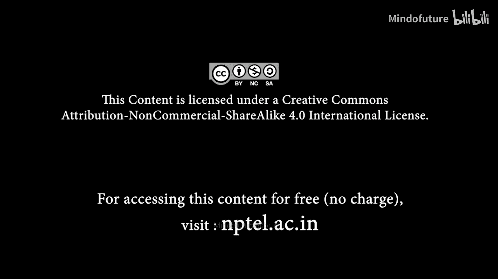
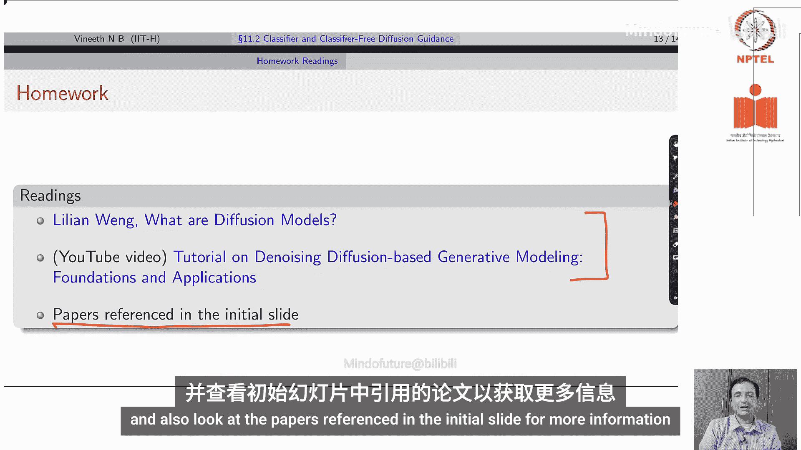

# 【NPTEL】计算机视觉的深度学习 p121 P121_分类器和无分类器扩散指导 -BV1vNWkzpEua_p121-

Moving on to the next lecture。We will now talk about classifier。

And classifier free diffusion guidance。What does this mean？So far。

 we talked about using diffusion models。To generate images from a given distribution。But。

You may have played with image generation software where you can specify what class or what caption for which you want a particular generation。

Why we will talk about the caption part in a subsequent lecture。We will now talk about。

How you can control the generation towards a particular class label。If you'd like to know more。

 you can see the papers linked on the slides here which propose what are called classifier guidance generation。

And classifier free guidance generation。Which we will focus on in this particular lecture。

If you saw how diffusion models work so far。They focus on unconditional generation。

Which means diffusion goes from noise to an image that comes from your original data distribution or is similar to your original data distribution in a step by step fashion。

This is suitable to get a diverse set of generations but may not be able to get us a desired output from a particular class；

 this is because of the inherent stochastic nature of diffusion itself。

So the question that we'd like to ask here is， can I know？

Orient the generation towards a particular class。And this was proposed in a paper in Europe's 2021 and is called Classifier guidance generation。

What we'd like to do here。I to perturb the denoizing trajectory in the reverse process to move it towards a particular class and then generate an image from that particular class。

To do this。The method suggested is first you train an image classifier in particular a noisy image classifier。

 you provide an image and several noisy variants of it。Train a classifier to get a class label。No。

What you do at sampling time in DDPM so you assume that your DDPM is trained。And at sampling time。

 remember you sample a noise and you keep predicting the noise that may have been added in the forward process and you keep removing that from the noise and get your original sample。

When you do that in between， you also perturb that noise using gradients that come from this classifier which is frozen。

Log of p of y given xt corresponds to what we get as the output of the classifier。

The gradient of that quantity with respect x is multiplied by some constant gamma to be able to give you which is also gamma is also called the guidance scale and that is used to get a noise component。

 the neural network predicts a noise component that is more aligned for a particular class。

How does this work remember we are trying to learn this p theta of xt minus 1 given xt。

 which is the goal of the reverse diffusion process。So， in general。

 if we say that wed like to learn gra of x log of p theta of xt。

Now we want to make this log of P theta of xt comma y because there is also a classifier or a class label involved at this point in time。

This can be written as Gex log。P Theta of Xt。Plus。Graex log of。P Theta of Y given X3。So。

 the first term here is what we used earlier for training the DDpM。

 which is what approximately gave us。Minus1 by root by alpha t bar。Epsilon theta of xt k。

 that was how we predicted epsilon theta in the standard GDPDPM。

 but now we are going to add a component that comes from the classifier function which we denote as say f phi which predicts y given a noisy xt。

And when this gradient is added to your noise， you now get a new noise which is more oriented towards a particular class。

So， this was your old noise that you predicted using your standard DPM now you also subtract a component of the gradient that comes from the classifier multiplied by a coefficient。

That becomes your new noise and this helps us generate samples from the same class。

How does this work？Let's consider the gradient that we just talked about on the previous slide。

If one had to generally write out from base theorem。

 you can say p of xt given y equals p of xt into p of y given xt divided by p of y。Now。

 by removing this P of y， we can say that the above quantity is proportional。To from P of。

To P of xt into p of y given xt。Because in the log term we have a gamma multiplying it if you remove the log。

 the gamma would。Be raised to the power of P。Now， what does this tell us， this tells us that。

We are raising the conditional distribution term here to the power gamma。Which corresponds？

which is similar to providing a temperature of that distribution where gamma or the guidance scale which we provide becomes a tunenable parameter that tells us how much we want to weigh this particular distribution while predicting the noise。

When gamma is greater than 1， we are giving this particular term more weighttage and that shifts the probability mass in that time step from。

What could potentially be an unlikely class to the most likely class for that generation？So。

 classified guidance enables us to apply temperature tuning selectively to the segment of distribution that impacts the conditional signal。

Here is the overall implementation of the sampling process with classifier guided DDPM or DDIM。So。

 you can see here that this was the original noise that was predicted by the standard GDPDPM neural network we now take a component of a gradient with respect to a classifier multiplied by a certain quantity and get our new noise and now that is used to generate your xt minus1 with this new noise epsilon hat。

The rest of the process of the DDPM stays the same。

And this particular work showed that with this approach。

 they got significantly better targeted generation results。

Here is an example where on the left you see when gamma equals 1 and when we try to generate samples corresponding to the Pembroke Welshkogy class。

You see that when lambda it doesnt generate as good samples and gamma equals 1 when gamma equals 10。

 you give more weight to that particular term and the model starts generating more images from that particular class。

While this is a good approach。This has its own limitations。😊，It requires a dedicated classifier。

 which is a new network。And this classifier also remember has to handle high noise levels because you are going use this even at different noisy time stepss of your reverse process where the classifier needs to be attuned to images with that kind of noise。

Classify gradients by themselves may also be imperfect and give you wrong signals and take noise in a different direction。

All of these are possible limitations of such an approach。To overcome this。

Another work in a workshop at New 2021 called。Whi had a paper called Classifier free diffusion guidance came up with a method for classifier free guidance generation。

How do you do this without an independent classifier？They came up with an interesting idea。

Where the diffusion model itself。Can be used to get perturbations for guidance。How is this done？

You train a conditioned diffusion model。With conditioning dropout where this particular information y is removed to make the model unconditional。

In practice， you remove the y that is used to predict the noise with some special input value that represents the absence of any conditioning information in different iterations。

 both the conditioned and the unconded diffusion models can be learned by a single neural network。So。

 the overall。The reason for how this works is once again from bayes rule p of y given xt can be written as p of xt given y into p of y by p of xt when you write out the log equivalent of it you would get this expression and when you take the gradient of this with respect to x。

 the second term has no gradient with respect to x goes to 0 and you have only three of these terms with respect to x。

Now， one could interpret this expression as a conditioning term with respect to y and an unconditioned or an unconditional term which has no reliance on y。

So， when you substitute this formula for classifier guidance。

 you have your new noise vector that is predicted by the DDPM to be the old noise vector。Plus gamma。

 which is your guidance scale。Epsilon theta with respect to y minus epsilon theta with respect to phi where there is no y。

 so you could assume that phi is like one class label which says absence of any label。

And this now teaches to model to go from unconditional to conditional。

And your overall algorithm when used for sampling becomes。

You start by sampling data with conditioning from the data set。

 then you randomly discard the conditioning to train an unconditional version of the same model。

And now you take your gradient step with respect to C of the dennoizing module which is done with the unconditional model and that teaches your diffusion model to be able to guide your model towards generating samples from a class without explicitly needing a classifier at inference time。

You will need a classifier while you train the initial part of the model。

 but you would not need it at inference time。And here are some examples of the results with their work where they show that even with gamma equals 1。

 it can generate images that correspond to a particular class which was not possible with the classifier guidance approach。

So， one question somebody could ask is why is classifier free guidance working better than classifier guidance and the answers are fairly intuitive。

😊，The classifier now has come from the generative model itself。

 the diffusion model that was generating has itself got oriented towards the classifier。😊。

And the gradients that come from the generative model may be more robust than those that come from the classifier that may not be used。

Two noisy image distributions。And finally。Training a single generator model is always easier than training a generator model and a classifier and conditioning dropout is very。

 very simple to implement in the training process。For more details。

 you can go back to the same references as the previous lecture。

And also look at the papers referenced in the initial slide for more information。

