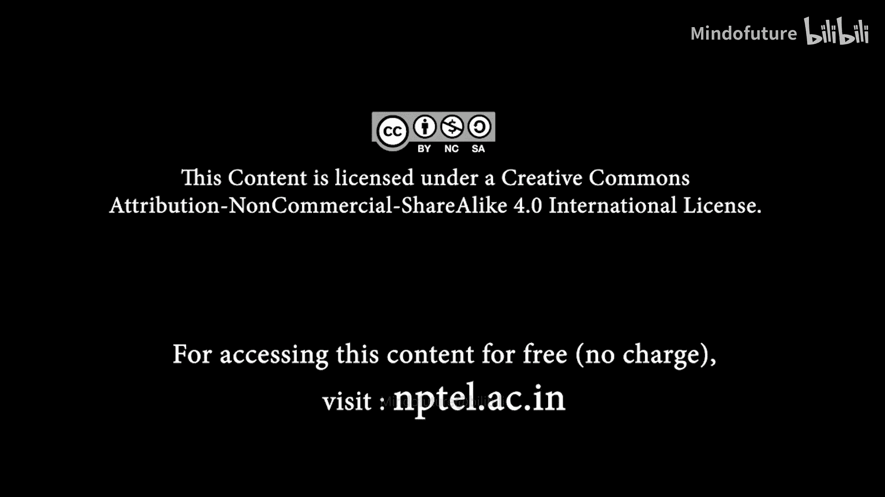
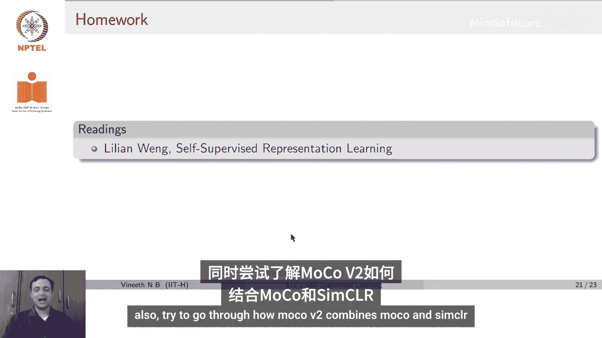

# 【NPTEL】计算机视觉的深度学习 p124 P124_自监督学习 - SimCLR -BV1vNWkzpEua_p124-

The next topic。That well get into for this week。Is a very popular one these days。

Called self supervised learning。Unsupervised learning the tasks that could be categorized under this topic could be clustering。

 which groups data into clusters to reveal something meaningful about the data。

 dimensionality reduction。Well learn low dimensional representations of data that could be useful in some tasks。

Data generation， which is where we talked about GNS and VAEs and other generative models where the goal is to generate data belonging to a given training distribution。

The last one we will include now is the more broader task of representation learning。In essence。

 several of the methods that we have talked about so far do perform representation learning。

The specific context in which we approach representation representation learning now is within an unsupervised learning。

Where our goal is to learn a distribution。That implicitly reveals data representation that can eventually help a downstream task。

And this leads us to the topic of self supervised learning。What is self supervised learning？

It is a twist on unsupervised learning。Where we exploit unlabeled data to obtain labels。

 there is no explicit annotation or class labels associated with the data。

 we exploit unlabeled data itself。To get some kind of labels and induce a supervised learning model on unlabeled data。

Specifically。We design supervised tasks， which are called pretext or auxiliary tasks。

Which can learn meaningful representations。😊，Through which the model becomes more ready。

To then be able to solve a downstream task， such as a classification or semantic segmentation or any other supervised learning task。

 a sample task in this context could be to predict a certain part of the input from another part。

 somewhat like fill in the blanks of of a given input。So。So。

 what part of an input can you then predict or what can you learn。

 you can predict any part of the input from any other part。

Between images and videos you could predict the future from the past。

 you could predict the future from the recent past。

 you could try predicting the past from the present the top from the bottom in case of an image。

In a more broader sense， you could predict the occluded from the visible。😊，In general。

 you pretend there is a part of the input that you don't know and try to predict that。

Thats those are the different tasks or pretext tasks that you can use in selfupised learning。

 we will see a more set of more concrete examples or the remainder of this lecture。😊。

Why do we do this， why self supervised learning？We know that deep supervised learning works well where there is large amounts of label data。

However， in the real world， we also know that we have large amounts of unlabeled data。

How can we exploit this？We take inspiration from humans that humans don't need supervision to learn everything。

They learn or we rather learn by observation and prediction and by self feedback。

You try something and you see how that boomerangs on you or how that affects you。

 and then you keep recalibrating based on a self supervised or a self feedback paradigm of learning。

That's the idea of self supervision。So how do you do self supervision in computer visionion。

 lets see a few examples of tasks that are fairly popular。😊。

One of such examples which we already saw in the gam context but also becomes relevant in a self supervised context is image in painting。

😊，The goal of this task is to occlude or remove a certain part of the image。

And ask a network to complete the image。No external labels required。No external annotation required。

In this particular work called context encoders published in CVPR of 2016。

There was an encoder decoder framework learned to perform image in painting。

A context encoder auto to encoder is what it was called was trained to fill in the missing parts。

The mask of the missing region in this example is a square， but it could be of any shape。😊。

The encoder in this particular work。😊，Was derived from an Alexnet architecture。

And the final model was trained。Using L2 loss between the final completed image and the original completed ground truth。

😊，But in addition， this method also introduced an adversarial loss。What's adversarial loss？

To look at the model completed image and the original image and have a discriminator say which of them is real and fake。

😊，Using these two losses， this work showed fairly good results。

You can see this example of an input where the central region is missing。😊。

This is an impression of a human artist on filling in the details。😊。

This is the same context encoder work with only the L2 loss you can see here that in the central patch。

The L2 loss has an averaging effect， does not give sharp details at every pixel because L2 loss minimizes error across the pixels and does not focus on each pixel individually。

Adding an adversarial loss to the context auto encoder。

Improves performance and makes them final in painted image more realistic。

Another popular example of a self self supervised pretext task。Is solving jigsaw puzzles。

In this case， the objective。😊，Is to teach a model。That an image is made of multiple parts。

And to coax the model to learn certain mappings of parts to the objects as well as their spatial arrangement in an image。

😊，This is done by solving a nine tiled jigsaw puzzle。

But how do you teach a neural network to solve a jigsaw puzzle， this is done using a neural network。

9ine tiles are shuffled。Taken from the image could be the entire image could be part of an image or。

Shuffled by a random permutation and a neural network is now asked to predict the right permutation。

How is this implemented？Given9 tiles。All possible permutations are given index values。

And the job of the neural network。Is to predict the index associated with the right permutation for this jumbled up set of patches。

What's the loss？A cross enpy loss on the index of permutation can be used to train the networker。

Another popular self supervised pretext task is predicting rotations。Given an image。

Multiple rotations of the image are performed you can see here this is the unroated image this is rotated by 90 degrees rotated by 180 degrees。

 270 degrees so on and so forth。And the same CNNnn model in all of these cases is used to predict the rotation angle。

This can help the network learn images from the domain as well as perhaps learn certain artifacts such as an object's location in an image。

 its type， pose， etc。😊，So K rotations are applied。And the model outputs a probability distribution over all rotations。

😊，Log loss is used for training your standard cross entropy loss over the set of rotation categories that you have as outputs is the loss that is used for training in this particular loss G is the transformation function which is our rotation and F denotes the CNN。

That's given in this particular picture。Another interesting self supervised task is image colorization。

😊，The goal here is to take a gray scale image。😊，And then predict the colored version of the gray scale image the assumption here is that you already have color images in your data set。

😊，So you take grayscale versions of them。😊，And now ask your network to predict the color version of the gray scale image。

Once youve trained such a network， remember， you could use this network as an initialization for say a semantic segmentation task or any other pixel Vi classification task such as surface normal prediction or depth estimation so on and so forth。

 just as examples。😊，So， in this particular case， the image is mapped to a distribution over 313 ab pairs of quantized color value outputs。

😊，So， the model does not predict any real value in the AB output space but about 313 bins are created and the model has to predict one of those 313 values making this a classification problem。

😊，Y LAB space remember LAB is one of the color spaces where L is the gray scale intensity and AB bring the color into the final representation y LAB space。

 why not RGB space。The answer is simple in LAB space， the L is given as input。

You only have to predict AB and add L to get the image。

 which means you need to predict only two channels instead of three channels which makes it an easier task。

Secondly， why， why not predict the color value as it is， why should we quantize and then predict？

The researchers in this paper found that quantizing it and then predicting gave sharper colors and predicting the actual color value necessitates an L2 kind of a loss。

Which can once again smoothen the colors over the image and not give us a sharp coloring effect。😊。

More recently over the last year in particular。Self supervised learning has been dominated by what are known as contrastive learning based methods。

Where the overall goal is to learn representations。😊，By contrasting positive and negative samples。

You can go back and revisit。Triipt loss。Contrastive laws， margin loss， so on and so forth。

 ranking loss， so on and so forth。But the goal， but the approach here is slightly different because we do not have class labels。

 lets see what the difference is。😊，The goal here is to learn an encoder which learns the representation of an image such that。

😊，Some score similarity score between an image and a similar sample is greater than a score between the same image and a negative sample。

😊，Now， if you had class labels。Positive and negative become easy to define similar to what we saw with triplet loss。

So how do you go about it here？Is what we'll talk about。So in this particular case。😊。

A softmax classifier is used at the end to classify the positive and negative samples we will soon talk about how those positive and negative samples are obtained。

And the general form of a loss function used for these set of tasks is given by。

A softmax loss and then having a log on top of that loss。

 but the softmax is defined as where the numerator is between the current sample and a similar sample divided by the similarity of the score between the current sample and all samples including positive and negative。

And generally， which with such softmax operators， there is also a temperature hyperparmeter tau that you see here。

 which is also added to health learning。What's the role of a temperature parameter in softmax？

It depend depending on what the value of tau is， it either helps smoothen the soft Max distribution。

Or sharpen the softm distribution。 If tau is greater than one， it softens the softmax distribution。

 a distribution which was perhaps concentrated in one label now gets distributed over all possible labels。

On the other hand， if tau is less than1。Your value inside your experiment will increase。

And any increase。In the argument further increases the value of the exponential function and your softm distribution gets sharper around certain nodes tau greater than one softens the distribution or smooths the distribution。

😊，Tau less than1 sharpens the modes of the distribution。

And one of the earliest methods in this space is known as Moco， which。

was first made public about a year ago， but was published in CVPR of 2020。

Moco stands for momentum contrast。And this method proposes an unsupervised learning of visual representations using the idea of a dynamic dictionary lookup。

😊，So you can see here that the dictionary which in this case is stored as x0 key， x1 key， x2 key。

 so on and so forth， a set of keys is structured as a large first in first out queue of encoded representations of data samples。

So given a query sample XQ。An encoder transforms it to a representation Q。Similarly。

 all the key samples。😊，Are transformed by another encoder， which gives us Kn K1， K2。

 say on and so forth， so on and so forth。And then we measure the similarity between Q k0， Q K1， Q K2。

 so on and so forth， pairwise and use the softmax log gloss that we saw on the previous slide。

One question is。How do we ensure that Q is similar to one of these case here。

 remember when we use this for a few short learning。

We would ensure that in a given meta learning episode。

The query class was from one of the key classes。But now， how do you ensure that？

That is ensured by making a cave one of the case as an augmented version of X cube。

And as I just mentioned， it is trained using the loss that we saw on the previous slide。

 which is the log loss with a softm with the temperature hyperpyramid。

Why is this called momentum contrast in that particular case？😊。

The reason it is called momentum contrast is the full network is firstly trained end end。

 which means both the query and the key encoders are updated based on the loss that we just talked about。

😊，And the dictionary is maintained as a queue of data samples。😊。

The interesting contribution of this work was to make this。

Set or dictionary of encoded cues as coming from the current mini batch as well as immediately preceding mini batches。

So， the dictionary size would be slightly large than a mini batch size。😊，So all the data points。

That are not queue in a mini batch would become keys of that mini batch。

 but you may also have a few images from the previous mini batch also as keys and that is a queue which whereas newer keys come from a current mini batch the oldest keys from the oldest mini batch that was visited then is pushed out of the queue and this is repeated over and over again。

It is called momentum because this dictionary is based on the philosophy of momentum where the idea is to use the previous iterations samples。

 not the gradient this time in the current iteration。😊，So。

 one question here is we say that we have an encoder as well as a momentum encoder。😊。

Y 2 encoders cant we use the same encoder in both places， it may be easy to update。Unfortunately。

 we cannot do that because the representation may not be consistent for both the query and the keys because the momentum encoder is more stable than the query encoder in the sense of maintaining a larger number of data points which stay constant for a couple of mini batches at least。

😊，Whereas the encoder can vary with each query image。So。

 the task in both the encoders is slightly different and that is why two different encoders to get the corresponding embeddings。

😊，While the query encoder is updated using normal back propagation。😊。

The key or the momentum encoder is updated using a momentum concept where theta k the parameters at a particular vibration is m theta k plus 1 minus m thetaq。

The Q comes as the parameters of the query encoder。

 so that is the idea that is used here to update both the query encoder and the momentum encoder。

Another framework that came up around the same time was published in ICL of 2020 this year is known as SimCLR。

😊，Where the goal is more similar to standard contrast of learning where。

The model learns via a maximizing agreement between differently augmented views of the same data sample。

How was this done？In a given mini batch。If you have N samples。You can obtain two end samples。

Up which can for which can be obtained using two different augmentations。Now。

 given one positive pair which is given an image， you give the image itself on one branch and give a rotated version of the image on the second branch。

 for instance。😊，So then for that one pair。Now that exists。

2 into n minus 1 where the other n minus1 images are in the same mini batch。

 those many negative pairs。So， we automatically have similar and dissimilar pairs in each mini batch without changing anything and this is useful to learn representations。

😊，In SimCLR， you see that there are two networks， an F network here which performs a representation learning step。

😊，And a G network here which is then used to get a representation to maximize agreement。😊。

You could consider this similar。😊，To the relation network that we saw in few short learning or zero short learning where we first learned an embedding。

And then learned a scoring mechanism to compare those embeddings this is similar in that sense。

 but the goal here is not few short or zero short learning but simply to learn the representations in an unsupervised setting using the data in a mini batch itself。

😊，Simclr and moco are direct competitors， so one can compare the two。SimclLR has some advantages。

It has strong data augmentation techniques and uses an MLlP projection。Over the representation layer。

 So you have a Q or a G on top of F， which is your embedding network。However。

 one of the disadvantages of S is that the number of negative samples you have is limited by the bath size in moco。

😊，That can be expanded to be a dictionary that is comprised of many mini batchges images。

On the other hand。Moco decouples the dictionary and the mini batch and does allows more negative samples to help better learning。

😊，So you can see here that in terms of number of parameters。😊。

When SimC has a small number of parameters， it still gets a reasonable amount of accuracy when compared to a fully supervised setting it gets close to 70% accuracy on Inet top 1 whereas supervised a fully supervised method is slightly over 75。

 however。😊，If the network of SimCLr has more parameters up to 4 x up to say 620 million。

 you can see the performance reaches close to supervised learning。

Without using any labels on imagineate top 1 accuracy。More recently。

There has been a version known as Moco V2 which combines the benefits of Moco and SCLR we leave this for your reading after this lecture。

The last method that we will talk about in the context of self supervised learning is another recent method called bootstrap your own latent or BY0L。

Where the method。Claims to achieve state of the art results。

Without depending on any negative sample at all。How does it achieve this？

It bootstraps the outputs of a network itself。To serve as targets， remember。

 itself self supervised learning。So， every input is passed through two networks。

 an online network shown in blue and a target network shown in red。So what's the objective？

The objective is that the online network predicts the target network's representation of another augmentation of the same image。

So you give a certain image。Let the network learn a series of representations and ask for it to provide a prediction。

And that prediction or output must match the output provided by the target networks。

Prediction of an augmented version of the same input。

T and T prime are two different transformations or augmentations of the same input。So。

 why is the bottom1 used as the target not really you can flip it as we will see soon。

 so the loss for B by OL is an L2 loss between the prediction of the online network Q Theta and the output of the target network which in this case is given by Z sub Zi。

Now， one can flip the network to also get the loss the other way。

 so in both of these casesq theta and Z are l2 normalized。And when it is flipped。

 the lower network becomes the online network and the top network becomes the target network so one can switch the roles of V prime and V。

And the final learning is through a combination of the original loss。

And the loss obtained by flipping， which is denoted as L L bar where the bottom network is online and the top network is target。

Your homework is to read this excellent article on self supervised representation learning by Lillian Wang。

 also try to go through how Moco V2 combines Moco and SCr。

Here are some references。