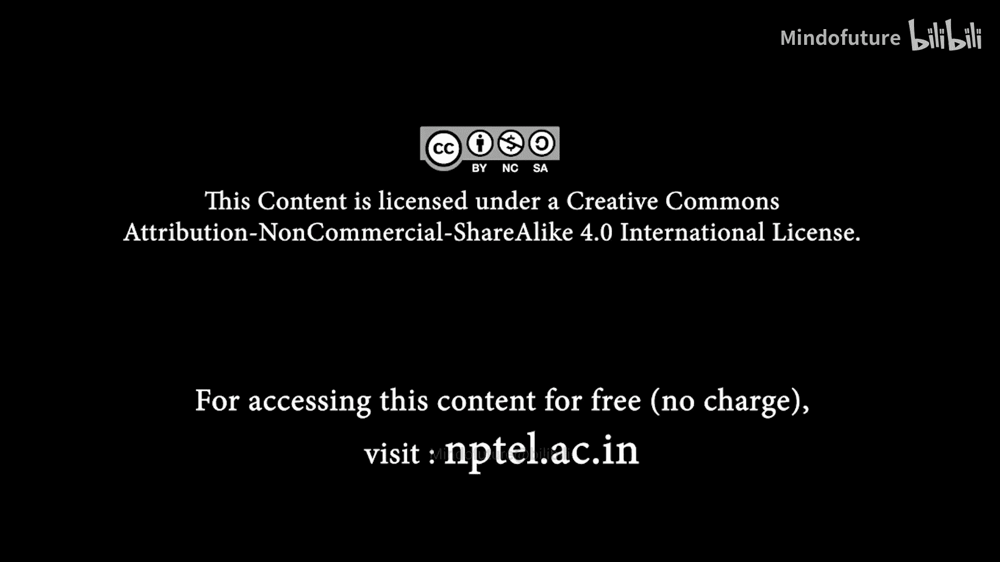
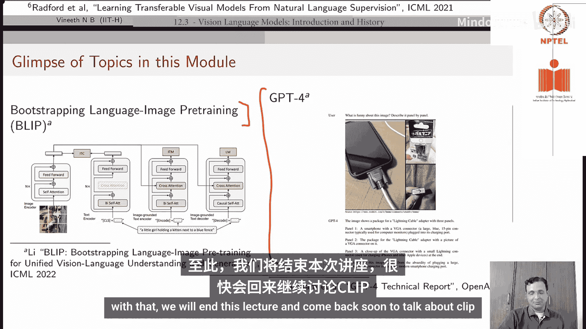

# 【NPTEL】计算机视觉的深度学习 p125 P125_视觉语言模型 - 介绍和历史 -BV1vNWkzpEua_p125-

We will now move on。To the next contemporary topic。Vision language models or Vlms。We are well aware。

That computer vision。Has focused on tasks such as object classification， object detection。

Instant segmentation。Semantic segmentation， so on and so forth。However。

While these tasks have had significant impact。On real world applications。They output class labels。

Bounding boxes。マスク？Images that are generated so on and so forth。However。They lack one element。

Which is。Communicating with humans in an organic and natural way through text。

 there have been efforts。On tying in language。Into computer vision tasks。

 even among the topics that we visited in earlier lectures。We saw image captioning。

Where one takes an image and provides a text caption about the image。Or visual question answering。

Where given an image。There is a question that is asked such as how many slices of pizza are there in this image or is there is this a vegetarian pizza？

And the model answers this question about the image。These have been there for a few years now。

More recently。There have been more such tasks that have been。Adds。An example。

Text to image generation。Thanks to the success of more contemporary generator models。

 we now have fairly good text to image generation。Or even text to video retrieval that has emerged in the last year or so。

Seeing from the other point of view in terms of natural language processing。

The standard tasks that NLP attempts are search engines。Sm filtering， machine translation。

 sentiment analysis， and many more of such tasks。They have an inherent limitation， too。While。😮。

They are pretty good at analyzing and generating text。😊，They cannot process visual cues， obviously。

Or verify interpretations against real world visual references。

Especially when there are linguistic ambiguities。😊，Language models。

Began with the objective to understand and generate text。

They have been largely based on the transformer architecture in the last few years。

And the attempt here is to learn from raw text。These language models have morphed into large language models in the last few years or what are called as LLMs。

Where the key differences are that the LLMs are pre traineded on very large data sets。

They typically have a very large number of parameters。

Offlate of the order of billions or hundreds of billions。

And the data sets used to train LLMs are web based text data sets such as common crawl web textex 2。

Books 1， books to Wikipedia and so on， of which common crawl is the most common one that's used across different models。

 The most popular example of LLM。Is the GP or the generative pretrained transformer？

Where the input at every step is a sequence of words or a sentence。

Where the sentence begins with a B or a beginning of sentence token and then you have the sequence of words given as input soon after the token。

And you have the target output。Be the same sentence shifted by one token with an end of sense token at the end。

How is GT trained？One of the key aspects of training such large language models such as GPT。

 is learning via self supervision。The model learns from raw text and sentences。

With a target sequence shifted by one token， as we just saw。

This enables it to grasp word relationships for accurate output prediction。In the previous slide。

 for example。When the beginning of sentence token is given， we expect the model to output life。

And given the context of the word life。We ask G to predict the next word， which is is。

Given the context of that word is and the previous sequence life is。

 we expect it to predicter and so on and so forth。Now。

 this is also called as an auto regressive model。Where words derive context from all preceding words。

Each generated token is added to the input sequence。Forming the input for the next step。

And one key difference of the GP Lllm model from earlier models like Bt。

Is that the GP model strictly learns context from left to right。

Bert was an earlier language model which used a bidirectional approach。

And use context from left to right。As well as。Right to left。Beyond G。

There have been many other LMs that have become popular over the last few years。

 Let's just look at a few of them before we move forward。Lambda is an LLM developed by Google。

Was traineded on 1。56 trillion words of public dialogue data。It originally powered the bad chatbot。

And a lightweight version of Lambda led to what we see as the Gemini at this point in time。Similarly。

 Lama was developed by Me。This is a relatively smaller model about 7 billion parameters。

 Keep in mind the GP3 had 175 billion parameters。But is almost as accurate as GPT3。

Bloom is an open source multilingual model。That was trained on data from 46 natural languages and 13 programming languages。

Galactica once again developed by meta。Was used to reason about scientific knowledge。

Cex is the model that powers GiHub Coilt。It's proficient in more than a dozen programming languages。

It can interpret simple commands in natural language and execute them。

Palm E was developed by Google more for robotic tasks and Chinchilla was developed by Google Deep Mind。

To simplify downstream utilization， considering that it required significantly lesser power for inference and fine tuning。

Why are we talking about all of these models we will come to that in a moment。

The applications that these LLMs have been used for include code generation。Content generation。

Copywriting， conversational tools， educational tools， so on and so forth。

But they do have some limitations。They are large。Compute intensive to train。Can have bias。

And one of the most pointed out limitations is that LLMs can sometimes hallucinate。

And make a user believe that the given output is actually true。No。

Let's try to see where we are going by combining vision and language models。

Vision systems are fundamental to how we perceive and understand our world as humans。However。

 these vision models as we saw before。Lack the ability to communicate with humans organically。😊。

And how do humans communicate？😊，Most often， the complex relationships between objects and their locations in scenes are described in human language or text。

😊，Vision language model attempt to bridge this gap between vision and language by understanding both modalities together。

A capability that the human brain is really good at。😊，The output of a VLM。Can be modified。

By providing prompts of different kinds。One could provide a bounding box as a prompt and segment an image we already saw examples of this with grounding dno and similar models。

One can have interactive dialogues by asking questions about an image or a video。

Or one can even manipulate a robot's behavior through language instructions。

Some of the tasks that such vision language models are capable of solving。

Or image retrieval from natural language text。😊，Phrase grounding。

Performing object detection from an input image and natural text， for example。

 if you you want to retrieve a particular image from a cricket match。

 you can say a young person swings a bat and retrieve an appropriate image from and perform detection on that image to localize the batsman in that scenario。

You can do visual question answering， finding answers from an input image and a question in natural language。

Or generate a caption for a given image。One can also detect hate speech from social media content that could involve a combination of text and images。

A question that one could ask at this point is these are all tasks that we have already seen with other deep learning models。

So why do we need to reinvent the wheel and call a new genre of models as long vision language models that can perform the same tasks？

There is a critical difference which is that these vision language models that we are going to talk about in the subsequent lectures。

😊，Can do all of this。Without knowing or having any images。

About the labels that it's going to interact with the user on。So， it can do。

Many of these tasks in a zero short manner， which is significantly different from what we have seen from the past。

Whatever models we saw in the past？These kinds of tasks required huge amounts of curated。

 annotated data for supervised learning of the model。

Whereas in the vision language models that we are going to see。

You are going to notice that these kind of tasks can be done for completely new images。😊。

For even text of which we have no images of。What are the topics that you are going to see in this module？

In the immediately next lecture。😊，We will see one of the most popular models in the VLM space。

 which is clip。It stands for contrastive language image pretraining。In a sense。

 this was the pivoting model that made vision language tasks scalable。😊，In a zero short way。

 the way we spoke about just now。This is an image from the clip paper and we will talk about this in detail in the next lecture。

😊，Beyond clip。We will also see variants of clip， a few of them。

 including models like blip blip stands for bootstrapping language image pretraining。

We will also see what are called multimodal large language models。

 sometimes also called large multimodal models， MLLms or LMms such as GP 4。

Which can also reason between images and text in a cross model manner with that will end this lecture。

And come back soon to talk about clip。

