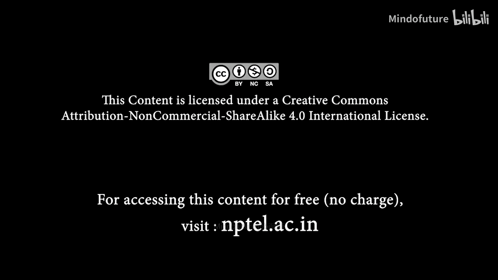
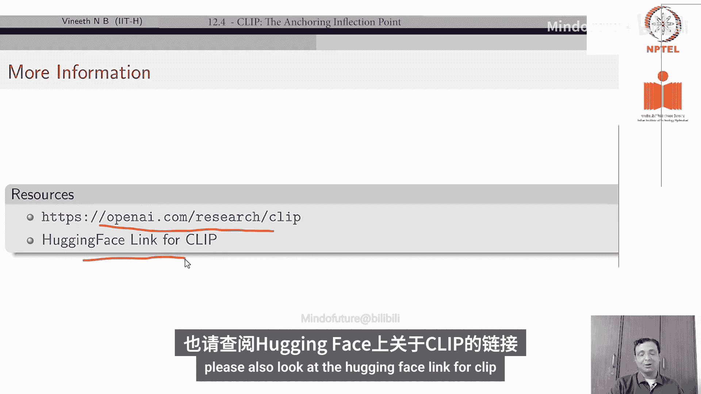

# 【NPTEL】计算机视觉的深度学习 p126 P126_CLIP - 锚定拐点 -BV1vNWkzpEua_p126-

In this lecture。We will discuss clip， which was an anchoring inflection point。

For the success of vision language models。Clip was introduced in the paper title。

Learning transferable visual models from natural language supervision。

Published in the ICmL 2021 conference。By a host of different authors LED by Alec Ratford。

The clip model。Provided a mechanism for text supervision in vision models。It paired an image。

With its caption。Using contrastive learning。Using a very simple approach。It outperformed。

Fully supervised learning baselines on multiple data sets。And also showed use。

As a zero short classifier as we mentioned in the previous lecture。The official link of clip。

Hosted by Open AI， which developed the model， has a lot of useful information。

Which I would recommend you to look through。Recall。

That in our earlier lectures on CNN models for face processing tasks。

We spoke about contrastive learning。We spoke about losses such as the triplet loss。

Here is the example we spoke about even then。The triplet loss。

Minimizes the distance between an anchor and a positive or similar sample。

And max maximizes the distance between the anchor and a negative。😊。

Which could be of a different identity or a different or a dissimilar sample。

Here is a more tangible example if you have an image of a dog in this case and you have a corresponding text。

 a dog lying in grass which matches with the image。😊，We ideally want to learn image representations。

As well as text representations。Whose similarity is maximized。Whereas for the same text。

If you had an image of an airplaneeroe。You want to learn image representations and corresponding text representations where we minimize the dot product or the similarity。

Or they。Telling the model that this image and this text are dissimilar。

This is the primary logic that C uses。But makes it scalable to a very large data set。

Here is the overall idea of how the clip model is trained。You provide both an image。

And text as an input。 So in this case you have an image of a dog。

And you also give the corresponding caption which says pepper the Aussie P。

Both of these are sent through corresponding encoders， the image through an image encoder。

 the text through a text encoder and the parameters of both these models are fine tuned during the training process why do we say fine tuned and not trained？

Because you start with the image encoder being a reNe or a vision transformer。

 similarly a text encoder being a text transformer。😊。

Once you get the embeddings of the images and the text。😊。

You can now organize all your images and text embeddings as a matrix。😊，Where our objective is。

That for a matching image and text， we want to maximize the dot product。Remember。

 got product measures similarity between two entities。And for i2 and T1， which may not be matching。

 we want to minimize the dot product。That's the intuition that we want to follow。

Let's see how this is actually implemented。If MI was a one hot encoded label。For a label vector。

 for the Ih image。So you could now imagine that MI is something like 1，0，0。So on and so forth。

0 all the way for the total number of。Imit samples or text。Embbedics。Why I am。

Is the cosine similarity vector for the8h image sample so。This topmost row here。Could be Y， I M。

One thing that we want to do here is now you look at this term here cross called the cross entropy loss phi is the cross enpy loss。

One thing that we want to do here with the loss is。You want to match。This cosine similarity vector。

With a one hot vector。Of the matching image and text。

And ensure that you minimize the cross entropy between these two vectors。In other words。

We want this first row， assuming i1 and T1 are the matching pairs。

We want the first row to resemble a one hot vector with one in the first column。

We similarly want to do the second row with one in the second column。

 the third row with three with one in the third column and so on and so forth。😊。

This is one thing that we'd like to do。Now， looking at the。Other notations here。Similarly。

 T is a one hot encoded label for the I text sample。

It is a similar just like how you have a one hot encoded vector for the image sample。

 similarly for the text sample， you may have another1 hot encoded vector which corresponds to the different images。

For that text。Now， for t1， this could be the one hot corresponding vector。Across all images。

And Y it is the cosine similarity vector for the8h text sample。

 so now we are talking about matching the column vector。So we take the first column vector。

And we would want this also to match a one hot vector where one is in the first place and so on and so forth for the other other column vectors in the matrix。

So you have one loss that comes from matching rows or images。

And you have another loss that comes from matching columns or the text corresponding cosine vectors。

And the overall loss used to train。Our text encoder and image encoder is the combination of the average of these two loss functions。

Now， the pseudo code for C， which is also given in their own paper shows how simple it is to implement clip。

You have an image encoder。You have a text encoder。IF and Tf are the corresponding embedding outputs of the image and the text respectively。

Now， you compute。You take the IF and multiply it by a weight matrix。

 similarly Tf multiplied by a weight matrix and whatever corresponding embeddings you have you normalize them。

😊，Then you compute your logics as the pairwise cosine similarities between all your image embeddings and text embeddings and there is a scaling exponential scaling factor that you use to just scale up your logics。

And finally， you simply implement your cross entropy loss on the row vectors and column vectors that we just mentioned。

Very simple to implement。Now， how can this be used in a zero short manner what we have been claiming so far？

Clearly， it can be used in a supervised manner where you have for every image a corresponding label。

And you now match your image and text and give a corresponding output。

How can this be extended to zero short learning？Let' us quickly recall what zero shot learning means。

Unlike supervised learning。The model is trained only on scene class labeled data in zero short learning。

But the model is evaluated on unseen and seen classes。

This is also called generalized zero short learning。

We know that traditional image classification models where you use pure supervised learning。😊。

Are limited to a fixed output label space。And may lack generalizations to new labels at inference time。

When we talked about zero short learning in one of the earlier weeks。

 we talked about methods like relation networks or generative approaches like FCLS WganN or meta learning methods to address zero short learning。

This visual shows an illustration of zero short learning。

Where you have a manifold of known classes for which you are given the images corresponding to the labels。

And then you have unknown classes where you only know the labels。

But no images corresponding to those labels， but when they are given at test time or inference。

 the model has to be able to classify those images into those unseen classes。So coming back to clip。

How does clip handle zero shot？Once you have trained your image encoder and text encoder。

You can now create a data set classifier from a label text。

And simply do zero shot prediction on the text， for example。If you have a new。Text。

Corresponding to a new class， let us assume dog was a class that we had not seen during training。

Now you have a new label called Dog。You create a caption out of the dog that simply says a photo of a dog。

So you pass it through the trained text encoder。You take the image。

Pass it through the trained image encoder。And simply use your cosine distance between i1。

 the image and all the text that you have so far， take all the dot products。

And wherever you have the highest dot product is where you have the highest similarity。

And you simply give out that text label as the answer for the given image。

This label dog in this particular case may not have been seen during training at all。

How does this magically happen？The hope here is that the image encoders and text encoders have learned such good image and text embeddings that even for unseen classes and images it is able to map these two embeddings to a space where if we compare the image and text embeddings the correct matching。

😊，Autoomatically happens even for unseen classes。Obviously。

This has to mean that the model was originally trained on large amounts of data that is when it can scale to new labels and this is something we will talk about in the next few slides as to what data sets they used to train C。

Existing crowd labeled data sets like MS Coco， Viual Gen。

 YfCC 100 M are possibilities for training clip。😊，However。

Data sets like MSs Coco and visual genome are relatively small， they have about 100，000 images each。

And Yfcc 100 M is a good data set。😊，But it has about 15 million natural description titles with corresponding image matches。

Which is about the same magnitude as imnet。😊，You could be wondering how that is the case because Inet is supposed to be about 1 million images 1。

2 million images but please keep in mind is that images the Inet data originally had about 14 to 15 million image and corresponding text of which only 1 million was used in the original benchmarks but the data by itself has about the same number of image text matches as Yfcc 10M plus or minus a few。

Given these to be relatively smaller data sets。The authors of clip。

Created their own dataset called the web image text or the WIT dataset。

Which consisted of 400 million image text pairs curated from various publicly available sources on the internet。

This was their magic portion， if you can say so。Once you learn。

Text encoders and image encoders that match these 400 million pairs。

 their claim is that now you could use the same encoders to even classify on nuer labels as。

Zero short classification， as we mentioned。This web image text data is somewhat similar to the web text data set。

😊，That was used to train GP 2 we also spoke about the web text 2 data set in the previous lecture so web image text was in some sense the extension of those kind of data sets for the vision language confluence。

What were the other considerations， design considerations that they had while trading their model？

For the vision encoder。They tried。Two lines of models。

The ressonnet line of models and the VIT or the vision transformer line of models。

In the ResNe periods， they use ResNe 50， ResNe 101 an efficient net style model where they scaled up to 4 x 16 x and 64 x of ReNe 50。

With VTs， they used the base model VIT B16。😊，They used VITb32 and they also used VIT 1114。

 which is the largest model。Recall that when you。Pth size becomes smaller。

 the model becomes bigger in VTs。And for the text encoder。😊。

They used an adaptation of the standard transformer similar to the ven GPT。In terms of optimization。

 they use the Adamom optimizer。A temperature scaling factor of 0007。

 we also saw that in the pseudocode。A batch size of 32，768。And they trained the model for 32 epochs。

An obvious query in your mind could be how long did the model take to train and what kind of hardware？

So for the largest resnet model。It took them about 18 days to train on 592 v00 GPUs。

And for the largest VIT model， it took them about 12 days to train on 256 v00 GPs。Now。

 let's see some of the impressive results that they reported based on this very simple approach。

Here are some results of their zero shot transfer。So。

 what they showed here is that C outperformed baselines on a wide variety of data sets。

Across a 27 data set evaluation suite。A zero short clip classifier keep in mind that the final classification on those set of labels are on images where you had not seen those labels before。

😊，It outperforms a fully supervised linear classifier fitted on Reite 50 features What do we mean？😊。

You train a ReNe 50 model or take a pretrained ReNe 50 model you get the features out of the ReNe 50 model now train a linear classifier on those features on all the labels。

Which means we are comparing zero short clip。To a fully supervised linear classifier on ReNe 50 features。

On 16 of the 27 data sets。😊，Cllip outperforms all the baselines。

It seems to underperform on a few data sets which are generally specialized on specific domains like it performs the worst on a Euros data。

 which is a satellite image data。😊，So， one takeaway。

You can observe here is that clip is good for generic tasks。

 but as you go towards more specific domains or hyperspec tasks， C requires fine tuning on that data。

😊，Here is another example of the performance of clip on zero shot transfer。

They studied the number of labeled examples per class。That are required to train a linear classifier。

On the clip feature space。That gets you the same performance as the zero short clip classifier。😊。

Let's try to understand this better。We already spoke about how C does zero short classification now imagine。

That we took the clip feature vectors the image feature vectors that we get。

Now you train a linear classifier on those clip features。

How many images did you need on each of those zero shot classes to match your original zero shot accuracy itself okay that is what was measured in this experiment。

😊，And you see that for a majority of data sets。😊，The model needed quite a few examples。

Of clip features itself。To match the clip zero short performance。

You could argue that its simple cosine distance matching was actually better than even training a linear classifier on the clip image features。

😊，Only in two data sets。It could not do as well。Once again， the Euroat data set being one of them。

 which is a specialized domain data set on satellite images。

Here is another of their experiments where they studied the linear probing performance of clip。

Which is in other words a linear classifier trained on the clip image feature representations。

You see here the。The solid stars and the hollow stars that correspond to clip models you see that they are on top in both the experiments in two different cases。

 one in cont Eal 12 data sets and the other on the 27 data sets that we saw on the previous slide in both these cases。

Clip outperforms pretty much all the baselines which have standard baselines like efficient net and so on and so forth。

 including even VT。And what is interesting to observe is that as you allow the model more capacity。😊。

Which means as you allow more G flops per image。Clip only does even better than your baseline models。

Here is their experiments on the few short learning performance of clip。

As compared to its zero short performance。You see here that the zero short performance of clip is right here where it takes zero samples from each of the zero short classes。

😊，And even if you give a few samples for competing models。

 you see that all of these models don not perform as well as clip。😊。

Unless you go and give at least 16 samples for each of those unseen classes。

And a linear classifier built on the clip features significantly outperforms any other baseline in this context when it receives 16 samples for those unseen classes。

One last result that will reproduce from their work is the robustness of clip。To distribution shifts。

Here is an interesting result where they consider the banana class。😊。

Which is a class that is shared along many of the natural distribution shift data sets。

You see that you have the Inet data， Inet V2 dataset， Inet R data， objectNe。

 Inet sketch and Inet a there are about five of these dataset sets other than Inet that contain the banana class。

And what we are doing here。Is we are comparing zero short clip performance to。

A resNe 101 model that is trained on base imagenet on this first row here we want to see how well it classifies the same banana class on newer other kinds of data sets that may have a distribution shift。

The first row you see that zero short clip performs as well as a resonnet 101 trained on Inet itself on a bar class okay that is the base performance。

😊，Now， as we go to the other data sets that have a distribution shift。😊。

You see the ReNe 101 model that was trained on IageNe。😊。

It its performance keeps dropping as the distribution shift keeps increasing。

Iminenet A is one of the most challenging distribution shifts。

foollowed by Inet sketch objectnet Inet R and Inet B2 and you see that the renet 101 model that was trained on Inet。

Its accuracy keeps dropping as we go to higher and higher distribution shifts。

But now you see that the zero shot clip model pretty much maintains its performance across all of these cases。

 in fact in some cases having significant improvements over the base resnet 101 model。😊。

These results are fairly impressive for an approach that is， as you can see， simple to implement。😊。

But of course， they trained it on a very large data set to be able to obtain these results for more details on the clip model。

😊，Please see their original formal。呃。Website for describing the clip model。

And if you would like to know more about the code， please also look at look at the hugging face link for。

