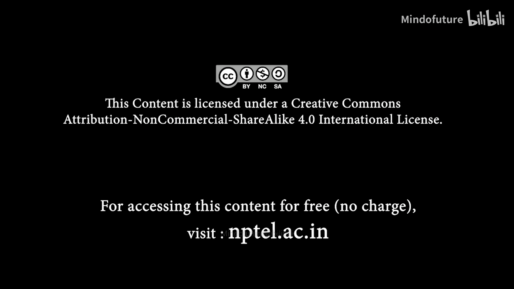
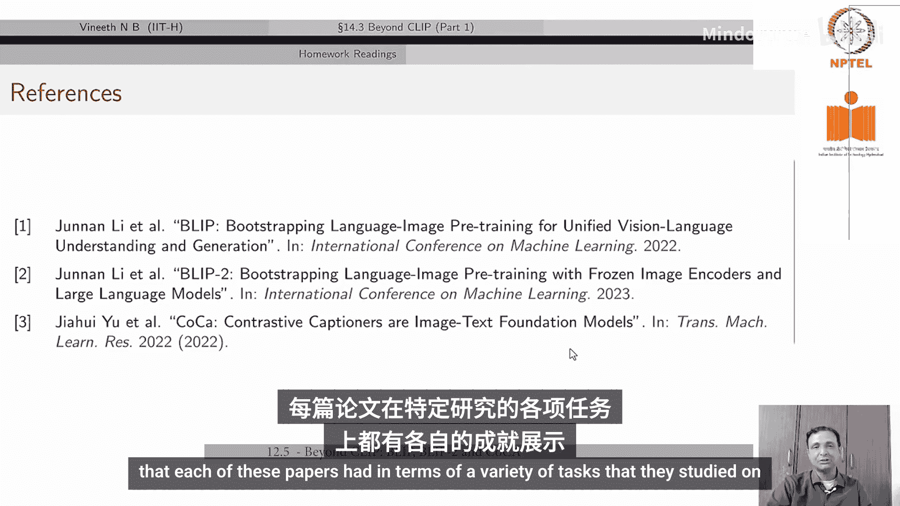

# 【NPTEL】计算机视觉的深度学习 p127 P127_超越CLIP - BLIP、BLIP-2和CoCA -BV1vNWkzpEua_p127-

We will talk about a few other vision language models that extend clip。As well as go beyond clip。

In the architectural components， as well as how they are all put together。

 if one had to look at clip。There are a couple of limitations where one could say that clip can fail。

Firstly。The objective of clip。Was to learn good。Image， language， joint representations。However。

 such encoder models may not be easy to transfer to text generation tasks where say you have to generate a caption based on a given image。

A second perspective is one of a data perspective。Where。Clip used。

Web script data as the data used to build their model。

One of the follow up works which we are going to discuss now called Blip。

Shows that such noisy web script data。May not be completely optimal for vision language learning。

Here are a few examples of。Web script text and generated text using a train model。That blip produces。

If you notice。The webscript text for such an image states a week spent at our rented beach house in Sandbridge。

The issue with scraping from the web are。Few。One， people could have written an article and posted an image along with that article。

So the text may not exactly correspond to the image， but may be about a story around the image。

Sometimes this scraping process also entails and brings in。

Alternative text that is required for accessibility purposes on browsers。Now。

 such texts sometimes don't exactly match the image。

Maybe be even written for marketing purposes or search engine optimization purposes。

So this noisy web scrap text。May not completely be useful for learning good vision language representations is what one of these follow up models claims。

And they show many other results here Here is another one where given this image。😊。

The web script text says that is what a sign says over the door whereas there is the text that is generated by their model says the car is driving past a small old building and there are a few other examples here that are fairly demonstrative of this issue。

So， what do we do is where blip comes into the picture。

Blip stands for Botping language image pretraining for Unified vision language understandingstand and Generation this was a paper published in ICML of 2022。

And as you can see here。😊，Their objective was to solve the model problem in clip。

And their entire model is made of four components， a VIT image encoder。A Bt text encoder。

An image grounded text encoder and an image grounded text decoder。The input to their system。

Is an image。Which is divided into patches as well as the text corresponding to the image。

Let's see this in more detail。So， given the image broken down into patches into a standard VIT encoder which has n such transform transformable blocks。

We get an image embedding as the output of this encoder。

The VIT here has the standard self attention modules and the fit forward modules。

On the next block we have the BRT text encoder where we provide the caption corresponding to the text which came with the noisy web scrap text for instance。

 along with a CLS token please keep in mind that whenever you have a CLS token provided to a transformer that helps to be theken the output token of the transformer where the classification label can eventually be obtained from。

So， they have the C is token and you have the output here of the Bt text encoder。So。

 there is an image text contrast of loss well come to this in a moment as to how that is done。Now。

 this birth text encoder has a bidirectional self attention。

 which means the self attention goes on either side of a given token in the sentence。

There is no cross attention component here because there is no image feeding in at this point in time into the text encoder so there is just a feet forward layer a little later in the transformer and you have a final embedding that comes out of the transformer。

Now， the image text contrast of loss or the LITC。Is used。

To match the representations of the image and text pairs that are expected to match。

And push away the representations of image and text pairs that are not expected to match。

 which means you provide your positive and negative pairs as input in a given batch to be able to compute the image text contrast of loss。

This is like many other similar methods that align image and text embeddings。

Moving on to the third block。They have an image grounded text encoder。

Which takes the same text caption as input。Along with a token called encode。But this time。

They also have the image embedding from the VIT as a side input to the text encoder。

 which is the reason it is called an image grounded text encoder。😊。

And there is an image text matching loss， which we will talk about in a moment again。😊。

This image grounded text encoder has once again a bidirectional self attention layer。

foollowed by a cross attention layer which measures attention between the image tokens and the text tokens that are given us input and that particular step。

Then a feet forward layer again。Now， the output of this block is matched using the image text matching loss。

Which tries to learn an image text multimodal representation to get a better alignment between image and language。

How is this implemented？The image text matching loss gives out just a single classification output to say whether the image and text match。

Unlike the contrastive loss which checks for positive and negative pairs in this particular case it is a simple classification of whether the image and text match。

 you could assume that to be a standard cross entropy binary cross entropy kind of loss。And finally。

 as the last block。😊，We have the image grounded text decoder。Where once again。

 you have your caption given as input tokens。Along with a token called Decode。Now。

 the image grounded text decoder has。A slightly different self attention module called the causal self attention module。

 which is common in many language models where。The self attention is only on the previous tokens and is not on any later token。

So， the later tokens are masked and the self attention for any token T only depends on all tokens less than t within that sequence。

Why is this done， this is done so that the model learns to predict text in an autoregressive manner by looking at only the previous text to predict the next word。

So， clearly you can imagine what the output of this block would be。

This block outputs textual descriptions given the image。

I was mentioning once again in the fourth block， you have the image embedding that is also provided for grounding alongside your text tokens。

So， the purpose of this block becomes to generate text descriptions given an image。

And it optimizes a cross entropy loss。which trains the model to maximize the likelihood of the text in a standard autoregressive manner。

 which means it predicts the first token given the first token it predicts the first word then given the first word it predicts the second word and so on and so forth until the end of end of sentence token。

So， those are the different modules that Blip puts together。Beyond this。Blip also points out。

This issue of noisy web script text being suboptimal in learning good vision language representations。

They also do something about it。What do they do， they have a pretty strong process for this。

 let's try to talk about them。They introduce a module called the CA F module。

 that is what they call it which consists of two networks we can say。Where。

The model first considers these web scrap text， for example。

 an image like this could have a text when you scrape it from the web as blue sky bakery in Sunset Park often bakery put out their menu images alongside on their website。

😊，Now， they have a filter to say whether this is the appropriate caption for such an image or not。

This filter is exclusively learned separately on a human annotated data set we will talk about on this about this soon。

😊，They also learn an exclusive captioning module which given this image generates a synthetic caption。

 these are the captions that we saw in one of the earlier slides which now states chocolate cake with green frosting and chocolate sprinkles on top。

😊，Now， the same filter passes this caption as a valid one for this particular image。Now。

 let' us see how these captioning modules and filtering modules are actually constructed。

So they first take data set， which is web scrapd。And a data set which is human annotated Ih ph corresponds to image text pairs。

 which is web scriptd and image text pairs which is human annotated。

This is used to train their model， which is called as MED or multimodal encoder decoder。😊。

That's what is strained using this initial data。Once they have an initial version of their multimodal mixture of encoder decoder。

This is used to train a filter module which is an image grounded text encoder which receives all the human annotated text image pairs as input and it trained using the image text contrastive loss and the image text matching loss。

😊，This filter learns to look at image text pairs and say whether they are good or not good。

Once they have this filter as you can see this is now used they have their web scriptd text image text pairs and you can see only the good ones are obtained as outputs of this filtering module。

😊，This is not done yet。They also train a captioning module using the same human annotated data。

 which is once again an image grounded text decoder。And based on this captioning module。

 they now take their web script images and generate a bunch of synthetic captions so you have now IW and TS。

😊，Web script images and synthetic data that is generated。😊。

This is now used to refine the filter again。Now to get also IWTS that is webscript images with synthetic data。

 which is also the output now of the filtering module。

Now you have your overall data set to be good web script data， which is filtered。😊。

Webscript data along with the synthetic text and the human annotated data all together forming a new data。

😊，And this is now used to feed in and refine their overall multimodal mixture of encoder decoder model to get a better model at the end。

So not only do they put together the architecture differently from clip。

They also refine the data pipeline to get much better results using this approach。

So this MMED is finally used for various set of downstream tasks such as captioning and many more。

Just to show a few qualitative examples we are not going to go over all their results in the papers Id highly encourage you to look at the paper which was you know one of the footnotes in earlier slides please do look at it for more results but let's just see a few qualitative examples here so the original webscript text for this particular image was from bridge near my house。

😊，Which is a perfectly fair comment for an image posted on the web。

But the true caption for this image is。The synthetic one that they obtain using their method。

 which is a flock of birds flying over a lake at sunset。

Here is another one here is the image the webscribe text is the current castle was built in 1180 replacing a 9th century wooden castle and their synthetic generated text from their captioner is a large building with a lot of windows on it。

😊，Now， that was about blip。And this was soon followed。

More recently in ICM of 2023 by a model called Blip 2。

Blip 2 stands for bootstrapping language image pretraining， the name stays the same。

 but with frozen image encoders and large language models this was published in ICML of 2023 as just mentioned。

So， there。USB is that often wed like to use frozen pretrained vision models or language models。

Unfortunately， all previous approaches until then。😊。

We are trying to do end to end fine tuning or training of large scale models。

 which can be very costly and even prohibitive。Their main focus in Blip2 was。

How do we come up with a method to use frozen backbones for both vision and language tasks that was their mandate and they came up with an interesting approach to achieve this。

Whenever someone uses frozen backboard models。It obviously may introduce a modality gap。

Because you are not fine tuning a VT， a vision encoder or a text encoder to align the embeddings。

 you are not fine tuning them， you are freezing them。So。

 Blip 2 introduce is an idea to overcome this issue while not explicitly needing to refine the backbone image or text models。

How do they go about this they have two parts in their overall pipeline one is a vision and language representation learning this is the part that actually tries to use the frozen backbones and finds a way to get the representations aligned。

And a second module is the vision language generative learning， which generates the text。

Just to show you how this works。The vision language representation learning module。Given an image。

And the text。Gives these inputs to gives the image the to a frozen image encoder。

 this icon here denotes that that module is frozen。Now。

 the output of the image encoder is given to a Q former where this is their contribution in the Blip2 framework。

 which is also called the querying transformer。😊，Where they have a set of query tokens which are learnable that are provided as input along with the text。

 we will see this module in more detail in the next few slides。😊，And on the other side。😊。

From the vision language generative learning perspective。

 they have a large language model once again frozen。Which receives the output of the Q former。

And writes out a caption for a given image that may have been provided to the image encoder in this case。

If given this image and given a text that says， write a romantic message that goes along with this photo。

Now the Blip2 model writesLove is like a sunset， it's hard to see it coming， but when it does。

 it's so beautiful。😊，Let us delve into one more level of detail。

 let us first see the vision and language representation learning， especially the Q former。

 which is the main contribution of the Blip2 framework。😊，So in the representation learning component。

Given an image cut up into patches， it goes into the image encoder which is frozen。Now。

 within the Q format。They have。都。Kinds of transformer blocks。The first one here。

Whi has in such blocks and a second transformer here， which also has in such blocks。

Let's try to understand both of these in more detail。So， the first transformer over here。

Has a self attention module。Has a cross attention module and a feet forward layer。So。

 it also receives a set of learnable query tokens。What do we mean by learnable query tokens。

 they experiment with up to 32 tokens in their empirical studies。😊。

So they have these tokens are vectors that are pre initialialized to some values but when the model learns it is also updating these tokens through backpro thats what we mean by learn queries these are provided as input and the cross attention layer we have cross attention between these query tokens and the image tokens and that output is provided to a feet forward layer which then takes it forward we will talk about that part soon and on the other side you have a text encoder which once again has a self-atten module then a feed forward module there is no cross attention there because there is no other input other than text in that particular module and that provides the image grounded text generation。

But we have one more detail to talk about and they also have an image text contrastive learning loss here。

So these three losses that you see。Or tasks with corresponding losses that you see image text matching。

 image text contrastive learning and image grounded text generation are very similar to blip and use the same loss functions。

But there is once something else that you can see here。

 which is that the attention is of three different kinds。So。

 by looking at the colors that you can make out that the feet forward layers in this transformer and this transformer are different。

 their weights are different， they perform different tasks。

The cross attention as evident is only in this transformer。The self attention weights， however。

 looking at the color are shared between the two transformers。😊。

But they are shared in a slightly unique way， they have three different ways of using this attention。

😊，Each differently for these three tasks for image text matching。

 for image text contrastive learning and image grounded text generation。

So let's see those attention masking details next。So， given Q query tokens， anti text tokens。

The shaded blocks are masked and the unshaded ones are unmasked。

So in the bidirectional self attention mask。Which is used for image text matching。

They allow the query tokens and the text tokens to completely be matched with each other both ways we ideally want to do image text matching so wed like to match the query tokens with the text query tokens in this case stand for the images themselves if you。

Go back to the architecture， the query tokens in some sense become the output of the first transformer which is image grounded because it also receives the input from the image so you could say that the query tokens in this particular example in this particular construct。

Stand for the image。And in the bidirectional self attention mask。

 there is complete matching of attention between the query tokens and the text tokens。

Now coming to the second one， which is the multimodal causal self attention mask。

This is used for the image grounded text generation task。Where they use causal self attention。

 which means。The image can see previous image tokens because there there is nothing causal。

The text can also see all the image tokens。But the text can only see the previous text tokens and not the later ones。

 the later ones are masked because as we said similarly for blip。😊。

They use causal self attention to be able to generate text in an autoregressive manner by looking only at text tokens that have been seen so far。

That's what is used to you。Now finally the third mode of attention they use is called as the Uniimmodal self attention mask which is straightforward。

 this is used for their image text contrastive learning where you can clearly see that the image tokens can only see the image tokens and the text tokens can only see the text tokens which is why it is called a unimmodal self attention mask。

😊，So， though， that' is what comprises the overall blipto framework for the vision and language representation learning。

😊，So once this is all done in the Q format。The output tokens from Q former go to the generative module。

 which is a fairly straightforward one， but let us look at that in more detail。So。

 within the generative learning module， they consider two different ways of going about it。😊，So。

 the output tokens of the Q former， please keep in mind that the number of output tokens of the Q format would be the same as the number of learned query tokens。

Now， these are provided through a fully connected。Layer。As input to an LLM decoder which is frozen。

For this experiment， they use the OPT LLM to study their approach。

And now the this LLM decoder outputs a text for this image that says a cat wearing sunglasses。

But in the generation module， they also test a variant where once again the output query tokens of the Q formerer goes through a fully connected layer and then is first provided to an LLM encoder。

As queries and a prefix text。😊，And the LLM encoder then forwards this to an LLM decoder。😊。

And this then outputs wearing sunglasses given that a cat was the perfectfix text to prompt the model。

For this， they use a fl Tfi encoder decoder model to perform their studies。

Thats the overall architecture of Blip2 and here are once again some qualitative examples they are not going to talk about all the results they have in their paper they have a various set of results encourage you to look at the paper to go through all of those results but here is a simple example they have this image and a user queries as input to their model that says write a conversation between the two animals and the blip2 model says cat hey dogg can I write on your back Do say show why not cat says I'm tired of walking in the snow and so on and so forth here is one more example about the Titanic movie and there are many more that you can see in their work here is another example which is I could say a failure case here is an image and here is the text input along with the image which asks for write a famous quote set by this person the model says Albert Einstein。

The world is a book and those who do not travel read only one page。Fair enough。

 but then this quote is from a different person， so it' is not technically accurate。

Similarly here is an image and if I say can I wear this for my trip to Canada in December the model says yes。

 it is a nice shirt and shorts but it is a little too casual for a trip to Canada。😊，Right。

 but then it completely ignores the weather component in this outcome。

So works quite well has a few limitations， but there are more extensive results in the paper which I will request you to go over。

😊，The third vision language model that we are going to talk about in this lecture。

 we will come back with more of them in the next lecture is Koka。😊。

Kka is contrastive captioners and the title of this paper is contrastive captioners are image text Foundation models which was published in the transactions of machine learning research in 2022。

The Koka model has the objective of unifying different paradigms that is they try to introduce an approach that brings together single encoder models。

 dual encoder models as well as encoded decor paradigms。😊。

To be able to get a foundation model that can solve various tasks。So。

 they ideally want to train an image text foundation model that encompasses the functionalities of all of these kinds of approaches。

 just a single encoder， a dual encoder and an encoder decor paradigm。

Their approach is fairly straightforward so they have an image encoder they have a unimmodal text decoder please keep in mind that they begin with single encoder decoder kind of models that is part of their agenda so they have an encoder they have a unimmodal text decoder。

😊，Now， they use cross attention over the output of the Unimodal text decoder to build a multimodal text decoder。

And they use two kinds of loss functions to train such an overall model。

 a contrastive loss and a captioning loss。Let's see these components in more detail。

 This is the overall architecture of their approach， a fairly simple one， as you can see。

 but lets see this in more detail。😊，So， in the pre training stage they have an image and a corresponding caption so they have these image text pairs they also use positive negative pairs because they use a contrastive loss in their approach。

Now the image goes through an image encoder， the text goes through a Unioral text decoder along with a CS token。

 which is used for the contrast of loss。Now， the image encoder outputs a set of tokens along with a token that is used for the contrastive loss along with a CLS token that is given as output by the text decoder。

The contrasted loss is given by。Both the image to text components and the text to image components。

 so X I and Yi are the corresponding outputs of the language and the text component so they compare the positive ones where they want to increase the similarity and the negative ones where they want to decrease the similarity using standard the softm kind of contrastive loss here is the equation that they use they are not going to walk over the equations this is fairly a straightforward form of contrastive loss that they use。

Now， as I mentioned， these are combined now from the image encoder。

 the all the tokens that they obtained undergo cross attention with the text decoders outputs that results in the multimodal text decoder which also outputs the final caption that comes out of the model。

😊，To train。This task of captioning using the caption loss。

 they use a standard autoregressive loss function where they try to minimize the probability。

 the log probability of yt given all the tokens before y before t sorry and the input x that comes from the image itself。

 this is a standard autoregressive loss。These are the componentss that they use to put together their framework and their final loss for training the model is a weighted combination of the contrastive loss and the captioning loss。

😊，They show how this approach can be used for the different paradigms that we talked about。

 the single encoder dual encoder and encoder decoder。So， let us see that too at this point。

 so they show that this entire approach after their pre training process can now be used for multiple downstream tasks。

It can be used for an visual classification or image classification downstream task in this particular case。

It can be used for a cross model alignment kind of a task so in this particular case it was just an image encoder which is used for image classification they show now that you could just use these two trained components and align the text and images。

😊，To be able to achieve a and that is part trained using a contrastive loss and they also show that you could put all of them together and then train using the captioning loss so you can serve multiple purposes through the same approach。

😊，Here are some qualitative examples that we are reproducing here please do take a look at the paper for more results too so here is an image and the corresponding caption generated by Koka a hand holding a San Francisco 49ers football。

A row of cannons with the Eiffel tower in the background。

 a white van with a license plate that says we love Flynn。

 a person sitting on a wooden bridge holding an umbrella and so on and so forth。

So for your homework for this lecture。Please do read through these links one by Lillian Wang on generalized vision language models and the hugging faced blog on a dive into vision language models。

Here the references of the papers that we discussed in this lecture。

 please do look at it too for more details， especially the comprehensive results that each of these papers had in terms of a variety of tasks that they studied on。

😊。

