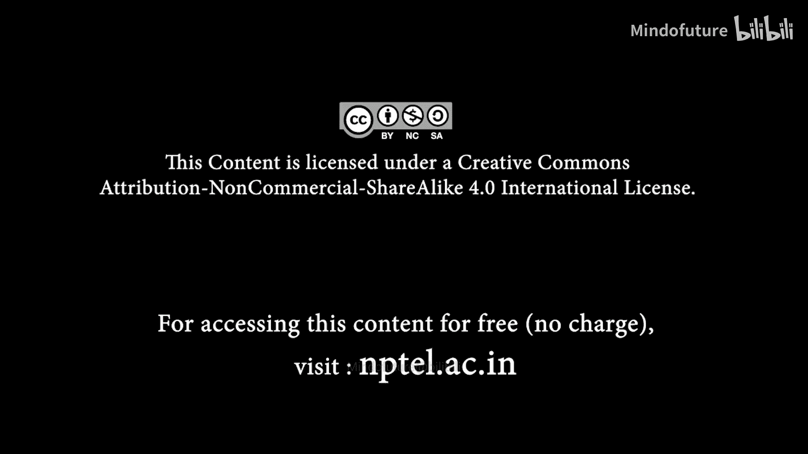
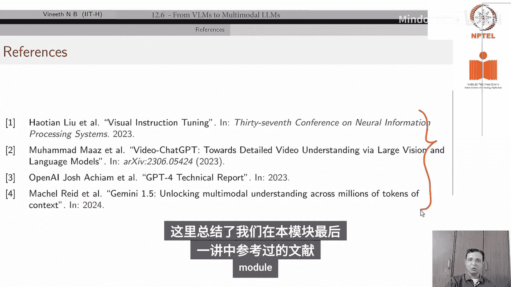

# 【NPTEL】计算机视觉的深度学习 p128 P128_从VLM到多模态LLM -BV1vNWkzpEua_p128-

For the last lecture。In this module。We will go beyond。Vision language models。

To even more recent contemporary models， which are called MMm LLMs。Sometimes。

These are also called MLMm LLMs or Lmms。These acronyms can seem confusing。But broadly。

 they stand for multimodal LLms。Or。Large multimodal models， which are elements。In particular。

 we will try to cover a few different ones like lava。Video charge， G。Char GT 4b and Gemini 1。

5 of which we only have cursory information at this point in time。Let's start with Lava。

 which stands for La language and vision assistant。The first question you may have is。

Weve already spoken about different kinds of vision language models over the last couple of lectures。

How are they different？From bringing multimodality into LLms。

There is one key difference between vision language models and MMLLMs as they stand today。

 these differences could get blurred as we go forward。

But the key difference today is that in MMmLLms。😊，We don't touch or change the LLM part of the model itself。

We only try to influence how we can provide an image or a video as input tokens to an LLM in addition to the text tokens。

Whereas in models like clip and Blip。We were trying to align image and text even inside the architecture。

Which is something that we dont do in MMm LLMs where we leave the LLM as and only play with the input to the LLM。

😊，Lava was the first successful image text conversation model in this context。

The Lava model integrates vision and language models for instruction tuning。

Where the goal is to tune the instructions to an LLM。

The LLM stays as it is in this particular context。😊。

Lava utilized GPT4 for generating its multimodal instruction following data。

We will see a few examples of their data as we go forward in this lecture。

And their notion of instruction tuning， they also call this visual instruction tuning。

Employees a two stage process。In the first stage。They align their features with image text pairs。

And in the second phase， they do end to end fine tuning on the multimodal data。

Their oral objective is to improve zero shot capabilities on multimodal tasks。

Here is their overall idea and architecture。The goal is to leverage。

A pre traineded LLM they use Vicua Vicua is an open source version of Lama we saw Lama as an LLM that was developed by Me Vicua is an adapted version of Lama that is the LLM they use。

And theyd like to leverage the LLM and the visual model's capabilities to do reasoning on images。😊。

For input images， a pre trained。Clip visual encoder V T L 14 is used to obtain features Zb。

You can see that here too， so Xv a given image spread into the visual encoder。

 which is a VIT and you get Z V。😊，A linear layer projects Zvi。Into visual tokens Hwe。

 so you have a bunch of weights which are learned which project Zby into Hwe。

And this projection scheme is simple and lightweight so that you can do this efficiently and quickly。

😊，Then for each image。They generate a multi turn conversation which can be denoted as xq1。

 xa 1 that is a question and an answer the first one。😊，Then you would have x Q 2， x a2。

 the second question and answer and so on and so forth until T questions and answers where t denotes the number of turns。

So， the instruction X T instruct at the teeth turn is given by in their case。

If the turn was the first turn。They randomly choose either xq1 x v。

 that is the question and the image or the image and the question in which of a sequence。

Whereas for any other turn greater than one， they provide the corresponding question at that turn as the instruction at that time step。

😊，And for a sequence of length L。The probability of the target answers which are given as xa is computed by。

😊，The probability of Xa given Xb an X instructor， please keep in mind。

That this probability is the output of the LLM。And LLMs。

 if you recall from an earlier lecture in this module are autoregressive models。😊。

Which means you predict a word。Based on an input and in this case。

 also an image XV corresponds to the image features。And this is given by。😊。

Pi going pi going from I going from1 to l pi the product P theta of X I given X v。

X in instruct less than I， x a less than I。Which means in the8 auto regressive step。

 which means you are predicting， say the fifth output token。😊。

What is the probability of the fifth output token given your image features？Your instruct。

All your instructor tokens until。Less than five because you want to predict the fifth token and all your previous output tokens until less than five。

That becomes the conditional probability that you're computing for the model。So。

 their overall approach， as we mentioned earlier， was a two stage approach。

Wherere at the first stage。They do a pre trading for featured alignment。To this end。

 they considered the CC3M data set， which is the conceptual captions 3 million data set。😊。

But they filtered the data set to only about 595000 image taxpayers where they ensured concept coverage。

And at the same time， they wanted training efficiency by reducing the number of image taxpayers。

They converted these image text pairs to instruction following data。

What does that mean they approached this using a simple expansion method。For every sample。

 they convert it to a single turn conversation， which means。😊，Given an image。

They randomly sampled a question which is a language instruction。

 a question could be can you tell me something about this image that could be the question that is posed to the LLM。

And the original caption for the image is the expected ground truth answer。

This is a single term conversation， which means you have an image， you ask a question。

 you get an answer and you are done。😊，If you follow through with multiple follow up questions。

 they would then form the second term， the third turn and so on and so forth。During the training。

In this stage one of pre training for feature alignment。

With the visual encoder and the LLM weights being frozen。

They only update the projection matrix W please keep in mind you had a visual encoder which was a VIT。

😊，Those embeddings were projected onto。Oh。It's we。And this aligns。

 this step aligns the image features H。😊，With pre trained Lm word embeddings。 So in in some sense。

 you are trying to learn the best image tokens that can be given as input to the Lm。

Along with the text tokens that come from the LLM word embedding。That's your stage one。

In your stage  two， once the projection matrix is trained in stage 1 in stage two。

 they fine tune the entire model end to end。By updating the pretrain weights of the projection layer as well as the LLM。

 but keep only the visual encoder weights frozen。Now， how do they go about training this model？

They take the Coco data set and use the images in that data set。😊。

To generate three kinds of instruction following data conversations。

Detailed descriptions and complex reasoning。They totally generated about 158。

000 unique language image or vision language instruction following samples with about 58k in conversation category with about 23k in the detailed description category and about 77 k in the complex reasoning category。

What do these three categories mean， let's see an example。

So here is the conceptual captions data set。We given an image。

You have a few different captions for the image itself。So just to give you an example。

 given this image here。You have one caption to be a group of people standing outside of a black vehicle with various luggage a second caption would be luggage surrounds a vehicle in an underground parking area and so on and so forth where you have five different captions。

Similarly， you also have the bounding boxes for the different objects in this particular scene。So。

 these bounding boxes and captions are used as context to prompt GPT those become like your text inputs to your LLM。

Now， for the instruction tuning part。They introduce or the instruction following data。Part of it。

 as we just mentioned on the previous slide， they do three kinds。Conversation。

 detail description and complex reasoning。Where in the conversation category。

 they introduce a sample question like what type of vehicle is featured in the image。😊。

And the caption itself becomes one of the captions itself becomes an answer。

In the detailed description， the expectation is to give a detailed description of that scene。😊。

And they used GP4 to generate all of these kinds of instruction following data。

And in the complex reasoning kind， the question could be what challenges do these people face and once again you have an answer that is provided in the data。

😊，Keep in mind that their data set focused on single term instruction following data。So。

 the visual image here is not used to prompt GPT it is only used as a reference they simply used the other details to get these responses which was used for the instruction following data set。

Once this data set was used to train the lava model。

 they showed that it gave significantly strong performance。

To evaluate the generalizability to novel domains， they considered a small pool of 24 images with about 60 questions in total。

😊，And they showed that lava significantly outperformed models like Blip2 and open flamingo。

They also show results on a science QA data set which has different subjects and categories。I'll。

Request you to look at the paper for more details on their experiments。Moving on from lover。

Going to the domain of videos。The video charge G。Has been a recent model introduced a few months ago。

That talks about detailed video understanding why are large vision and language models。

Considering we are discussing this approach in the MMm LLMs lecture。You may understand。

That they provide the video as a token input to an LLM。

And that's why we are presenting this particular paper in this module in this lecture。

Their objective is to generate meaningful conversations about videos unlike a few other efforts that did it for images。

😊，They merge LLMs with a pre traineded visual encoder for a spatial temporal video representation。

They introduce about 100 thousand00 high quality video instruction pairs。

 which by itself is a contribution that they bring to the community。

And one could say that this was the first。Quantitative video conversation evaluation。Effort。

Here is the overall architecture and flow of their model。Given a video sample。Which is。

Of dimension t cross h cross W cross C， H W W cross C is the height weight width and channels and t is the number of frames。

 So that those are the video frames that you see at the bottom of this image。

The visual encoder in their case， VIT L 14。Outputs features which are now of the dimension t cross small edge cross small w cross D。

 which means your H cross W cross C grows through the visual encoder and comes out with small edge cross small W cross D channels the total number of frames still remains t。

Then they access。The frame level embeddings。😊，And average them across the temporal dimension。

They perform temporal pooling。What does that result in once they take these excise and perform temporal pooling？

You get T ices which are of dimension n cross d。Where n is small edge cross small W。 So in essence。

 you could say T is are。N， which is H into W across D。

By averaging across all of these T temporal frame embeddings。That's your temporal pooling step。

They also similarly perform a spatial pooling step you can see that in the image here。😊。

Where they average the frame level embeddings across the spatial dimension。

Which means you have zs as output from the excise where you average across the h cross view dimension and get output in the t cross d space。

Given these， the video level features are then obtained by concatenating the temporal and spatially pooled features TI and ZI。

 you concatenate them to form VI which are your final visual features that go on to the next stage。

What do they do with VI？They now use a linear layer G， which you can see in this yellow box here。

 which projects VI into the language decoders embedding space resulting in QV of dimension p plus n cross K which give you a set of visual tokens to instruct the large language model。

Similarly， you have your standard text queries which are of dimension L cross k where L is the text query length。

Both of them as you can see， are in the same dimension space of k。

 but for the length of the visual query and the text query visual query has length t plus n。😊。

The text query has length L。Both of these are fed into the LLM。

And the LLM gives you standard outputs like how it has been trained before。

Now let's talk about the LLM itself。😊，The pretrained LLM is fine tuned on the prediction tokens using its standard autoregressive object objective using the high quality image video text pairs that they generated for this work。

During this fine tuuring process。They follow a particular format for the prompts saying user instruction。

 video tokens assistant。See they use that as a systemic information to the model saying that these are video tokens that are coming into the system。

The instruction here is the video related question。😊。

And the model's objective is to predict the corresponding answer related to the question about the video。

The linear layer in the model that we saw above the video features。

Simply aims to align the video features with the LLM's word embeddings so that there is better responses。

 natural response， naturalness and reliability of the output of the overall MM LLM model。😊。

Beyond this。Obviously to train such a model， they needed to curate data to make this effective。

So they use both human assisted。And semi automatic annotation to create quality video instruction data for training their model。

Using human annotation experts。They get detailed data。

Annotations while semi automatic methods offer high volume annotations using advanced vision language models。

 which they use for annotation。Through this process， they collect a total of 100。

000 video instruction pairs， which has a fairly diverse content covering a wide range of concepts。

Here is an example of how their videoing question answering task works。Given a video。Now。

 a user could ask a question like describe the activity in the video。

And the model now answers in the video。A man is playing the drums while sitting in front of a microphone。

He is wearing a black shirt and black pants。Another example is a video briefly described the video。

 the video shows a woman who is grooming a horse with a brush。

She is also seen talking to the camera and explaining how to groom a horse。

And the user further questions the second term how many different horses are seen in the video。

 there are 10 different two different horses seen in the video is the answer。😊。

They also show these results in an objective form。Using a lot of evaluations。

 which Id once again recommend you to look at the paper for。

Having these seen these two models Lava and video charge GT we will step forward to more contemporary ones like Ch GT 4b and Gemini 1。

5。😊，And one cannot， but observe。That there has been a shift。In the last。Few months so to speak。

On going towards closed source models， which is rather concerning。

If one looked at how these models have。These foundation models have evolved over the last few years。

These shaded boxes are open source models， while the non shaded boxes are close source models。

Initially from 2018 to 2020。Pretty much all models were open source models， as you can see。

 across different branches of this three of models。😊，Then somewhere around 2020， 2021 came GP3。

Which was perhaps the first model at that time， which was largely closed source。And since then。

 over the last year or so。Most of the models that have been released have actually been close source。

 There have been a few open source models， but a significant amount of them being close source models。

And this could be a concerning shift because what has really led to exponential growth of AI or language models in the recent past has been their open source nature。

This close source close source trend has its own pros and cons。

The pros are it allows confidentiality and protection for the companies developing these models。

 so if there are proprietary techniques and intellectual property it protects them from competitors。

It also allows them to mitigate risk。😊，The lesser the model architecture is known。

The lesser there are potential vulnerabilities for hacking the models and related security risks that could come out of hacking these models。

But the cons are significant too there are now transparency and trust issues because the model is no more open source。

And the lack of transparency may lead to skepticism and hinder collaboration。😊。

There could be reproducibility challenges because we don't know anymore how the model is actually how the model actually works in terms of its architecture。

Innovation limitations because it is not going to be easy to build on top on top of those models because for anyone to replicate those results may take many months of effort。

And this is also going to create accessibility barriers for smaller teams say from academic institutions to build on top of these foundation models。

 which could lead to disparities in access to technology and expertise。Hopefully。

We will continue to receive and see open source models in the immediate in the near future too so that some of these cons can at least get mitigated in the near future。

Having said that， let' us talk briefly about charge GPT4B and Gemini 1。5 to conclude this lecture。😊。

The release of GP 4。😊，Because it did not disclose its training methodologyology。

Established a significant precedent。You could now say that the landscape of NLP can be delineated into distinct periods before and after release of GPT4。

 because following GT4， many other companies have refrained from divrguling their architectural details and methodologyology including recent ones like Gemini 1。

5。So， we really cannot go into the depth of how these models work。

 but can only give examples of applications of these models。

Char GT 4b has a wide range of capabilities including object identification。

The GP 4 v or the vision variant accurately pin points and describes objects and images fairly well。

😊，It can do text transcription， it can extract written or printed text from images。

It can extract essential data from graphical content to translate to text insights like taking graphical data like a bunch of bar charts or graphs and writing down the summary of the bar chart or the graph。

Multi condition processing analyze images under different conditions with a capability that is not being seen before。

😊，Educational assistance can convert diagrams and visual aids into detailed textual explanations and extension of data deciphering。

😊，Coding enhancement， it can interpret visual code structures and flow chart kind of diagrams into coding languages。

And also can do design understanding where it breaks down design elements and offers text insights for refining concepts。

Here is a couple of examples of how charge GT4b4 fee works in reality。

If you give out an image such as this and ask a question， what is funny about this image。

 describe it panel by panel。😊，It gives a fairly good text explanation。

 it says the image shows a package for a lightning cable adapter with three panels。😊。

Pannel1 is a smartphone with a VgaA connector plugged into into its charging port。

Pannel2 is a package for the lightning cable adapter with a picture of a VGA connector on it。

Pannel 3 is a close up of the VGA connector with a small lightning connector at the end。

The humor in this image comes from the absurdity of plugging a large outdated。

VG connector into a small， modern smartphone charging port。Here is one more example。

 what is unusual unusual about this image and Cha GPT4 we say is the unusual thing is that a man is ironing clothes on an ironing board attached to the roof of a moving taxi。

This is fairly good。Understanding of the image that these models capture at this point。Gemini 1。5。

 a more recent model from Google once again follows the trend of not revealing its architecture。

 so we may not be able to discuss the details of its architecture。

But just to understand how it's different。GP 4 turbo version。Takes in about 128。

000 tokens as input to the model， please keep in mind tokens are the inputs that you give to the LLM model itself。

Ct 2。1， which is another。AAnother model takes in 200 k tokens。

Gmini 1 pro took about 32 k tokens and all of a sudden with Gemini 1。5。

Things have gone up to 10 million tokens。What does 10 million tokens really mean？

It could mean a1 hour video that can be used to prompt Gemini。11 hours of audio。30 k lines of code。

Or 700 K words， which are significant amount of information that can be used for prompting。

You could ask the question what can I do with this here are a couple of examples you could do very interesting things like in what file is the backward pass for auto differentiation implemented in JX and you could simply attach the JX core code base along with this query and ask Gemini for the answer。

😊，And it gives this answer that says the backward pass for auto differentiation is implemented in the file JX。

Slash underscore C。Slash interpreters slash a。 p py python。

 and it points out to the exact code snippet in that particular file。

Here is one more example where the use of prompt is given the reference materials is context。😊。

Translate the following sentence sentence from English to Kalamang。

And you give a grammar book and the dictionary as an input token itself because Gemini allows a significantly large number of tokens。

 in fact all of this grammar book and dictionary together is still only 250k tokens while Gemini 1。

5 can take up to 10 million tokens as input to its model。😊，And in this case。

 the model outputs a fairly correct answer as a response to the user query。

 So that concludes this entire module of going。From vision language models to MMm LLms。

For each of these slides we had various references。

 please do look at them to read more about them and here is a summary of the references that we visited in the last lecture of this module。

😊。

