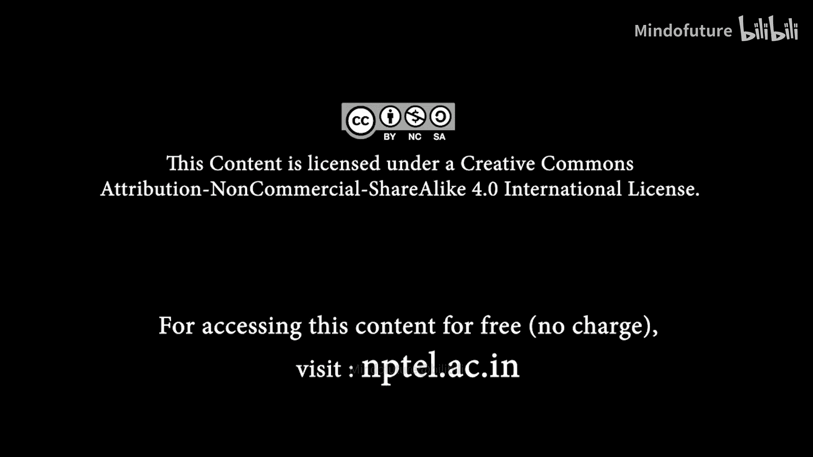
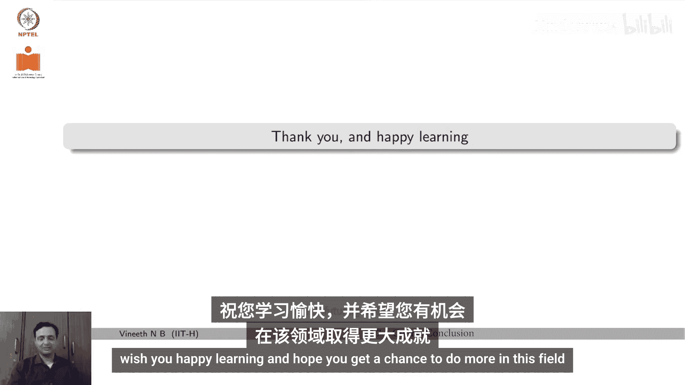

# 【NPTEL】计算机视觉的深度学习 p129 P129_课程总结 -BV1vNWkzpEua_p129-

After these 12 weeks of lectures， which you hopefully learn something valuable from。

We come to the conclusion of this course。In these last few minutes。

I'd like to share a few topics that we did not get a chance to cover in this course。

As well as look at some emerging areas and applications of computer vision which are worth looking into。

😊，One topic which which we briefly touched upon earlier this week， but has many faces。

 facets and dimensions is learning with limited supervision。

In the standard supervised learning setting。You have a training set。

And you train a learner and you get a model which is used on the test set。

So now you can adapt this paradigm to several other paradigms。

 some of which we have seen some of which。We have not。Multiitaask learning。

There is a setting where you train a model using a learner。

Using data from multiple different tasks to learn a single model that can then classify all the tasks across the image at the test time。

An example of multitask learning could be given a face image。

You may want to recognize the identity of the person， the expression of the person。

 the post of the person， so on and so forth using a single model。

 and this would come under multitask learning。A second kind of a setting is transfer learning。

 which we have seen earlier in the course where you have a source domain data。

Where you have trained a model now the knowledge of that model is used to train a different model on a different target data set to be able to perform well on the target domain。

We saw fine tuning as one of the most。Preferred and used approaches in deep learning for computer vision。

 but there are other methods that one can use for transfer learning too。

A variant or a generalization is of this idea is also called domain adaptation where。

In the source domain， you don't necessarily learn a model。

 but you directly use the source data to train a model which performs on the target domain。

Doomain adaptation when you see the diagram， it looks similar to multitask learning。

But there is a subtle difference。In multitask learning。

 your goal is to do well the on each of these tasks at test time。

Whereas in domain adaptation your goal is to do well on the target domain alone。

 the source domain is intended merely to provide that adaptation or extra information from another domain。

K short learning is a generalization of few short or zero short learning where we have a set of classes。

For which you have a lot of data， a set of classes for which you have only k samples where k can be0。

 we now have to train a model to be able to do well on all the classes we have seen a few examples of methods here。

Another setting in the context of learning with limited supervision is continual learning which has become popular in recent years where you once again have multiple tasks similar to multitask learning。

 the only difference being is that the tasks could keep coming incrementally over time that universe of tasks may not be limited。

Now you want to train a model that works on all the tasks seen so far。

Initially you have data from taskask1， you train a model， it should work on other data from task 1。

Then data for task2 comes， you update the model and the model now has to work on data from task 1 and task2。

Similarly so on and so forth， you get data from task TN。

 you now have to ensure that your trained updated model。Works on all of your data from task 1。

 task 2 through task N。This especially gets challenging when you don't have access to the data from the previous tasks。

The phenomenon。Of catastrophic forgetting， we briefly spoke about this in the lecture on few short and zero short learning becomes even more prominent here when you don't have access to data from task 1 or task2 when you come to the task TN。

 but you still have to perform well on them。Neural networks in in their vanilla versions suffer from catastrophic forgetting in this context。

 addressing catastrophic forgetting is one of the most important objectives of continual learning methods。

The last setting well talk about is called domain generalization。

You could consider this as an extension of domain adaptation。You have multiple domains in this case。

 say 2 TS and TT， you train a model， but now the model has to work on a third domain or a different domain Dt plus 1。

This is why we call this domain generalization。All of these are very contemporary topics in deep learning for computer vision。

To be able to go beyond supervised learning in general， which we understand can be solved by。

engngineering networks and training them and evaluating them in a comprehensive manner。😊。

Another topic。That we didn't have the scope to cover in this course an important one is the intersection of reinforcement learning and computer vision。

😊，Reinforcement learning， as you may know， is a paradigm of machine learning similar to supervised and unsupervised。

 where an agent takes actions and interacts with an environment to maximize potentially delayed rewards。

And this is usually modeled as a markov decision process。

Where is reinforcement learning used in computer vision？We already saw a couple of examples。

 we saw the use of reinforcement learning， we at least briefly spoke about it in hard attention。😊。

Where one cannot back propagate， we said we use a reinforcement learning based algorithm。

There is also NAS that we just saw where reinforcement learning based methods are used to search for architectures。

Other use cases are in games， for example， in Atari games to automatically play the game。

 one needs to understand the visual elements on the screen as well as use reinforcement learning to give a path of actions that the agent has to take to attain a specific reward。

Visual surveying where a motor is moved to be able to capture or achieve a specific purpose is done using reinforcement learning visual tracking can also be done using reinforcement learning。

 there are many more applications but these are a few sample use cases of reinforcement learning in vision。

More generally speaking， other contemporary topics in terms of methods could be egocentric vision where the camera is placed on the person。

wWho is traversing an environment and not necessarily placed as a CCTV or a web camera or anything like that it's placed on the person。

 so the problems are associated with how one views the world around an individual using camera feed。

You could look an example application for this could be based on something like Googlelass a wearable Glass or could be very useful for developing technologies for individuals with visual impairments where the problems have to be seen from that individual's egocentric perspective when we say egocentric。

 we mean from the viewpoint of that individual。You can also have embodied vision which becomes similar to egocentric vision where we talk about the vision technologies being embodied in a human we also have the intersection of visual perception and robotics which is a very useful and a very contemporary topic which will tracking highpectral image analysis where we try to understand。

Images of different spectra， for example， ultraviolet images or IR images so on and so forth。

A lot of the methods that we discussed so far directly can be applied to hyperpectral images。

 it may just be a difference in the number of channels in the input so on and so forth， however。

 studying images。Across the visible， beyond the visible spectrum is an important。

Area of research for various problems such as nighttime vision or astronomy or many other such domains。

Further， doing computer vision for augmented and virtual reality is also becoming an important topic。

While it could have been for games of the entertainment industry。

 these days its also becoming important for remote interactions of any kind， be it instructional。

 educational or simply a family interaction doing computer vision on augmented and virtual reality settings is becoming an important topic。

And finally， having fair， explainable and trusted models continues to be a very important topic。😊。

We saw。Vious methods for explaining the decisions of a CNN。

 but one can go beyond and also talk about fairness of these models to debias these models from any biases that may be there in the data and help humans develop trust in these models on the application front。

Some of the applications that are quite popular and have received a lot of attention in recent years are vision for autonomous navigation。

 self drivinging cars， this is a very important topic that has a lot of investment from the industry。

 companies like Uber， Tesla， Google itself， many other companies investing a lot of effort in this direction。

Vision for drone images。Drones are becoming increasingly popular for various tasks ranging from security to disaster management。

 how do you understand images that come from drones becomes an important task？Vision for all seasons。

A lot of the data sets that are available are all based on daylight scenes。

How do you now make these tasks work on adverse weather and lighting conditions becomes a very general context of vision applications？

Vision for healthcare and biomedical imaging continues to be an important topic。

Vision for agriculture has received a lot of traction in the last few years to help deep learning models and computer vision models for precision agriculture to understand plant phenotypes to be able to spray pesticides to be able to understand how much harvest you'd get out of a patch of a land and so on and so forth。

Similarly， vision for fashion and retail。Trying to use a virtual try on to see how a person looks in a particular dress or simply using computer vision such as an Amazon go in a shopping environment to automate the shopping experience is an important dimension of applications in vision and finally。

An application of a huge commercial interest， which is vision for sports。In many different sports。

 computer vision is being used these days to understand biomechanics of humans。

 perhaps for rehabilitation， understand strategies on a football field。

Understand movements of a particular player for analysis。

Either could be for an opponent or for a coach of that player so on and so forth。

 let me recall that computer vision is far broader than the topics that we covered in this course。

Recall that in the first lecture of this course， we said that one could divide computer vision into three parts。

 learning based vision， geometry based vision and physics based vision。For a large part。

 we focused on learning based vision in this course。

And you can go back and revisit the links that be provided for you if you would like to learn more about geometry based vision or physics based vision。

With that。Let me take the opportunity to acknowledge and thank all the resources。

including deep learning and computer vision courses that are publicly available which definitely inspired and help create the content for this course。

 although it was content of the content of this course was created exclusively definitely there was influence and content adapted and perhaps borrowed from different sources。

😊，We thank all of these sources and if there are any errors in the material。

 we will gladly take your suggestions and improve them as we move forward。😊，With that。

Thank you to each one of you for being a part of this course， participating in this course。

 hope you learned something valuable by going through this course through the lectures as well as the quizzes and the assignments wish you happy learning and hope you get a chance to do more in this field thank you。

