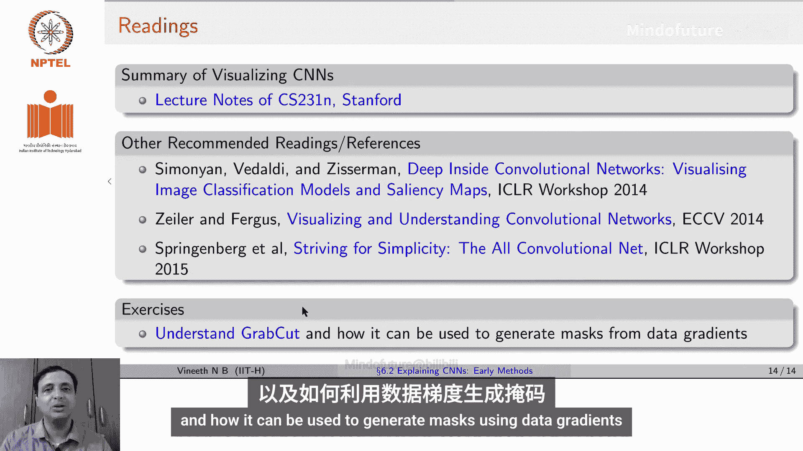

# 【NPTEL】计算机视觉的深度学习 p39 P39_解释CNN - 早期方法 -BV1vNWkzpEua_p39-

Continuing from the previous lecture， lets now discuss a few more methods that can help us understand CNN and its predictions。

Let's start with a question which is a bit different from what we saw in the previous lecture。

The question is， can we find an image that maximizes a class score？

So an AlexNe or any other network when trained on imagenet has been exposed to a lot of， for example。

 say CA images。So at the end of training， does Alexnet know what an average cat looks like。

If we ask it to reconstruct an image of a cat， can it do it is the question that we are trying to ask。

Can you think of how we can do this in case you don't have the answer？You can do this。Using。

A different use of the gradient descent approach that we used for updating the weights of a neural network and this was first introduced by a work called Deep In Convolutional Networks in 2014。

And the idea here is you take the trained Alexnet model。😊，And you provide a zero image as input。

 a zero image could be a black image or a gray image you can choose whichever ones you would like and you give this as input to the CNN model。

😊，And you now want。The final prediction to be a one hot vector where the one is in the position of the cat or any other class that you want to get an image of。

And zeros in all other places。 That's what you'd like to see at the last layer at the output classification layer。

 But obviously when you feed a0 image input， you will not be able to get that。

 youll probably get a different probability vector Based on the difference between these two。

 you have a loss。 You can now update your network。But this time you are not going to update your network。

 you are going to do what we call back prop to image。What is back prop to image？

If you had a loss in the last layer。We have spoken so far on different ways of computing doL by do W depending on what weight you are trying to compute the gradient of if its the last layer。

 its straightforward， if its an intermediate layer you use chain rule。

 if it is convolutional layer you are to think through it bit differently batch normalization layer you have to work these things out so on and so forth。

 we have been able to do that。Can we extend this to compute do L by do x where x is the input？

It can be done， this is just another version of chain rule you will just have to carefully work out DoL by doX through all the activations and weights in the neural network。

If you don't believe it。Tri it out as homework to work it out。Once you have such a gradient。

We try to do an image update。And how do we do the image update， we do it using gradient ascent。

So far we spoke about gradient descent as a methodologyology to minimize an objective function in gradient ascent we maximize an objective function and we will see this objective function in the next slide。

So we will use gradient ascent to get the final image so once you do a small image update the updated image so it could have been an initial zero image and after doing an update the x becomes different now or the I becomes different assuming this image is I which is equal to x for us。

Now you the eye becomes a new iterated update I and that is forward propagated through the network。

 you again get an output， you compare it with the expected output which should have one at the position of a cat and zeros elsewhere and you repeat this process over and over again。

What could be the objective function， the objective function is formally written as you want to r max over i where I is the input image。

S C of I， which is the scores that you have in the last layer。

 S C of I is when you propagate I through the network and get scores in the last layer。

You want to find an eye that maximizes the score corresponding to a particular class and you have a regularizer on the image just so that you won't overfi。

Remember， because this is a maximization problem， you have a negative sign because you would ideally like to minimize the2 norm of the image；

 that is the reason for the negative sign。So， how do you solve this problem because it is a maximization problem you use gradient ascent。

So， you go in the positive direction of the gradient and keep climbing and keep updating the image over and over again and at the end after many iteration when the gradient between your output and your expected output in the last layer is close to 0 you would have converged and you would have got one such image。

😊，Let's see a few examples。So， here are a few images that maximize a class score this may not feel like the way we perceive these images。

 but this is what the model thinks is representative of those objects so any such artifacts in an image it going to consider it as belonging to an object。

So the top left is a washing machine。Below is a goose。

 you can actually see that there is a structure of a goose located at different points。

 then you have an ostrich， a limousine， a computer keyboard， and so on and so forth。

You can do such an optimization， not just with respect to the last layer。

 you can do this with respect to any neuron in the neural network。

You can try to see if you want to find out which image maximally activated a neuron that saw in the previous lecture that we keep forward propagating several images and then see which all images fire a particular neuron that would have been one way of doing it。

But now what we can do is start with a gray image or a zero image。Forward。

 propagate your image until a particular layer。 let's say you have a particular neuron in one layer that you wanted to。

maximize that you wanted to fire for a particular image then you go forward propagate until that layer you set the gradient with respect to that neuron to be 1 and everything else to 0 which means you want that to fire。

And you back propagate from there and update the input image iteratively using gradient ascent。

 and you will now be able to get an average image that fires that particular neuron。

Another add up that was proposed in the same work， in fact。

 was the concept of just visualizing the data gradient。So。

 how do you go about doing it which means we are talking about do L by do i in this case。

 remember we are saying that I is equal to x， which is the input image for us。So。

 we have a do L by do I， which gives us the gradient of the output with respect to the input。

So in our case we are defining L as SC of I that' is the score that we want to maximize。

 it is not a loss here， but it says maximization of the score。😊。

But because you have three channels in your input， how do you understand this gradient by itself？

You can this paper suggests that you take an absolute value of the gradient along each channel and then take the maximum of those as the final gradient at a particular pixel location。

Instead of trying to update an image iteratively， this suggests that simply visualizing that gradient will tell you the shape of that gradient gives you a rough picture of what maximizes that particular output neuron。

Because there is color， you take the maximum among those and you assume that that could be a good representation。

Here are a few examples， so here you see a sailboat and you see that these are the pixels that had the highest gradient across the color channels which maximize the score。

 similarly this one for the dog。And this one for this object and so on and so forth。So。

 what can you do with this gradient okay it does seem to give us an indication of which part of the image is responsible or probably caused the particular probability score to go up。

They suggested that you could。Join this with a segmentation method known as Gr cut。😊。

Which can be applied on the data gradient to get an object mask。

Graph cut is an extension or adaptation of the graph cut segmentation that we saw earlier in this course。

Using this if you had an input image。And you get the gradient corresponding to a particular class。

Then using those gradients and this graph cut segmentation algorithm。

 which is a way of taking those pixels and segmenting the region around them。😊。

You end up getting a mask in the input image which is responsible for a particular class to be predicted。

Here are a couple of more examples so you see especially the third row a bit more clearer you can see here that you have a bird。

 it data gradient， then you use Gr cut to segment out that object from the background and you get a nice mask of the object which you can use for other purposes。

For details of Gr cut， please see this link below。And that' is also an exercise for you in this lecture to see how Gr cut can be used with the data gradient to obtain these kinds of masks。

Another question that we can ask here is given the FC7 representation of data in a CNN。

 so that's the output representation of the FC7 layer or the fully connected seventh layer of AlexNe。

Is it possible to reconstruct the original image in the last lecture we saw that a two dimensional embedding of these representations from F7 layer do seem to capture semantics and similar images seem to be put together in that embedding space。

But now we are going further and asking if I gave you a code of a particular object。

 can you reconstruct how that object looks doing some kind of an inverse mappingping？

How do you think you would do this？This can be done again by solving an optimization problem。

With two criteria one， we like the reconstructed images code to be similar to the code that we are given by code we mean the representation of the obtained at the output of the Fc7 layer。

And the second is we want that image to look as natural as possible。

 we are going to call that image prior regularization or image regularization。😊，So。

 we will keep these two criteria in the objective function。

 which means what we are going to get is x star。Is going to be a minimization problem over。

Phi of x phi of x is take x propagated through Alexnet and take the Fc7 layer output。

That's what we refer as phi of x It's a function， which we are calling as phi of x。

 We want the phi of x that we optimize through this process to be close to the phi n。

Wwhichch is given to us remember we said there is a code given to us we want to find an image whose code is close to the code that we have in our hand。

😊，So we are trying to do that using an optimization approach。

Take an x phi x minus phi n must be minimized， the mean square error between them must be minimized。

 and you add a regularizer on top of x similar to what we saw on the earlier slide。

 This is just an image regularization step。Here are some results using the Alexnet model。

 so this is done by taking the log probabilities for the Imaginenet classes in the last layer。

So for this is the original image and this corresponds to a particular class in INet and we are now trying to take that class or that representation for this particular image。

 sorry not the class that representation of that particular image and then trying to reconstruct similar images that would give the same Fc7 representations。

😊，W 5 different images， if you go back to the previous slide。

 you see that this is an optimization problem on x。

Which means you would start with the value of x and then do gradient descent to keep updating x until you got a minimum value on this objectiveor function。

So， if you start with different xs you will get different solutions and those are the different solutions that you see here so these are with five different initializations and you see that there is an overall similarity to the original image which we wanted to reconstruct。

Here are more examples， this is the original image。

We take the F c 7 representation of that original image and then ask this kind of an optimization methodologyology to rediscover that original image whose representation would have been that Fc embedding that was given to us and you see a fairly close。

Reconstruction here， similarly this one， this one， this one and this one。

Moving further we talk about an important method called guided back propagation that was developed in 2015 that helped improve the performance while visualizing data gradients let's look at this approach it's sometimes also called the deconvolution method of visualizing and understanding CNNs but the more popular name today is guided back propagation so guided back propagation is actually used along with other explanation methods in more recent years which we will see in later slides in this week。

Let's once again start with Alexnet lets and of course needless to say Alexnet can be replaced with any other model of a CNN。

 we are only explaining all these methods using Alexnet。Let's take the Xnet model。

Let's feed an image into the trained Alexnet model。Let's pick a layer。

And set the gradient there to0 except for one particular neuron。Which we want to maximally activate。

 let's assume that this is our setting。So， the way we would go about it is you take the input image。

 you will forward propagate it through as many layers and remember you have a relu activation function in Alexnet and what does the relu activation function do in any layer where you have such a matrix such a set of activations in any layer。

Wherever there are negative values denoted by these red boxes here， you replace them with 0。

And anything that is non negative is retained as it is， that' is the standard Relu operation。Now。

 when you do this， you can then back prop to the image as we just mentioned。

 because we want to set the gradient of a particular neuron to be one。

Everything else to zero in that layer and then back from there to the image and do gradient ascent on the image to understand which image maximally activated that neuron in that con3 layer for instance。

And when we back propagate， remember that if these were your gradients let us assume that what you see here were your gradients。

 we know that because of the effect of Relu，Wherever there were negative values。

 those were these were the locations， the red ones there。

There the gradient would become0 because when you back propagate it will get multiplied by the activations in those locations when you go through chain rule and because the activations at those locations become zero the gradient will also become zero and this is what you will be left with which you back propagate further to reconstruct the original image。

Note here that in this particular location in this particular the representation of the gradients。

 the gradient values can be negative or positive， it is just that where the input was negative the gradient becomes0 there in the other locations the gradient can be negative or positive。

And when you do this。😊，You can visualize your data gradient and you can see an image that looks somewhat like a cat here if you observe closely you can get the gradients that correspond to an outline of a cat while it has some resemblance to the cat you can also make out that it is fairly noisy。

So what can you do about it？So， to handle this scenario， guidedduct propagation。

 which is a method proposed in 2015。Proposed that instead of using in the backward pass。

 instead of allowing all the gradients to pass through。

Let's not allow the negative gradients to pass through。

What does it mean we are saying here originally we set when the input is greater than 0。😊。

Only those gradients will pass through because the rest of the gradients would have been cut off by the relu which was applied in the forward pass。

But now。We are now adding that the gradient must also be non negative when you propagate rather if you went to the previous slide。

In addition to making these four zeros。You would also make this minus2 is 0。

 this minus1 is 0 and minus1 is 0 only the positive gradients will be passed through to the previous layers when you do your。

Graadient update for the reconstructed image。And doing this。😊。

Greatly improves the final visualization of the data gradient and now you get a clearer image of the cat the data gradient。

😊，Why does this happen？Because you allowed negative gradients to propagate。Even。

Aspects of the image that negatively correlated with the outcome in a particular neuron also contributed to coming up with this reconstruction of the image。

By removing those， we now retain only those pixels that had a positive impact on the activation of a neuron in one of the layers that we are interested in。

This is known as guided back propagation， and this is something that well use in other methods in the rest of this week's lectures also。

The recommended readings for this lecture are once again the lecture notes of CS231N on visualizing CNNNs as well as three papers deep inside convolutional networks。

 visualizing and understanding convolutional networks in ECCCV and striving for simplicity the all convolution net。

Which was the paper that introduced guided back propagation。On one exercise。

 use this link hyperlink here to understand graph cut and how it can be used to generate masks using data gradients。

