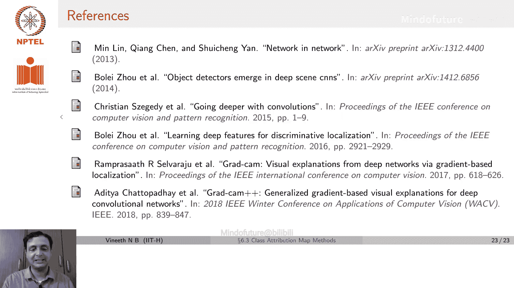

# 【NPTEL】计算机视觉的深度学习 p40 P40_解释CNN - 类别归因图方法 -BV1vNWkzpEua_p40-

Having seen a few different methods。That use various aspects of a CNN model。

To explain its predictions such as its activations at different layers， its gradients。

 its output probabilities， so on and so forth。We will now look at what are known as class discriminative saliency maps or class discriminative attribution maps。

By saency maps， we mean。Maps or regions in an image that are salient for a given prediction。

And by class discriminative saliency map， we mean a saliency map that helps distinguish one class from another。

For example， if we had a cat。And a dog in an image。

 which part of the image LED to it being predicted to be a cat and which part of the same image LED to it being predicted as a dog。

Let's see this in more detail over the next few slides。

So the question we still continue to ask is can we know what a network was looking at while predicting a class。

 but the approach as you will see is different from what we have seen so far。

One of the earliest methods in this regard was known as class activation mapps or CAm。

 which was published in 2015 and16。So， this takes a convolutional neural network and uses the notion of global average pooling to achieve the objective。

So let' us look at this in more detail， so if you had say five to six convolutional layers in your architecture。

You take the last convolutional layer。And then for each map in that convolutional layer。

 remember you could have 100 filters， you would have 100 maps。

 so for each of those maps you do global average pooling or gap。

What does global average pooling do you take a particular attribution map or a feature map。

 sorry not an attribution map， a feature map this green 1。

And you average all the intensity values there into one single scalar。

 and that becomes this green circle here。😊，Similarly。

 you take the red feature map and average all its values and it becomes the red scalealar here。

 you take the blue feature map， average all its values and it becomes the blue scalealar here。

Global average， it takes the average of the entire image。Now。

 what do we do with these global averages？Having these global averages。

 So each of these scalrs here represents one feature map。Now we learn a simple regression model。😊。

Or a linear model that takes us from these scalrs to each of the class labels on the last layer。

So for each of the class labels in the last layer， we learn a w1 into the first attribution into the first feature maps average plus w2 into the second feature maps average and so on and so forth until WN where n is the number of feature maps in that last convolutional layer。

Now， how does this help us？So for a given image， such as the image that you see here。

If you forward propagated this through a trained Alexnet。

You would get a set of n activation maps as the until the last conal layer。

 let us assume that these are those activation maps you see one here， the second one here。

 and so on and so forth until the last one here。Now， the weights that we learned。

Between the output of the gap layer and the classification layer are now used to weight each of these activation maps。

 and when you do a weighted sum of all of these activation maps that gives us。

The contribution of these activation maps towards one particular class label。In this example。

 lets say we want to predict this image as belonging to an Australian terrier。

Then you learn weights corresponding to each of those activation maps to the Australian  Terrier class and you weight each activation map in the same way and this weighted combination of activation maps of that confi layer corresponds to the Australian terrier。

If you say wanted to predict a man in the image through this。

 then you would have a different set of weights， maybe let's say this was the man class。

So then you would have a different set of weights of the same activation maps that connect you to the man class。

 so a different weighted combination of the same activation maps will tell you which part of the image corresponded to the man class。

Now， this approach gives us a way of getting us class discriminative saency maps。

There are some advantages and disadvantages， as we will see soon。

 but here are some visual examples to start。So you can see here that in the first three images。

It is examples of the class brard and the second three examples is the class barbells。

And you can see here that in each of these cases。😊，The CNN model looks at this particular region。

And calls it a b， similarly so in this case， similarly so in this case。

 and similarly for the barbells， you can actually see that the CNN looks at the weight plates to make the decision that this image corresponds to barbells。

So obviously you can ask the question what if I changed the class so lets see an example for that too so here is an image and here are the predicted saency maps or class activation maps for the top five predicted classes based on this image。

The top five predicted classes were P dome。Church。Alter。And monastery。

And you see here that when the model was predicting P， it was looking at the entire。Structure。

When it was predicting dome， it was only looking at the dome。When it was predicting church。

 it looked at only the facade close to the dome and similarly for Altar and for monastery。

 it was looking at certain parts， which probably made it think it was a monastery。So this gives us。

 as we just mentioned， class specific activation maps which can be useful in practice。

An intuition for doing cam is that in any CNN so far that weve seen in most CNNs。

 we have had a few convolutional layers then followed by some fully connected layers。

Convolutionional layers do maintain a certain level of object localization capability。

If you recall in the first lecture， we saw an example of the confi feature map with two people sitting in an image and we saw that the feature map actually showed where they were positioned in the image。

The convolutional layer did give us an idea of where the objects were localized with no supervision or with no details given to us explicitly。

However。If you try to look at the representation that you get after a fully connected layer。

 for example， the Fc7 representation， you would lose this information。😊。

That's the very nature of the difference between a convolutional layer and a fully connected layer。

 So that's one of the reasons for developing a convolutional layer itself。

So that is now by doing the ca based approach， we actually see now that we can retrieve back the activation maps of the fifth layer and be able to use them to explain our decisions at the classification layer。

These are just more examples here of。The localization capability of CNNns in different feature maps。

 and you can see here that。You have different receptive fields of convolutional units and the patches that maximally activate that patch and you can see here that you do get a certain set you you get a certain sense of localization through these kinds of feature maps at different convolutional layers。

You obviously lose that when you go to fully connected layers。

Here are a comparison of cam maps across different models。 You can see here this is。

Applying cam or using gap global average pooling on Google net。V G G， Alexnet， just Google net alone。

 another architecture known as N I N or network in network。 And these are compared with。

A back propagation on Alexnet and a back propagation on Google net back propagation is your data gradient。

 Remember we talked about the data gradient in the earlier lecture。 So this is that visualization。

 and you can clearly see that cam gives a far stronger salency map a far more useful saency map when compared to the data gradient。

😊，What are the pros and cons of cam？Can you think about it。

 Can you think of any significant con disadvantage of cam？

Advantages class discriminative can localize objects without any positional supervision。

 and it does not require a backward pass through the entire model unlike something like guided back prop or back prop to image。

What are the disadvantages？This disadvantages the key one is that you actually the key one is actually the third bullet here。

 which is there is a need to retrain these models to be able to get those weights that we get after global average polling。

After training in AlexNe， you still have to do global average pooling and learn those many linear models at the last layer to be able to understand the relationship between the activation maps and each class label。

You will have to do this retraining explicitly for explanations on top of training your Alexnet or any other CNN model。

 and that can become an additional computational burden。

And we are imposing a constraint on architecture by saying that you will have to introduce a global average pooling layer to be able to explain your model。

 and that may cause problems when you want to generalize to many vision tasks using this kind of a method。

And there is a chance that the model may trade off accuracy for interpretability。

So to get a better interpretability， it may end up achieving lower accuracy if you used the gap model and the corresponding weights itself for classification。

Now， let's try try to see how we can address these disadvantages。

Which was done in a follow up method called GrdCm， which is published in ICCV of 2017 ICCV is a top tier computer vision conference。

Grarack cam stands for gradient weighted cam。As we will see in the next few slides。

 its a very intelligent approach on repurposing cam using existing quantities in a CNN and let's see how that works。

 but here is the overall idea and architecture。 we will describe each of these components over the next few slides。

 So you have the input image here。You send it through a CNN。

 you have your convolutional feature maps and the convolutional feature maps could be followed by any task specific network you could be doing classification which is what we have seen so far。

 but you could also use their approach for any other tasks such as image captioning or visual question and answering these are tasks that we will see later in this course。

Irrespective of the task， we assume now that there is a last layer。 There is a loss。

 and there is a gradient， which can be assumed in any neural network for that matter。

 once you have the gradient。Of a loss with respect to any task。

You have now gradients with respect to all of the feature maps or the activation maps。You know。

Combine them， you combine the gradients that you get for each of those activation maps and they automatically become your weights for each of the feature maps。

And in graDCm， because we want to ensure that only positive correlations are shown in the final seency map。

 we apply a re on the on the weighted combination of the activation maps and that becomes our final graDCm saency map。

The method also talks about adding guided back propagation to make a variant of graD cam called guided grat cam。

Let's see this in a bit more detail and also mathematically as to why。

Grad cam becomes an extension of cam。From cam mathematically speaking， we have YC。

Which is your scores or the class scores in the last layer。Which is given by summation over K。

 which is all your K feature maps。 We assume now that you have K such feature maps。

And you have a class weights for each of these feature maps。And summation over I， summation over J。

 AI， J K 1 by。Z is going to be your global average pooling of each of the K feature maps。

And then you have the weights and in CA we know that these WCK。

 WC corresponds to the weight for each class and Wk corresponds to the weight for each activation map。

 so you need to do both。This is what we learn through linear models in that last layer。

Now let's go from there。Let' us now assume that F superscript K is given by。

The last terms1 by Z summation over I， summation over J， AI Js superscript K。

Then you're going to have Yc is going to be given by。Sorry， there is an equal to missing there。

 so youre going to have Yc to be equal to summation over k W CK into FK we are simply replacing the last terms with fK。

And if you now took the gradient of yc with respect to Fk， you have do yc by do fk is equal to。

Do YC with respect to do AI JK divided by do FK with respect to do AI JK。

We just have the same component that you are taking the derivative with respect to。

If you look at this closely。😊，Do Y C by Do Fk。which is what WC is we can see that from this equation here remember once again that this yC is equal to summation wCK fK。

 so which means do yc by do fk will be wCK for a particular k whichever fK you chose for a particular feature map and that is given by do。

YC。With respect to do AI JK divided by do FK by do AI JK。Now。

 do fk by do AI JK by the very definition of Fj will turn out to be 1 by z。

And because that is one by z in the denominator， you get an into Z on the numerator here when you when you write this out more clearly。

So what does this tell us？Now， if we sum the terms on the left hand side over INJ。

 which are all your pixel locations in each feature map。

 you similarly have a summation on the right hand side。Now。

 the summation over INj for WCK because WCK does not depend on INj is just going to be Z which is the total number of pixels in each。

Feature map or activation map。And similarly， the Z constant comes out here。

 and you have your summation over I summation over J， do Y C by Do AI J K here。Rather。

 we can say WCK then is given by summation over I， summation over J do Y C by do AI J K。

This tell us tells us something important that the WCK， which we actually learned。

In the cam model are actually simply the summation of the gradients of each each of the class core with respect to every pixel in the feature map and adding them all up。

So， in truth， the class feature weights here are the gradients themselves and we actually don't need to do the retraining the way we saw it with cam。

 you don't need the global average pooling， you don't need the retraining those weights that you did the global average pooling for can actually be obtained。

As gradients of the last layer scores with respect to any feature map or activation map with which you want to compute your saency maps。

So which means we can now write out WCK as summation over I summation over J do yc by do AIjk we are going to have a normalization factor1 by z because we want to divide it across all of the pixels this becomes our new weight and our final salency map or the localization map in GrCm becomes given by summation over k wCK Ak where ak or the different k activation maps that we have and because we want only the positive correlations to be shown on the final salency map。

 we apply re on it to get the final to get the final image。You see examples now。For original image。

 here is the grad cam for cat， which focuses on the cat。

And similarly doing this with a renet model here is the location of the cat and similarly for a dog it looks at the dog to be able to say its a dog and similarly for the renet model looks at the entire dog to be able to say its a dog。

Which is quite good。But one careful observation here is that。

The network actually predicts this to be a tiger cat and not just a cat。

So can we elaborate on this further and see why it' is a tiger cat and not just a cat。

 can we try to do anything further？And here is the where here is where the method now proposes a variant of gradcam called guided gradCm。

whichch brings together guided back propagation that we saw in the earlier lecture and grad cam together and juxttapoing them one on top of the other by doing what is known as a haraad product or a pixel vice product and we now see that taking this particular region which was pointed out by grad cam and combining it with guided back propagation output in terms of what was salient in the image we now get a clearer estimate of what was the dog remember guided back propagation was not necessarily class discriminative so if you only use that you would also have other kinds of pixels which are active as you can see here。

But by combining it with grat cam， we get a more localized。

Understanding of what the CNN was looking at while calling it a dog。

And now you see why you called it a tiger cat， why the model called it a tiger cat。

 because you take the Grdcam saency map and combine it with guided back props output again。

 and you actually get this kind of a output which shows the striations on the body of the cat which explains why it was a tiger cat。

GradCm went on to also show how this method could be used for what are known as counterfactual explanations。

Rather， can you try to find out。Which class or which region in the image。

Maximally affected my model in calling an image as belonging to a dog。So I have an image。

I want to label it as a dog。And the model does give me certain probability of the label being a dog。

But can I find out which other pixels in the image may have suppressed my probability for a dog as the output of the model？

And this can be done by using the exact same gra campamp procedure。

 the only difference now is use negative gradients instead of the positive gradients and this would tell us which which combination of feature maps or which weighted combination of feature maps where negatively influenced a particular class probability to be high。

And that would give us what are known as counterfactual explanations。

And eventually how do you use this， you can remove or suppress these features in some way to improve the confidence of the model if you would like to use it in that particular way。

Grad campm， however， had some limitations。When there were multiple instances of objects or when there were occlusions in the image。

So here is an image where there are multiple dogs and you can see that Grdcam gives such an output where it doesn't seem to capture all the dogs in the image maybe it does somewhat well when there are a fewer number of objects there are still three dogs here and gradcam captures two dogs but misses the one in the middle thats one of the limitations of grad cam another case where it seems to not completely get a good saency map is where there are occlusions you see a bird here whose legs are hidden underneath the water and and as well it has a beak and here you see a hedgehog which has a beaklike structure too in both of these cases grad cam doesn't seem to capture those aspects which are actually salient aspects of that object as class discriminative in its visualization。

Can we do something about it to are or are there any limitations in the formulation of grad camp itself that we can improve？

And this was done in a work called GrdCm+ plus。😊，And the main motivation of grad cam plus plus is。😊。

Observing that gracam took and took the gradients of Do YC with respect to each of the pixels in your activation maps。

😊，And then took an average of all of them to get its final weight。In a sense。

 it is weighting each pixel equally by taking the average when it when it gets the final weight。

Gradamm plus plus idea states that maybe pixels that contribute more towards a class should get more weight than have equal distribution。

While computing this weight， W K C。Let's see how we can do that。

So this can especially suppress activation maps with lesser spatial footprint rather we saw this example on the previous slide too when you have three dogs and there is one dog which is smaller。

 the other two dogs got most of the gradient and the third dog did not because it has a lesser spatial footprint。

We will see this more clearly on the next slide。😊，And when you have this kind of a bias in the visualization。

 some of the smaller objects may just not be picked up in the saliency maps。

What can we do about this G gradcm plus plus suggests that we retain the same formulation of grad of gradcam。

 however， this time while computing your final weight， W K C。We are going to give。

Each each pixel in each activation map a certain weight as to how they must be how they must contribute to that saliency map。

So let's call those constants Alpha sub Ij superscript Key。

 so Al sub Ij corresponds to each IJth location of a feature map。

K corresponds to the K feature map and C corresponds to the class。

 which we want to maximize gradam plus plus。Also adds a re here。

To ensure that only positive gradients are considered in the computation of this weight。

But the larger question here is how do you get these weights in GrdCm。

 it was simpler to average all of these gradients that you get and use that to get a WKC and remember each WKC then becomes the weight of the K feature map towards the seat plus。

😊，So but now how do you compute these alpha Ijs at each pixel level？

Before we go there let us try to understand the intuition of gradcm plus plus again visually。

 so here you notice that if you had an image with three different objects say dogs a dog of a large occupying a larger spatial footprint。

 another dog occupying a mid levelvel spatial footprint and another dog occupying a small footprint。

And for the moment， let's assume that different feature maps capture different dogs this for instance。

 could be any other object for that matter could have been a dog cat and a jug or something like that。

 So each feature map， lets assume captures each of these objects。

And you see here that in Gcam when the sa sea map gradients are computed。

 you can see that the area with the largest footprint ends up getting most of the gradient while the gradient towards rest of the pixels are smaller because they have fewer pixels and hence contribute lesser towards the output。

😊，While grad cam plus plus tries to overcome this by doing the pixel wise weight。

 And you can see here that in grad cam plus plus the weights are in the same range。

 those the gradients are in the same range when you use this kind of an approach。

 This is actually the final salency map。 that's in the same range for grad ca plus plus。😊，So。

 we still are left with a question in gradcam plus plus as to how do you compute those alphas at a pixel level？

We are not going to derive this here。 This can be lengthy and that's going to be part of your homework。

 but what happens is by reorganizing the gradients and using some arithmetic around the expressions of the gradients。

 gradcam plus plus shows that Al sub Ij Kc can actually be obtained as a close form expression of several。

Grads that you have already with you。Both AB and IJ here are iterators on the same activation map and you can go ahead and look at the paper for gradCm plus plus to understand how this derivation is done。

That once this derivation is done， the rest of it stays very similar to graDcam in graDCm plus plus you still do a relu at the end of summation over k wCK ak。

 where wCK is given by summation ori summation overj alpha IjKC Relu of do yc by do AIjK。

How does this help You now see that。Given the same image of multiple dogs。

 while Grcam did not localize all of them effectively。

 Grdcam plus plus seems to get a better cency map around the dogs。

 and it works a bit better even when there are three dogs and it also captures the setting when there are。

Structure such as beak or legs under occlusion。Ask when compared to gra camp。

Gradcm plus plus also showed that the saency maps obtained from gradCm plus plus give better localization if compared to the bounding boxes that are provided with images when compared to grad cam and you see several results here。

 the first column in this left block are the original images then you have the corresponding grad cam visualizations for each of these classes hair。

 American lobster， grayveale and a necklace and you see the grad cam plus plus localization which seems to be better especially for some things like grayveale when compared to grad cam。

 you see similar set of images for another grayveale here。

 a kite a gocat and an eel where grad cam plus plus localizations improve over grad cam by considering the pixel wise weight strategy。

Here are more examples of grad campm plus plus for multiple occurrences of objects。 once again。

 improved performance over grad campm。For homework。There are these three papers， cam。

 Grd cam and Grd cam plus plus， and your job would be to read through them。

And the other exercise would be to work out how we get the close form expression for alphas in grad campm plus plus。

References。